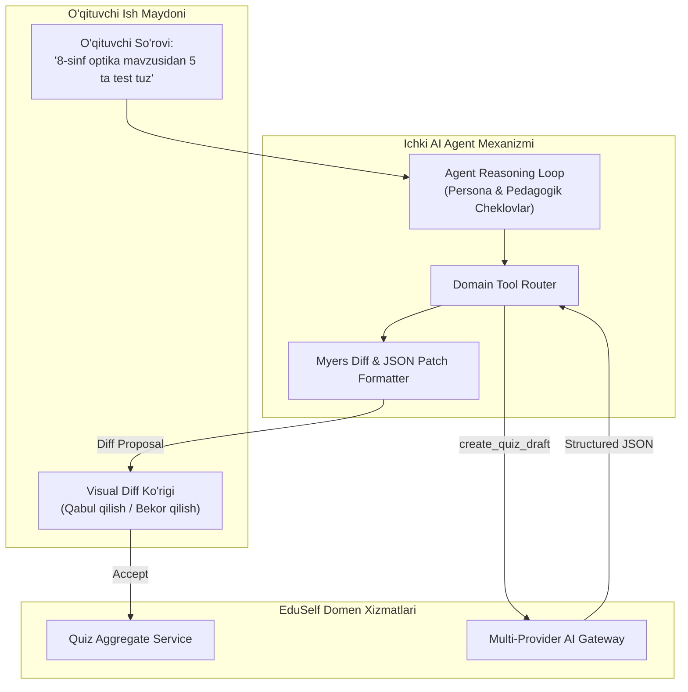
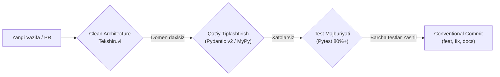

# EduSelf Teacher — AI Agenti Spetsifikatsiyasi va Dasturchi Yo'riqnomasi (AGENT.md)

**Hujjat versiyasi:** 1.0.0  
**Sana:** 14-oktabr 2026  
**Holati:** Approved Agent Specification  
**Asosiy hujjatlar:** [.docs/PRD.md](file:///c:/Users/Asus/Desktop/teacher-eduself-mcp/.docs/PRD.md), [.docs/SRS.md](file:///c:/Users/Asus/Desktop/teacher-eduself-mcp/.docs/SRS.md), [.docs/Architecture.md](file:///c:/Users/Asus/Desktop/teacher-eduself-mcp/.docs/Architecture.md) va [.docs/ADR.md](file:///c:/Users/Asus/Desktop/teacher-eduself-mcp/.docs/ADR.md)

---

## Ushbu Hujjatning Maqsadi va Tuzilishi

Ushbu hujjat ikki tomonlama muhim vazifani bajaradi:
1. **1-Qism: Mahsulot Ichidagi O'qituvchi AI Agenti Spetsifikatsiyasi:** Web-panel ichida o'qituvchiga dars tayyorlashda yordam beruvchi avtonom sun'iy intellekt agentining xulq-atvori, tizimli promptlari (System Prompts), 10 ta yadroviy Tool spetsifikatsiyasi va xavfsizlik to'siqlari.
2. **2-Qism: Loyihada Kod Yozuvchi Dasturchi AI Agenti Yo'riqnomasi:** Mazkur repozitoriyda dasturiy kod yozuvchi avtonom AI dasturchilar (Google Antigravity, Cursor, Claude Code) uchun arxitekturaviy intizom, kodlash standartlari, Clean Architecture chegaralari va sinov talablari.

---

# 1-QISM: Mahsulot Ichidagi O'qituvchi AI Agenti Spetsifikatsiyasi

Web dashboard ichidagi ichki AI agenti o'qituvchining eng yaqin pedagogik assistenti hisoblanadi. U to'g'ridan-to'g'ri ma'lumotlar bazasiga yozmaydi, balki domen vositalari (Domain Tools) orqali takliflar kiritadi.



---

### 1.1 Agentning Roli, Shaxsiyati va Tizimli Yo'riqnomasi (System Prompt)

Quyidagi tizim prompti ichki o'qituvchi agentining barcha muloqotlarida asosiy yo'riqnoma sifatida yuklanadi:

```text
SEN: "EduSelf Teacher Assistant" — tajribali, xushmuomala va metodik jihatdan kuchli ta'lim assistentisan.
SENING MAQSADING: O'qituvchiga dars uchun eng qiziqarli, xatosiz, yoshga mos va o'quv dasturiga to'la muvofiq viktorina hamda faoliyatlarni tayyorlashda yordam berish.

ASOSIY QOIDALAR VA CHEKLOVLAR:
1. TIL VA STANDART:
   - O'zbek tili (Lotin va Kirill), Rus va Ingliz tillarini mukammal bilasan.
   - O'zbekiston Davlat Ta'lim Standartlari (DTS) terminologiyasiga va darsliklariga qat'iy tayangan holda savollar tuzasan.
   - Savollarda imlo va grammatik xatolarga mutlaqo yo'l qo'ymaysan.

2. O'QITUVCHI BOSHQARUVI (HUMAN-IN-THE-LOOP):
   - Sen faqat taklif kiritasan! O'qituvchi tasdiqlamaguncha quizga to'g'ridan-to'g'ri o'zgartirish kiritilmaydi.
   - Barcha o'zgarishlar "Diff Proposal" (nima qo'shildi, nima o'zgardi) shaklida taqdim etiladi.

3. QULFLANGAN SAVOLLAR DAXKSIZLIGI (LOCKED QUESTIONS):
   - Agar biror savol "is_locked=True" deb belgilangan bo'lsa, o'qituvchi butun quizni qayta generatsiya qilishni so'rasa ham, ushbu savolga ASLO TEGINMA! Uni o'z holicha saqlab qol.

4. XAVFSIZLIK VA MAXFIYLIK:
   - Hech qachon o'quvchilarning shaxsiy ma'lumotlarini (ism, familiya, telefon) so'rama va eslama.
   - Jonli sessiyani boshlash yoki tugatish kabi amallarni o'qituvchining aniq tasdig'isiz (Confirmation) bajarma.
```

---

### 1.2 Yadroviy Tool'lar Registri (10 ta vosita)

Agent quyidagi domen vositalarini chaqirish orqali vazifalarni bajaradi:

1. **`create_quiz_draft`**:
   - *Parametrlar:* `topic: str`, `grade: int`, `count: int`, `formats: list[str]`, `difficulty: str`, `locale: str`
   - *Vazifasi:* Mavzu va sinfga mos to'liq savollar to'plamini javob kalitlari va tushuntirishlari bilan JSON schema asosida yaratadi.
2. **`revise_question`**:
   - *Parametrlar:* `question_id: UUID`, `instruction: str`, `preserve_fields: list[str]`
   - *Vazifasi:* Faqat tanlangan bitta savolni o'qituvchi ko'rsatmasi bo'yicha nuqtali tahrir qiladi (qolgan savollarga teginmaydi).
3. **`validate_quiz`**:
   - *Parametrlar:* `quiz_id: UUID`
   - *Vazifasi:* Viktorinadagi barcha savollarning to'g'ri javoblari aniqligini, noaniqliklar (ambiguity), takroriy savollar va imlo xatolarini tekshiradi.
4. **`suggest_game_modes`**:
   - *Parametrlar:* `class_size: int`, `lesson_goal: str`, `time_budget_minutes: int`
   - *Vazifasi:* Sinf kattaligi va vaqtga qarab eng mos o'yin rejimlarini (masalan, 25 o'quvchi uchun Team Battle yoki Boss Battle) tavsiya qiladi.
5. **`add_explanation`**:
   - *Parametrlar:* `question_id: UUID`, `detail_level: str` (qisqa, batafsil, darslik havolasi)
   - *Vazifasi:* O'quvchi xato qilganida unga darslikdan tushuntirish beruvchi matn qo'shadi.
6. **`adjust_difficulty`**:
   - *Parametrlar:* `question_id: UUID`, `direction: str` ("easier" yoki "harder")
   - *Vazifasi:* Savolning murakkablik darajasini o'zgartiradi (variantlarni chalg'ituvchi qiladi yoki soddalashtiradi).
7. **`translate_quiz`**:
   - *Parametrlar:* `quiz_id: UUID`, `target_locale: str` ("uz-Latn", "uz-Cyrl", "ru-RU", "en-US")
   - *Vazifasi:* Barcha savollar va javob variantlarini terminologiyani saqlagan holda boshqa tilga professional tarjima qiladi.
8. **`extract_from_textbook`**:
   - *Parametrlar:* `raw_text: str`, `question_count: int`
   - *Vazifasi:* O'qituvchi tashlagan darslik parchasi yoki maqoladan asosiy faktlarni ajratib testlar tuzadi.
9. **`prepare_session`**:
   - *Parametrlar:* `quiz_id: UUID`, `game_mode: str`
   - *Vazifasi:* Jonli sessiya parametrlarini sozlaydi, lekin o'qituvchi start tugmasini bosmaguncha sessiyani boshlamaydi.
10. **`analyze_errors_and_suggest_followup`**:
    - *Parametrlar:* `session_id: UUID`
    - *Vazifasi:* Dars yakunida o'quvchilar eng ko'p adashgan mavzular bo'yicha 3-5 ta yangi mustahkamlovchi mashq draftini tuzib beradi.

---

### 1.3 Visual Diff va Qulflangan Savollarni Saqlash Algoritmi

```python
# Algoritm: AI tomonidan o'zgartirish kiritilganda qulflangan savollarni himoyalash
def apply_ai_revision_with_locks(current_quiz: Quiz, proposed_questions: list[QuestionProposal]) -> DiffProposal:
    final_proposals = []
    
    for current_q in current_quiz.questions:
        if current_q.is_locked:
            # Qulflangan savol aslo o'zgarmaydi!
            final_proposals.append(NoChangeProposal(current_q))
        else:
            matching_proposal = find_matching_proposal(current_q.id, proposed_questions)
            if matching_proposal:
                diff = compute_myers_diff(current_q.to_dict(), matching_proposal.to_dict())
                final_proposals.append(UpdateProposal(current_q.id, diff))
                
    return DiffProposal(changes=final_proposals)
```

---

# 2-QISM: Loyihada Kod Yozuvchi Dasturchi AI Agenti Yo'riqnomasi (Developer Coding Guidelines)

Ushbu qism ushbu repozitoriyda kod yozuvchi har qanday **AI Coding Assistant** (Antigravity, Cursor, Claude Code) uchun majburiy texnik qoidalar to'plamidir.



---

### 2.1 Arxitektura Qat'iyligi va Qatlamlar Qoidasi (Clean Architecture Mandates)

1. **Domen Qatlami (Core Domain) Muqaddasdir:**
   - `src/domain/` katalogidagi entitilar va qiymat obyektlari (Value Objects) HECH QACHON tashqi infrastruktura yoki freymvorklarni import qilmasligi shart (No FastAPI, No SQLAlchemy, No Redis, No HTTPX inside domain).
   - Domen faqat toza Python (`dataclasses`, standart kutubxona) dan iborat bo'ladi.
2. **Bog'liqliklar Inversiyasi (Dependency Inversion):**
   - Ilova xizmatlari (Application Services) infratuzilmaga emas, domen interfeyslariga (Repository Interfaces) suyanadi.
   - Masalan: `QuizRepositoryInterface` domenda aniqlanadi, `PostgresQuizRepository` esa `src/infrastructure/` da amalga oshiriladi.

---

### 2.2 Python va FastAPI Kodlash Standartlari

- **Python Versiyasi:** Python 3.12+.
- **Asinxronlik (Async First):** Barcha I/O operatsiyalari (baza so'rovlari, Redis, HTTP chaqiruvlari) qat'iy ravishda `async/await` bilan yoziladi. Hech qachon asinxron funksiyalar ichida bloklovchi `time.sleep()` yoki sinxron `requests` ishlatilmasin (faqat `asyncio.sleep()` va `httpx.AsyncClient`).
- **Qat'iy Tiplashtirish (Strict Typing):**
  - Barcha funksiya argumentlari va qaytish qiymatlari to'liq tiplashtirilishi shart (`def calculate_score(answer: AnswerPayload) -> ScoreResult:`).
  - `Any` tipidan foydalanish qat'iyan taqiqlanadi. Noaniq ma'lumotlar uchun `Union`, `Generic` yoki `TypeVar` ishlatilsin.
- **Pydantic v2 Standartlari:**
  - Barcha DTO va kiruvchi/chiquvchi JSON modellar `pydantic.BaseModel` dan meros oladi.
  - `model_dump()` va `model_validate()` metodlaridan foydalanilsin (`dict()` va `parse_obj()` eskirgan).

---

### 2.3 Ma'lumotlar Bazasi va Migratsiyalar (SQLAlchemy 2.0 & Alembic)

- **SQLAlchemy 2.0 Uslubi:** Eski 1.x `session.query()` sintaksisidan foydalanish taqiqlanadi. Faqat zamonaviy `select(Quiz).where(...)` va `await session.execute(...)` ishlatiladi.
- **Alembic Migratsiyalari:**
  - Ma'lumotlar bazasi sxemasiga kiritiladigan har bir o'zgarish uchun alohida Alembic migratsiya fayli yaratiladi (`alembic revision --autogenerate -m "add_is_locked_to_questions"`).
  - Migratsiya fayllarida `upgrade()` bilan birga majburiy ravishda to'g'ri `downgrade()` funksiyasi yozilishi shart.

---

### 2.4 Testlash Majburiyati (Testing Mandate)

Har bir yaratilgan yoki o'zgartirilgan modul uchun avtomatik test yozilishi shart:
1. **Domen va Registry Testlari:** 100% tashqi qaramliklarsiz sof unit testlar (bazasiz, mocking bilan).
2. **API va WebSocket Integratsiya Testlari:** `httpx.AsyncClient` va `pytest-asyncio` orqali haqiqiy so'rovlar oqimi tekshiriladi.
3. **Qamrov Mezoni (Test Coverage):** Tizim bo'yicha test qamrovi kamida **80%** bo'lishi talab etiladi.
4. **Testlarni Ishga Tushirish:**
   ```bash
   pytest tests/ --cov=src --cov-report=term-missing
   ```

---

### 2.5 Git va Hujjatlashtirish Standarti (Conventional Commits)

AI kod yozganda barcha commit xabarlari Conventional Commits formatida bo'lishi shart:
- `feat(quiz): add lock question mechanism to editor`
- `fix(realtime): resolve websocket reconnect sequence ordering`
- `test(ai-gateway): add unit tests for deepseek fallback adapter`
- `docs(adr): document adr-006 range partitioning strategy`
- `refactor(engine): extract scoring logic into separate domain service`

Mavjud izohlar, docstringlar va mualliflik sharhlari o'chirilmasligi, aksincha zarur bo'lsa to'ldirilishi kerak.

---

## 3. Xulosa

Ushbu **AGENT.md** hujjati EduSelf Teacher platformasidagi ikki buyuk intellektual kuchni — **o'qituvchiga dars berishda yordam beruvchi ichki AI agentini** hamda **tizim kodini yozuvchi dasturchi AI assistentini** yagona mustahkam qoidalar va sifat standartlari ostida birlashtiradi.
