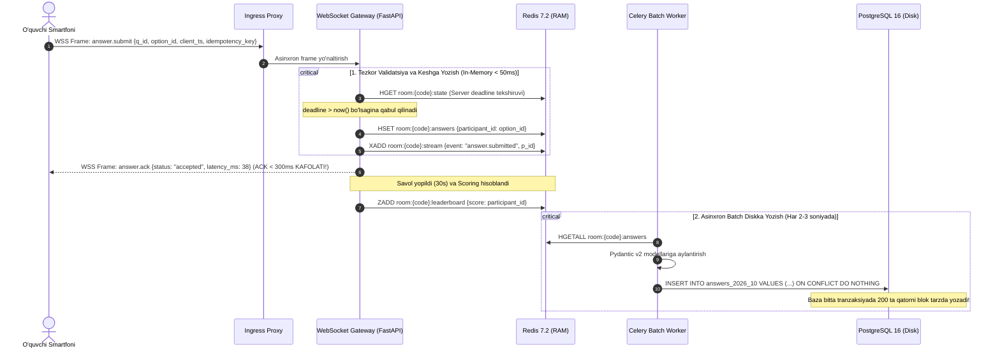
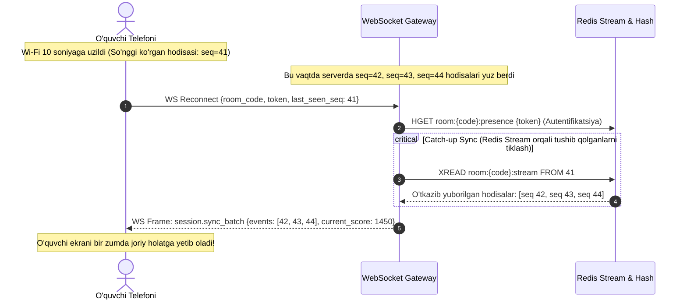
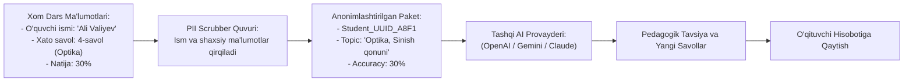

# EduSelf Teacher — Ma'lumotlar Oqimi Diagrammalari va Quvurlari (DATA_FLOWS.md)

**Hujjat versiyasi:** 1.0.0  
**Sana:** 14-oktabr 2026  
**Holati:** Approved Data Flow Specification  
**Asosiy hujjatlar:** [.docs/PRD.md](file:///c:/Users/Asus/Desktop/teacher-eduself-mcp/.docs/PRD.md), [.docs/SRS.md](file:///c:/Users/Asus/Desktop/teacher-eduself-mcp/.docs/SRS.md), [.docs/Architecture.md](file:///c:/Users/Asus/Desktop/teacher-eduself-mcp/.docs/Architecture.md), [.docs/ADR.md](file:///c:/Users/Asus/Desktop/teacher-eduself-mcp/.docs/ADR.md) va [.docs/AGENT.md](file:///c:/Users/Asus/Desktop/teacher-eduself-mcp/.docs/AGENT.md)  
**Notatsiya standarti:** Yourdon / DeMarco va Gane & Sarson DFD notatsiyalari

---

## 1. Kirish va DFD Konvensiyalari

Ushbu hujjat **EduSelf Teacher** platformasida axborotning kirish nuqtalaridan boshlab, qayta ishlanishi (processing), xotirada keshlanishi, doimiy omborlarga yozilishi va tashqi tizimlarga uzatilishigacha bo'lgan barcha **Ma'lumotlar Oqimlari (Data Flows)** va **Quvurlarini (Pipelines)** ifodalaydi.

### 1.1 Belgilash Qoidalari (DFD Notatsiyasi)
- **Tashqi Entitilar (External Entities / Termintorlar):** Tizim chegarasidan tashqarida joylashgan aktyorlar va servislar (O'qituvchi, O'quvchi, AI Provayderlar, Tashqi Chatbotlar).
- **Jarayonlar (Processes):** Ma'lumotlarni o'zgartiruvchi, hisoblovchi yoki tekshiruvchi biznes mantiqlari (Doira yoki yumaloq burchakli to'rtburchak: `1.0`, `2.0`...).
- **Ma'lumotlar Omborlari (Data Stores):** Ma'lumotlar vaqtincha yoki doimiy saqlanadigan joylar (`D1` PostgreSQL, `D2` Redis, `D3` S3 Storage).
- **Ma'lumotlar Oqimlari (Data Flows):** Axborot harakati yo'nalishini ko'rsatuvchi yo'naltirilgan strelkalar.

---

## 2. DFD Level 0: Global Kontekstual Ma'lumotlar Oqimi

Level 0 diagrammasi butun EduSelf platformasini yagona "qora quti" (Black Box) sifatida ko'rsatib, uning tashqi dunyo bilan axborot almashinuvini tasvirlaydi.

```mermaid
flowchart TB
    subgraph ExternalActors["Tashqi Aktyorlar va Tizimlar"]
        Teacher["O'qituvchi (Host)"]
        Student["O'quvchilar (1-200)"]
        ExternalChatbot["Tashqi LLM (Claude, ChatGPT)"]
        AIProviders["7 ta AI Provayderi API"]
        CloudStorage["S3 Media Ombori (R2 / AWS)"]
    end

    subgraph EduSelfPlatform["0.0 EduSelf Teacher Platformasi"]
        CoreEngine["EduSelf Yadro Mexanizmi\n(REST API, WebSocket Gateway, MCP Server, Storage)"]
    end

    Teacher -->|1. Viktorina parametrlari, savollar, tahrirlar, sessiya buyruqlari| CoreEngine
    CoreEngine -->|2. Diff takliflari, xona PIN/QR, dars hisobotlari| Teacher

    Student -->|3. PIN kod, taxallus, javoblar, anonim fikrlar| CoreEngine
    CoreEngine -->|4. Savol matnlari, taymer signallari, ballar va reyting| Student

    ExternalChatbot -->|5. MCP buyruqlari: create_quiz, start_session| CoreEngine
    CoreEngine -->|6. MCP natijalari: draftlar, sessiya holati, hisobotlar| ExternalChatbot

    CoreEngine -->|7. Tozalangan promptlar (Zero-PII), JSON Schema talablari| AIProviders
    AIProviders -->|8. Generatsiya qilingan savollar, formulalar, izohlar| CoreEngine

    Teacher -.->|9. To'g'ridan-to'g'ri rasm/audio yuklash (Presigned URL)| CloudStorage
    CloudStorage -.->|10. CDN orqali media yetkazish| Student
```

---

## 3. DFD Level 1: Makro Tizimlararo Ma'lumotlar Harakati

Level 1 diagrammasi tizimning ichki 7 ta asosiy biznes jarayoni va 3 ta ma'lumotlar ombori o'rtasidagi oqimlarni ochib beradi.

```mermaid
flowchart TD
    subgraph External["Tashqi Entitilar"]
        TeacherUser["O'qituvchi"]
        StudentUser["O'quvchi"]
        ChatbotUser["Tashqi Chatbot (MCP)"]
        AICloud["AI Provayderlar"]
    end

    subgraph Processes["Yadroviy Jarayonlar"]
        P1["1.0 Autentifikatsiya va RBAC"]
        P2["2.0 Manual Quiz Boshqaruvi"]
        P3["3.0 Built-in AI Agent & Diff"]
        P4["4.0 Public MCP Server"]
        P5["5.0 Real-time O'yin va Sessiya"]
        P6["6.0 Moderatsiya va Anonim Devor"]
        P7["7.0 Tahlil va Hisobot Eksporti"]
    end

    subgraph Stores["Ma'lumotlar Omborlari"]
        D1[("D1: PostgreSQL 16\n(Users, Quizzes, Partitioned Answers)")]
        D2[("D2: Redis 7.2 Ephemeral\n(Presence, Scores, Streams, Deadlines)")]
        D3[("D3: S3 / Cloudflare R2\n(Media, Audio, PDF/Excel Exports)")]
    end

    TeacherUser -->|Login so'rovi| P1
    P1 -->|Foydalanuvchi ma'lumotlari| D1
    P1 -->|JWT / Session Token| TeacherUser

    TeacherUser -->|Qo'lda savol tuzish / Autosave| P2
    P2 -->|CRUD & Versiyalash| D1
    P2 -->|Presigned URL so'rovi| D3

    TeacherUser -->|AI dan so'rov: 'quiz tuz'| P3
    P3 -->|Zero-PII Prompt| AICloud
    AICloud -->|Structured JSON| P3
    P3 -->|Oldingi savollar va Locks| D1
    P3 -->|Diff Proposal| TeacherUser

    ChatbotUser -->|MCP Tool chaqiruvi| P4
    P4 -->|OAuth Scope tekshiruvi| P1
    P4 -->|Quiz yoki Sessiya amali| P2
    P4 -->|Sessiya ma'lumotlari| P5

    TeacherUser -->|Sessiya ochish| P5
    StudentUser -->|PIN Join & Javob yuborish| P5
    P5 <-->|Presence, Ballar, Event Stream| D2
    P5 -->|Zero-Knowledge Savol tarqatish| StudentUser
    P5 -->|Leaderboard & O'yin holati| TeacherUser

    StudentUser -->|Anonim fikr yozish| P6
    P6 -->|Profanity tekshiruvi| P6
    P6 -->|Tasdiqlash navbati| TeacherUser
    TeacherUser -->|Ruxsat berish| P6
    P6 -->|Tasdiqlangan xabar| D2

    P5 -->|Yakuniy sessiya hodisalari| P7
    P7 -->|Batch insert (Answers)| D1
    P7 -->|Excel / PDF generatsiya| D3
    D3 -->|Yuklab olish havolasi| TeacherUser
```

---

## 4. Chuqurlashtirilgan Ma'lumotlar Quvurlari (Deep-Dive Pipelines)

### 4.1 Real-Time Javob Ingestion va Batch Yozish Quvuri (High-Throughput Pipeline)

Bu quvur 200 ta ishtirokchi bir vaqtning o'zida javob yuborganida tizimning <300ms kechikish bilan ishlashini ta'minlaydi.



---

### 4.2 AI Generatsiya, Qulflangan Savollar va Diff Proposal Quvuri

O'qituvchining mavjud savollari tasodifan yo'qolib ketmasligi uchun ma'lumotlar oqimi quyidagi bosqichlardan o'tadi:

```mermaid
flowchart TD
    TeacherPrompt["O'qituvchi So'rovi:\n'4-savolni formulali qilib almashtir'"] --> PII_Scrubber["1. PII Scrubber:\nO'quvchi ismlari va maxfiy ma'lumotlar tozalanadi"]
    
    PII_Scrubber --> ContextBuilder["2. Kontekst Yig'uvchi:\n- Mavjud savollar (1-10)\n- Qulflangan savollar ro'yxati (is_locked=True)"]
    
    ContextBuilder --> SchemaCompiler["3. JSON Schema Prompt Compiler:\nPydantic QuizDraft modeli shabloni biriktiriladi"]
    
    SchemaCompiler --> AIGateway["4. Multi-Provider AI Gateway:\nToken Bucket -> Circuit Breaker -> AI API (OpenAI/Gemini)"]
    
    AIGateway --> JSONValidator["5. Pydantic v2 Validatori:\nAI qaytargan JSON qat'iy tekshiriladi"]
    
    JSONValidator --> LockPreserver{"6. Locked Check:\nQulflangan savol bormi?"}
    
    LockPreserver -->|Ha| PreserveLogic["Qulflangan savollar o'rniga\neski asl nusxa qo'yiladi"]
    LockPreserver -->|Yo'q| DiffCalculator["7. Myers Diff & JSON Patch:\nEski va yangi nusxa solishtiriladi"]
    
    PreserveLogic --> DiffCalculator
    
    DiffCalculator --> DiffProposal["8. Visual Diff Obyekti:\n{changes: [replace_q4: {...}], locked: [q1, q2]}"]
    
    DiffProposal --> TeacherReview["9. O'qituvchi Ekrani:\nDiff Preview Modali ochiladi"]
    
    TeacherReview -->|Tasdiqlash (Accept)| SaveDB[("PostgreSQL: UPDATE quizzes & INSERT quiz_versions")]
    TeacherReview -->|Bekor qilish (Reject)| DiscardChanges["Xotiradan o'chiriladi, baza o'zgarmaydi"]
```

---

### 4.3 Tarmoq Uzilishidan Tiklanish (Reconnection & Event Replay Quvuri)

O'quvchining interneti uzilib qolib qayta ulanganda, ma'lumotlar yo'qolmasdan qanday tiklanadi?



---

### 4.4 Direct-to-Storage Media Yuklash Quvuri (S3 Presigned URLs)

O'qituvchi og'ir rasmlar va audio yozuvlar yuklaganda, asosiy server xotirasini tejash oqimi:

```mermaid
flowchart LR
    subgraph Client["O'qituvchi Brauzeri"]
        FilePicker["Fayl tanlash (audio.mp3, 8MB)"]
        DirectUploader["Direct HTTP PUT Client"]
    end

    subgraph BackendAPI["EduSelf Core API"]
        PresignService["Presign Service (Fayl turi va hajmi tekshiruvi)"]
        ConfirmService["Media Confirm Service"]
    end

    subgraph ObjectStorage["Bulutli Ombor va CDN"]
        S3["Cloudflare R2 / AWS S3 Ombori"]
        CDN["Global CDN Edge"]
    end

    FilePicker -->|1. POST /api/v1/media/presign| PresignService
    PresignService -->|2. 10 daqiqalik Imzolangan PUT URL| DirectUploader
    DirectUploader -->|3. To'g'ridan-to'g'ri HTTP PUT (8MB)| S3
    S3 -->|4. 200 OK Tasdiq| DirectUploader
    DirectUploader -->|5. POST /api/v1/media/confirm| ConfirmService
    ConfirmService -->|6. Metadata bazaga yoziladi| DB[(PostgreSQL)]
    CDN -.->|7. O'quvchilarga tezkor tarqatish| StudentApp["O'quvchilar"]
```

---

### 4.5 Jonli Moderatsiya va Anonim Devor Quvuri (Safe Moderation Pipeline)

Sinfda o'quvchilar tomonidan yozilgan erkin fikrlar proyektor ekraniga chiqishidan oldin ko'p bosqichli xavfsizlikdan o'tadi:

```mermaid
flowchart TD
    StudentInput["O'quvchi kiritgan fikr:\n'Mening fikrimcha... <matn>'"] --> ProfanityFilter["1. Avtomatik Leksik Filtr:\nO'zbek, Rus va Ingliz haqoratli so'zlar tekshiruvi"]

    ProfanityFilter -->|Haqorat aniqlandi| RejectMessage["Rad etish:\nO'quvchiga 'Odob chegarasidan chiqmang' ogohlantirishi"]
    ProfanityFilter -->|Toza matn| AnonMasking["2. Anonimlashtirish:\nShaxsiy identifikatorlar yashirilib, Pseudo-token beriladi"]

    AnonMasking --> ModQueue[("3. Redis Moderatsiya Navbati:\nroom:{code}:mod_queue")]

    ModQueue --> TeacherModView["4. O'qituvchi Ekrani:\nKo'rib chiqish navbati (Pending List)"]

    TeacherModView -->|Tasdiqlash (Approve)| ApprovedEvent["5. Event: board.card_approved"]
    TeacherModView -->|O'chirish (Dismiss)| DismissEvent["O'chirildi (Hech kimga ko'rsatilmaydi)"]

    ApprovedEvent --> ProjectorWall["6. Katta Proyektor Devori:\nFikr katta ekranda hamma uchun ochiladi"]
```

---

## 5. Ma'lumotlar Omborlari va Holat Matritsasi (Data Stores & State Matrix)

Platforma axborotning hayotiy sikliga qarab uni 3 xil saqlash sathiga ajratadi:

| Saqlash Qatlami | Texnologiya | Saqlanadigan Ma'lumotlar | Saqlanish Muddati (TTL) | Muvofiqlik Kafolati |
|---|---|---|---|---|
| **Ephemeral (Tezkor Xotira)** | Redis 7.2 Cluster | Xona presence, server taymer deadline, joriy savol javoblari, jonli leaderboard, Redis Stream hodisalar ro'yxati. | Sessiya davomida + tugagach 1 soat (TTL). | Yuqori tezlik (<1ms), In-Memory, Append-Only log. |
| **Relational (Doimiy Baza)** | PostgreSQL 16 (Partitioned) | Foydalanuvchilar, tashkilotlar, quizlar, savollar, quiz versiyalari, sessiyalar, bo'lingan javoblar (`answers_YYYY_MM`), AI audit loglar. | Doimiy (Yillik arxivlash siyosati bilan). | ACID tranzaksiyalar, Relyatsion yaxlitlik, B-Tree va GIN indekslar. |
| **Blob / Object Storage** | Cloudflare R2 / AWS S3 | O'qituvchi yuklagan rasmlar, audio yozuvlar, videolar, dars yakunida generatsiya qilingan PDF va Excel fayllar. | Rasmlar doimiy; Eksport qilingan hisobotlar 30 kun. | 99.999999999% chidamlilik (11 9s Durability), CDN kesh. |

---

## 6. Xavfsizlik va PII Scrubber Ma'lumotlar Quvuri



- **Qat'iy Izolyatsiya:** AI hech qachon o'quvchining haqiqiy ismini bilmaydi.
- **Zero-Knowledge Javob Kaliti:** WebSocket orqali savol yuborilganda Pydantic filtri `exclude={'correct_answer'}` yordamida javobni paketdan yulib oladi.

---

## 7. Ma'lumotlar Saqlash Muddatlari va Tozalash (Retention & Purge Pipeline)

1. **Redis Keshini Tozalash:**
   - O'qituvchi sessiyani yakunlaganda (`session.completed`), xona kodi bo'yicha barcha presence va ephemeral kalitlar 1 soatlik `EXPIRE` bilan belgilanadi va xotira bo'shatiladi.
2. **PostgreSQL Arxivlash Siyosati:**
   - `answers` jadvali oylar bo'yicha bo'lingan. 1 yildan oshgan partitsiyalar (masalan `answers_2025_09`) bazadan ajratilib (Detach Partition), siqilgan shaklda Cold Storage (S3 Glacier) ga ko'chiriladi.
3. **Audit Loglar:**
   - Xavfsizlik va moliyaviy audit loglari (`ai_usage_logs`) firibgarlikning oldini olish va billing hisob-kitoblari uchun 3 yil davomida o'zgarmas (immutable) saqlanadi.

---

## 8. Xulosa

Ushbu **DATA_FLOWS.md** hujjati EduSelf Teacher platformasining qon tomirlari bo'lgan barcha ma'lumotlar oqimini aniq belgilab beradi.

Tizimda ma'lumotlar harakati **minimal kechikish (<300ms ACK)**, **mutlaq maxfiylik (Zero-Knowledge & Zero-PII)** va **yuqori yuklamalarga chidamlilik (Redis In-Memory -> Batch PostgreSQL)** tamoyillariga to'liq bo'ysunadi.
