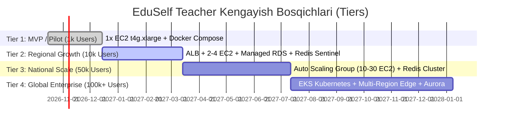
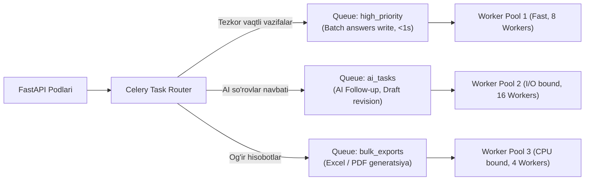

# EduSelf Teacher — Tizimni Kengaytirish va Masshtablash Rejasi (SCALABILITY.md)

**Hujjat versiyasi:** 1.0.0  
**Sana:** 14-oktabr 2026  
**Holati:** Approved Production Scalability Plan  
**Asosiy hujjatlar:** [.docs/PRD.md](file:///c:/Users/Asus/Desktop/teacher-eduself-mcp/.docs/PRD.md), [.docs/SRS.md](file:///c:/Users/Asus/Desktop/teacher-eduself-mcp/.docs/SRS.md), [.docs/Architecture.md](file:///c:/Users/Asus/Desktop/teacher-eduself-mcp/.docs/Architecture.md), [.docs/DEPLOYMENT_ARCHITECTURE.md](file:///c:/Users/Asus/Desktop/teacher-eduself-mcp/.docs/DEPLOYMENT_ARCHITECTURE.md) va [.docs/DATA_FLOWS.md](file:///c:/Users/Asus/Desktop/teacher-eduself-mcp/.docs/DATA_FLOWS.md)

---

## 1. Kirish va Masshtablash Prinsiplari

Ushbu hujjat **EduSelf Teacher** platformasida foydalanuvchilar, o'quvchilar va parallel dars sessiyalari soni keskin oshganda tizimni **gorizontal (Horizontal Scaling)** va **vertikal (Vertical Scaling)** kengaytirish strategiyasini belgilab beradi.

### 1.1 Asosiy Muhandislik Prinsiplari
1. **Stateless Web/WebSocket Qatlami:** Backend serverlarida mijoz sessiya xotirasi (in-memory session state) saqlanmaydi. Har qanday so'rov yoki WebSocket ulanishi istalgan server tuguniga (Node) tushishi mumkin.
2. **Shared-Nothing & Externalized State:** Barcha tezkor holatlar (Presence, ballar, taymer deadline'lari) **Redis Cluster**'da, doimiy ma'lumotlar esa **PostgreSQL**'da saqlanadi.
3. **Asynchronous Non-Blocking I/O:** Python 3.12 va FastAPI (uvloop) ning asinxron imkoniyatlari orqali bitta vCPU o'zagida 2,500 tagacha uxlab yotgan (idle) WebSocket ulanishlarini ushlab turish.
4. **Cache-Aside & Event-Driven Fan-Out:** Baza so'rovlarini 90% ga kamaytirish uchun Redis keshidan foydalanish va hodisalarni faqat qiziquvchilarga (Pub/Sub) yetkazish.
5. **Kaskadli Yuklama Tushirish (Graceful Load Shedding):** Favqulodda yuqori pik yuklamalarda yadroviy o'yin mantig'i (savol va javob) birinchi o'ringa qo'yiladi, og'ir animatsiyalar va ikkilamchi AI izohlari vaqtincha kechiktiriladi.

---

## 2. Kengayishning 4 Bosqichi (Scaling Progression Tiers)

Loyiha o'sish sur'atlariga qarab 4 ta aniq texnik bosqichda masshtablanadi:



### 2.1 Bosqichlararo Texnik Taqqoslash Matritsasi

| Ko'rsatkich | Tier 1: MVP / Pilot | Tier 2: Regional Growth | Tier 3: National Scale | Tier 4: Global Enterprise |
|---|---|---|---|---|
| **Bir vaqtdagi o'quvchilar** | 1,000 parallel user | 10,000 parallel user | 50,000 parallel user | **100,000+ parallel user** |
| **Parallel Jonli Sessiyalar** | 50 ta sinf | 500 ta sinf | 2,500 ta sinf | **5,000+ ta sinf** |
| **Hisoblash Qatlami (Compute)** | 1x `t4g.xlarge` (4 vCPU, 16GB) | 2-4x `t4g.xlarge` (ALB bilan) | Auto Scaling (10-30x `t4g.xlarge`) | AWS EKS (Kubernetes Pods) |
| **Relyatsion Baza (Postgres)** | Docker Postgres (EBS gp3) | AWS RDS Postgres (db.m6g.xlarge) | Multi-AZ RDS + 2 Read Replicas | Amazon Aurora Serverless v2 |
| **Kesh va Realtime (Redis)** | Redis 7.2 (AOF Volume) | Redis Sentinel (Master/Replica) | **Redis Cluster (3 Shard Master/Replica)**| Redis Enterprise Cluster |
| **Ulanishlar Hovuzi (Pooling)**| FastAPI internal pool (20) | PgBouncer (100 pool) | PgBouncer / RDS Proxy (500 pool) | AWS RDS Proxy Multi-Region |
| **Oylik Taxminiy AWS Narxi** | ~$97 / oy | ~$450 / oy | ~$1,800 / oy | ~$4,500+ / oy |
| **Throughput (Javoblar/sek)** | 100 req/sec | 1,500 req/sec | 8,000 req/sec | **25,000+ req/sec** |

---

## 3. Stateless Web va WebSocket Qatlamini Gorizontal Kengaytirish

Backend tugunlari (FastAPI Nodes) soni ko'payganda, mijozlar qanday qilib serverlararo muammosiz muloqot qiladi?

```mermaid
flowchart TB
    subgraph Clients["Mijozlar Qatlami"]
        TeacherApp["O'qituvchi (Node 1 ga ulangan)"]
        Student1["O'quvchi A (Node 1 ga ulangan)"]
        Student2["O'quvchi B (Node 2 ga ulangan)"]
        Student3["O'quvchi C (Node N ga ulangan)"]
    end

    subgraph LoadBalancer["Taqsimlash Qatlami"]
        ALB["AWS Application Load Balancer (ALB)\n(Round-Robin, WebSocket Upgrade, No Sticky Sessions)"]
    end

    subgraph BackendCluster["Gorizontal Kengayuvchi Backend Tugunlari"]
        Node1["FastAPI Node 1 (EC2 / Container)"]
        Node2["FastAPI Node 2 (EC2 / Container)"]
        NodeN["FastAPI Node N (EC2 / Container)"]
    end

    subgraph RedisPubSub["Xabarlar Shinalari (Redis Cluster)"]
        PubSubChannel["Redis Sharded Pub/Sub Channel\nchannel: room:{492018}:events"]
    end

    TeacherApp --> ALB
    Student1 --> ALB
    Student2 --> ALB
    Student3 --> ALB

    ALB --> Node1
    ALB --> Node2
    ALB --> NodeN

    Node1 <-->|SPUBLISH / SSUBSCRIBE| PubSubChannel
    Node2 <-->|SPUBLISH / SSUBSCRIBE| PubSubChannel
    NodeN <-->|SPUBLISH / SSUBSCRIBE| PubSubChannel

    Note over TeacherApp,Student3: O'qituvchi Node 1 da savol ochsa, Redis orqali Node 2 va Node N dagi o'quvchilarga <50ms da yetib boradi!
```

### 3.1 AWS ALB va Auto Scaling Konfiguratsiyasi
1. **Sticky Sessions Kerak Emas:** An'anaviy tizimlarda foydalanuvchini bitta serverga bog'lab qo'yish (Sticky Session / Affinity) serverlar o'rtasida yuklama notekis taqsimlanishiga olib keladi. EduSelf'da Redis Pub/Sub mavjudligi tufayli Sticky Sessions o'chirib qo'yiladi (`stickiness.enabled = false`).
2. **Auto Scaling Qoidalari (Target Tracking Policy):**
   - **Metrika 1:** CPU foydalanish darajasi > 70% bo'lganda yangi tugun qo'shish.
   - **Metrika 2 (Custom CloudWatch Metric):** Bitta serverdagi faol WebSocket ulanishlar soni 2,000 tadan oshganda yangi tugun ko'tarish (`Scale Out`).
3. **Graceful Shutdown va Connection Draining:**
   - Server o'chirilayotganda ALB yangi ulanishlarni to'xtatadi (`deregistration_delay.timeout_seconds = 30`).
   - Server mavjud WebSocket mijozlarga `session.reconnecting` xabarini yuboradi.
   - O'quvchilar tasodifiy kechikish (Jitter: 1-5 soniya) bilan boshqa tirik serverlarga qayta ulanadi. Bu **Reconnect Storm** falokatining oldini oladi.

---

## 4. Real-Time Holat Taqsimoti va Redis Cluster Kengayishi

Millionlab o'quvchilar qatnashganda bitta Redis serverining xotirasi va tarmoq kartasi (NIC) yetarli bo'lmay qoladi. Shuning uchun **Redis Cluster Sharding** joriy etiladi.

### 4.1 Redis Hash Tags `{room_code}` Strategiyasi
Redis Cluster 16,384 ta virtual slotga (Hash Slots) bo'lingan. Agar ma'lumotlar turli kalitlar bilan yozilsa, multi-key operatsiyalar (masalan Lua skriptlari yoki Tranzaksiyalar) `CROSSSLOT Keys in request don't hash to the same slot` xatosi bilan to'xtaydi.

Buni hal qilish uchun **Hash Tag** mexanizmi qo'llaniladi:
```text
room:{492018}:presence   -> Hash slot: CRC16("492018") % 16384 -> Slot 8192 (Shard 2)
room:{492018}:state      -> Hash slot: CRC16("492018") % 16384 -> Slot 8192 (Shard 2)
room:{492018}:scores     -> Hash slot: CRC16("492018") % 16384 -> Slot 8192 (Shard 2)
room:{492018}:stream     -> Hash slot: CRC16("492018") % 16384 -> Slot 8192 (Shard 2)
```
> [!IMPORTANT]
> `{492018}` figurali qavslar ichidagi xona kodi bir xil bo'lgani uchun, ushbu xonaga tegishli **barcha mavjudotlar yuz foiz bitta Redis Shard'da jamlanadi**. Bu xona ichidagi barcha tranzaksiyalarni ultra-tez (<1ms) bajarishni kafolatlaydi!

### 4.2 Redis Sharded Pub/Sub (`SPUBLISH` / `SSUBSCRIBE`)
Klassik `PUBLISH` barcha hodisalarni klasterdagi barcha Redis tugunlariga nusxalaydi. Yuqori masshtabda bu tarmoqni to'ldirib qo'yadi. Redis 7.2 dagi **Sharded Pub/Sub (`SPUBLISH`)** hodisani faqat o'sha xona joylashgan shardga yuboradi, bu esa tarmoq trafigini 80% tejaydi.

---

## 5. Relyatsion Baza (PostgreSQL) Masshtablash Strategiyasi

PostgreSQL yadroviy relyatsion yaxlitlikni ta'minlaydi. Yuklama oshganda baza quyidagi uch qavatli himoya bilan masshtablanadi:

```mermaid
flowchart TD
    AppInstances["FastAPI Ilova Qatlami\n(10,000 ta parallel asinxron ulanish)"] --> PgBouncer["PgBouncer Ulanishlar Hovuzi\n(Transaction Pooling Mode)"]

    PgBouncer --> DBRouter{"SQLAlchemy 2.0\nRouting Session"}

    DBRouter -->|INSERT / UPDATE / DELETE\n(Yozish amallari)| PG_Primary[("PostgreSQL 16 Primary (RW)\nFaqat yozish amallari")]
    DBRouter -->|SELECT\n(Quiz qidiruv, O'qish)| PG_Replica1[("Read Replica 1 (RO)\nKutubxona & O'qituvchi paneli")]
    DBRouter -->|SELECT\n(Katta tahlillar, Eksport)| PG_Replica2[("Read Replica 2 (RO)\nHisobotlar & Analytics")]

    PG_Primary -.->|Asynchronous Streaming Replication| PG_Replica1
    PG_Primary -.->|Asynchronous Streaming Replication| PG_Replica2
```

### 5.1 PgBouncer bilan Ulanishlarni Siqish
- PostgreSQL'da har bir ulanish 5-10MB RAM talab qiladi. 10,000 ta to'g'ridan-to'g'ri ulanish bazani 50-100GB RAM bilan qulatadi.
- **PgBouncer (Transaction Pooling):** 10,000 ta mijoz ulanishini atigi **150-200 ta faol baza hovuziga** siqib beradi. So'rov tugashi bilan ulanish boshqa ishchiga beriladi.

### 5.2 SQLAlchemy 2.0 Read/Write Ajratish K奮i
```python
# Arxitektura kodi: Yozish va O'qishni avtomatik ajratuvchi Router
class RoutingSession(Session):
    def get_bind(self, mapper=None, clause=None):
        if self._flushing or isinstance(clause, (Insert, Update, Delete)):
            return primary_engine # Primary bazaga yozish
        return read_replica_engine # Read Replica bazasidan o'qish
```

---

## 6. Asinxron Ishchilar va Navbatlar Masshtabi (Celery & RabbitMQ)

Fon vazifalari (PDF generatsiya, AI tahlil, bazaga ommaviy yozish) alohida ixtisoslashgan navbatlarga ajratiladi:



- **KEDA (Kubernetes Event-driven Autoscaling):** Agar `high_priority` navbatida vazifalar soni 1,000 tadan oshsa, qo'shimcha Celery Worker podlari 15 soniyada avtomatik ishga tushadi.

---

## 7. Multi-Provider AI Gateway Kengayishi va Kvotalar

7 ta AI provayderi (OpenAI, Gemini, Claude, DeepSeek, Groq, Qwen, Grok) o'rtasida katta dars kunlarida (masalan dushanba ertalab 09:00 dars piki) so'rovlarni taqsimlash:

```mermaid
flowchart TD
    Req["O'qituvchilar AI So'rovlari Piki (1,000 req/min)"] --> RateLimiter["Global Redis Token Bucket Limiter"]
    
    RateLimiter --> HealthRouter{"Provayderlar Salomatligi va Limitlari"}

    HealthRouter -->|Normal holat (Vazn: 40%)| OpenAI["OpenAI GPT-4o-mini"]
    HealthRouter -->|Normal holat (Vazn: 40%)| Gemini["Google Gemini 2.5 Flash"]
    HealthRouter -->|Matematik hisoblar| DeepSeek["DeepSeek R1 / V3"]
    HealthRouter -->|Ultra-tezkor tahlil| Groq["Groq Cloud Llama-3.3"]

    OpenAI -.->|429 Rate Limit yuz bersa| Gemini
    Gemini -.->|503 Xatolik yuz bersa| Claude["Anthropic Claude Haiku"]
```

- **Load Shedding Siyosati:** Agar barcha AI API provayderlarida global cheklov yuz bersa, tizim avtomatik ravishda tayyor savollar bankidagi (Question Bank) mavjud savollarni taklif qiladi, dars to'xtab qolmaydi.

---

## 8. Yuklama Sinovlari Metodologiyasi (k6 Stress Testing)

Platformaning 10,000 parallel o'quvchiga chidamliligini tekshirish uchun quyidagi **k6 test skripti** qabul qilingan:

```javascript
// k6 Stress Test Skripti: 10,000 ta WebSocket ulanishini tekshirish
import ws from 'k6/ws';
import { check, sleep } from 'k6';

export const options = {
  stages: [
    { duration: '2m', target: 2000 },  // 2 daqiqada 2,000 user
    { duration: '5m', target: 10000 }, // 5 daqiqada 10,000 userga chiqish
    { duration: '3m', target: 10000 }, // 3 daqiqa pik yuklamani ushlab turish
    { duration: '2m', target: 0 },     // Sekin tushish
  ],
  thresholds: {
    'ws_connecting': ['p(95)<500'],    // Ulanish vaqti < 500ms
    'answer_ack_duration': ['p(95)<300'] // Javob tasdig'i < 300ms
  },
};

export default function () {
  const url = 'wss://api.eduself.uz/ws/session/492018?token=mock_user_' + __VU;
  
  const res = ws.connect(url, {}, function (socket) {
    socket.on('open', () => {
      // Har 10 soniyada javob yuborish simulyatsiyasi
      socket.send(JSON.stringify({
        action: 'answer.submit',
        question_id: 'q_test_1',
        option_id: 'opt_B',
        client_ts: Date.now()
      }));
    });

    socket.on('message', (data) => {
      const msg = JSON.parse(data);
      if (msg.event === 'answer.ack') {
        check(msg, { 'ACK received under 300ms': () => (Date.now() - msg.client_ts) < 300 });
      }
    });

    socket.setTimeout(() => socket.close(), 60000);
  });

  check(res, { 'WebSocket ulandi': (r) => r && r.status === 101 });
}
```

---

## 9. Ko'lamdorlik Metrikalari va SLO Standartlari (SRE Targets)

| Metrika | Target (SLO) | Qachon Ogohlantirish (Alert) | Qachon Favqulodda (Critical) |
|---|---|---|---|
| **Answer ACK Latency (p95)** | < 300 ms | > 400 ms (2 daqiqa davomida) | > 800 ms (Darhol) |
| **API Request Latency (p95)** | < 500 ms | > 700 ms | > 1,500 ms |
| **WebSocket Connection Drop Rate**| < 0.1% | > 0.5% | > 2.0% |
| **Database Connection Pool Exhaustion** | < 70% | > 80% to'lganda | > 95% to'lganda |
| **Redis Memory Utilization** | < 70% | > 80% | > 90% (OOM xavfi) |
| **AI Provider Fallback Rate** | < 2% | > 5% | > 15% |

---

## 10. Xulosa

Ushbu **SCALABILITY.md** hujjati EduSelf Teacher platformasining kichik sinfdan (20 nafar o'quvchi) tortib, butun mamlakat maktablari bir vaqtda kiradigan ulkan imtihon va darslar (100,000+ nafar o'quvchi) bosqichigacha **kodni qayta yozmasdan, faqat arxitektura qatlamlarini ko'paytirish orqali** muammosiz o'sishini to'liq kafolatlaydi.
