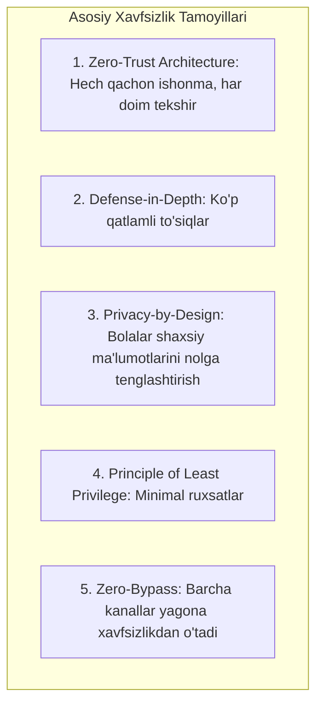
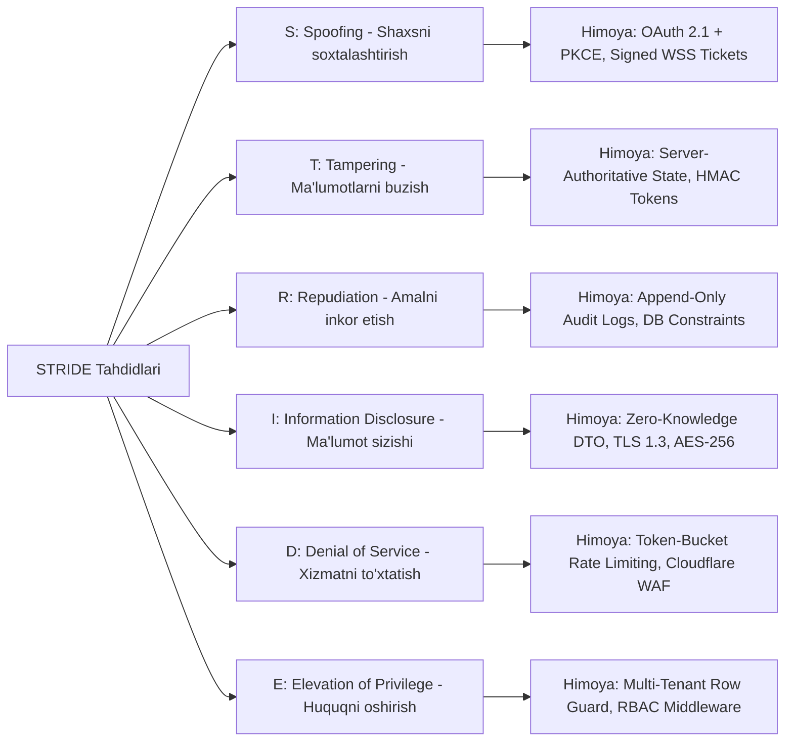
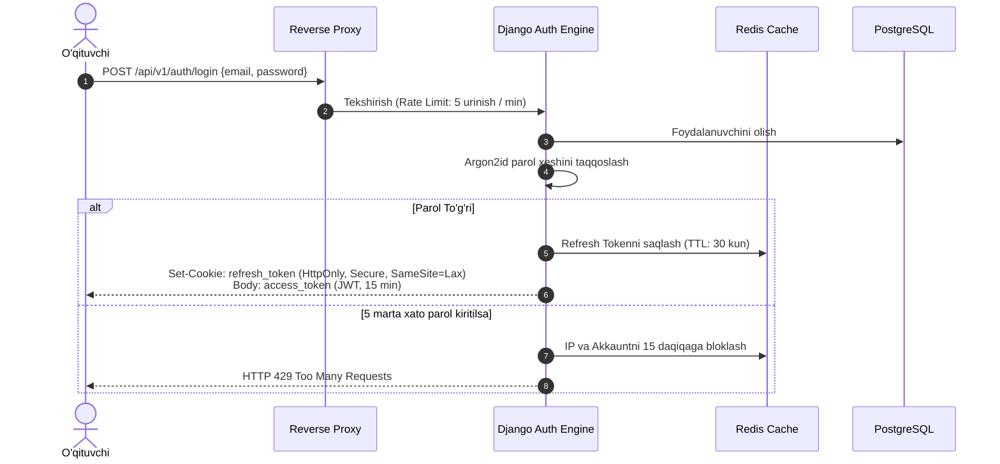

# EduSelf Teacher — Security Architecture & Specification

**Hujjat identifikatori:** DOC-SEC-01  
**Fayl nomi:** `SECURITY.md`  
**Status:** Tasdiqlangan arxitektura spetsifikatsiyasi  
**Versiya:** 1.0.0  
**Sana:** 15-oktabr 2026  
**Standartlar:** OWASP Top 10 (2021+), NIST SP 800-53, COPPA, FERPA, GDPR-K  
**Qamrov:** Web Application, Real-Time WebSockets, Multi-Provider AI, Public MCP Server va Infratuzilma  

---

## 1. Xavfsizlik Falsafasi va Asosiy Tamoyillar

EduSelf Teacher platformasi maktab o‘quvchilari, o‘qituvchilar va ta'lim muassasalari bilan ishlaydigan yuqori mas'uliyatli tizimdir. Shu sababli xavfsizlik platformaga keyinchalik qo‘shiladigan vosita emas, balki arxitekturaning dastlabki poydevori hisoblanadi.



### Tamoyillar Izohi:
1. **Zero-Trust (Nol Ishonch):** Server hech qachon klientga (brauzer, mobil ilova, tashqi AI chatbot) ko‘r-ko‘rona ishonmaydi. Har bir so‘rov va har bir WebSocket freymi serverda autentifikatsiya va avtorizatsiyadan o‘tishi shart.
2. **Defense-in-Depth (Ko‘p qatlamli himoya):** Agar bitta xavfsizlik qatlami (masalan, WAF) buzilsa, keyingi qatlamlar (Nginx, Django Middleware, RBAC, DB Partitioning) tizim yaxlitligini saqlab qoladi.
3. **Privacy-by-Design (Maxfiylik asosida loyihalash):** O‘quvchilardan majburiy shaxsiy ma'lumotlar talab qilinmaydi (Guest Mode). Tizim o‘quvchining ismi, familiyasi yoki telefon raqamisiz ham to‘liq ishlay oladi.
4. **Zero-Bypass (Chetlab o‘tmaslik):** Web panel, mobil ilova yoki tashqi MCP chatboti — barchasi yagona Core Domain xizmatlari va xavfsizlik tekshiruvlari orqali o‘tadi.

---

## 2. Tahdidlar Modeli (Threat Modeling via STRIDE)

Tizim komponentlariga nisbatan yuzaga kelishi mumkin bo‘lgan xatarlar **STRIDE** modeli bo‘yicha tahlil qilingan va tegishli himoya choralari ko‘rilgan:



### STRIDE Matritsasi:

| Tahdid | Xavf Ssenariysi | EduSelf Himoya Mexanizmi |
|---|---|---|
| **Spoofing** | O‘quvchi o‘zini o‘qituvchi deb ko‘rsatib, boshqaruv pultiga ulanishga urinishi | Bir martalik 60 soniyalik WSS Ticket va qat'iy Role-based WebSocket Consumer tekshiruvi. |
| **Tampering** | O‘quvchi tarmoq paketini o‘zgartirib, o‘ziga ko‘proq ball yozishi | Authoritative Server Game Loop — ballar faqat server xotirasida hisoblanadi. |
| **Repudiation** | O‘qituvchi *"Men sessiyani tugatmadim, tizim o‘zi yopib yubordi"* deyishi | Har bir holat o‘zgarishi `teacher_id` va `timestamp` bilan audit jurnaliga yoziladi. |
| **Information Disclosure** | O‘quvchi brauzer DevTools orqali to‘g‘ri javob kalitini ko‘rib olishi | Zero-Knowledge Question Delivery — savol yopilmaguncha to‘g‘ri javob tarmoqqa chiqmaydi. |
| **Denial of Service** | Bitta xonaga 5,000 ta bot ulanib, server xotirasini to‘ldirishi | Cloudflare WAF, Nginx IP rate limiting va Redis presence connection capping. |
| **Elevation of Privilege** | O‘qituvchi boshqa maktabning yopiq testlarini ko‘rishga urinishi | Har bir ORM so‘rovida majburiy `tenant_id` va `school_id` filtri (Row-Level Security). |

---

## 3. Identifikatsiya, Autentifikatsiya va Sessiyalar Boshqaruvi



### 3.1 Parollarni Saqlash (Argon2id):
- Barcha parollar **Argon2id** (OWASP tavsiyasi) algoritmi bilan xeshlanadi:
  - `time_cost = 2`
  - `memory_cost = 19456 KiB (19 MiB)`
  - `parallelism = 1`
  - `salt_length = 16 bytes`

### 3.2 Ijtimoiy Tarmoqlar Orqali Kirish (OAuth 2.0):
- **Google OAuth 2.0:** O‘qituvchi Google Workspace orqali kiradi, faqat tasdiqlangan `email_verified=true` hisoblar qabul qilinadi.
- **Telegram Login Widget:** Telegram orqali kirishda `hash` tekshiruvi server-side bot tokeni orqali HMAC-SHA-256 yordamida validatsiya qilinadi.

### 3.3 JWT Tokenlar Hayot Sikli:
- **Access Token:** Muddati 15 daqiqa. Faqat `user_id`, `tenant_id` va `role`ni o‘z ichiga oladi.
- **Refresh Token:** Muddati 30 kun. `HttpOnly`, `Secure`, `SameSite=Lax` kuki sifatida uzatiladi (JavaScript o‘qiy olmaydi, XSS dan himoyalangan).
- **Token Blacklisting:** O‘qituvchi "Chiqish" (Logout) bosganda refresh token Redis qora ro‘yxatiga (`blacklist:refresh_token`) yoziladi va darhol bekor qilinadi.

---

## 4. Avtorizatsiya va Ko‘p Ijarachilik (Multi-Tenant Isolation)

EduSelf tizimida rollar aniq ierarxiya asosida boshqariladi:

```text
[Platform SuperAdmin] ──> Tizim monitoringi va global sozlamalar
       │
       ▼
 [School Admin]       ──> Maktab o'qituvchilari, litsenziyalar, hisobotlar
       │
       ▼
   [Teacher]          ──> Viktorinalar yaratish, jonli sessiyalarni boshqarish
       │
       ▼
   [Student]          ──> Xonaga ulanish, javob berish, shaxsiy reyting
       │
       ▼
 [Projector / Guest]  ──> Read-only tomosha, umumiy sinf natijalari
```

### 4.1 Row-Level Multi-Tenant Guard:
Bitta maktabning o‘qituvchisi boshqa maktabning testlarini yoki o‘quvchilar natijalarini ko‘ra olmasligi uchun Django ORM darajasida xavfsizlik filtri joriy etilgan:

```python
class TenantQuerySet(models.QuerySet):
    def for_tenant(self, tenant_id: str):
        return self.filter(tenant_id=tenant_id)

class QuizManager(models.Manager):
    def get_queryset(self):
        return TenantQuerySet(self.model, using=self._db)

# Barcha so'rovlar avtomatik tenant doirasida bajariladi:
# Quiz.objects.for_tenant(request.user.tenant_id).filter(...)
```

---

## 5. Real-Time WebSocket Xavfsizligi

Jonli o‘yin sessiyalari paytida aldash (cheating), xakerlik va noqonuniy ulanishlarning oldini olish:

```mermaid
flowchart TD
    JoinReq[Talaba: POST /api/v1/sessions/join] --> VerifyRoom{PIN To'g'rimi va Xona Ochiqmi?}
    VerifyRoom -->|Yo'q| Reject[Ulanish Rad Etildi]
    VerifyRoom -->|Ha| GenTicket[Vaqtinchalik WSS Ticket: 60s TTL]
    
    GenTicket --> ConnectWS[WSS /ws/session/?ticket=...]
    ConnectWS --> TicketValidate{Ticket Haqiqiymi va Ishlatilmaganmi?}
    TicketValidate -->|Ha| JoinChannel[Xonaga Ulash & Ticketni O'chirish (Single-Use)]
    TicketValidate -->|Yo'q| Terminate[Soketni Yopish: Code 4001]
```

### 5.1 Zero-Knowledge Savol Yetkazish (Anti-Cheat):
- Savol talabaga uzatilganda `correct_answer_key` DTO darajasida olib tashlanadi.
- Talaba brauzeri yoki mobil xotirasida qaysi variant to‘g‘riligi haqida hech qanday bayt ma'lumot bo‘lmaydi.
- Faqat savol yopilib, o‘qituvchi `answer.reveal` komandasini yuborgandagina server to‘g‘ri javobni alohida hodisa bilan tarqatadi.

### 5.2 Authoritative Server Clock (Vaqt Firibgarligiga Qarshi):
- Mijozning telefon soatiga ishonilmaydi.
- Savol ochilganda server `deadline_ts = now() + time_limit` belgilaydi.
- Agar javob serverga `deadline_ts + 500ms` (tarmoq toleransi) dan keyin yetib kelsa, u avtomatik ravishda `TIMEOUT (0 ball)` deb belgilanadi.

---

## 6. OWASP Top 10 Himoya Strategiyalari

| OWASP (2021) | Tahdid Nomi | EduSelf Amaliy Himoya Kodingiz / Mexanizm |
|---|---|---|
| **A01** | Broken Access Control | Har bir endpointda `IsAuthenticated` va `IsOwnerOrTenant` permission klasslari. |
| **A02** | Cryptographic Failures | Barcha API kalitlar (BYOK) AES-256-GCM bilan shifrlanadi. Trafik faqat TLS 1.3. |
| **A03** | Injection (SQL, XSS) | Django ORM parametrlashtirilgan SQL; matnlar uchun `nh3` / `bleach` XSS tozalagich. |
| **A04** | Insecure Design | Server-Authoritative Game Loop; Zero-Knowledge Question Delivery. |
| **A05** | Security Misconfiguration | Strict CSP, HSTS, `X-Content-Type-Options: nosniff`, `X-Frame-Options: DENY`. |
| **A06** | Vulnerable Components | CI/CD pipeline'da avtomatlashtirilgan `pip-audit` va `Trivy` konteyner skanerlari. |
| **A07** | Auth Failures | Argon2id parol xeshlash, brute-force IP rate limiting, OAuth 2.1 + PKCE. |
| **A08** | Software/Data Integrity | Imzolangan JWT tokenlar, Docker bazaviy rasmlari xeshlari (SHA-256 pinned). |
| **A09** | Logging/Monitoring Failures | Strukturaviy JSON audit jurnali, Sentry PII filtri, Prometheus xavfsizlik signallari. |
| **A10** | SSRF (Server-Side Request Forgery) | Media yuklashda va tashqi havolalarda ichki IP manzillarni (`127.0.0.1`, `169.254.169.254`) bloklash. |

### 6.1 Xavfsiz HTTP Sarlavhalari (Security Headers):
Nginx va Django darajasida quyidagi sarlavhalar majburiy o‘rnatiladi:
```http
Content-Security-Policy: default-src 'self'; script-src 'self' 'nonce-...'; style-src 'self' 'unsafe-inline' https://fonts.googleapis.com; img-src 'self' data: https://storage.eduself.uz; connect-src 'self' wss://api.eduself.uz https://storage.eduself.uz; object-src 'none'; frame-ancestors 'none';
Strict-Transport-Security: max-age=63072000; includeSubDomains; preload
X-Frame-Options: DENY
X-Content-Type-Options: nosniff
Referrer-Policy: strict-origin-when-cross-origin
Permissions-Policy: geolocation=(), microphone=(), camera=()
```

---

## 7. Bolalar Maxfiyligi va Qonuniy Muvofiqlik (COPPA / FERPA / GDPR-K)

1. **Zero-PII Guest Mode:** O‘quvchi viktorinaga kirayotganda email, telefon, familiya talab qilinmaydi. Faqat sinfdoshlaridan ajralib turish uchun taxallus (nickname) kiritadi.
2. **24 Soatlik Ephemeral Tozalash (TTL):**
   Jonli sessiya tugagach, Redis'dagi barcha oraliq javoblar va ishtirokchilar mavjudligi 24 soatlik TTL bilan belgilanadi va muddati o‘tgach butunlay yo‘q qilinadi:
   ```text
   EXPIRE session:{session_id}:participants 86400
   EXPIRE session:{session_id}:stream 86400
   ```
3. **Unutilish Huquqi (Right to Erasure):** O‘qituvchi o‘z hisobini o‘chirganda unga tegishli barcha testlar, hisobotlar va arxivlar 30 kun ichida qoldiqsiz o‘chirib yuboriladi.

---

## 8. AI va MCP Maxsus Xavfsizlik Boshqaruvi

```mermaid
flowchart TD
    TeacherReq[O'qituvchi So'rovi / Fayl Import] --> PIIScrub[1. Outbound PII Scrubber: Ismlarni [TALABA_1] ga o'girish]
    PIIScrub --> InjectionGuard[2. Prompt Injection Guard: XML Delimiter Izolyatsiyasi]
    InjectionGuard --> ModelCall[Tashqi AI Modeliga Uzatish]
    
    ModelCall --> ToolCall{Model Tool Chaqirmoqdami?}
    ToolCall -->|Xavfli Amal: start_session, end_session| ConfirmModal[3. destructiveHint: O'qituvchidan Tasdiq So'rash]
    ToolCall -->|Xavfsiz Amal: get_quiz| RunService[Core Servisni Bajarish]
    ConfirmModal -->|O'qituvchi Tasdiqlasa| RunService
    ConfirmModal -->|Rad etilsa| CancelTool[Tool Bajarilmaydi]
```

1. **Outbound PII Scrubber:** Tashqi AI modellariga so‘rov yuborishdan oldin barcha shaxsiy ma'lumotlar avtomatik niqoblanadi.
2. **Prompt Injection Himoyasi:** Foydalanuvchi kiritgan har qanday matn `<user_content> ... </user_content>` teglari ichiga olinadi va modelga ularni buyruq sifatida emas, faqat xom-ashyo ma'lumot sifatida qabul qilish qat'iy buyuriladi.
3. **BYOK Shifrlash:** Foydalanuvchining shaxsiy API kalitlari (OpenAI, Claude, Gemini) **AES-256-GCM** bilan shifrlanadi, faqat chaqiruv paytida bir necha millisekund xotirada dekriptlanadi va hech qachon loglarga tushmaydi.
4. **MCP Destructive Hints:** Tashqi chatbot o‘qituvchi nomidan darsni to‘xtatib qo‘ymasligi yoki javoblarni muddatidan oldin ochmasligi uchun barcha muhim buyruqlar `destructiveHint: true` bilan belgilanadi.

---

## 9. Infratuzilma va Tarmoq Xavfsizligi

1. **Docker Hardening:**
   - Konteynerlar `root` foydalanuvchisi ostida ishlamaydi (`USER appuser`, UID: 10001).
   - Read-only fayl tizimi (`read_only: true`), faqat `/tmp` va loglar uchun vaqtinchalik xotira (`tmpfs`).
2. **Tarmoq Izolyatsiyasi (Private Network):**
   - PostgreSQL (5432) va Redis (6379) portlari tashqi internet uchun **butunlay yopiq**.
   - Ular faqat ichki Docker tarmog‘i (`172.20.0.0/16`) orqali Django konteynerlari bilan bog‘lanadi.
3. **Nginx Rate Limiting:**
   - API so‘rovlari: Har bir IP uchun soniyasiga ko‘pi bilan 20 ta so‘rov (`burst=40`).
   - Login so‘rovlari: Har bir IP uchun daqiqasiga ko‘pi bilan 5 ta so‘rov (`burst=2`).

---

## 10. Hodisalarga Javob Berish va Zaifliklarni Oshkor Qilish (Incident Response)

### 10.1 Xavfsizlik Darajalari va Tuzatish Muddatlari (SLA):
- **Kritik (P0):** Ruxsatsiz ma'lumotlarga kirish yoki Remote Code Execution $\to$ **MTTR < 24 soat**.
- **Yuqori (P1):** Autentifikatsiyani chetlab o‘tish yoki o‘yin holatini buzish $\to$ **MTTR < 72 soat**.
- **O‘rta (P2):** Kichik ma'lumot sizishi yoki cheklangan DoS $\to$ **MTTR < 7 kun**.

### 10.2 Mas'uliyatli Oshkor Qilish (Responsible Disclosure):
- **Xavfsizlik Bilan Bog‘lanish:** `security@eduself.uz`
- **Xavfsizlik Fayli:** `https://eduself.uz/.well-known/security.txt`
- Xavfsizlik tadqiqotchilari topilgan zaifliklarni ochiq tarmoqqa e'lon qilmasdan, 30 kunlik mas'uliyatli davr (Responsible Disclosure Window) doirasida EduSelf muhandislari bilan hamkorlikda bartaraf etishga chaqiriladi.
