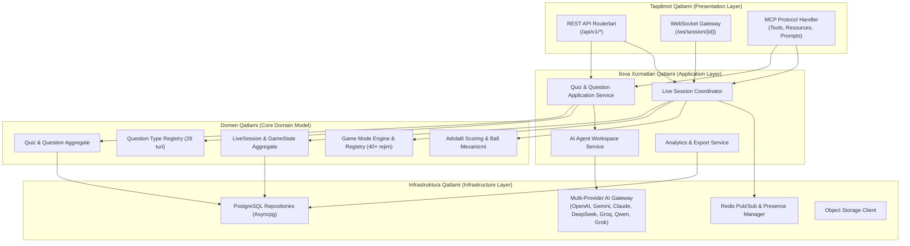
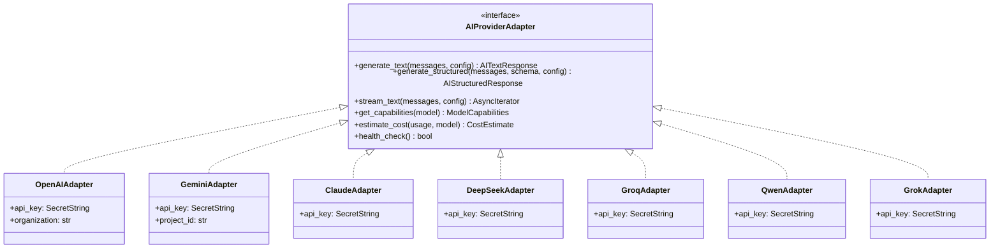
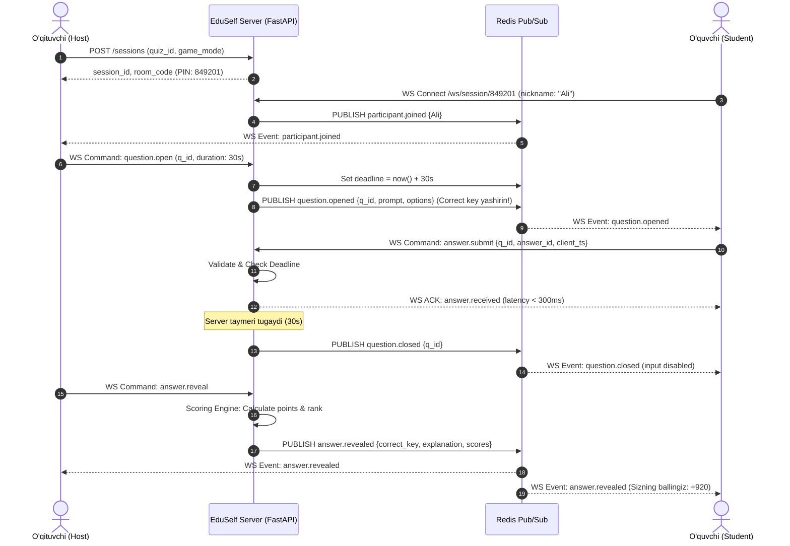
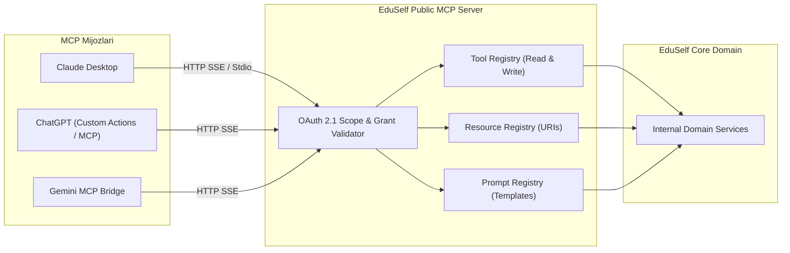
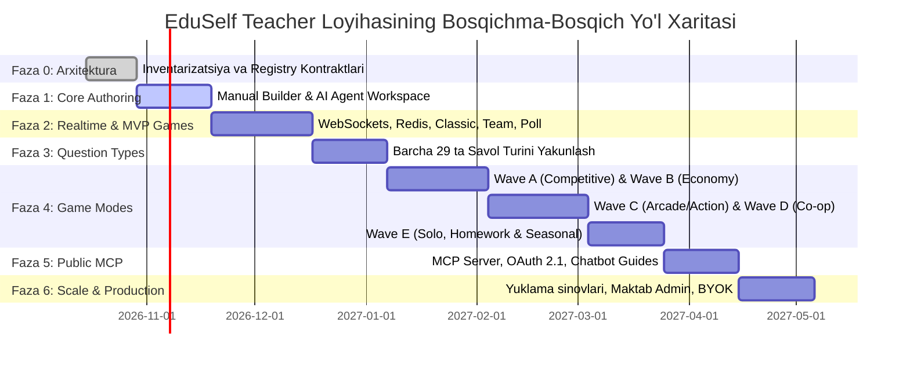

# EduSelf Teacher — Software Requirements Specification (SRS)

**Standart:** ISO/IEC/IEEE 29148:2018 va IEEE 830-1998  
**Hujjat versiyasi:** 1.0.0  
**Sana:** 14-oktabr 2026  
**Holati:** Approved Technical Specification  
**Asosiy hujjat:** [.docs/PRD.md](file:///c:/Users/Asus/Desktop/teacher-eduself-mcp/.docs/PRD.md)  
**Mahsulot:** EduSelf Teacher — Manual Quiz Builder, Built-in AI Agent, Multi-Provider Gateway, Public MCP Server va Real-Time Classroom Game Engine.

---

## 1. Kirish (Introduction)

### 1.1 Hujjatning maqsadi (Purpose)
Ushbu Dasturiy Ta'minot Talablari Spetsifikatsiyasi (SRS) **EduSelf Teacher** platformasining to'liq arxitekturasi, funksional va nofunksional talablari, ma'lumotlar modellari, interfeyslari hamda xavfsizlik mezonlarini belgilab beradi. Ushbu hujjat dasturiy ta'minot muhandislari, arxitektorlar, QA mutaxassislari va loyiha rahbarlari uchun asosiy texnik qo'llanma hisoblanadi.

### 1.2 Loyihaning qamrovi (Scope)
EduSelf Teacher — o'qituvchilar dars jarayonida viktorina va interaktiv o'yinlarni yaratish, boshqarish va o'tkazish imkonini beruvchi ta'lim platformasi. Platforma 4 ta asosiy mustaqil ustunga tayanadi:
1. **Manual Quiz Builder:** AI talab qilmaydigan, to'liq funksional, 29 ta savol turini qo'llab-quvvatlovchi zamonaviy muharrir (autosave, undo/redo, drag-and-drop, import/export).
2. **Built-in AI Agent Workspace:** Web-panel ichida joylashgan, o'qituvchi bilan muloqot qiluvchi, o'zgarishlarni diff/preview formatida taklif etuvchi va savollarni selektiv qulflash (lock) imkoniyatiga ega ichki AI agent.
3. **Multi-Provider AI Gateway va Public MCP Server:** 7 ta yirik AI provayderi (OpenAI, Gemini, Claude, DeepSeek, Groq, Qwen, Grok) uchun yagona adapter va tashqi LLM mijozlar (ChatGPT, Claude Desktop, Gemini) orqali tizimni boshqarish uchun rasmiy Python Model Context Protocol (MCP) serveri.
4. **Real-Time Classroom Game Engine:** Server-authoritative arxitekturaga ega, kamida 200 ta ishtirokchini <300ms kechikish bilan qabul qiluvchi, Kahoot va Blooket'ning to'liq o'yinlar katalogi ekvivalenti hamda EduSelf original rejimlarini o'z ichiga olgan o'yin mexanizmi.

### 1.3 Atamalar va qisqartmalar (Definitions and Acronyms)
| Atama / Qisqartma | To'liq nomi va ta'rifi |
|---|---|
| **MCP** | **Model Context Protocol** — LLM ilovalari tashqi xizmatlar (tools, resources, prompts) bilan xavfsiz muloqot qilishi uchun Anthropic tomonidan ishlab chiqilgan ochiq protokol. |
| **Server-Authoritative** | O'yin va sessiyaning yagona haqiqiy holati (state) serverda boshqariladi; mijozlar (brauzerlar) faqat buyruq yuboradi va hodisalarni aks ettiradi. |
| **BYOK** | **Bring Your Own Key** — Foydalanuvchi yoki maktab o'zining shaxsiy AI provayder API kalitini xavfsiz ulab ishlatishi. |
| **PII** | **Personally Identifiable Information** — O'quvchi shaxsini aniqlovchi ma'lumotlar (ism, familiya, email, telefon). |
| **COPPA / FERPA** | Bolalar va o'quvchilar ma'lumotlari maxfiyligini tartibga soluvchi xalqaro qonunchilik me'yorlari. |
| **WATS** | **Weekly Active Teaching Sessions** — Haftasiga kamida bitta jonli dars faoliyatini to'liq o'tkazgan o'qituvchilar soni (North Star Metric). |
| **SSE** | **Server-Sent Events** — HTTP orqali bir tomonlama doimiy ma'lumot oqimini uzatuvchi protokol (MCP transporti uchun). |
| **Diff Proposal** | AI tomonidan taklif qilingan, ammo o'qituvchi tasdiqlamaguncha quizga kiritilmaydigan ko'rikli o'zgarishlar to'plami. |

---

## 2. Umumiy tizim tavsifi (Overall Description)

### 2.1 Mahsulot istiqboli va konteksti (Product Perspective)
EduSelf Teacher mustaqil web-platforma bo'lib, ta'lim muassasalaridagi zamonaviy interaktiv doskalar, proyektorlar, o'qituvchi kompyuterlari hamda o'quvchilarning smartfon/planshetlari bilan real vaqt rejimida ishlaydi. Shu bilan birga, u tashqi AI ekotizimlariga MCP protokoli orqali ulanadi.

```mermaid
graph TB
    subgraph ExternalEcosystem["Tashqi Ekotizim"]
        LLMClients["Tashqi Chatbotlar\n(ChatGPT, Claude, Gemini)"]
        AIProviders["AI Provayder API'lari\n(OpenAI, Gemini, Claude, DeepSeek, Groq, Qwen, Grok)"]
    end

    subgraph EduSelfPlatform["EduSelf Teacher Platformasi"]
        WebGateway["Web & WebSocket Gateway"]
        MCPServer["EduSelf Public MCP Server"]
        CoreBackend["Core Domain & Game Engine (FastAPI)"]
        StateStore["PostgreSQL 16 & Redis Cluster"]
    end

    subgraph ClassroomClients["Auditoriya Ishtirokchilari"]
        TeacherClient["O'qituvchi Web Paneli"]
        ProjectorClient["Sinf Proyektori / Doskasi"]
        StudentClients["O'quvchilar Qurilmalari (Mobil/Web)"]
    end

    LLMClients <-->|MCP Protocol (SSE / Stdio)| MCPServer
    MCPServer <--> CoreBackend
    TeacherClient <-->|REST / WSS| WebGateway
    ProjectorClient <-->|WSS| WebGateway
    StudentClients <-->|WSS (PIN / QR Join)| WebGateway
    WebGateway <--> CoreBackend
    CoreBackend <--> AIProviders
    CoreBackend <--> StateStore
```

### 2.2 Foydalanuvchi profillari va rollar (User Classes and Characteristics)
1. **O'qituvchi (Teacher / Host):**
   - Quizlarni qo'lda va AI yordamida yaratadi, tahrirlaydi, nashr etadi.
   - Jonli dars sessiyasini ochadi, o'quvchilarni PIN/QR orqali ulaydi.
   - O'yin davomida savollarni boshqaradi, natijalarni ochadi, javoblar devorini moderatsiya qiladi.
   - Sessiya hisobotlarini tahlil qiladi va eksport qiladi.
2. **O'quvchi (Student / Participant):**
   - Ro'yxatdan o'tmasdan (Guest nickname) yoki hisob orqali tezkor qo'shiladi.
   - Mobil telefonda o'yin rejimiga mos interfeysda javob beradi.
   - Jamoaviy o'yinlarda o'z jamoasiga hissa qo'shadi, anonim devorlarda fikr bildiradi.
3. **Maktab / Tashkilot Administratori (School Admin):**
   - O'qituvchilar litsenziyalari, AI kvotalari, umumiy savollar kutubxonasi va xavfsizlik sozlamalarini boshqaradi.
4. **Tashqi AI Chatbot (MCP Client):**
   - Ruxsat etilgan scope doirasida o'qituvchi nomidan savollar yaratadi, holatni tekshiradi va o'qituvchi tasdig'i bilan sessiya tayyorlaydi.

### 2.3 Ishlab chiqish muhiti va texnologik stak (Technology Stack)
- **Backend API & Realtime:** Python 3.12, FastAPI (ASGI), Pydantic v2, SQLAlchemy 2.0 (Asyncpg), WebSockets (FastAPI native / Socket.IO).
- **Public MCP Server:** Rasmiy Python MCP SDK (`mcp` package), SSE va Stdio transportlari.
- **Frontend Applications:** React 19, TypeScript 5.5, Tailwind CSS / Vanilla CSS modullari, Vite, Lucide Icons, Canvas API / PixiJS (arkada va mini-o'yinlar uchun).
- **Relational Storage:** PostgreSQL 16 (JSONB, Full-Text Search, Partitioning).
- **In-Memory & Cache:** Redis 7.2 (Pub/Sub, Stream, Cluster, Room Presence).
- **Background Workers:** Celery / ARQ (asinxron tahlil, PDF/CSV generatsiya, eksport).
- **File Storage:** S3-compatible Object Storage (MinIO / Cloudflare R2 / AWS S3) + CDN.

---

## 3. Tizim arxitekturasi va komponentlar dizayni (System Architecture)

EduSelf Teacher toza (Clean/Hexagonal) arxitektura tamoyillariga asoslanadi. Domen mantig'i tashqi transport (REST, WebSocket, MCP) va ma'lumotlar omboridan to'liq ajratilgan.



---

## 4. Funksional talablar (Functional Requirements)

### 4.1 Quyi tizim 1: Manual Quiz Builder (FR-1)

| Talab ID | Nomi | Tavsif |
|---|---|---|
| **FR-1.1** | Bo'sh viktorina yaratish | O'qituvchi sarlavha, tavsif, fan, sinf darajasi, til (O'zbekcha lotin/kirill, ruscha, inglizcha) va umumiy vaqt limitini belgilab yangi quiz boshlashi shart. |
| **FR-1.2** | 29 ta savol turidan tanlash | O'qituvchi "Savol qo'shish" menyusida katalogdagi barcha 29 ta savol turidan istalgan birini tanlab qo'sha olishi kerak. |
| **FR-1.3** | Savol parametrlarini boshqarish | Har bir savol uchun: savol matni, variantlar, to'g'ri javob(lar), muqobil qabul qilinadigan javoblar, izoh (explanation), ballar (points), individual taymer, qiyinlik darajasi va teglarni kiritish imkoniyati. |
| **FR-1.4** | Drag-and-drop va bulk amallar | Savollar ro'yxatida sudrab tartiblash (drag-and-drop), nusxalash (duplicate), o'chirish, bir vaqtning o'zida bir nechta savolni tanlab vaqt/ballini o'zgartirish (bulk edit). |
| **FR-1.5** | Real-time autosave va versiyalash | Har bir o'zgarish 1 soniya ichida avtomatik saqlanadi (debounced autosave). O'qituvchi `Undo (Ctrl+Z)` va `Redo (Ctrl+Y)` qila olishi shart. Har bir nashr etilgan holat muzlatilgan versiya (`QuizVersion`) sifatida saqlanadi. |
| **FR-1.6** | Savollar banki va import/export | Shaxsiy savollar kutubxonasidan savollarni qo'shish; CSV va Excel formatlaridan savollarni validatsiya bilan import qilish; PDF/CSV shaklida yuklab olish. |
| **FR-1.7** | Media biriktirish | Rasm (PNG, JPG, WEBP, SVG), audio (MP3) va video (MP4, YouTube/Vimeo embed) biriktirish. Fayllar hajmi va formati avtomatik tekshiriladi. |

### 4.2 Quyi tizim 2: Built-in AI Agent Workspace (FR-2)

| Talab ID | Nomi | Tavsif |
|---|---|---|
| **FR-2.1** | Mustaqil ichki agent paneli | Web dashboard ichida joylashgan chat interfeysi. Ushbu agent MCP ulanmasdan ham platformaning o'zida to'liq ishlaydi. |
| **FR-2.2** | So'rovdan spetsifikatsiya ajratish | O'qituvchi "7-sinf, fizika, bosim mavzusi, 10 ta savol, Team Battle" deb yozganda, agent so'rovni tahlil qilib, yetishmayotgan parametrlar bo'yicha qisqa aniqlashtiruvchi savol beradi. |
| **FR-2.3** | Structured Draft yaratish | Agent belgilangan JSON schema bo'yicha to'liq savollar to'plamini javob kalitlari va izohlari bilan generatsiya qiladi. |
| **FR-2.4** | Diff Proposal & Change Preview | AI o'zgartirish kiritganda, mavjud savollarni jimgina ustidan yozmaydi! O'qituvchiga har bir o'zgarish visual diff ko'rinishida taqdim etiladi. |
| **FR-2.5** | Savollarni qulflash (Lock Mechanism) | O'qituvchi ma'qul kelgan savolni qulflab qo'yishi mumkin. Keyingi "Quizni qayta yaxshila" yoki "Savollarni 15 taga yetkaz" kabi buyruqlar qulflangan savollarga teginmaydi. |
| **FR-2.6** | Selektiv qayta ishlash | Aniq buyruqlar: "Faqat 3-savolning noto'g'ri variantlarini qiyinlashtir", "Hamma savollarga darslikdan izoh qo'sh", "Faqat 5-savolni formulali savolga almashtir". |
| **FR-2.7** | O'qituvchi nazorati (Human-in-the-loop) | AI taklif etgan o'zgarishlarni o'qituvchi `Accept` yoki `Reject` qiladi. O'qituvchining tasdig'isiz hech qanday tashqi ta'sirli amal (sessiyani boshlash, xabarlar yuborish) bajarilmaydi. |

### 4.3 Quyi tizim 3: Multi-Provider AI Gateway (FR-3)

Tizim barcha 7 ta AI provayderini yagona abstraksiya orqali qo'llab-quvvatlaydi.



| Talab ID | Nomi | Tavsif |
|---|---|---|
| **FR-3.1** | Yagona Adapter Interfeysi | Barcha provayderlar uchun structured output (JSON Schema), token usage, xatoliklar va latency ko'rsatkichlari standartlashtiriladi. |
| **FR-3.2** | 7 ta Provayder Qo'llab-quvvatlanishi | OpenAI (GPT-4o, GPT-4o-mini), Google Gemini (Gemini 2.5 Flash, Pro), Anthropic Claude (Claude 3.5 Sonnet, Haiku), DeepSeek (V3, R1), Groq (Llama-3.3 70B), Qwen (Qwen-2.5), xAI Grok (Grok-2). |
| **FR-3.3** | Xarajat va Budjet Nazorati | Har bir so'rov bo'yicha tokenlar, millisekundlar va taxminiy narx hisoblanadi. O'qituvchi/maktab uchun oylik limitlar o'rnatiladi. |
| **FR-3.4** | BYOK (Bring Your Own Key) | O'qituvchi yoki maktab o'zining API kalitini kiritib foydalanishi mumkin. Kalitlar AES-256 shifrlangan holda saqlanadi va frontendga hech qachon chiqmaydi. |
| **FR-3.5** | Intelligent Failover & Fallback | Agar tanlangan asosiy provayderda vaqtincha xatolik (5xx) yoki rate-limit yuz bersa, tizim avtomatik ravishda mos keluvchi ikkilamchi provayderga (faqat foydalanuvchi roziligi bo'lsa) o'tadi. |
| **FR-3.6** | Graceful Degradation | Barcha AI provayderlar ishlamay qolganda ham, Manual Builder, saqlangan viktorinalar va jonli sessiyalar to'xtovsiz ishlashi shart. |

### 4.4 Quyi tizim 4: Question Type Registry — 29 ta savol formati (FR-4)

Barcha savol turlari `QuestionTypePlugin` interfeysi orqali ulanadi:
- `schema`: Savol va javob ma'lumotlarining JSON Schema'si.
- `teacher_editor`: O'qituvchi panelidagi kiritish komponenti.
- `student_renderer`: O'quvchi ekranidagi optimallashgan ko'rinish.
- `validate_answer(payload)`: Javob strukturasi to'g'riligini tekshirish.
- `score_answer(submitted, correct_key, config)`: Ball hisoblash algoritmi.
- `reveal_view`: Natijalarni auditoriyaga ko'rsatish ko'rinishi.

#### Baholash va Bilim Tekshirish Savollari (Assessment):
1. **Single-Choice Quiz:** 1 ta to'g'ri javobli klassik test.
2. **Multiple-Select:** Bir nechta to'g'ri javobli test (qisman ball berish sozlanadi).
3. **True / False:** Rost yoki Yolg'on.
4. **Type Answer / Short Text:** Qisqa matnli javob (katta-kichik harf, bo'shliqlar va tinish belgilari normalizatsiyasi bilan).
5. **Puzzle / Order:** Javob variantlarini to'g'ri ketma-ketlikda joylashtirish.
6. **Numeric Answer:** Aniq sonli javob yoki ruxsat etilgan xatolik (tolerance ±X%).
7. **Slider:** Slayder orqali qiymat tanlash (to'g'ri oraliqqa yaqinlik bo'yicha dinamik ball).
8. **Pin Answer:** Berilgan rasmda to'g'ri hududni (koordinata/polygon) belgilash.
9. **Drop Pin:** Butun sinfning tanlagan nuqtalarini umumiy rasm/xarita ustida jamlab ko'rsatish.
10. **Match Pairs:** Juftliklarni to'g'ri bog'lash.
11. **Ranking / Category Sort:** Elementlarni kategoriyalarga ajratish yoki darajalash.
12. **Fill in the Blanks:** Matndagi bo'sh o'rinlarni to'ldirish (dropdown yoki yozma).
13. **Math Expression / Equation:** LaTeX/MathML formulali savollar va matematik ekvivalentlikni tekshirish.
14. **Code Output / Bug Hunt:** Dasturlash kodi fragmenti, natijani topish yoki xatoni tuzatish.
15. **Passage / Case-based:** Katta matn yoki vaziyatli holat (case-study) asosidagi savollar guruhi.
16. **Image Choice / Hotspot / Diagram Labeling:** Sxema va diagrammalardagi qismlarni belgilash.
17. **Audio / Video based:** Media fragmentini tinglab/ko'rib javob berish.

#### Fikr Almashish, Hamkorlik va Formativ Baholash:
18. **Poll:** Anonim yoki ochiq so'rovnoma (to'g'ri javobsiz).
19. **Rating Scale / Likert:** 1 dan 5 gacha baholash yoki ishonch darajasi.
20. **NPS-Style Scale:** 0 dan 10 gacha bo'lgan umumiy taassurot shkalasi.
21. **Word Cloud:** O'quvchilar yuborgan so'zlardan real vaqtda so'zlar bulutini shakllantirish.
22. **Open-Ended Response:** Erkin matnli javoblar devori.
23. **Brainstorm & Cluster:** G'oyalarni erkin yuborish, AI yordamida mavzularga klasterlash va sinf bilan ovoz berish.
24. **Anonymous Answer Wall:** Butunlay anonim fikrlar devori (moderatsiyadan so'ng proyektorda ochiladi).
25. **Confidence Rating & Reasoning:** Javob bilan birga ishonch darajasini (100%, 75%, 50%) va asoslashni yuborish.
26. **Exit Ticket / Survey:** Dars oxiridagi 2-3 savolli xulosa so'rovi.

#### Taqdimot va Kontent Bloklari (Presentation Blocks):
27. **Slide / Content Card:** Matn, rasm, formula yoki spiker eslatmalariga ega slayd (savollar orasida tushuntirish uchun).
28. **Step-by-Step Worked Example:** Bosqichma-bosqich yechim ko'rsatuvchi interaktiv slayd.
29. **Question Group Header:** Umumiy kontekst/matnga bog'langan savollar bloki.

### 4.5 Quyi tizim 5: Game Mode Engine va To'liq Katalog Qamrovi (FR-5)

Har bir o'yin rejimi `GameModeEngine` interfeysiga muvofiq quyidagi hayotiy sikl hook'lariga ega:
- `on_session_start(session, config)`
- `on_question_open(question, state)`
- `on_answer_submitted(participant, answer, state)`
- `on_question_closed(state)`
- `on_round_end(state)`
- `calculate_rewards(state)`
- `check_end_condition(state)`
- `serialize_state_for_client(participant_id, state)`

#### 4.5.1 Kahoot Ekvivalenti O'yin Tajribalari:
1. **Classic Quiz:** Individual jonli viktorina, tezlik va to'g'rilikka asoslangan klassik ball tizimi.
2. **Accuracy First:** Faqat to'g'rilik baholanadi; vaqt tugaguncha barcha o'quvchilarga teng imkoniyat beriladi.
3. **Confidence Wager:** Javobga ishonch darajasi bilan garov tikish (noto'g'ri bo'lsa ball kamayadi).
4. **Team Battle:** Sinf avtomatik yoki qo'lda jamoalarga ajratiladi, jamoaviy umumiy ball hisoblanadi.
5. **Color Kingdoms (Territory Conquest):** To'g'ri javoblar orqali xaritadagi hududlarni egallash va mudofaa qilish.
6. **Chill Art (Collaborative Canvas):** Sinf to'g'ri javoblari orqali umumiy san'at asari yoki mozaikani ochish.
7. **Submarine Squad (Survival Objective):** Butun sinf suv osti kemasida; har bir xato kema bosimini oshiradi, to'g'ri javoblar uni qutqaradi.
8. **Tallest Tower:** To'g'ri javoblar orqali minora qavatlarini qurish va mustahkamlash.
9. **Treasure Trove:** Raundlar orasida kutilmagan bonus sandiqlari va mini-mukofotlar.
10. **The Lost Pyramid:** Jamoa bo'lib piramida cho'qqisiga qarab pog'onama-pog'ona ko'tarilish.
11. **Robot Run:** Butun sinf xavfdan qochuvchi robotni harakatlantiradi; to'g'ri javoblar energiya beradi.
12. **Cosmic Conquest:** Koinot kemasi sayohati, sayyoralarni tadqiq qilish va resurslar to'plash.
13. **Interactive Presentation:** Slaydlar, so'rovnomalar va testlar integratsiyalashgan ma'ruza formati.
14. **Teacher-Led Lecture:** O'qituvchi nazoratidagi tushuntirish va tezkor tushunish tekshiruvi.
15. **Unplugged / Shared Screen:** Shaxsiy smartfonsiz, proyektor orqali jamoaviy muhokama bilan o'ynaladigan rejim.
16. **Marble Race Simulation:** To'g'ri javoblar uchun shariklar (marbles) yig'iladi va dars yakunida hayajonli poyga o'tkaziladi.

#### 4.5.2 Blooket Ekvivalenti O'yin Tajribalari:
17. **Battle Royale:** 1v1 yoki jamoa dueli; noto'g'ri javob berganda hayotlar kamayadi, oxirgi qolgan g'olib bo'ladi.
18. **Blook Rush / Resource Clash:** Boshqalardan resurs yutib olish va o'z bazasini himoyalash.
19. **Busy Bees:** To'g'ri javoblar evaziga ishchi asalarilarni ko'paytirish va asal ishlab chiqarish.
20. **Gold Quest:** Har bir to'g'ri javobdan so'ng 3 ta sandiqdan birini tanlash (oltin, boshqadan o'g'irlash yoki bo'sh).
21. **Crypto Hack:** Kriptovalyuta yig'ish, parollarni topish va boshqalarning kriptosini xak qilish.
22. **Fishing Frenzy:** Qarmog'ini tashlab baliq yoki xazina tutish (og'irligi va tasodifiy kutilmagan sovg'alar).
23. **Deceptive Dinos:** Qazilma boyliklarni yig'ish, boshqalarni chalg'itish va strategik qarorlar.
24. **Café Management:** Mijozlarga taom tayyorlash, buyurtmalarni bajarish va kafeni yangilash.
25. **Factory Economy:** Zavod uchun uskunalar sotib olish, daromadni oshirish va modernizatsiya.
26. **Tower Defense:** To'g'ri javoblar evaziga himoya minoralari qurish va dushman to'lqinlarini qaytarish.
27. **Tower Defense 2:** Chuqurlashtirilgan minora turlari, takomillashtirish daraxti va darsdan keyingi mustaqil rejim.
28. **Monster Brawl:** Qahramonni boshqarish, maxluqlarga qarshi kurashish va yangi qobiliyatlarni ochish.
29. **Racing / Speed Run:** Har bir to'g'ri javob o'quvchi mashinasini marraga yaqinlashtiradi.
30. **Crazy Kingdom (Solo/Homework):** Qirollikni boshqarish, fuqarolarning so'rovlariga javob berish va muvozanatni saqlash.
31. **Pirate Pool (Physics Minigame):** To'g'ri javobdan so'ng to'pni nishonga aniq otish.
32. **Zorblitz / Arcade Survival:** Kosmik kosmik to'siqlarni yorib o'tish arkadasi.
33. **Study Drill:** Ortiqcha o'yin elementlarisiz sof o'rganish va kartochkalar mashqi.
34. **Seasonal Modes (Candy Quest, Santa's Workshop, Egg Hunt, Tag or Treat):** Bayramona mavzuli o'yinlar (feature flag orqali faollashtiriladi).

#### 4.5.3 EduSelf Original Rejimlari:
35. **Anonymous Answer Wall:** Fikrlar to'liq anonim yig'iladi, o'qituvchi saralagach proyektorda ko'rsatiladi.
36. **Quick Poll / Pulse Check:** 30 soniyada butun sinfning mavzuni qanchalik tushunganini bilish.
37. **Brainstorm & Cluster:** Fikrlarni yig'ish, AI yordamida guruhlash va saralanganlariga ovoz berish.
38. **Boss Battle:** Butun sinf birlashib "Mega Boss"ning jonini (HP) to'g'ri javoblar orqali tugatishi kerak.
39. **Escape Room:** Guruhlar ketma-ket jumboqli savollarni yechib xonadan chiqish kodlarini ochadilar.
40. **Jeopardy Board:** Kategoriyalar va ballar jadvali (100, 200, 300...) bo'yicha savol tanlash.
41. **Peer Instruction:** Individual javob → juftlikda muhokama → qayta ovoz berish (Mazur metodi).
42. **Relay Race:** Jamoa a'zolari navbat bilan estafeta tarzida savollarga javob beradi.
43. **Concept Map / Mind Link:** Tushunchalarni vizual bog'lash orqali dars tushunchalari xaritasini hosil qilish.
44. **Code Battle / Bug Hunt:** Real kod fragmentidagi xatoni eng tez va to'g'ri topish musobaqasi.
45. **Learning Ladder:** Har bir o'quvchi o'z darajasiga mos pog'onani egallab yuqorilab boradigan differentsial ta'lim rejimi.

### 4.6 Quyi tizim 6: Jonli sessiya va Real-Time sinxronizatsiya (FR-6)

Sessiyalar WebSocket va Redis Pub/Sub yordamida server-authoritative tamoyili asosida ishlaydi.



| Talab ID | Nomi | Tavsif |
|---|---|---|
| **FR-6.1** | PIN va QR orqali ulanish | 6 xonali noyob raqamli kod yoki QR-kod orqali 1 soniyada ulanish. |
| **FR-6.2** | Ishtirokchilar va Lobby | O'qituvchi ulanayotganlarni real vaqtda ko'radi, noo'rin ismlarni chiqarib yuboradi yoki xonani qulflaydi. |
| **FR-6.3** | Server Authoritative Timer | Taymer o'quvchining telefonidagi soatga bog'liq emas. Server deadline'ni Redis'da saqlaydi va qat'iy yopadi. |
| **FR-6.4** | Maxfiy Javob Kaliti | To'g'ri javob kaliti savol server tomonidan to'liq yopilmaguncha hech qachon student qurilmasiga yuborilmaydi! |
| **FR-6.5** | Tarmoq uzilishidan tiklanish (Reconnection) | Internet uzilib qaytgan o'quvchi avtomatik ravishda so'nggi `state snapshot`ni oladi va o'yinni davom ettiradi. |
| **FR-6.6** | Proyektor / Katta Ekran Ko'rinishi | Sinf doskasiga chiqariladigan toza, katta shriftli va dinamik animatsiyali presentation rejimi. |

### 4.7 Quyi tizim 7: Public Model Context Protocol (MCP) Server (FR-7)

Rasmiy Python MCP SDK asosida tashqi AI chatbotlar uchun yagona kirish interfeysi taqdim etiladi.



#### MCP Tools Spetsifikatsiyasi:
1. `create_quiz_draft(topic: str, grade: int, count: int, formats: list[str], language: str) -> QuizDraft`
2. `get_quiz(quiz_id: UUID) -> QuizDetails`
3. `update_quiz(quiz_id: UUID, changes: list[QuestionPatch]) -> QuizDetails`
4. `validate_quiz(quiz_id: UUID) -> ValidationReport`
5. `import_questions(raw_text: str, format_type: str) -> ImportedSummary`
6. `list_question_sets(query: str, limit: int) -> list[QuestionSetSummary]`
7. `create_live_session(quiz_id: UUID, game_mode: str, settings: dict) -> SessionInfo`
8. `get_session_status(session_id: UUID) -> SessionLiveStatus`
9. `start_session(session_id: UUID) -> Confirmation` *(Destructive/Action confirmation talab qiladi)*
10. `advance_question(session_id: UUID) -> QuestionInfo`
11. `reveal_answers(session_id: UUID) -> RoundSummary`
12. `end_session(session_id: UUID) -> SessionReportSummary` *(Confirmation talab qiladi)*
13. `create_anonymous_board(topic: str, prompt: str) -> BoardInfo`
14. `get_session_report(session_id: UUID) -> DetailedReport`
15. `generate_followup_activity(session_id: UUID) -> RecommendedQuizDraft`

#### MCP Resources va Prompts:
- **Resources:** `eduself://question-types`, `eduself://game-modes`, `eduself://teacher-guide`, `eduself://session/{session_id}/summary`
- **Prompts:** `create_lesson_quiz`, `analyze_class_weaknesses`, `team_review_game`

### 4.8 Quyi tizim 8: Tahlil, Moderatsiya va Xavfsizlik (FR-8)

| Talab ID | Nomi | Tavsif |
|---|---|---|
| **FR-8.1** | O'qituvchining jonli moderatsiyasi | O'qituvchi istalgan noo'rin yozuvni bitta tugma bilan devordan olib tashlashi va foydalanuvchini bloklashi mumkin. |
| **FR-8.2** | Avtomatik so'z filtri (Profanity Filter) | O'zbek, rus va ingliz tillaridagi behayo/haqoratli so'zlar avtomatik yashiriladi (yulduzchalar bilan almashtiriladi). |
| **FR-8.3** | O'quvchi PII himoyasi | O'quvchining shaxsiy ma'lumotlari (familiyasi, telefon raqami) tashqi AI provayderlariga hech qachon yuborilmaydi. |
| **FR-8.4** | Dars yakuni tahliliy hisoboti | Savollar kesimida qaysi mavzu o'quvchilar tomonidan eng qiyin o'zlashtirilgani foizlarda ko'rsatiladi. |
| **FR-8.5** | Eksport qilish | Natijalar Excel (XLSX), CSV va printerga mos PDF formatida yuklab olinadi. |

---

## 5. Ma'lumotlar arxitekturasi va baza sxemasi (Data Architecture)

Tizim relyatsion ma'lumotlar uchun **PostgreSQL 16** va real-time holatlar uchun **Redis 7.2** dan foydalanadi.

### 5.1 Relyatsion Modellar (PostgreSQL DDL)

```sql
-- Foydalanuvchilar va Tashkilotlar
CREATE TABLE users (
    id UUID PRIMARY KEY DEFAULT gen_random_uuid(),
    email VARCHAR(255) UNIQUE NOT NULL,
    full_name VARCHAR(255) NOT NULL,
    role VARCHAR(50) NOT NULL DEFAULT 'teacher', -- 'teacher', 'admin', 'student'
    preferred_locale VARCHAR(10) NOT NULL DEFAULT 'uz-Latn',
    created_at TIMESTAMPTZ NOT NULL DEFAULT now(),
    updated_at TIMESTAMPTZ NOT NULL DEFAULT now()
);

CREATE TABLE organizations (
    id UUID PRIMARY KEY DEFAULT gen_random_uuid(),
    name VARCHAR(255) NOT NULL,
    subscription_plan VARCHAR(50) NOT NULL DEFAULT 'free',
    ai_monthly_token_budget BIGINT NOT NULL DEFAULT 1000000,
    created_at TIMESTAMPTZ NOT NULL DEFAULT now()
);

-- Quiz va Savollar modeli
CREATE TABLE quizzes (
    id UUID PRIMARY KEY DEFAULT gen_random_uuid(),
    owner_id UUID NOT NULL REFERENCES users(id) ON DELETE CASCADE,
    organization_id UUID REFERENCES organizations(id) ON DELETE SET NULL,
    title VARCHAR(255) NOT NULL,
    description TEXT,
    subject VARCHAR(100),
    grade_level INT,
    locale VARCHAR(10) NOT NULL DEFAULT 'uz-Latn',
    visibility VARCHAR(20) NOT NULL DEFAULT 'private', -- 'private', 'shared', 'public'
    status VARCHAR(20) NOT NULL DEFAULT 'draft', -- 'draft', 'published', 'archived'
    current_version INT NOT NULL DEFAULT 1,
    created_at TIMESTAMPTZ NOT NULL DEFAULT now(),
    updated_at TIMESTAMPTZ NOT NULL DEFAULT now()
);

CREATE TABLE questions (
    id UUID PRIMARY KEY DEFAULT gen_random_uuid(),
    quiz_id UUID NOT NULL REFERENCES quizzes(id) ON DELETE CASCADE,
    type VARCHAR(50) NOT NULL, -- 29 ta turdan biri
    prompt TEXT NOT NULL,
    media_url TEXT,
    media_type VARCHAR(20), -- 'image', 'audio', 'video'
    options JSONB, -- Variantlar massivi yoki konfiguratsiya
    correct_answer JSONB NOT NULL, -- Maxfiy kalit
    accepted_alternatives JSONB, -- Qabul qilinadigan muqobil variantlar
    explanation TEXT,
    points INT NOT NULL DEFAULT 1000,
    time_limit_seconds INT NOT NULL DEFAULT 30,
    difficulty VARCHAR(20) DEFAULT 'medium',
    tags TEXT[],
    order_index INT NOT NULL,
    is_locked BOOLEAN NOT NULL DEFAULT FALSE, -- AI qayta yozishidan himoya
    review_status VARCHAR(20) NOT NULL DEFAULT 'approved',
    version INT NOT NULL DEFAULT 1,
    created_at TIMESTAMPTZ NOT NULL DEFAULT now()
);

-- Versiyalar tarixi va audit
CREATE TABLE quiz_versions (
    id UUID PRIMARY KEY DEFAULT gen_random_uuid(),
    quiz_id UUID NOT NULL REFERENCES quizzes(id) ON DELETE CASCADE,
    version_number INT NOT NULL,
    snapshot_payload JSONB NOT NULL, -- Butun quizning to'liq holati
    published_by UUID NOT NULL REFERENCES users(id),
    created_at TIMESTAMPTZ NOT NULL DEFAULT now()
);

-- Jonli sessiya va ishtirokchilar
CREATE TABLE live_sessions (
    id UUID PRIMARY KEY DEFAULT gen_random_uuid(),
    quiz_version_id UUID NOT NULL REFERENCES quiz_versions(id),
    host_id UUID NOT NULL REFERENCES users(id),
    room_code VARCHAR(10) UNIQUE NOT NULL, -- Masalan '492018'
    status VARCHAR(20) NOT NULL DEFAULT 'draft', -- 'draft','lobby','active','paused','review','completed','cancelled'
    game_mode VARCHAR(50) NOT NULL, -- 40+ rejimdan biri
    settings JSONB NOT NULL,
    started_at TIMESTAMPTZ,
    ended_at TIMESTAMPTZ,
    created_at TIMESTAMPTZ NOT NULL DEFAULT now()
);

CREATE TABLE participants (
    id UUID PRIMARY KEY DEFAULT gen_random_uuid(),
    session_id UUID NOT NULL REFERENCES live_sessions(id) ON DELETE CASCADE,
    nickname VARCHAR(50) NOT NULL,
    team_name VARCHAR(50),
    anonymous_token VARCHAR(64) NOT NULL,
    score INT NOT NULL DEFAULT 0,
    is_connected BOOLEAN NOT NULL DEFAULT TRUE,
    joined_at TIMESTAMPTZ NOT NULL DEFAULT now()
);

CREATE TABLE answers (
    id UUID PRIMARY KEY DEFAULT gen_random_uuid(),
    session_id UUID NOT NULL REFERENCES live_sessions(id) ON DELETE CASCADE,
    participant_id UUID NOT NULL REFERENCES participants(id) ON DELETE CASCADE,
    question_id UUID NOT NULL REFERENCES questions(id),
    submitted_payload JSONB NOT NULL,
    is_correct BOOLEAN NOT NULL,
    awarded_points INT NOT NULL DEFAULT 0,
    response_time_ms INT NOT NULL,
    created_at TIMESTAMPTZ NOT NULL DEFAULT now(),
    CONSTRAINT uq_session_participant_question UNIQUE (session_id, participant_id, question_id)
);

-- AI foydalanish va Xarajat audit logi
CREATE TABLE ai_usage_logs (
    id UUID PRIMARY KEY DEFAULT gen_random_uuid(),
    user_id UUID NOT NULL REFERENCES users(id),
    provider VARCHAR(50) NOT NULL,
    model VARCHAR(100) NOT NULL,
    task_name VARCHAR(100) NOT NULL,
    input_tokens INT NOT NULL,
    output_tokens INT NOT NULL,
    estimated_cost_usd NUMERIC(10, 6) NOT NULL,
    latency_ms INT NOT NULL,
    status VARCHAR(20) NOT NULL,
    created_at TIMESTAMPTZ NOT NULL DEFAULT now()
);
```

### 5.2 Ephemeral Data Structures (Redis 7.2)
- `room:{room_code}:presence`: Set (ulangan participant ID'lari ro'yxati).
- `room:{room_code}:state`: Hash (joriy raund, savol ID'si, server deadline timestamp'i).
- `room:{room_code}:scores`: Sorted Set (real-time ballar va reyting tartibi).
- `room:{room_code}:stream`: Redis Stream (sessiya hodisalari ketma-ketligi, qayta ulanish uchun).
- `rate_limit:ip:{ip_address}`: String / Counter (5 soniyada max 20 so'rov).

---

## 6. Tashqi interfeys talablari (External Interface Requirements)

### 6.1 Foydalanuvchi interfeyslari (User Interfaces)
1. **O'qituvchi Web Ilovasi:** Desktop va noutbuklar uchun mo'ljallangan, yuqori kontrastli, ikki panelli ish maydoni (chapda savollar daraxti, o'rtada WYSIWYG muharrir, o'ngda AI yordamchi agenti).
2. **Proyektor / Katta Ekran Ko'rinishi:** Kamida 10 metr masofadan aniq ko'rinadigan katta shriftlar, yuqori sifatli SVG animatsiyalar, 16:9 va 16:10 formatlarga to'liq moslashish.
3. **O'quvchi Mobil Interfeysi:** Ultra-yengil (initial load < 300KB), katta sensor tugmalar (kamida 48x48px), 300ms dan kam kechikish, haptik bildirishnomalar (vibratsiya).

### 6.2 Dasturiy protokollar va Aloqa (Communication Protocols)
- **REST API:** JSON over HTTPS (TLS 1.3), JWT Bearer avtorizatsiyasi.
- **WebSocket Gateway:** Secure WebSockets (`wss://`), binary/text JSON frames, yurak urishi (heartbeat ping-pong har 15 soniyada).
- **MCP Server:** HTTP Server-Sent Events (SSE) uzoq masofali ulanishlar uchun, Stdio mahalliy CLI/Desktop mijozlar uchun.

---

## 7. Nofunksional talablar (Non-Functional Requirements - NFR)

### 7.1 Ishlash unumdorligi va Kechikish (Performance & Latency)
- **API Response Time:** Oddiy CRUD REST so'rovlari p95 < 500ms.
- **Answer ACK Latency:** O'quvchi javob yuborganida tasdiq olish vaqti (ACK) p95 < 300ms.
- **Event Fan-out:** Serverdan 200 ta mijozga hodisa tarqalish vaqti p95 < 500ms.
- **Yuklama standarti:** Bitta sessiyada 200 ta faol ishtirokchi, tizim bo'yicha kamida 50 ta parallel sessiya (10,000 parallel WebSocket ulanishi).

### 7.2 Ishonchlilik va Mavjudlik (Reliability & Availability)
- Tizimning beta versiyasi uchun mavjudlik ko'rsatkichi (Availability): **99.5%**.
- AI provayderlari uzilganida asosiy viktorina yaratish va jonli o'yin funksiyalari to'xtamasligi kerak.
- Tarmoq uzilgan o'quvchi yoki o'qituvchi 10 soniya ichida o'z holatini to'liq qayta tiklay olishi shart.

### 7.3 Xavfsizlik va Maxfiylik (Security & Privacy)
- **Bolalar ma'lumotlari maxfiyligi:** O'quvchilardan majburiy shaxsiy ma'lumotlar talab qilinmaydi (Guest nicknames). COPPA va GDPR-K talablariga muvofiq.
- **Shifrlash:** Barcha trafik HTTPS / WSS (TLS 1.3) orqali shifrlanadi. Shaxsiy BYOK API kalitlari AES-256-GCM bilan shifrlanadi.
- **Xavfsiz Javob Kaliti:** To'g'ri javoblar savol yopilguncha tarmoqqa yoki brauzer xotirasiga yuborilmaydi.
- **Rate Limiting:** DoS hujumlariga qarshi har bir IP va xona kodi bo'yicha cheklovlar.
- **Prompt Injection:** Tashqi kiritilgan matnlar tizim yo'riqnomasidan ajratiladi va xavfsiz sanitizatsiya qilinadi.

### 7.4 Inklyuzivlik va Qulaylik (Accessibility)
- Standart: **WCAG 2.1 Level AA**.
- Rang ko'rishi cheklangan (Color-blind) o'quvchilar uchun ranglar bilan birga shakllar (uchburchak, doira, kvadrat, romb) va matnli belgilar majburiy qo'shiladi.
- "Reduced Motion" rejimi: og'ir animatsiyalarni o'chirib, statik vizuallarga o'tish imkoniyati.
- Ekran o'quvchilar (Screen Readers - NVDA, VoiceOver) uchun ARIA teglari.

---

## 8. Verifikatsiya va Qabul Qilish Mezonlari (Acceptance Criteria Matrix)

| ID | PRD Talabi | SRS Verifikatsiya Usuli | Qabul Qilish Mezoni (Pass Criteria) |
|---|---|---|---|
| **AC-01** | AI'siz manual builder | Avtomatlashtirilgan E2E test (Playwright) | O'qituvchi AI panelini ochmasdan 29 ta savol turini kiritib, nashr qila oladi. |
| **AC-02** | AI Draft va Diff taklifi | Unit & Integratsion test | AI yaratgan savollar editor'da ochiladi, o'zgartirishlar diff formatida ko'rinadi va tasdiqlanadi. |
| **AC-03** | Savollarni qulflash (Lock) | Integratsion test | Qulflangan savol AI ga "barcha savollarni o'zgartir" buyrug'i berilganda ham o'zgarmasdan qoladi. |
| **AC-04** | 7 ta AI Provayder | Mock va Live API testlari | Barcha 7 ta adapter yagona interfeys orqali muvaffaqiyatli JSON savollar draftini qaytaradi. |
| **AC-05** | Public MCP Server | MCP Client Simulator | Tashqi client `create_quiz_draft` va `start_session` buyruqlarini xavfsiz bajara oladi. |
| **AC-06** | Real-time Yuklama | Yuklama testi (k6 / Locust) | 200 ta virtual o'quvchi bir vaqtda javob yuborganda p95 javob vaqti < 300ms, yo'qolgan javoblar 0%. |
| **AC-07** | Javob kaliti maxfiyligi | Penetration / Sniffing test | WebSocket frame'lar tahlil qilinganda `correct_answer` savol yopilguniga qadar paketda mavjud bo'lmaydi. |
| **AC-08** | Tarmoq uzilishi (Reconnection) | Chaos / Network drop test | Brauzer qayta yuklanganda sessiya o'sha ball va holatdan davom etadi. |
| **AC-09** | Anonim devor moderatsiyasi | Funksional test | O'qituvchi tasdiqlamagan anonim fikrlar proyektor ekranida ko'rinmaydi. |

---

## 9. Bosqichma-bosqich ishlab chiqish va Yetkazib berish (Phased Roadmap)

PRD talablariga mos ravishda barcha o'yinlar va savol turlari 7 ta aniq bosqichda yetkazib beriladi:



---

## 10. Xulosa (Summary)

Ushbu **Software Requirements Specification (SRS)** hujjati EduSelf Teacher platformasini noldan boshlab to'liq production darajasiga qadar qurish uchun zarur bo'lgan barcha texnik, arxitekturaviy va xavfsizlik mezonlarini belgilab beradi.

Platforma **o'qituvchini markazga qo'ygan holda**, sun'iy intellektning tezligini, zamonaviy o'yinlarning (Kahoot, Blooket) pedagogik quvvatini va Model Context Protocol'ning ochiq ekotizimini yagona mustahkam tizimda birlashtiradi.
