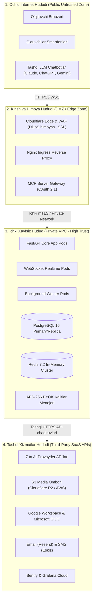
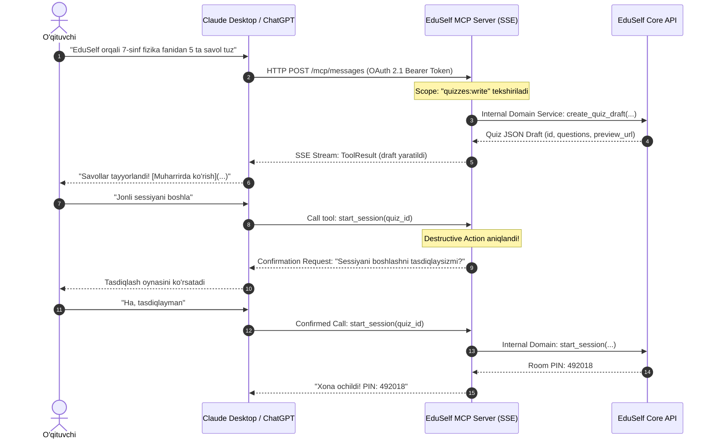
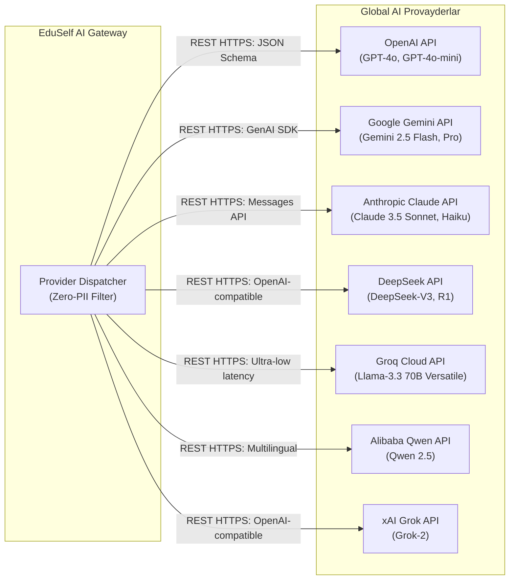
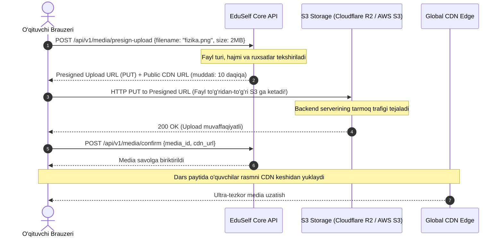
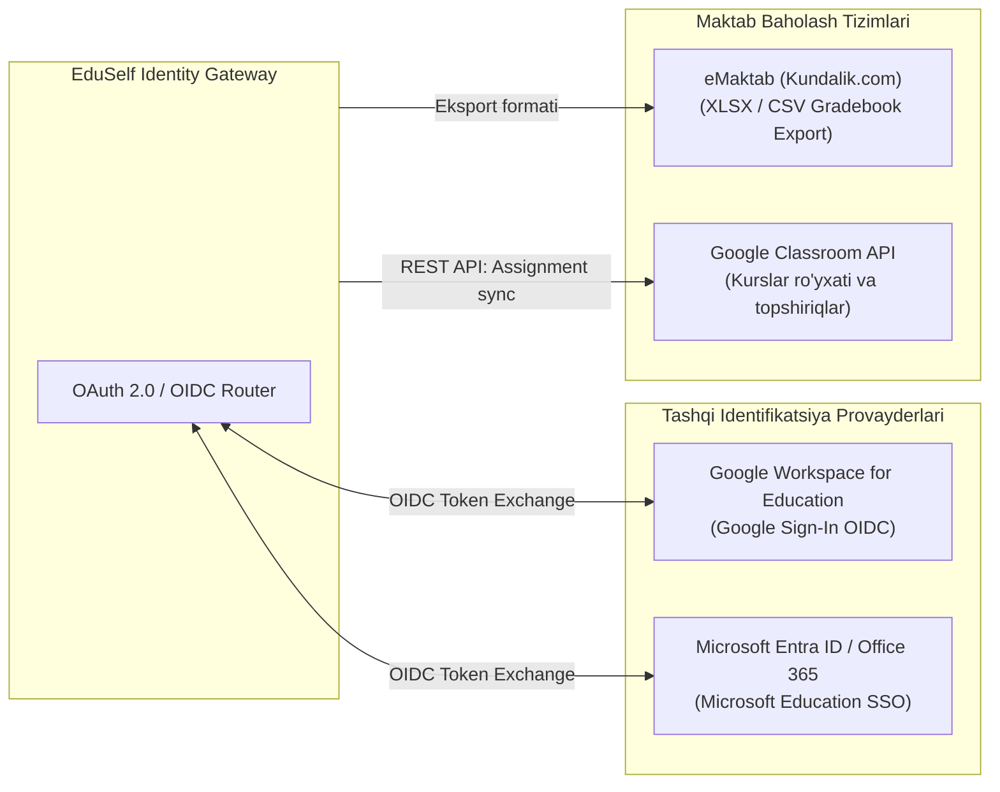
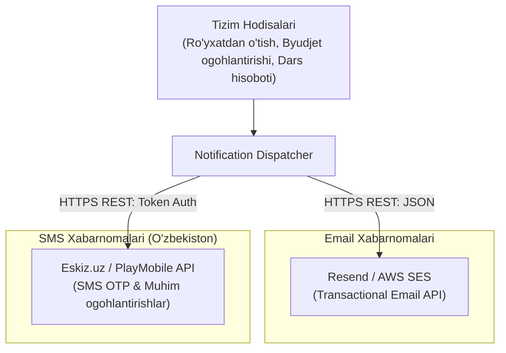
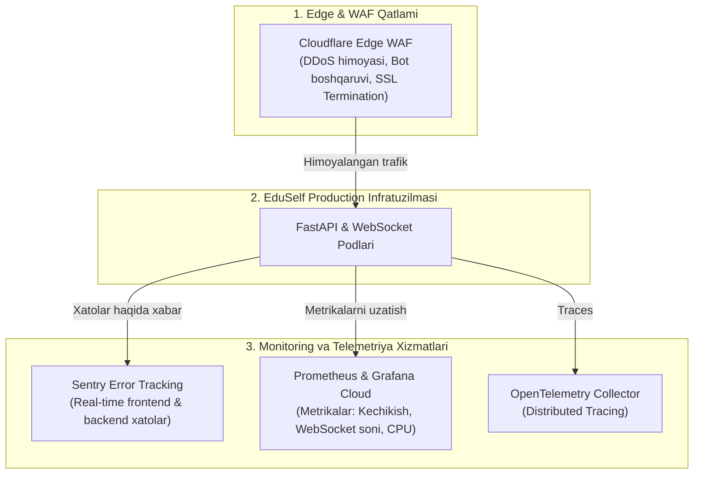

# EduSelf Teacher — Tizim Konteksti va Tashqi Servislar Integratsiyasi (System_context.md)

**Hujjat versiyasi:** 1.0.0  
**Sana:** 14-oktabr 2026  
**Holati:** Approved System Context Specification  
**Asosiy hujjatlar:** [.docs/PRD.md](file:///c:/Users/Asus/Desktop/teacher-eduself-mcp/.docs/PRD.md), [.docs/SRS.md](file:///c:/Users/Asus/Desktop/teacher-eduself-mcp/.docs/SRS.md) va [.docs/Architecture.md](file:///c:/Users/Asus/Desktop/teacher-eduself-mcp/.docs/Architecture.md)  
**Qamrovi:** Tizim chegaralari (System Boundaries), Kiruvchi (Inbound) va Chiquvchi (Outbound) barcha tashqi servislar, integratsiya protokollari, xavfsizlik va SLA standartlari.

---

## 1. Kirish va Tizim Chegarasi (System Boundary Definition)

EduSelf Teacher platformasi dars jarayonini interaktiv tashkil qilish uchun ichki domen mantig'iga ega bo'lishi bilan birga, zamonaviy sun'iy intellekt ekotizimi, tashqi chatbotlar va ta'lim muassasalari infratuzilmasi bilan chambarchas bog'langan.

### 1.1 Tizim Chegarasi va Ishonch Hududlari (Trust Zones)
Tizim 3 ta asosiy xavfsizlik va ishonch zonasiga ajratilgan:

---

## 2. Kiruvchi Tashqi Servislar va Mijozlar (Inbound Touchpoints)

Kiruvchi integratsiyalar tashqi mijozlar va tizimlarning EduSelf platformasi resurslariga murojaat qilishini ta'minlaydi.

### 2.1 Tashqi LLM Chatbotlar (Public Model Context Protocol — MCP)
EduSelf o'zining rasmiy Python MCP serveri orqali tashqi sun'iy intellekt mijozlari uchun xavfsiz darvoza ochadi.

| Parametr | Qiymati |
|---|---|
| **Mijozlar** | Anthropic Claude Desktop/Web, OpenAI ChatGPT Actions, Google Gemini Extensions |
| **Protokol** | Rasmiy Model Context Protocol (v1.0), HTTP Server-Sent Events (SSE) va Stdio |
| **Endpoint** | `https://api.eduself.uz/mcp/sse` va `https://api.eduself.uz/mcp/messages` |
| **Autentifikatsiya** | OAuth 2.1 (PKCE bilan), Scoped Access Tokens (`quizzes:read`, `quizzes:write`, `sessions:host`) |
| **Xavfsizlik** | O'qituvchining tasdig'isiz destruktiv amallar (sessiyani boshlash/yakunlash, quizni o'chirish) bajarilmaydi |

### 2.2 Web va Mobil Brauzer Mijozlari
- **O'qituvchi Web Ilovasi:** HTTPS REST (`/api/v1/*`) va Secure WebSockets (`wss://api.eduself.uz/ws/host/*`) orqali darsni boshqarish.
- **O'quvchilar Mobil Interfeysi:** Ultra-yengil Secure WebSockets (`wss://api.eduself.uz/ws/session/{room_code}`) orqali minimal kechikish (<300ms) bilan javob yuborish.
- **Proyektor / Katta Ekran Ko'rinishi:** Proyektor uchun tozalangan, animatsiyali va yuqori kontrastli WebSocket taqdimot oqimi.

---

## 3. Chiquvchi Tashqi AI Provayderlari (Multi-Provider AI Gateway)

Platforma 7 ta yirik global sun'iy intellekt provayderi bilan to'g'ridan-to'g'ri aloqa qiladi.

### 3.1 Provayderlar Xususiyatlari va Integratsiya Matritsasi

| Provayder | Asosiy Modellar | Integratsiya Protokoli | Maqsadi va Afzalligi | Zaxira Provayder (Fallback) |
|---|---|---|---|---|
| **OpenAI** | `gpt-4o`, `gpt-4o-mini` | REST API (Structured JSON Outputs) | Universal yuqori sifatli savollar, testlar va izohlar | Google Gemini |
| **Google Gemini** | `gemini-2.5-flash`, `gemini-2.5-pro` | REST API / Google GenAI SDK | Juda katta matnlar, darsliklar va tezkor generatsiya | OpenAI |
| **Anthropic Claude** | `claude-3-5-sonnet`, `claude-3-5-haiku` | REST Messages API | Murakkab pedagogik tahlil, nozik tushuntirishlar | OpenAI |
| **DeepSeek** | `deepseek-chat (V3)`, `deepseek-reasoner (R1)` | REST API (OpenAI-compatible) | Matematik, fizik formulalar va chuqur hisob-kitoblar | Groq / OpenAI |
| **Groq Cloud** | `llama-3.3-70b-versatile` | REST API (LPU Inference) | O'ta past kechikishli (<1s) tezkor viktorina yaratish | Gemini |
| **Alibaba Qwen** | `qwen-2.5-72b-instruct` | REST API (DashScope / OpenAI) | O'zbek, rus va ko'p tilli sifatli grammatika | DeepSeek |
| **xAI Grok** | `grok-2`, `grok-2-mini` | REST API (OpenAI-compatible) | Zamonaviy dolzarb mavzular va faktik bilimlar | Claude |

### 3.2 Qat'iy Xavfsizlik va Maxfiylik Standartlari:
1. **Zero-PII Kafolati (No Student Data to AI):** Tashqi AI xizmatlariga faqat fan mavzusi, sinf darajasi va darslik matni yuboriladi. O'quvchilarning ismlari, identifikatorlari yoki shaxsiy ma'lumotlari AI so'rov paketidan PII-Scrubber orqali 100% tozalanadi.
2. **AES-256 BYOK Shifrlash:** Maktablar o'z API kalitlarini (BYOK) ulatganda, kalitlar xotirada faqat chaqiruv paytida ochiladi va tranzit paytida TLS 1.3 bilan himoyalanadi.
3. **Circuit Breaker:** Har qanday provayder 3 marta xatolik bersa yoki javob 15 soniyadan oshsa, tizim kutib o'tirmay avtomatik zaxira provayderga ulanadi.

---

## 4. Fayllar va Media Ombori (Object Storage & CDN Context)

O'qituvchilar yuklaydigan rasmlar, audio yozuvlar va diagrammalar uchun bulutli media ombori xizmat qiladi.

| Parametr | Qiymati |
|---|---|
| **Provayder** | Cloudflare R2 (Birlamchi — nol chiqish to'lovi / Zero Egress Fees) yoki AWS S3 / MinIO |
| **Protokol** | S3-Compatible REST API, HTTPS, Presigned URLs (Direct-to-Storage Upload) |
| **Fayl Turlari** | Rasm: PNG, JPG, WEBP, SVG (Max 5MB); Audio: MP3 (Max 10MB); Video: MP4 (Max 25MB) |
| **Kesh Qatlami** | Cloudflare Global CDN — rasmlar va audiolarni 30 kun davomida keshda saqlaydi |

---

## 5. Autentifikatsiya va Maktab Tizimlari (Identity & LMS Context)

Platforma o'qituvchi va maktablar uchun yagona kirish tizimlari (SSO) hamda mahalliy ta'lim portallari bilan integratsiyalashadi.

1. **Google Workspace for Education & Microsoft Entra ID:** O'qituvchilar yangi login/parol eslab qolmasdan o'zlarining rasmiy maktab akkauntlari orqali bir marta bosishda tizimga kiradilar.
2. **eMaktab (Kundalik.com) Mosligi:** O'zbekiston maktablaridagi dars jurnali talablariga mos ravishda, sessiya yakunida baholar eMaktab tizimiga yuklashga mos XLSX/CSV jadvalida beriladi.

---

## 6. Xabarnomalar va Tranzaksion Xizmatlar (Messaging Context)

- **Email Provayderi (Resend / AWS SES):**
  - O'qituvchiga ro'yxatdan o'tish tasdig'i, parolni tiklash havolasi.
  - Dars yakunlangach to'liq tahliliy hisobotni PDF shaklida o'qituvchi pochtasiga yuborish.
  - Maktab administratoriga oylik AI byudjeti 90% ga yetganda xabar berish.
- **SMS Provayderi (Eskiz.uz / PlayMobile):**
  - O'zbekiston mobil raqamlari (`+998...`) uchun tezkor 6 xonali OTP tasdiqlash kodlari.

---

## 7. Kuzatuvchanlik, Monitoring va Xavfsizlik (Observability & Ingress Context)

Tizimning uzluksiz ishlashi va kiberxavfsizligini ta'minlovchi tashqi servislar.

- **Cloudflare Edge & WAF:** Tizimni DDoS hujumlaridan, zararli botlardan himoya qiladi va SSL/TLS 1.3 shifrlashini ta'minlaydi.
- **Sentry:** Dastur ichida yuz bergan har qanday kutilmagan istisno (exception) haqida ishlab chiquvchilarga darhol bildirishnoma beradi.
- **Prometheus & Grafana:** Tizim yuklamasi, javob berish kechikishi (p95 ACK < 300ms) va faol xonalar sonini real vaqtda grafiklarda ko'rsatadi.

---

## 8. Tashqi Servislar Integratsiya Matritsasi va SLA Standartlari

| Tashqi Servis / Tizim | Aloqa Turi | Protokol | Autentifikatsiya | Kutilayotgan SLA | Uzilish paytidagi Harakat (Fallback Strategy) |
|---|---|---|---|---|---|
| **OpenAI API** | Outbound | HTTPS REST (JSON) | Bearer API Key (AES-256) | 99.9% | Avtomatik Google Gemini provayderiga o'tish |
| **Google Gemini API** | Outbound | HTTPS REST (GenAI) | API Key / Service Account | 99.9% | Avtomatik OpenAI yoki Claude'ga o'tish |
| **Anthropic Claude API** | Outbound | HTTPS REST | x-api-key | 99.9% | Avtomatik OpenAI GPT-4o'ga o'tish |
| **DeepSeek API** | Outbound | HTTPS REST | Bearer API Key | 99.5% | Groq yoki OpenAI modellariga o'tish |
| **Groq Cloud API** | Outbound | HTTPS REST | Bearer API Key | 99.9% | Gemini Flash modeliga o'tish |
| **Claude / ChatGPT (MCP)** | Inbound | HTTP SSE / Stdio | OAuth 2.1 (PKCE) | 99.5% | O'qituvchi bevosita Web Dashboarddan foydalanadi |
| **Cloudflare R2 (S3)** | Outbound | HTTPS S3 API | AWS Signature v4 | 99.99% | MinIO mahalliy zaxira omboriga o'tish |
| **Google Workspace (OIDC)**| Inbound | HTTPS OIDC | OAuth 2.0 Client Secret | 99.99% | Oddiy Email/Parol orqali kirish imkoniyati |
| **Resend (Email Gateway)** | Outbound | HTTPS REST | Bearer Token | 99.9% | Xabarlarni navbatga (Queue) qo'yib qayta urinish |
| **Eskiz.uz (SMS Gateway)** | Outbound | HTTPS REST | Bearer Token | 99.5% | Email orqali tasdiqlash kodini yuborish |
| **Sentry (Error Tracker)** | Outbound | HTTPS REST | Sentry DSN Key | 99.9% | Mahalliy log faylga yozish (Non-blocking) |

---

## 9. Xulosa

Ushbu **System_context.md** hujjati EduSelf Teacher platformasining tashqi raqamli dunyo bilan munosabatlarini, axborot almashish chegaralarini va xavfsizlik choralarini aniq belgilab beradi.

Tizim har qanday tashqi AI yoki bulutli xizmatning vaqtincha to'xtab qolishiga nisbatan **chidamli (Resilient)** qilib loyihalangan: barcha tashqi bog'liqliklar uchun mustahkam zaxira zanjirlari (Fallback Chains) va o'qituvchining darsini to'xtatib qo'ymaydigan mustaqil Manual rejim mavjud.
