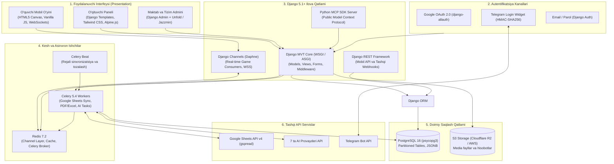
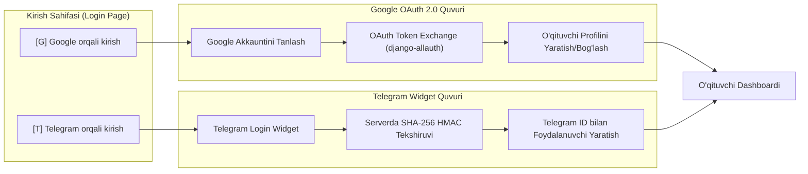
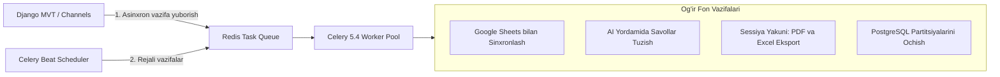

# EduSelf Teacher — Texnologik Stak Spetsifikatsiyasi (TECH_STACK.md)

**Hujjat versiyasi:** 1.0.0  
**Sana:** 14-oktabr 2026  
**Holati:** Approved Technology Stack Specification  
**Asosiy arxitektura tamoyili:** Django MVT (Model-View-Template) + Django Channels (ASGI/WebSockets)  
**Asosiy hujjatlar:** [.docs/PRD.md](file:///c:/Users/Asus/Desktop/teacher-eduself-mcp/.docs/PRD.md), [.docs/SRS.md](file:///c:/Users/Asus/Desktop/teacher-eduself-mcp/.docs/SRS.md), [.docs/Architecture.md](file:///c:/Users/Asus/Desktop/teacher-eduself-mcp/.docs/Architecture.md) va [.docs/ADR.md](file:///c:/Users/Asus/Desktop/teacher-eduself-mcp/.docs/ADR.md)

---

## 1. Kirish va Texnologik Falsafa

Ushbu hujjat **EduSelf Teacher** platformasini ishlab chiqishda qo'llaniladigan barcha texnologiyalar, dasturiy freymvorklar, ma'lumotlar bazalari, autentifikatsiya vositalari hamda ularni tanlashning texnik va biznes asoslarini belgilab beradi.

### 1.1 Asosiy Texnologik Ustunlar
- **Monolitning Kuchliligi va Xavfsizligi:** Django 5.1+ MVT tamoyili asosida tezkor ishlab chiqish, o'rnatilgan kuchli xavfsizlik (CSRF, XSS, SQL Injection himoyasi) va boy ma'muriy boshqaruv (Django Admin).
- **Gibrid Real-Time Arxitektura:** Oddiy sahifalar uchun qulay server-side render (Django MVT), 200 ta o'quvchining jonli o'yini uchun esa **Django Channels (ASGI / WebSockets)**.
- **Tezkor va Parolsiz Kirish:** O'zbekiston va xalqaro o'qituvchilar uchun **Google OAuth 2.0** va **Telegram Login Widget** orqali 1 marta bosishda autentifikatsiya.
- **Tashqi Ma'lumotlar Sinxronizatsiyasi:** O'qituvchilarning eng sevimli vositasi bo'lgan **Google Sheets** bilan bazaning ikki tomonlama integratsiyasi (savollarni import qilish va o'quvchilar baholarini jadvalga avtomatik yozib borish).

---

## 2. Umumiy Texnologik Topologiya



---

## 3. Backend Freymvork Qatlami (Django MVT + Channels)

### 3.1 Nima uchun Django 5.1+ MVT?
1. **Tezkor Rivojlanish (Batteries-Included):** Foydalanuvchilar autentifikatsiyasi, sessiyalar, xavfsizlik tokenlari, ma'lumotlar migratsiyasi (Django Migrations) va kuchli Admin panel tayyor holda keladi.
2. **Keng Kamchiliksiz Xavfsizlik:** CSRF hujumlari, Clickjacking, XSS va SQL Injection'ga qarshi sanoatdagi eng mustahkam himoyaga ega.
3. **ORM va Relyatsion Kuch:** Murakkab savollar iyerarxiyasi, versiyalar tarixi va tashkilotlar boshqaruvi Django ORM orqali oson boshqariladi.

### 3.2 Django Channels (Daphne / ASGI) Real-Time Mexanizmi
Dars jarayonidagi 200 ta ishtirokchining millisekundlik o'yinlarini an'anaviy sinxron WSGI orqali boshqarib bo'lmaydi. Shuning uchun loyihada **Django Channels** qo'llaniladi:
- **Daphne ASGI Serveri:** HTTP va WebSocket trafigini qabul qiladi.
- **Channels Consumers:** Har bir xona uchun `GameSessionConsumer` asinxron ishlaydi (`AsyncJsonWebsocketConsumer`).
- **`channels_redis`:** Barcha serverlararo xabarlarni Redis Channel Layer orqali tarqatadi.

```python
# Real-Time WebSocket Consumer namunasi (Dars o'yini uchun)
from channels.generic.websocket import AsyncJsonWebsocketConsumer

class ClassroomGameConsumer(AsyncJsonWebsocketConsumer):
    async def connect(self):
        self.room_code = self.scope['url_route']['kwargs']['room_code']
        self.room_group_name = f"classroom_{self.room_code}"

        # Xona guruhiga ulanish
        await self.channel_layer.group_add(self.room_group_name, self.channel_name)
        await self.accept()

    async def disconnect(self, close_code):
        await self.channel_layer.group_discard(self.room_group_name, self.channel_name)

    async def receive_json(self, content):
        action = content.get('action')
        if action == 'answer.submit':
            # Javobni tekshirish va ACK qaytarish (<300ms)
            await self.handle_answer_submit(content)
```

---

## 4. Autentifikatsiya va Identifikatsiya (Google & Telegram Auth)

Platformada o'qituvchilarning tezkor ro'yxatdan o'tishi va tizimga kirishi uchun ikkita asosiy ijtimoiy kanal tanlandi:



### 4.1 Google OAuth 2.0 (`django-allauth`)
- **Maqsadi:** Maktab o'qituvchilari va Google Workspace for Education hisoblariga ega foydalanuvchilar uchun yagona kirish (SSO).
- **Afzalligi:** O'qituvchining ismi, rasmiy emaili va avatari to'g'ridan-to'g'ri olinadi. Keyingi bosqichda Google Classroom va Google Drive bilan bog'lanish osonlashadi.

### 4.2 Telegram Login Widget (`django-telegram-login`)
- **Maqsadi:** O'zbekistondagi o'qituvchilarning 90% dan ortig'i Telegram platformasidan faol foydalanadi. Parol eslab qolmasdan, bir marta bosish orqali kirish eng qulay UX hisoblanadi.
- **Xavfsizlik Kafolati (HMAC-SHA256):**
  Telegram tomonidan qaytarilgan ma'lumotlar (`id`, `first_name`, `username`, `auth_date`, `hash`) serverda **Telegram Bot Token** asosida tekshiriladi:

```python
# Telegram ma'lumotlarining haqiqiyligini tekshirish funksiyasi
import hashlib
import hmac
import time

def verify_telegram_authentication(data_dict: dict, bot_token: str) -> bool:
    check_hash = data_dict.get('hash')
    if not check_hash:
        return False

    # auth_date 24 soatdan oshmaganligini tekshirish
    auth_date = int(data_dict.get('auth_date', 0))
    if time.time() - auth_date > 86400:
        return False

    # Ma'lumotlarni alfavit tartibida string holatiga keltirish
    data_check_arr = [f"{k}={v}" for k, v in sorted(data_dict.items()) if k != 'hash']
    data_check_string = "\n".join(data_check_arr)

    # SHA256 orqali maxfiy kalit hosil qilish
    secret_key = hashlib.sha256(bot_token.encode()).digest()
    calculated_hash = hmac.new(secret_key, data_check_string.encode(), hashlib.sha256).hexdigest()

    return hmac.compare_digest(calculated_hash, check_hash)
```

---

## 5. Ma'lumotlar Bazasi va Kesh Qatlami (PostgreSQL & Redis)

### 5.1 PostgreSQL 16 (psycopg3)
- **Nima uchun tanlandi?** Kuchli ACID tranzaksiyalari, JSONB maydonlar orqali 29 xil savol strukturalarini erkin saqlash, va millionlab o'quvchi javoblarini oylar bo'yicha ajratuvchi **Declarative Range Partitioning** qo'llab-quvvatlanishi.
- **Drayver:** `psycopg3` (PostgreSQL uchun eng zamonaviy, to'liq asinxron Python drayveri).

### 5.2 Redis 7.2
- **django-redis:** Django kesh mexanizmi (baza so'rovlarini 80% tejaydi).
- **channels-redis:** Django Channels WebSocket xabarlarini serverlararo uzatish shinasi.
- **Celery Broker:** Asinxron vazifalar navbati va natijalar ombori.
- **Ephemeral State:** Xona kodlari, o'quvchilar ulanishi (presence) va jonli reyting (Sorted Sets).

---

## 6. Asinxron Vazifalar va Rejali Jarayonlar (Celery & Celery Beat)

Dars paytida o'qituvchi yoki o'quvchi interfeysi aslo qotmasligi (bloklanmasligi) uchun barcha og'ir amallar Celery ishchilariga topshiriladi:



- **`high_priority` navbati:** Real-time o'yin javoblarini bazaga blok tarzda yozish (Batch DB write).
- **`sync_sheets` navbati:** Google Sheets API bilan o'zaro ma'lumot almashish.
- **`ai_tasks` navbati:** 7 ta AI provayderidan yangi viktorina draftlarini generatsiya qilish.
- **`celery-beat`:** Har oyning 28-sanasida keyingi oy uchun PostgreSQL partitsiyalarini avtomatik yaratish va 30 kundan oshgan kesh fayllarni tozalash.

---

## 7. Google Sheets Ikki Tomonlama Sinxronizatsiyasi (gspread)

O'qituvchilar o'z kompyuterlarida yoki Google Drive'larida mavjud bo'lgan test jadvallarini dasturga qo'lda qayta terib o'tirmaydilar. Shuningdek, dars natijalari to'g'ridan-to'g'ri o'qituvchining Google Sheet jadvaliga tushadi.

```mermaid
flowchart TD
    subgraph ImportFlow["1. IMPORT OQIMI: Google Sheets -> EduSelf Database"]
        TeacherSheet["O'qituvchining Google Sheet Jadvali\n(Mavzu, Savol, A, B, C, D, To'g'ri Javob)"]
        GSpreadReader["gspread API Reader (Celery Vazifasi)"]
        DataValidator["Pydantic / Django Form Validatsiyasi"]
        SaveToDB["PostgreSQL: Quiz va Questions jadvallariga saqlash"]
        
        TeacherSheet --> GSpreadReader --> DataValidator --> SaveToDB
    end

    subgraph ExportFlow["2. LIVE SYNC / EXPORT OQIMI: EduSelf -> Google Sheets"]
        LiveGameSession["Jonli Dars Sessiyasi (200 ta o'quvchi)"]
        BatchCollector["Javoblar va Ballar Jamlagichi (Celery Worker)"]
        GSpreadWriter["gspread Batch Append Rows API"]
        TargetSheet["O'qituvchining Natijalar Jadvali (Google Sheet)"]

        LiveGameSession --> BatchCollector --> GSpreadWriter --> TargetSheet
    end
```



### 7.1 Python Integratsiya Kodi Namunasi (`gspread`)

```python
# Google Sheets bilan ikki tomonlama integratsiya xizmati
import gspread
from google.oauth2.service_account import Credentials

SCOPES = [
    'https://www.googleapis.com/auth/spreadsheets',
    'https://www.googleapis.com/auth/drive'
]

class GoogleSheetsSyncService:
    def __init__(self, service_account_info: dict):
        self.creds = Credentials.from_service_account_info(service_account_info, scopes=SCOPES)
        self.client = gspread.authorize(self.creds)

    def import_questions_from_sheet(self, spreadsheet_url: str) -> list[dict]:
        """Google Sheet jadvalidan savollarni o'qib olish"""
        sheet = self.client.open_by_url(spreadsheet_url).sheet1
        records = sheet.get_all_records()
        # records: [{'Savol': '...', 'A': '...', 'B': '...', 'Javob': 'A'}, ...]
        return records

    def export_session_results_batch(self, spreadsheet_url: str, results_data: list[list]):
        """Dars natijalarini Google Sheet'ga blok (batch) tarzda yozish"""
        sheet = self.client.open_by_url(spreadsheet_url).sheet1
        # results_data: [['Ali', 950, '10/10', '95%'], ['Vali', 820, '8/10', '82%'], ...]
        sheet.append_rows(results_data, value_input_option='USER_ENTERED')
```

> [!TIP]
> **Google API Kvotasini Saqlash (Quota Management):**
> Google Sheets API har bir foydalanuvchi uchun daqiqasiga **60 ta so'rov** limitiga ega. Har bir o'quvchi javob berganda Google Sheets'ga murojaat qilish limitni darhol to'ldiradi. Shu sababli Celery dars natijalarini to'plab, bitta `append_rows` so'rovi bilan 100-200 ta qatorni bir vaqtda yozadi (Batching).

---

## 8. Frontend va Foydalanuvchi Interfeysi Staki

- **O'qituvchi Boshqaruv Paneli:**
  - **Django Templates (HTML5) + Tailwind CSS:** Sof, toza va chiroyli dizayn tizimi.
  - **Alpine.js:** Modal oynalar, drag-and-drop savollar ro'yxati va dinamik dropdownlar uchun ultra-yengil JavaScript.
  - **Django Admin (Unfold / Jazzmin mavzusi):** Zamonaviy qora/oq rejimli, qulay boshqaruv paneli.
- **O'quvchi Mobil Interfeysi:**
  - **HTML5 Canvas & Vanilla JavaScript:** Arzon telefonlarda ham 60 FPS tezlikda ishlovchi mini-o'yinlar, katta sensor tugmalar va haptik tebranish (vibratsiya).

---

## 9. AI Gateway va Public MCP Integratsiyasi

- **Multi-Provider AI Gateway:**
  - Django servis qatlamida 7 ta provayder (OpenAI, Gemini, Claude, DeepSeek, Groq, Qwen, Grok) uchun yagona adapter.
  - API kalitlar bazada **AES-256-GCM** bilan shifrlanadi (BYOK qo'llab-quvvatlanadi).
- **Public Python MCP Server:**
  - Rasmiy Python MCP SDK orqali tashqi Claude Desktop va ChatGPT uchun Server-Sent Events (SSE) ulanishi taqdim etiladi.

---

## 10. Paketlar va Bog'liqliklar Ro'yxati (`requirements.txt`)

Loyiha uchun qat'iy versiyalangan yadroviy paketlar:

```text
# Django va Asinxron Web Freymvork
Django>=5.1,<5.2
daphne>=4.1.2
channels>=4.1.0
channels-redis>=4.2.0
djangorestframework>=3.15.2

# Autentifikatsiya (Google va Telegram)
django-allauth>=65.0.0
requests>=2.32.0

# Ma'lumotlar Bazasi va Kesh
psycopg[binary]>=3.2.0
django-redis>=5.4.0
redis>=5.0.8

# Asinxron Vazifalar (Celery)
celery>=5.4.0
django-celery-beat>=2.7.0

# Google Sheets Integratsiyasi
gspread>=6.1.2
google-api-python-client>=2.140.0
google-auth>=2.34.0

# Sun'iy Intellekt va MCP SDK
mcp>=1.0.0
openai>=1.50.0
google-genai>=0.1.0
anthropic>=0.36.0
pydantic>=2.9.2
cryptography>=43.0.1

# Foydali Utilitlar va Eksport
openpyxl>=3.1.5
weasyprint>=62.3
Pillow>=10.4.0
```

---

## 11. Texnologik Taqqoslash va Tanlov Asoslari (Trade-off Matrix)

| Talab / Komponent | Tanlangan Yechim | Nima uchun? (Afzalliklari) | Rad etilgan Alternativalar |
|---|---|---|---|
| **Yadro Freymvork** | **Django 5.1+ (MVT)** | Qulay Admin panel, o'rnatilgan kuchli ORM, yuqori xavfsizlik va tezkor MVP chiqarish. | *FastAPI:* Admin yo'q, hamma narsani noldan yozish kerak. *Node.js:* Python AI ekotizimi yo'q. |
| **Real-time Dars** | **Django Channels (ASGI)** | Django bilan 100% uyg'un, WebSockets va Redis Channel Layer bilan 10,000+ ulanishni ushlaydi. | *Socket.io:* Django bilan sinxronlash noqulay. *Polling:* Serverni ortiqcha yuklaydi. |
| **Autentifikatsiya** | **Google + Telegram Login** | O'zbekiston va xalqaro o'qituvchilar uchun parolsiz, 1 bosqichli eng qulay kirish kanallari. | *Faqat Email/SMS:* SMS qimmat, parollar esa doim esdan chiqadi. |
| **Jadvallar Sinxronlash** | **Google Sheets (`gspread`)** | O'qituvchilarning 85% dars rejasi va baholarni Google Sheets'da yuritadi. Ikki tomonlama qulay sinxronizatsiya. | *Faqat CSV yuklash:* Har safar fayl yuklab, qayta yuklash o'qituvchini charchatadi. |
| **Ma'lumotlar Bazasi** | **PostgreSQL 16** | O'quvchilar javoblarini Range Partitioning qilish imkoniyati, kuchli JSONB va ACID kafolati. | *MySQL:* JSONB imkoniyatlari kuchsiz. *MongoDB:* Tranzaksiyalar murakkab. |
| **Fon Ishchilari** | **Celery 5.4 + Redis** | Google Sheets sinxronlash, AI chaqiruvlari va hisobotlarni fonda navbat bilan xavfsiz bajaradi. | *Thread:* Xotira to'lib qulaydi. *Cron:* Haqiqiy navbatni boshqarolmaydi. |

---

## 12. Xulosa

Ushbu **TECH_STACK.md** hujjati EduSelf Teacher platformasining mustahkam, amaliy va eng muhimi **o'qituvchilar uchun eng qulay (Google va Telegram login, Google Sheets sinxronlash)** texnologik asosini yaratadi.

Django MVT va Channels uyg'unligi tufayli loyiha ham tezkor ishlab chiqiladi, ham minglab o'quvchilarning jonli dars faoliyatlarini barqaror ta'minlay oladi.
