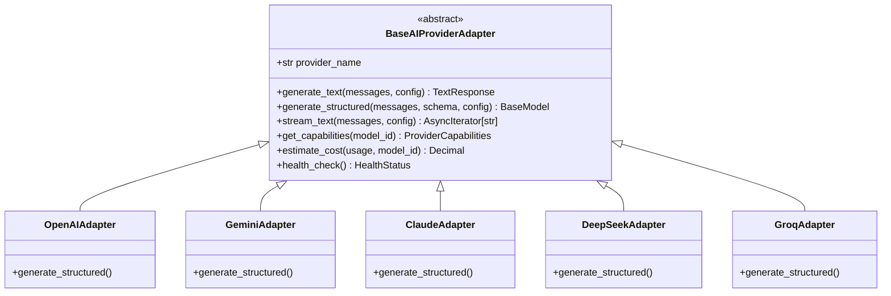
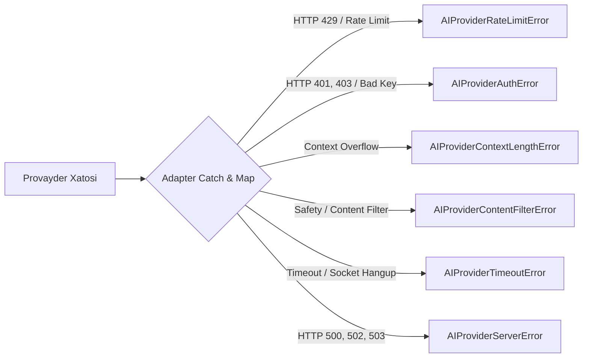

# AI Provider Adapter Contract

**Hujjat identifikatori:** DOC-68  
**Fayl nomi:** `AI_ADAPTERS.md`  
**Status:** Tasdiqlangan arxitektura spetsifikatsiyasi  
**Modul:** `apps.ai_engine.adapters`  
**Mavzu:** Barcha 7 ta provayder uchun yagona interfeys shartnomasi (Adapter Pattern), DTO tuzilmasi va xatolarni normalizatsiyalash  

---

## 1. Umumiy Ko‘rinish va Vazifasi

Platforma turli provayderlar (OpenAI, Gemini, Claude va h.k.) bilan to‘g‘ridan-to‘g‘ri gaplashmasligi uchun **Adapter Pattern** qo‘llaniladi. Har bir provayder o‘zining maxsus SDK yoki API tuzilishini yagona `BaseAIProviderAdapter` shartnomasiga moslashtiradi.



---

## 2. Asosiy Interfeys Shartnomasi (`BaseAIProviderAdapter`)

```python
from abc import ABC, abstractmethod
from typing import AsyncIterator, Type, TypeVar, Optional
from decimal import Decimal
from pydantic import BaseModel
from dataclasses import dataclass

T = TypeVar("T", bound=BaseModel)

@dataclass
class ModelConfig:
    temperature: float = 0.7
    max_tokens: int = 4096
    top_p: float = 0.95
    timeout_seconds: float = 30.0
    api_key_override: Optional[str] = None  # BYOK uchun

@dataclass
class TokenUsage:
    prompt_tokens: int
    completion_tokens: int
    total_tokens: int
    cached_tokens: int = 0

@dataclass
class TextResponse:
    content: str
    finish_reason: str
    usage: TokenUsage
    latency_ms: int

@dataclass
class ProviderCapabilities:
    supports_structured_outputs: bool
    supports_tools: bool
    supports_streaming: bool
    supports_vision: bool
    max_context_window: int

class BaseAIProviderAdapter(ABC):
    provider_name: str

    @abstractmethod
    async def generate_text(
        self, messages: list[dict], config: ModelConfig
    ) -> TextResponse:
        """Oddiy matnli suhbat yoki tushuntirish uchun"""
        pass

    @abstractmethod
    async def generate_structured(
        self, messages: list[dict], schema: Type[T], config: ModelConfig
    ) -> T:
        """Qat'iy Pydantic JSON sxemasi asosida javob olish"""
        pass

    @abstractmethod
    async def stream_text(
        self, messages: list[dict], config: ModelConfig
    ) -> AsyncIterator[str]:
        """Real-vaqtda Server-Sent Events (SSE) uchun token oqimi"""
        pass

    @abstractmethod
    def get_capabilities(self, model_id: str) -> ProviderCapabilities:
        """Modelning texnik imkoniyatlarini qaytarish"""
        pass

    @abstractmethod
    def estimate_cost(self, usage: TokenUsage, model_id: str) -> Decimal:
        """Tokenlar sarfini AQSH dollarida hisoblash"""
        pass

    @abstractmethod
    async def health_check(self) -> bool:
        """Provayder API faoliyatini minimal 'ping' so'rovi bilan tekshirish"""
        pass
```

---

## 3. Xatolarni Yagona Domenga Normalizatsiyalash (Exception Mapping)

Har bir provayder o‘ziga xos xatolik kodlarini (masalan, Claude `invalid_request_error`, OpenAI `rate_limit_exceeded`, Google `RESOURCE_EXHAUSTED`) qaytaradi. Adapter barcha ushbu xatolarni platformaning yagona istisnolariga aylantiradi:



### 3.1 Istisnolar Sinfining Vazifasi:
- `AIProviderRateLimitError`: Router darhol boshqa provayderga (Fallback) o‘tadi.
- `AIProviderAuthError`: Foydalanuvchiga *"API kalitingiz yaroqsiz"* xabarini chiqaradi (BYOK rejimida).
- `AIProviderContentFilterError`: Foydalanuvchiga *"Kiritilgan matn xavfsizlik qoidalariga mos kelmadi"* deb ko‘rsatiladi va qayta urinilmaydi.
- `AIProviderTimeoutError`: 1 marta qayta uriniladi, so‘ngra tezkor modelga (Groq) o‘tiladi.
