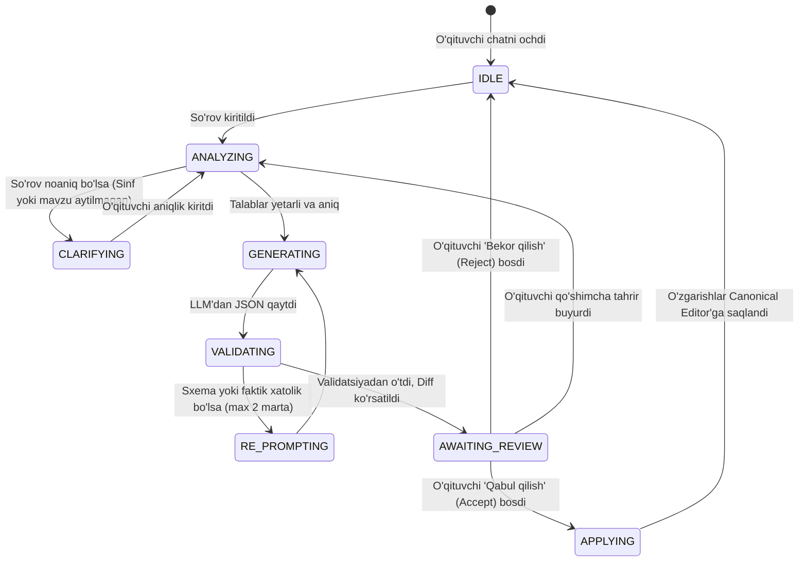
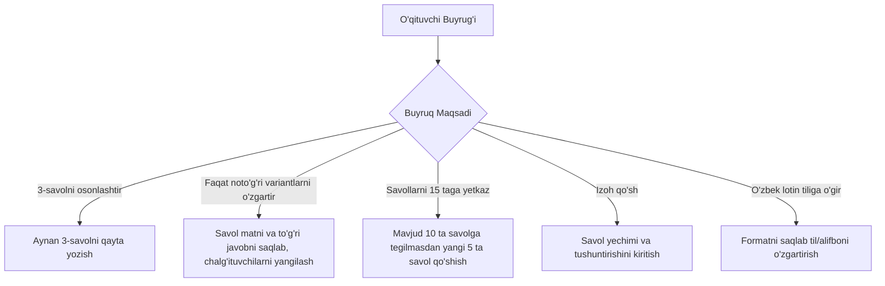

# AI Agent Specification

**Hujjat identifikatori:** DOC-66  
**Fayl nomi:** `AI_AGENT.md`  
**Status:** Tasdiqlangan arxitektura spetsifikatsiyasi  
**Modul:** `apps.ai_engine.agent`  
**Mavzu:** O‘qituvchi boshqaruv panelidagi AI agentning xulqi, muloqot mantig‘i, FSM holatlari va interaktiv tahrirlash imkoniyatlari  

---

## 1. Umumiy Ko‘rinish va Vazifasi

EduSelf AI Agenti — o‘qituvchining shaxsiy metodist-yordamchisidir. U o‘qituvchi bilan tabiiy tilda (o‘zbek, rus, ingliz) suhbatlashadi, dars talablarini tushunadi va o‘qituvchi nazorati ostida sifatli ta'lim kontentini yaratadi va tahrirlaydi.

### Asosiy Qoidalar:
1. **No Silent Overwrites:** O‘qituvchi qo‘lda kiritgan yoki tasdiqlagan savollarni AI hech qachon bildirmasdan o‘chirib yoki o‘zgartirib yubormaydi.
2. **Explicit Change Preview:** Har qanday tahrir taklifi avval vizual "Diff Preview" (eski vs yangi) ko‘rinishida o‘qituvchiga taqdim etiladi.
3. **Question Locking:** O‘qituvchi o‘zi yoqtirgan savollarni "Qulflash" (`lock`) orqali keyingi barcha generatsiyalardan himoyalay oladi.
4. **No Destructive Autonomous Actions:** Jonli sessiyani boshlash, viktorinani o‘chirish yoki talabalarga ko‘rsatish amallari faqat o‘qituvchining jismoniy tugmani bosishi orqali bajariladi.

---

## 2. Agent Finite State Machine (FSM)



### 2.1 Holatlar Spetsifikatsiyasi:
- `IDLE`: Agent buyruq kutmoqda.
- `CLARIFYING`: Agar o‘qituvchi juda qisqa so‘rov bersa (masalan: *"Test yaratib ber"*), agent birdaniga tasodifiy test yaratmaydi, balki 1–2 ta qisqa savol bilan talabni aniqlashtiradi: *"Qaysi fan, nechanchi sinf va qaysi mavzu bo‘yicha test yaratamiz?"*.
- `GENERATING`: LLM orqali savollar va javoblar strukturali generatsiya qilinmoqda (ekranda real-vaqtda progress ko‘rinadi).
- `VALIDATING`: Server Pydantic sxemasi, to‘g‘ri javob kalitlari va takroriylikni tekshirmoqda.
- `AWAITING_REVIEW`: O‘qituvchiga natijalar kartalar ko‘rinishida taqdim etilgan.
- `APPLYING`: Tasdiqlangan o‘zgarishlar PostgreSQL va xotiradagi Universal Modelga yozildi.

---

## 3. Interaktiv Tahrirlash Buyruqlari (Editing Commands)

O‘qituvchi butun testni qayta yaratmasdan, aniq savollarga yo‘naltirilgan buyruqlar berishi mumkin:



### 3.1 Qisman Generatsiya va Resurs Tejamkorligi:
Agar o‘qituvchi *"Faqat 4-savolning variantlarini o‘zgartir"* desa:
- Agent butun 10 ta savolni qayta yaratmaydi (bu token va vaqtni tejaydi).
- Prompt faqat 4-savol kontekstini o‘z ichiga oladi va faqat yangilangan variantlarni qaytaradi.

---

## 4. O‘zgarishlar Diff Ko‘rinishi (Diff & Proposal View)

O‘qituvchi ekranda o‘zgarishlarni yonma-yon (Side-by-Side) ko‘radi:

```text
+-------------------------------------------------------------------+
| 3-SAVOL: TAHRIR TAKLIFI (AI PROPOSAL)                            |
|                                                                   |
| [Eski Holat]                             [AI Taklif Qilayotgan]   |
| Savol: Kislorod qanday modda?            Savol: Kislorodning havoda |
| Variantlar:                              hajmiy ulushi qancha?     |
| A) Qattiq                                Variantlar:              |
| B) Gaz (To'g'ri)                         A) 78%                   |
| C) Suyuq                                 B) 21% (To'g'ri)          |
|                                          C) 1%                    |
| Sabab: "Oldingi savol 8-sinf uchun juda sodda edi, qiyinlashtirildi"|
|                                                                   |
|  [ ✅ Qabul qilish (Accept) ]      [ ❌ Bekor qilish (Reject) ]    |
+-------------------------------------------------------------------+
```

---

## 5. Savollarni Qulflash (Question Locking)

O‘qituvchi biron savolni qo‘lda mukammal yozgan bo‘lsa yoki AI yaratgan savol unga juda yoqqan bo‘lsa, u savol burchagidagi 🔒 **Qulflash (Lock)** tugmasini bosadi:
- `question.is_locked = True`
- Shundan so‘ng o‘qituvchi *"Butun testni takomillashtir"* yoki *"Mavzuni chuqurlashtir"* deb umumiy buyruq bersa ham, agent tizimli promptga quyidagi qoidani qo‘shadi:
  > *"DIQQAT: 1- va 5-savollar o‘qituvchi tomonidan qulflangan. Ularning matni, variantlari va tartibi qat'iy o‘zgarmasdan saqlanishi shart!"*
