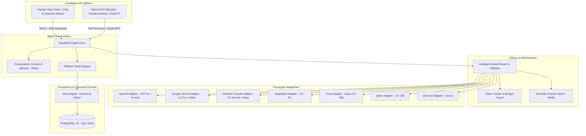
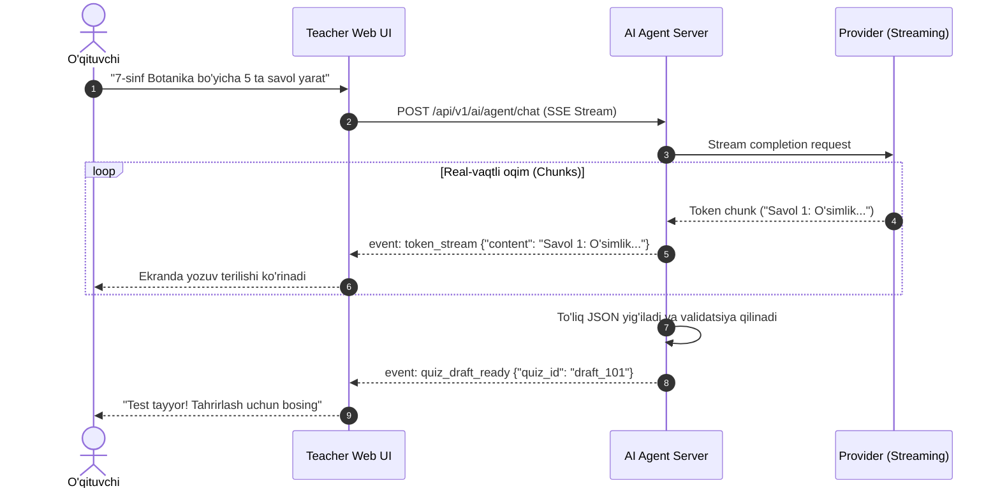

# AI Architecture Specification

**Hujjat identifikatori:** DOC-65  
**Fayl nomi:** `AI_ARCHITECTURE.md`  
**Status:** Tasdiqlangan arxitektura spetsifikatsiyasi  
**Modul:** `apps.ai_engine`  
**Mavzu:** EduSelf Teacher platformasidagi sun'iy intellekt qatlamining umumiy arxitekturasi va subsystem bog‘lanishlari  

---

## 1. Umumiy Ko‘rinish va Arxitektura Tamoyillari

EduSelf Teacher platformasida AI shunchaki tashqi chatbot emas, balki o‘qituvchining darsga tayyorgarlik ko‘rishini 10 barobar tezlashtiruvchi intellektual hamkordir.

### Asosiy Tamoyillar:
1. **Teacher-in-the-Loop:** AI taklif qiladi, yaratadi va tahrir qiladi; lekin o‘qituvchi yakuniy qarorni qabul qiladi, tasdiqlaydi yoki rad etadi.
2. **Canonical Editor Parity:** AI tomonidan generatsiya qilingan har qanday kontent (savollar, variantlar, vaqt, ballar) xuddi qo‘lda kiritilgan testlar kabi tizimning umumiy modelida (Universal Canonical Model) saqlanadi va to‘liq tahrirlanadi.
3. **Provider-Agnostic Core:** Platforma OpenAI, Google Gemini, Anthropic Claude, DeepSeek, Groq, Qwen va xAI Grok API’lariga to‘g‘ridan-to‘g‘ri qattiq bog‘lanmaydi; yagona `BaseAIProviderAdapter` abstraksiyasi orqali ishlaydi.
4. **Zero-PII Transmission:** Tashqi AI modellariga talabalarning ism-shariflari yoki shaxsiy ma'lumotlari hech qachon yuborilmaydi.

---

## 2. AI Qatlamining Yuqori Darajadagi Arxitekturasi

---

## 3. Subsystemlar va Ularning Vazifalari

### 3.1 AI Agent Core (`apps.ai_engine.agent`)
O‘qituvchi bilan tabiiy tilda suhbat olib boruvchi, suhbat kontekstini yurituvchi va o‘qituvchi so‘rovini strukturali talablarga (fan, sinf, mavzu, qiyinlik, o‘yin turi) aylantiruvchi yadro.

### 3.2 Intelligent Model Router (`apps.ai_engine.router`)
So‘rovning murakkabligiga qarab eng maqbul modelni tanlaydi:
- Tezkor va tejamkor viktorina: **Groq Llama 3.3** yoki **GPT-4o-mini**.
- Chuqur pedagogik mantiq va matematika: **Claude 3.5 Sonnet** yoki **DeepSeek-R1**.
- Katta darslik va kitoblarni tahlil qilish: **Gemini 1.5 Pro** (1M+ token kontekst).

### 3.3 Provider Gateway & Adapters (`apps.ai_engine.providers`)
Har bir tashqi AI API provayderining formatlarini yagona standartga (Normalized Request/Response) o‘tkazuvchi qatlam. Tarmoq xatolari (Rate Limit, Timeout, 5xx) yuz berganda avtomatik ravishda boshqa provayderga (Fallback) o‘tishni ta'minlaydi.

### 3.4 Validation & Guardrails Layer (`apps.ai_engine.validation`)
Model qaytargan JSON javobini Pydantic sxemalari orqali tekshirish, savollardagi faktik xatoliklarni, takroriylikni va gallyutsinatsiyalarni filtrlash.

---

## 4. Asinxron Streaming va Real-Vaqt Muloqot (SSE)

O‘qituvchi savollar yaratilayotganda 10–20 soniya bo‘sh ekranga qarab qolmasligi uchun tizim **Server-Sent Events (SSE)** orqali real-vaqtda oqimli javob beradi:

---

## 5. Sessiya Xotirasi va Kontekstni Boshqarish (Context Memory)

O‘qituvchi agent bilan ketma-ket muloqot qiladi (masalan: *"1-savolni qiyinlashtir"*, *"Endi shunga mos 2 ta ochiq savol qo‘sh"*).

- **Redis Context Store:** Suhbat tarixi Redis xotirasida `session:{session_id}:ai_history` kaliti ostida 2 soatlik TTL bilan saqlanadi.
- **Context Pruning:** Kontekst uzunligi provayder limitiga yetmasligi uchun faqat oxirgi 10 ta xabar va joriy quiz draftining ixcham DTO ko‘rinishi modelga uzatiladi.
