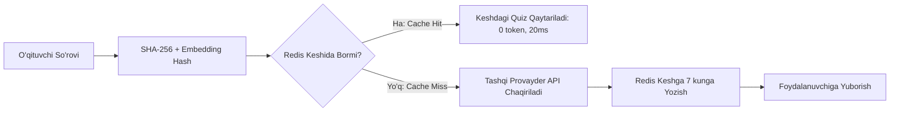
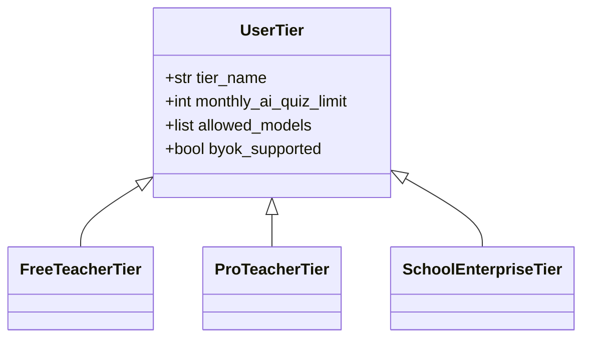

# AI Cost & Usage Policy Specification

**Hujjat identifikatori:** DOC-76  
**Fayl nomi:** `AI_COSTS.md`  
**Status:** Tasdiqlangan arxitektura spetsifikatsiyasi  
**Modul:** `apps.ai_engine.costs`  
**Mavzu:** Tokenlar hisobi, xarajatlar nazorati, tarif kvotalari va semantik prompt keshlash  

---

## 1. Umumiy Ko‘rinish va Iqtisodiy Model

Platformaning uzoq muddatli moliyaviy barqarorligi uchun AI xarajatlari qat'iy nazorat qilinishi, ortiqcha sarflarning oldi olinishi va har bir o‘qituvchi bo‘yicha aniq hisob-kitob yuritilishi shart.

### Asosiy Tamoyillar:
1. **Per-Teacher Quotas:** Har bir foydalanuvchining oylik va kunlik token chegaralari bo‘ladi.
2. **Semantic Caching:** Standart maktab mavzularidagi takroriy so‘rovlar uchun keshdan foydalaniladi (60%–80% gacha xarajat tejash).
3. **Hard Budget Guardrails:** Platforma miqyosida oylik belgilangan byudjetdan oshib ketmaslik uchun avtomatik cheklovlar mavjud.

---

## 2. Model Narxlari va Bitta Viktorina Narxi

Odatdagi 10 ta savolli viktorina yaratish uchun:
- **Input Tokens (Prompt + Darslik matni):** $\approx 1,200 - 3,000$ token
- **Output Tokens (10 ta savol JSON):** $\approx 1,500 - 2,000$ token

| Model | 1M Input Narxi | 1M Output Narxi | 10 ta Savol Narxi (O‘rtacha) |
|---|---|---|---|
| **DeepSeek-V3** | $0.14 | $0.28 | **$0.0007** (Eng arzon) |
| **OpenAI GPT-4o-mini** | $0.15 | $0.60 | **$0.0014** (Ultra tejamkor) |
| **Groq Llama 3.3 70B** | $0.59 | $0.79 | **$0.0022** (O‘ta tezkor) |
| **Claude 3.5 Haiku** | $0.80 | $4.00 | **$0.0088** |
| **OpenAI GPT-4o** | $2.50 | $10.00 | **$0.0230** |
| **Claude 3.5 Sonnet** | $3.00 | $15.00 | **$0.0340** (Yuqori mantiq) |

---

## 3. Semantik Prompt Keshlash (Semantic Prompt Caching)

O‘zbekistondagi yuzlab o‘qituvchilar bir vaqtda bir xil dars mavzularini o‘tadilar (masalan: *"7-sinf Fizika Zichlik"*).

### Natija:
- Keshdan olingan so‘rovlar uchun provayderga 0 dollar to‘lanadi.
- Javob berish tezligi 10 soniyadan **20 millisekundga** tushadi.

---

## 4. Foydalanuvchi Kvotalari va Tarif Rejalari

1. **Free Teacher (Bepul O‘qituvchi):**
   - Oyiga 30 ta AI viktorina yaratish imkoniyati.
   - Faqat tejamkor modellar: GPT-4o-mini, DeepSeek-V3, Groq Llama 3.3.
2. **Pro Teacher (Professional):**
   - Oyiga 300 ta AI viktorina.
   - Barcha premium modellar (Claude 3.5 Sonnet, GPT-4o).
3. **School / Enterprise & BYOK:**
   - Cheklanmagan generatsiya (maktab shartnomasi yoki o‘zining shaxsiy API kalitlari orqali).

---

## 5. Xarajatlar Xavfsizligi va Haddan Tashqari Sarf Himoyasi (Budget Guardrails)

- **Har Kunlik Limit (Daily Spending Cap):** Platforma kunlik $50 dan ortiq umumiy sarf qilsa, ma'murlar Telegram/Slack bot orqali ogohlantiriladi.
- **Favqulodda O‘chirgich (Emergency Kill Switch):** Oylik byudjetning 90% qismi sarflansa, bepul tariflar vaqtincha faqat kesh va mahalliy arzon modellarga o‘tkaziladi.
