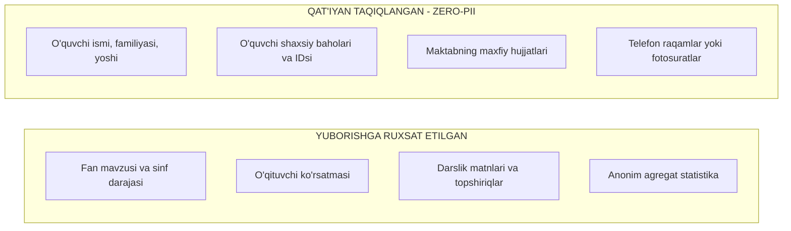

# AI Data Handling Policy Specification

**Hujjat identifikatori:** DOC-78  
**Fayl nomi:** `AI_DATA_HANDLING.md`  
**Status:** Tasdiqlangan arxitektura spetsifikatsiyasi  
**Modul:** `apps.ai_engine.compliance`  
**Mavzu:** Tashqi AI modellariga yuboriladigan ma’lumotlar, Zero-PII qoidasi, bolalar ma'lumotlari xavfsizligi va model o‘qitilishini rad etish  

---

## 1. Umumiy Ko‘rinish va Bolalar Ma'lumotlari Xavfsizligi (COPPA / GDPR / FERPA)

EduSelf Teacher platformasi maktab o‘quvchilari bilan ishlagani sababli, ma'lumotlar maxfiyligi eng yuqori darajadagi axloqiy va qonuniy majburiyat hisoblanadi.

### Asosiy Standartlar:
1. **Zero-PII Siyosati (Personally Identifiable Information):** O‘quvchilarning shaxsiy ma'lumotlari tashqi sun'iy intellekt modellariga **umuman yuborilmaydi**.
2. **Model Training Opt-Out:** Tashqi provayderlar (OpenAI, Anthropic, Google) bilan ma'lumotlarni o‘z modellarini qayta o‘qitish uchun ishlatmaslik (Zero Data Retention) shartnomasi asosida ishlanadi.
3. **Faqat Pedagogik Kontekst:** AI faqat o‘quv dasturi, fan mavzulari va savollar matni bilan ishlaydi.

---

## 2. Tashqi Modellarga Nimalar Yuboriladi va Nimalar Taqiqlanadi?



### 2.1 Aniq Misol:
- **Taqiqlangan so‘rov:** *"Jasur 3-savolga noto‘g‘ri javob berdi, unga qanday yordam bersak bo‘ladi?"*
- **Ruxsat etilgan so‘rov (Sanitizatsiya qilingan):** *"Sinfdagi o‘quvchilarning 40% qismi kinetik energiya formulasida adashdi. Ushbu mavzuni mustahkamlash uchun 2 ta tushuntirish va mashq tavsiya qil."*

---

## 3. Shaxsiy Ma'lumotlarni Filtrlash Qatlami (PII Scrubber)

O‘qituvchi bexosdan prompt ichiga yoki yuklangan faylga talabaning ism-sharifini yozib yuborsa ham, tizim uni tashqi modelga uzatishdan oldin **avtomatik tozalaydi (PII Scrubbing)**:

```mermaid
flowchart TD
    TeacherPrompt[O'qituvchi Kiritmasi] --> Scrubber[PII Scrubber Dvigateli]
    Scrubber --> RegexRule[Ism, Telefon, Email, Pasport Regex]
    Scrubber --> NER[Mahalliy Named Entity Recognition - Spacy]
    
    RegexRule --> Mask[Shaxsiy Ma'lumotlarni [TALABA_1] deb Niqoblash]
    NER --> Mask
    
    Mask --> SafePrompt[Tozalangan Xavfsiz Prompt]
    SafePrompt --> LLM[Tashqi AI Provayderiga Yuborish]
```

---

## 4. Provayderlar Bilan Zero Data Retention (ZDR) Kafolati

Platforma faqat **Enterprise / Commercial API** shartnomalaridan foydalanadi:
- **OpenAI:** API orqali yuborilgan ma'lumotlar modelni qayta o‘qitish uchun ishlatilmaydi (`data retention: 0 days`).
- **Anthropic:** Tijoriy API orqali yuborilgan ma'lumotlar saqlanmaydi va treningga kiritilmaydi.
- **Google Cloud Vertex AI:** Ma'lumotlar faqat foydalanuvchining shaxsiy loyihasi doirasida qayta ishlanadi.

---

## 5. Tarmoq va Saqlash Xavfsizligi

- **In-Transit:** Barcha API aloqalari faqat **TLS 1.3** shifrlangan kanallari orqali amalga oshiriladi.
- **At-Rest:** O‘qituvchilar yuklagan barcha metodik qo‘llanmalar va darsliklar S3 xotirasida **AES-256** bilan shifrlangan holda saqlanadi.
