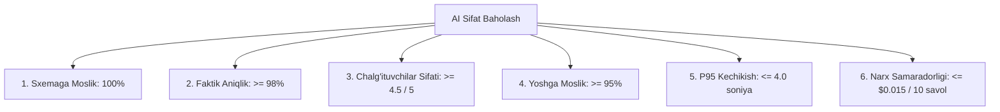

# AI Evaluation Plan Specification

**Hujjat identifikatori:** DOC-75  
**Fayl nomi:** `AI_EVALUATION.md`  
**Status:** Tasdiqlangan arxitektura spetsifikatsiyasi  
**Modul:** `apps.ai_engine.evaluation`  
**Mavzu:** AI sifatini o‘lchash, sinov to‘plamlari (Golden Dataset), LLM-as-a-judge va CI/CD regressiya testlari  

---

## 1. Umumiy Ko‘rinish va Baholash Maqsadi

AI modellari yangilanganda yoki yangi promptlar kiritilganda tizim sifati pasayib ketmasligi (Regression) uchun uzluksiz avtomatlashtirilgan sifat nazorati talab etiladi.

### Asosiy Maqsadlar:
1. **Faktik Aniqlik:** Savollar va javoblar ilmiy jihatdan xatosiz ekanligini ta'minlash.
2. **Sxemaga Moslik:** $100\%$ holatda JSON parsing xatolarisiz ishlash.
3. **Chalg‘ituvchilar Sifati:** Noto‘g‘ri variantlar yetarlicha qiyin va mantiqli ekanligini baholash.

---

## 2. Oltin Sinov To‘plami (Golden Dataset)

EduSelf platformasi tajribali o‘qituvchilar tomonidan tasdiqlangan **500 ta nazorat savollari to‘plamini** (Golden Benchmark Dataset) yuritadi:

| Fan Yo‘nalishi | Savollar Soni | Qamrab Olingan Sinflar | Asosiy Sinov Maqsadi |
|---|---|---|---|
| **Matematika & Geometriya** | 80 ta | 5–11 sinf | LaTeX formulalari, hisob-kitoblar aniqligi |
| **Fizika & Astronomiya** | 60 ta | 6–11 sinf | O‘lchov birliklari, fizik qonunlar |
| **Kimyo** | 50 ta | 7–11 sinf | Kimyoviy reaksiyalar va valentliklar |
| **Biologiya** | 50 ta | 5–11 sinf | Terminologiya va anatomiya faktlari |
| **O‘zbek tili va Adabiyot** | 80 ta | 5–11 sinf | Lotin/Kirill imlosi, she'riy vaznlar |
| **O‘zbekiston va Jahon Tarixi** | 70 ta | 5–11 sinf | Sanalar, tarixiy shaxslar va xronologiya |
| **Informatika va IT** | 60 ta | 5–11 sinf | Dasturlash algoritmlari va kod natijasi |
| **Boshlang‘ich Ta'lim** | 50 ta | 1–4 sinf | Sodda til va yoshga moslik |

---

## 3. Sifat Ko‘rsatkichlari (KPI Metrics)

Har bir yangi model yoki prompt versiyasi quyidagi ko‘rsatkichlar bo‘yicha sinovdan o‘tadi:



---

## 4. LLM-as-a-Judge Baholash Jarayoni

Avtomatlashtirilgan sifat nazorati uchun kuchli model (Claude 3.5 Sonnet yoki GPT-4o) hakam sifatida ishlatiladi:

```python
EVALUATION_JUDGE_PROMPT = """
Sen ta'lim sifati bo'yicha qat'iy nazoratchisan. Quyidagi savol va uning to'g'ri javobini bahola:

SAVOL: {prompt}
VARIANTLAR: {options}
BELGILANGAN TO'G'RI JAVOB: {correct_answer}
FAN VA SINF: {subject}, {grade_level}-sinf

QUYIDAGI MEZONLAR BO'YICHA 1 DAN 5 GACHA BALL QO'Y:
1. factual_accuracy: Savol va to'g'ri javob ilmiy jihatdan xatosizmi?
2. distractor_quality: Noto'g'ri variantlar mantiqiymi yoki darhol sezilib qoladimi?
3. age_appropriateness: Til va murakkablik ko'rsatilgan sinfga mosmi?

Javobni quyidagi JSON formatda ber:
{"factual_accuracy": 5, "distractor_quality": 4, "age_appropriateness": 5, "critique": "..."}
"""
```

---

## 5. CI/CD Regressiya Quvuri (Automated Regression Pipeline)

Har safar dasturchi promptga yoki model sozlamalariga o‘zgartirish kiritganda (`git push`):
1. GitHub Actions orqali `run_ai_eval.py` skripti ishga tushadi.
2. 50 ta savoldan iborat tezkor sinov to‘plamida test o‘tkaziladi.
3. Agar `factual_accuracy < 98%` yoki `schema_errors > 0` bo‘lsa, **Pull Request avtomatik ravishda bloklanadi**.
