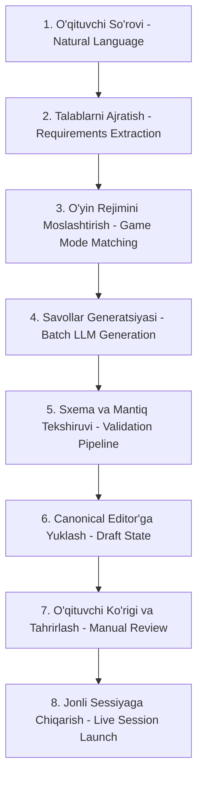

# AI Quiz Generation Specification

**Hujjat identifikatori:** DOC-73  
**Fayl nomi:** `AI_QUIZ_GENERATION.md`  
**Status:** Tasdiqlangan arxitektura spetsifikatsiyasi  
**Modul:** `apps.ai_engine.generation`  
**Mavzu:** Savollarni sun'iy intellekt orqali yaratish, tekshirish va tahrirlashning to‘liq ish oqimi (End-to-End Workflow)  

---

## 1. Umumiy Ko‘rinish va Asosiy Talab

EduSelf Teacher platformasida AI orqali test yaratish — bu bir martalik "matn generatsiya qilib berish" emas, balki bir necha bosqichli, xatolardan himoyalangan va o‘qituvchi nazoratidagi to‘liq jarayondir.

> **Kritik Qoida:** AI yaratgan savollar va inson qo‘lda kiritgan savollar bitta umumiy **Canonical Quiz Model**da saqlanadi. O‘qituvchi AI yaratgan testni qo‘lda yaratilgan test kabi xohlaganicha tahrirlay olishi shart.

---

## 2. To‘liq 8 Bosqichli Ish Oqimi (End-to-End Workflow)

### 2.1 1-Bosqich: O‘qituvchi So‘rovi (Teacher Request)
O‘qituvchi panelda erkin matnli so‘rov kiritadi:
> *"8-sinf Kimyo fanidan 'Davriy qonun va kimyoviy elementlar' mavzusida 10 ta savolli qiziqarli test tayyorla. Boss Battle rejimida o‘ynaymiz."*

### 2.2 2-Bosqich: Talablarni Ajratish (Requirements Extraction)
Agent so‘rovni tahlil qilib, parametrlar xaritasini hosil qiladi:
- `subject`: "Kimyo"
- `grade_level`: 8
- `topic`: "Davriy qonun va kimyoviy elementlar"
- `question_count`: 10
- `target_game_mode`: "boss_battle"
- `difficulty`: "medium"

*Agar sinf yoki mavzu aytilmagan bo‘lsa, agent shu zahoti o‘qituvchidan aniqlashtirish so‘raydi.*

### 2.3 3-Bosqich: O‘yin Rejimini Moslashtirish (Game Type Selection)
Agent tanlangan o‘yin rejimining (`boss_battle`) talablarini tekshiradi:
- Boss jangi uchun savollar tezkor, aniq variantli (Single Choice, True/False) bo‘lishi lozim.
- Uzoq insho yoki sekin matnli savollar bu rejimga mos emasligi haqida ogohlantiradi yoki savol formatlarini avtomatik moslashtiradi.

### 2.4 4-Bosqich: Savollar Generatsiyasi (Question Generation)
Model Router orqali eng optimal model (masalan: Claude 3.5 Sonnet yoki GPT-4o) tanlanadi va Pydantic `AIGeneratedQuiz` sxemasi bilan bir vaqtda 10 ta savol generatsiya qilinadi.

### 2.5 5-Bosqich: Sxema va Mantiqiy Validatsiya (Validation Pipeline)
Qaytgan JSON zudlik bilan avtomatik tekshiruvdan o‘tadi:
- 10 ta savolning barchasida to‘g‘ri javob kaliti bormi?
- Variantlar orasida takrorlanishlar bormi?
- Formulalar LaTeX formatidami?
*Agar biron savolda xatolik bo‘lsa, agent faqat o‘sha savolning o‘zini modelga qayta generatsiya qildiradi.*

### 2.6 6-Bosqich: Canonical Editor'ga Joylashtirish (Draft State)
Tasdiqlangan JSON to‘g‘ridan-to‘g‘ri platformaning vizual muharririga (Canonical Quiz Editor) tushadi:
- Har bir savol alohida karta sifatida ochiladi.
- Variantlar, to‘g‘ri javob belgilari, taymer va ballar ko‘rsatiladi.

### 2.7 7-Bosqich: O‘qituvchi Ko‘rigi va Tahrirlash (Manual Review & Editing)
O‘qituvchi ekranda:
- 3-savol matnini qo‘lda o‘zgartirishi;
- 5-savolni AI yordamida osonlashtirishi;
- 2-savolni o‘chirib, o‘rniga yangi savol qo‘shishi;
- O‘ziga yoqqan savollarni qulflab (lock) qo‘yishi mumkin.

### 2.8 8-Bosqich: Tasdiqlash va Sessiya Boshlash (Live Session Launch)
O‘qituvchi "Saqlash va Boshlash" tugmasini bosgandagina quiz `published` holatiga o‘tadi, Game PIN yaratiladi va jonli dars boshlanadi.
