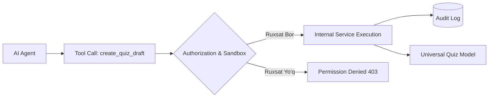

# AI Tool Calling Specification

**Hujjat identifikatori:** DOC-72  
**Fayl nomi:** `AI_TOOL_CALLING.md`  
**Status:** Tasdiqlangan arxitektura spetsifikatsiyasi  
**Modul:** `apps.ai_engine.tools`  
**Mavzu:** AI agentning platforma ichki xizmatlari va amallarini (Tool Calling / Function Calling) xavfsiz chaqirishi  

---

## 1. Umumiy Arxitektura va Xavfsizlik Qoidalari

EduSelf Teacher AI Agenti platformadagi amallarni to‘g‘ridan-to‘g‘ri ma'lumotlar bazasiga SQL yozish orqali emas, balki qat'iy tekshirilgan va ruxsat berilgan **Platform Tools** (Funksiyalar) orqali bajaradi.

### Asosiy Qoidalar:
1. **O‘qish (Read-only) va O‘zgartirish (State-changing) ajratilishi:**
   - O‘qish amallari (`get_quiz`, `suggest_game_modes`) agent tomonidan erkin chaqirilishi mumkin.
   - O‘zgartirish amallari (`apply_changes`, `prepare_live_session`) faqat draft holatida tayyorlanadi va o‘qituvchi tasdig‘i bilan kuchga kiradi.
2. **Server-Side Authorization:** Har bir tool chaqirilganda foydalanuvchining IDsi (`teacher_id`) va uning ruxsati (RBAC) serverda tekshiriladi. Agent boshqa o‘qituvchining testiga daxl qila olmaydi.
3. **Audit Logging:** Har bir tool chaqiruvi, uning argumentlari va qaytargan natijasi `ai_tool_audit_logs` jadvaliga yozib boriladi.



---

## 2. Asosiy Platforma Toollari Katalogi

### 2.1 `get_quiz_requirements`
- **Tavsifi:** O‘qituvchining tabiiy til so‘rovidan tuzilmani ajratadi.
- **Parametrlari:** `prompt: str`
- **Natija:**
  ```json
  {
    "subject": "Fizika",
    "grade_level": 8,
    "topic": "Nyuton qonunlari",
    "question_count": 10,
    "difficulty": "medium",
    "target_game_mode": "boss_battle"
  }
  ```

---

### 2.2 `suggest_game_modes`
- **Tavsifi:** Dars maqsadi, o‘quvchilar soni va vaqt chegarasiga qarab eng mos o‘yin rejimlarini tavsiya etadi.
- **Parametrlari:** `student_count: int, duration_minutes: int, learning_goal: str`
- **Natija:** Tavsiya etilgan 2–3 ta rejim (masalan: *Team Battle*, *Accuracy Master*, *Word Cloud*).

---

### 2.3 `create_quiz_draft`
- **Tavsifi:** Yangi test draftini xotirada yaratadi.
- **Parametrlari:** `spec: AIGeneratedQuiz`
- **Natija:** `draft_id: str, status: "draft"`

---

### 2.4 `revise_question`
- **Tavsifi:** Belgilangan savolni ko‘rsatilgan ko‘rsatma bo‘yicha qayta yozadi.
- **Parametrlari:** `quiz_id: str, question_index: int, instruction: str`
- **Natija:** `AIQuestionRevisionProposal` (Diff ko‘rinishida).

---

### 2.5 `validate_quiz_content`
- **Tavsifi:** Test savollarini mantiqiy va pedagogik xatoliklarga tekshiradi.
- **Parametrlari:** `quiz_id: str`
- **Natija:** Xatolar ro‘yxati yoki muvaffaqiyat hisoboti.

---

### 2.6 `prepare_live_session` (Destructive/Critical Hint)
- **Tavsifi:** Jonli sessiya uchun xona yaratadi, lekin o‘yinni boshlamaydi.
- **Parametrlari:** `quiz_id: str, mode: str`
- **Kafolat:** O‘qituvchi ekranda tasdiqlash tugmasini bosmaguncha o‘quvchilar xonaga qo‘yilmaydi.

---

## 3. Tool Calling JSON Spetsifikatsiyasi (OpenAI & Anthropic Format)

Modellarga uzatiladigan tool deklaratsiyasi:

```json
{
  "type": "function",
  "function": {
    "name": "create_quiz_draft",
    "description": "Yangi viktorina draftini yaratish va xotiraga joylashtirish",
    "parameters": {
      "type": "object",
      "required": ["title", "subject", "grade_level", "questions"],
      "properties": {
        "title": { "type": "string" },
        "subject": { "type": "string" },
        "grade_level": { "type": "integer", "minimum": 1, "maximum": 11 },
        "questions": {
          "type": "array",
          "items": { "$ref": "#/definitions/AIGeneratedQuestion" }
        }
      }
    }
  }
}
```
