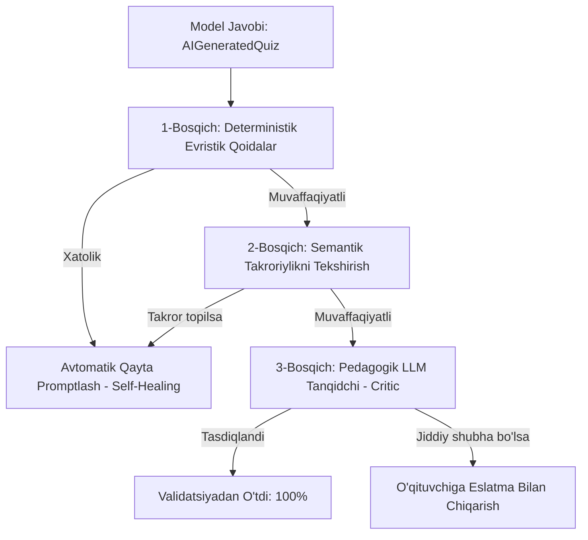

# AI Content Validation Specification

**Hujjat identifikatori:** DOC-74  
**Fayl nomi:** `AI_VALIDATION.md`  
**Status:** Tasdiqlangan arxitektura spetsifikatsiyasi  
**Modul:** `apps.ai_engine.validation`  
**Mavzu:** AI yaratgan savollardagi faktik, mantiqiy va grammatik xatoliklarni, noaniqlik va takroriylikni ko‘p bosqichli aniqlash  

---

## 1. Umumiy Ko‘rinish va Maqsad

AI modellari ba'zan ishonch bilan noto‘g‘ri javob belgilashi (gallyutsinatsiya), ikkita bir xil variant berishi yoki noaniq savol tuzishi mumkin. 

EduSelf Content Validation dvigateli modeldan chiqqan har bir savolni o‘qituvchiga yetib bormasidanoq **3 bosqichli filtr** orqali tekshiradi va xatolarni avtomatik tuzatadi (Self-Healing).

---

## 2. 1-Bosqich: Deterministik Evristik Qoidalar (Deterministic Heuristics)

Ushbu bosqich millisekundlarda ishlaydi va qat'iy dasturiy qoidalar bilan tekshiradi:

1. **Answer Key Integrity:** `correct_answer` identifikatori `options` ro‘yxatida mavjud bo‘lishi shart.
2. **Duplicate Options:** Bitta savol ichida ikkita bir xil variant matni bo‘lmasligi shart (masalan: Variant A: *"Toshkent"*, Variant C: *"Toshkent"* bo‘lib qolsa, xatolik qaytariladi).
3. **Forbidden Answer Patterns:** Taqiqlangan iboralar filtri:
   - *"Barchasi to‘g‘ri"*
   - *"Yuqoridagilarning barchasi"*
   - *"Hech biri to‘g‘ri emas"*
   - *"A va B javoblar"*
   *(Bunday iboralar variantlar aralashtirilganda (Shuffle) mantiqsizlikka olib keladi).*
4. **Length Bias (Uzunlik nomutanosibligi):** Agar to‘g‘ri variant qolgan barcha variantlardan 3 barobar uzunroq bo‘lsa, model to‘g‘ri javobni ataylab tushuntirib qo‘ygan deb baholanadi va variantlar qayta muvozanatlashtiriladi.

---

## 3. 2-Bosqich: Semantik Takroriylikni Aniqlash (Duplicate Detection)

Bitta 10 ta savolli viktorinada 2 ta savol mohiyatan bir xil narsani so‘rab qo‘ymasligi kerak.

- **Kichik Leksik O‘xshashlik:** Levenshtein masofasi orqali savollar matni taqqoslanadi.
- **Vektorli Semantik O‘xshashlik:** Har bir savol matni tezkor embedding modeliga (`text-embedding-3-small` yoki mahalliy model) yuboriladi:
  $$\text{CosineSimilarity}(\vec{Q}_i, \vec{Q}_j) \ge 0.88$$
  Agar o‘xshashlik $0.88$ dan yuqori bo‘lsa, bu deyarli bir xil savol hisoblanadi va $Q_j$ boshqa yangi savol bilan almashtiriladi.

---

## 4. 3-Bosqich: Pedagogik LLM Tanqidchi (Critic & Ambiguity Check)

Murakkab fanlarda (fizika, biologiya, kimyo) ikkinchi yengil model (LLM Critic) hakamlik qiladi:
- *"Savolda 2 ta to‘g‘ri javob bo‘lib qolish ehtimoli bormi?"*
- *"Savol matnida ilmiy jihatdan eskirgan yoki bahsli fakt bormi?"*

Agar model savolning to‘g‘riligiga 100% ishonmasa, o‘qituvchi ekranida maxsus sariq ogohlantirish belgisi (⚠️ **Diqqat: Ko‘rib chiqing**) bilan ko‘rsatiladi.

---

## 5. Avtomatik O‘zini Qayta Tuzatish (Self-Healing Loop)

Agar 1 yoki 2-bosqichda xatolik aniqlansa:
1. Agent butun testni qayta boshlamaydi.
2. Faqat xatosi bor savol uchun modelga zudlik bilan qayta so‘rov jo‘natadi:
   > *"XATOLIK: 4-savolda A va C variantlari bir xil bo'lib qoldi. Ushbu 4-savolning variantlarini qayta generatsiya qil."*
3. Qayta urinishlar soni ko‘pi bilan 2 marta bo‘ladi. Agar 2-urinishda ham tuzalmasa, tizim savolni tahrirlash uchun o‘qituvchiga havola qiladi.
