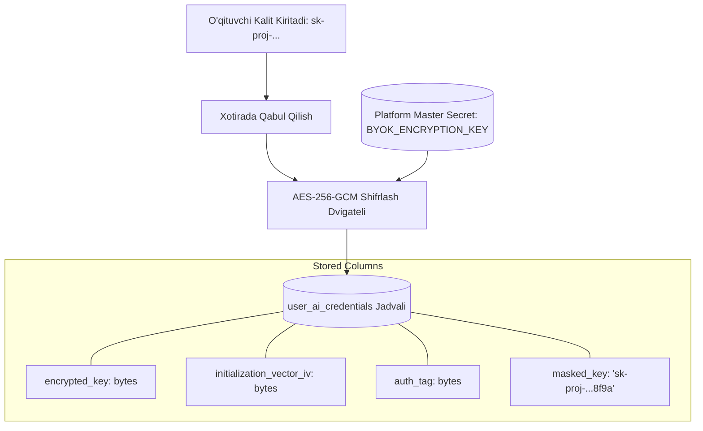
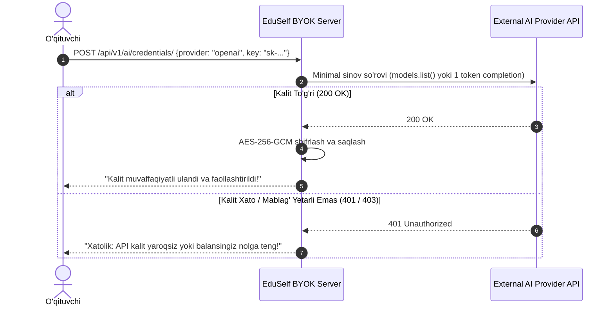

# BYOK (Bring Your Own Key) Specification

**Hujjat identifikatori:** DOC-77  
**Fayl nomi:** `BYOK.md`  
**Status:** Tasdiqlangan arxitektura spetsifikatsiyasi  
**Modul:** `apps.ai_engine.byok`  
**Mavzu:** Foydalanuvchilar va maktablarning o‘z shaxsiy API kalitlarini ulashi, AES-256-GCM shifrlash va xavfsiz boshqaruv  

---

## 1. Umumiy Ko‘rinish va Maqsad

BYOK (Bring Your Own Key) imkoniyati maktablar, universitetlar yoki faol o‘qituvchilarga o‘zlarining shaxsiy OpenAI, Anthropic, Google Gemini yoki boshqa provayder API kalitlarini platformaga ulash imkonini beradi.

### Asosiy Afzalliklari:
1. **Cheklovlarsiz Ishlash:** Foydalanuvchi EduSelf’ning oylik generatsiya kvotalariga bog‘lanib qolmaydi.
2. **To‘g‘ridan-to‘g‘ri Hisob-Kitob:** Tokenlar xarajati to‘g‘ridan-to‘g‘ri foydalanuvchining o‘z provayder hisobidan yechiladi.
3. **Maxsus Modellar Ruxsati:** Foydalanuvchi o‘z hisobidagi eng so‘nggi yoki nozik sozlangan (fine-tuned) modellardan foydalanishi mumkin.

---

## 2. Kalitlarni Shifrlash va Saqlash Arxitekturasi

Foydalanuvchi API kalitlari ma'lumotlar bazasida **hech qachon ochiq matn (plain-text) ko‘rinishida saqlanmaydi**.

### 2.1 Ma'lumotlar Bazasi Sxemasi (`user_ai_credentials`):
- `id` (UUIDv4): Yozuv identifikatori.
- `user_id` (UUIDv4): Qaysi o‘qituvchiga tegishliligi (Foreign Key).
- `provider` (Enum): `openai`, `gemini`, `claude`, `deepseek`, `groq`, `qwen`, `grok`.
- `encrypted_key` (Binary): Shifrlangan kalit.
- `iv` (Binary): Har bir kalit uchun alohida 12 baytlik Initialization Vector.
- `auth_tag` (Binary): GCM yaxlitlik tegi (tamper-proof).
- `masked_key` (String): Faqat frontendda ko‘rsatish uchun xavfsiz niqob: `sk-proj-...3a1b`.
- `is_valid` (Boolean): Kalit faol va ishlayotganligi.
- `created_at`, `last_used_at` (Timestamps).

---

## 3. Kalitni Saqlashda Darhol Tekshirish (Validation Handshake)

O‘qituvchi kalitni kiritib "Saqlash" tugmasini bosganida, server uni bazaga yozishdan oldin **minimal 1 tokenlik sinov so‘rovi** (Dry-run Ping) orqali tekshiradi:

---

## 4. Xotirada Kalitni Dekriptlash va Zero-Leakage Kafolati

1. **Jarayon Tugagach Tozalash:** Kalit faqat bitta asinxron so‘rov bajarilayotgan bir necha soniyada xotirada dekriptlanadi va so‘rov tugashi bilan `del key` va Python Garbage Collector orqali tozalanadi.
2. **Loglardan Qat'iy Himoya:** Tizim loglarida, Sentry xatolik hisobotlarida yoki audit jadvallarida API kalitlar avtomatik ravishda `[REDACTED]` belgisi bilan niqoblanadi.
3. **Frontend Xavfsizligi:** O‘qituvchi o‘z sozlamalar paneliga kirganida ham kalitining to‘liq matnini ko‘ra olmaydi (faqat `sk-proj-...4a1b` va "O‘chirish" tugmasi chiqadi).
