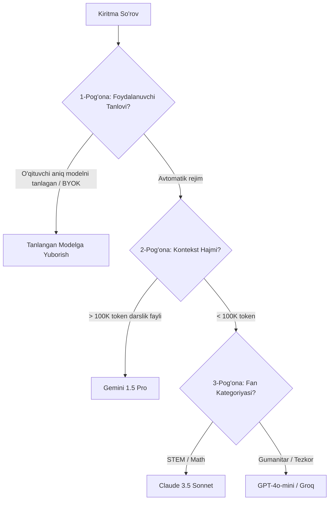
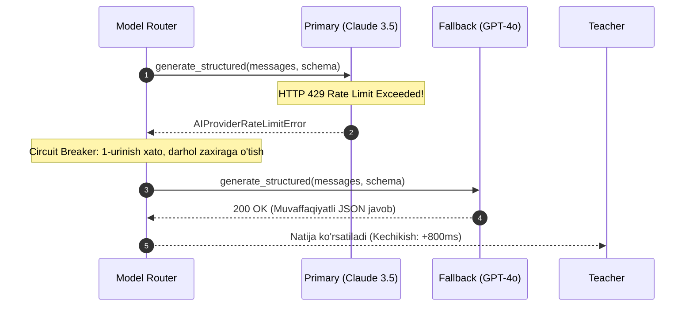

# Model Routing Policy Specification

**Hujjat identifikatori:** DOC-69  
**Fayl nomi:** `MODEL_ROUTING.md`  
**Status:** Tasdiqlangan arxitektura spetsifikatsiyasi  
**Modul:** `apps.ai_engine.router`  
**Mavzu:** Vazifa murakkabligi, narx va tezlik bo‘yicha intellektual model tanlash, yuklamani taqsimlash va avtomatik zaxira (Fallback) zanjiri  

---

## 1. Umumiy Maqsad va Tamoyillar

Har qanday so‘rov uchun bitta qimmat modelni (masalan, faqat GPT-4o) ishlatish iqtisodiy jihatdan samarasizdir. Shuningdek, bitta arzon model (masalan, 8B model) murakkab fizika yoki algebra formulalarini to‘g‘ri tuza olmaydi.

**Model Routing Engine** har bir o‘qituvchi so‘rovini tahlil qilib, uni eng mos, eng tez va eng arzon modelga yo‘naltiradi.

---

## 2. Vazifalar Bo‘yicha Marshrutlash Matritsasi (Routing Matrix)

```mermaid
flowchart TD
    Request[O'qituvchi So'rovi] --> Classifier{So'rov Turi va Murakkabligi}

    Classifier -->|Katta Fayl / Darslik Kitob (PDF/DOCX > 10MB)| Gemini[Google Gemini 1.5 Pro - 1M Context]
    Classifier -->|Murakkab Matematika, Fizika, Kodlash| Claude[Claude 3.5 Sonnet / DeepSeek-R1]
    Classifier -->|Ona tili, Adabiyot, Milliy Tarix| Qwen[Qwen 2.5 72B / GPT-4o]
    Classifier -->|Tezkor 5-10 ta test (Jonli dars paytida)| Groq[Groq Llama 3.3 70B - Sub-second]
    Classifier -->|Standart Viktorina / Umumiy Fanlar| GPTMini[OpenAI GPT-4o-mini - Tejamkor]
```

### 2.1 Qoidalar Jadvali:

| Vazifa Turi | Birlamchi Model (Primary) | 1-Zaxira (Fallback 1) | 2-Zaxira (Fallback 2) | Tanlash Sababi |
|---|---|---|---|---|
| **Katta darslikdan test tuzish** | Gemini 1.5 Pro | Claude 3.5 Sonnet | GPT-4o | 1M+ tokenli ulkan kontekst oynasi |
| **Matematika va STEM** | Claude 3.5 Sonnet | DeepSeek-R1 | GPT-4o | Yuqori mantiqiy reasoning va formulalar aniqligi |
| **Dasturlash / IT savollari** | Claude 3.5 Sonnet | DeepSeek-V3 | GPT-4o | To‘g‘ri sintaksis va debugging tahlili |
| **Ona tili va grammatika** | Qwen-2.5-72B | GPT-4o | Claude 3.5 Sonnet | O‘zbek lotin va kirill yozuvidagi yuqori leksik aniqlik |
| **Tezkor dars o‘rtasidagi test** | Groq Llama 3.3 | GPT-4o-mini | DeepSeek-V3 | 300+ token/sekund tezlik (kechikish < 1s) |
| **Standart dars viktorinasi** | GPT-4o-mini | DeepSeek-V3 | Groq Llama 3.3 | Arzon narx va barqaror format |

---

## 3. Uch Pog‘onali Marshrutlash Ierarxiyasi



1. **1-Pog‘ona (User Override / BYOK):** Agar o‘qituvchi o‘zining shaxsiy API kalitini ulagan bo‘lsa va aniq *"Faqat Claude 3.5 ishlatilsin"* deb belgilagan bo‘lsa, routing tizimi uning tanloviga to‘sqinlik qilmaydi.
2. **2-Pog‘ona (Capability Constraint):** Agar so‘rovga 200 betlik darslik PDF fayli biriktirilgan bo‘lsa, u avtomatik ravishda faqat katta kontekstli modellarga (Gemini) yo‘naltiriladi.
3. **3-Pog‘ona (Cost-Performance Optimization):** Oddiy 5 ta savol uchun qimmat Claude Sonnet emas, arzon va tez GPT-4o-mini yoki Groq tanlanadi.

---

## 4. Zaxira Zanjiri va O‘chirgich (Fallback & Circuit Breaker)

Agar asosiy tanlangan provayderda muammo yuzaga kelsa (tarmoq uzilishi, 503 Server Error, Rate Limit 429), o‘qituvchiga xatolik ko‘rsatilmaydi; so‘rov avtomatik ravishda zaxira provayderiga o‘tadi:



### Circuit Breaker Qoidalari (Redis Asosida):
- Agar ma'lum bir provayder ketma-ket 3 marta 5xx xatolik bersa, uning holati `OPEN` (O‘chirilgan) deb belgilanadi.
- Keyingi 60 soniya davomida ushbu provayderga so‘rovlar umuman yuborilmaydi (darhol 2-provayderga o‘tadi).
- 60 soniyadan so‘ng 1 ta sinov so‘rovi (`HALF-OPEN`) yuboriladi; agar u muvaffaqiyatli o‘tsa, provayder yana asosiy oqimga qaytariladi (`CLOSED`).
