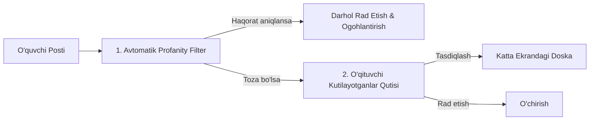
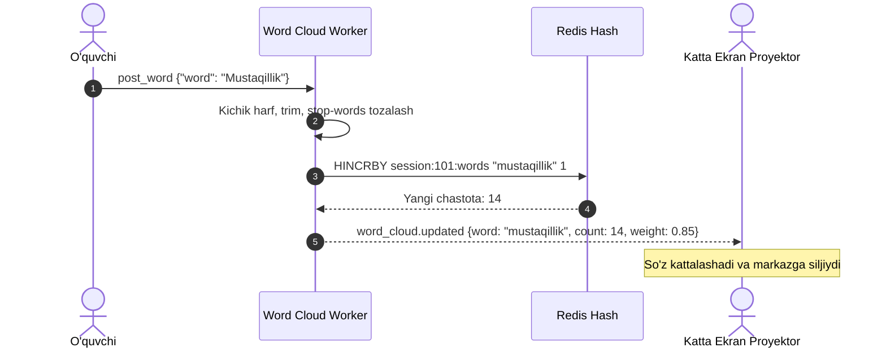

# Anonymous Activities Specification

**Hujjat identifikatori:** DOC-61  
**Fayl nomi:** `ANONYMOUS_ACTIVITIES.md`  
**Status:** Tasdiqlangan arxitektura spetsifikatsiyasi  
**Modul:** `apps.quiz_engine.activities`  
**Mavzu:** Anonim javoblar doskasi, Quick Poll, Word Cloud va AI yordamida g‘oyalarni klasterlash  

---

## 1. Umumiy Ko‘rinish va Pedagogik Maqsad

O‘quvchilar ko‘pincha sinf oldida xato qilishdan yoki o‘z shaxsiy fikrini ochiq aytishdan uyalishadi. EduSelf Teacher’ning **Anonim Faoliyatlar Moduli** (Anonymous Activities) o‘quvchilarga o‘z shaxsiyatini oshkor qilmasdan erkin fikr bildirish, sinfiy so‘rovnomalarda qatnashish va ijodiy g‘oyalar berish imkoniyatini taqdim etadi.

### Asosiy Faoliyatlar:
1. **Anonymous Answer Wall:** O‘quvchilar yuborgan matnli yoki rasmli postlar (yopishqoq qog‘ozlar) umumiy virtual doskaga tushadi.
2. **Quick Poll / Pulse Check:** 10 soniyalik tezkor ovoz berish va tushunish darajasini o‘lchash.
3. **Real-time Word Cloud:** O‘quvchilar yuborgan so‘zlardan proyektorda real-vaqtda interaktiv so‘zlar buluti hosil bo‘lishi.
4. **AI Brainstorm & Cluster:** Yuzlab tarqoq g‘oyalarni sun'iy intellekt yordamida avtomatik mavzuli guruhlarga (klasterlarga) ajratish va ovoz berish.

---

## 2. Zero-Knowledge Anonimlik Arxitekturasi

Tengdoshlar orasida to‘liq maxfiylikni ta'minlash bilan birga, maktab xavfsizligi va haqoratli so‘zlarning (cyberbullying) oldini olish uchun **Ikki Qatlamli Anonimlik (Two-Tier Anonymity)** mexanizmi qo‘llaniladi:

```mermaid
flowchart TD
    Student[O'quvchi: Jasur (usr_9921)] -->|Yuborish| Gateway[Realtime Gateway]
    
    subgraph Anonymization Layer
        Gateway --> HashEngine[One-Way HMAC Salted Hasher]
        HashEngine --> PseudoID[Pseudonym: 'Moviy Delfin #42']
        Gateway --> StripPII[Ism va Familiyani Olib Tashlash]
    end
    
    StripPII --> PublicStream[Proyektor & Tengdoshlar Ekrani]
    HashEngine --> AuditStore[(Xavfsiz Audit Jadvali - Shifrlangan)]
    
    Note over PublicStream: Boshqa bolalar faqat 'Moviy Delfin'ni ko'radi
    Note over AuditStore: Faqat direktor/o'qituvchi jiddiy qonunbuzarlikda ochishi mumkin
```

### 2.1 Maxfiylik Qoidalari:
- **Tengdoshlar darajasida (Peer Level):** WebSocket orqali tarqatiladigan postlarda o‘quvchining haqiqiy ismi, ID raqami yoki IP manzili umuman bo‘lmaydi. Faqat yoqimli taxallus (`Anonim Boyqush`, `Yashil Ayiq`) ko‘rsatiladi.
- **O‘qituvchi darajasida (Host Moderation):** O‘qituvchi ham odatda javoblarni anonim ko‘radi. Faqat o‘ta zarur hollarda (masalan, xavfsizlik tahdidi bo‘lsa) tizim administratoriga audit so‘rovi berish imkoni qoladi.

---

## 3. O‘qituvchi Moderatsiyasi (Moderation Queue) va Profanity Filter

Anonim doskaga nomaqbul so‘zlar chiqib ketmasligi uchun 2 bosqichli himoya ishlaydi:



### 3.1 Avtomatik Filtrlash:
- O‘zbek (lotin va kirill), rus va ingliz tillaridagi so‘kinishlar va haqoratli iboralar bazasi (`trie` va regex qidiruv).
- Raqamlar yoki maxsus belgilar bilan niqoblangan so‘zlarni aniqlash (masalan: `s*k*n`, `18+` iboralar).

### 3.2 O‘qituvchi Moderatsiyasi (Teacher Approval):
- O‘quvchi yuborgan post to‘g‘ridan-to‘g‘ri proyektorga chiqmaydi.
- O‘qituvchining boshqaruv panelida *"Kutilayotgan javoblar (Pending Queue)"* bo‘limida paydo bo‘ladi.
- O‘qituvchi bitta tugma bilan:
  - `Tasdiqlash (Approve)` $\to$ doskada hamma ko‘radi.
  - `Rad etish (Reject)` $\to$ e'tiborsiz qoldiriladi.
  - `Hammasini ochish (Approve All)` $\to$ ishonchli sinflar uchun.

---

## 4. Real-time Word Cloud Dvigateli

O‘quvchilar bittadan so‘z yuborganda proyektorda real-vaqtda chiroyli so‘zlar buluti shakllanadi.



### 4.1 Matnni Tozalash Qoidalari:
1. Tinish belgilari olib tashlanadi (`.,!?"'`).
2. Stop-words ro‘yxati (bog‘lovchilar, olmoshlar: *"va", "ham", "bilan", "uchun", "ammo"*) hisobga olinmaydi.
3. So‘zning bosh harfi katta qilinadi va chastotasiga qarab $FontSize \in [14px, 72px]$ oraliqda SVG formatida render qilinadi.

---

## 5. AI Brainstorm & Cluster (G‘oyalarni Klasterlash)

Ushbu faoliyat o‘quvchilar bilan erkin g‘oyalar generatsiyasi (Design Thinking, Brainstorming) o‘tkazish uchun mo‘ljallangan.

### 5.1 Ishlash Jarayoni:
1. **G‘oyalar Yig‘ish Bosqichi (3–5 daqiqa):** Har bir o‘quvchi o‘z telefonida cheklanmagan miqdorda yopishqoq qog‘ozlar (sticky notes) yozadi (masalan: *"Maktabimizda ekologiyani qanday yaxshilaymiz?"*).
2. **AI Klasterlash Bosqichi (10 soniya):** O‘qituvchi *"AI bilan guruhlash"* tugmasini bosadi. 
   Tizim o‘rnatilgan AI modeliga barcha postlarni uzatadi:
   ```json
   // AI Prompt Input
   [
     "Daraxt ekish kerak", 
     "Chiqindilarni saralash qutisi qo'yish", 
     "Qog'ozni qayta ishlash", 
     "Gullarni ko'paytirish", 
     "Plastik idishlarni kamaytirish"
   ]
   ```
   **AI Output (JSON Klasterlar):**
   ```json
   {
     "clusters": [
       {
         "cluster_name": "Ko'kalamzorlashtirish",
         "color": "#10B981",
         "items": ["Daraxt ekish kerak", "Gullarni ko'paytirish"]
       },
       {
         "cluster_name": "Chiqindilarni Boshqarish",
         "color": "#F59E0B",
         "items": ["Chiqindilarni saralash qutisi qo'yish", "Qog'ozni qayta ishlash", "Plastik idishlarni kamaytirish"]
       }
     ]
   }
   ```
3. **Ovoz Berish Bosqichi (Voting):** Proyektor ekrani chiroyli ustunlarga bo‘linadi. Har bir o‘quvchiga 3 tadan ovoz (upvote) beriladi. O‘quvchilar eng ma'qul ko‘rgan g‘oyalariga ovoz berishadi.
4. **Final Xulosa:** Eng ko‘p ovoz to‘plagan 3 ta g‘oya ekranda g‘olib sifatida taqdirlanadi.
