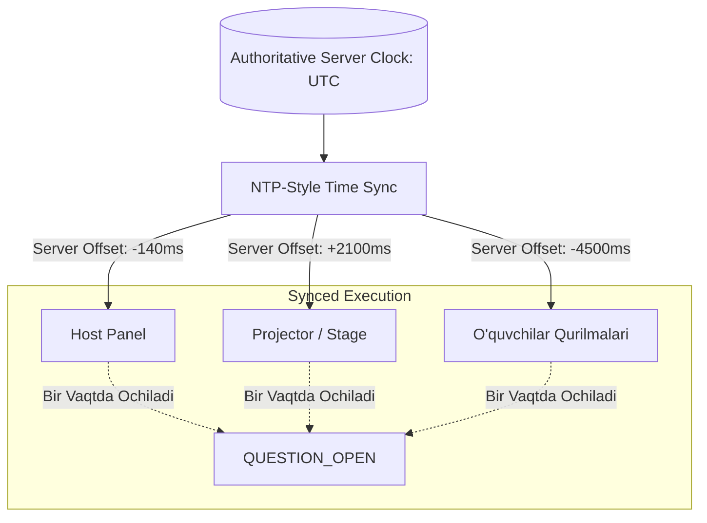
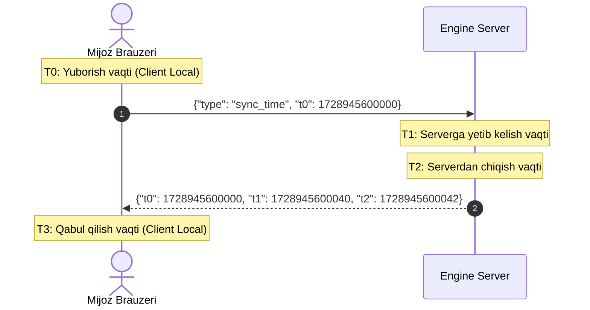
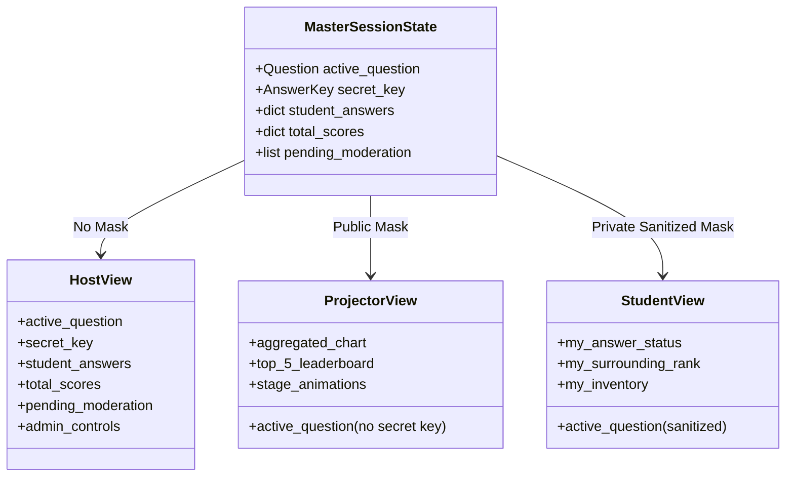

# Host / Student Synchronization Specification

**Hujjat identifikatori:** DOC-64  
**Fayl nomi:** `CLIENT_SYNC.md`  
**Status:** Tasdiqlangan arxitektura spetsifikatsiyasi  
**Modul:** `apps.realtime.sync`  
**Mavzu:** O‘qituvchi, proyektor va o‘quvchi ekranlarining millisekundlik sinxronizatsiyasi, vaqt dreyfini bartaraf etish (NTP) va rolli maskalash  

---

## 1. Kirish va Ko‘p Ekranli Sinxronlik Muammosi

Klassik interaktiv darsda 3 xil qurilma ishtirok etadi:
1. **Host Screen (O‘qituvchi Noutbuki / Plansheti):** Boshqaruv pulti, to‘liq statistika va maxfiy to‘g‘ri javoblar.
2. **Projector / Stage Screen (Katta Ekran / Doska):** Butun sinf ko‘radigan, qiziqarli animatsiyalar, umumiy taymer va musobaqa sahnasi.
3. **Student Devices (30–100 ta O‘quvchi Telefoni):** Faqat javob berish tugmalari va shaxsiy natija.

Muammo: Turli qurilmalarning ichki soatlari (Device Clock) bir-biridan 2–10 soniyagacha farq qilishi mumkin. Agar sinxronizatsiya bo‘lmasa, bitta o‘quvchida taymer tugab bo‘lgan, boshqasida esa hali 5 soniya vaqt qolgan bo‘ladi.

---

## 2. NTP-Style Vaqt Sinxronizatsiyasi (Clock Drift Compensation)

Klient hech qachon o‘zining `new Date()` mahalliy vaqtiga to‘g‘ridan-to‘g‘ri ishonmaydi. Buning o‘rniga ulanish vaqtida server bilan **Network Time Protocol (NTP)** uslubida vaqt farqini (Offset) hisoblab oladi.

### 2.1 Hisoblash Formulalari:
1. **Tarmoq Kechikishi (Round-Trip Time — RTT):**
   $$\text{RTT} = (T_3 - T_0) - (T_2 - T_1)$$
2. **Server Soati Bilan Farq (Time Offset):**
   $$\text{Offset} = \frac{(T_1 - T_0) + (T_2 - T_3)}{2}$$
3. **Mijozdagi Haqiqiy Server Vaqti:**
   $$\text{EstimatedServerTime} = \text{Date.now}() + \text{Offset}$$

Ushbu jarayon har 60 soniyada fonda takrorlanadi va median filtr orqali to‘g‘rilanadi. Natijada, barcha ekranlardagi taymerlar **50 millisekundgacha bo‘lgan aniqlikda bir vaqtda nolga yetib boradi**.

---

## 3. Rolli Holat Maskalash (Role-Based State Masking)

Serverdan barcha qurilmalarga yagona xabar tarqatilishi mumkin bo‘lsa-da, har bir rol faqat o‘ziga tegishli ma'lumotni qabul qilishi shart (Projection Mask).

### 3.1 Har bir Ekranning Ko‘rinishi:

| Ma'lumot Elementi | O‘qituvchi Ekrani (Host) | Proyektor Ekrani (Stage) | O‘quvchi Telefoni (Student) |
|---|---|---|---|
| **To‘g‘ri javob kaliti** | Doimiy ko‘rinadi | Savol yopilmaguncha yashirin | Savol yopilmaguncha yashirin |
| **Savol matni va rasm** | Ixcham boshqaruv ko‘rinishida | Katta shrift va yuqori sifatda | Katta, ixcham o‘qish oson |
| **Javob tugmalari** | Natijalar monitoringi | Ko‘rinmaydi (faqat variant matnlari) | 4 ta katta rangli interaktiv tugma |
| **Kim qaysi javobni berdi** | Jonli ism-familiyasi bilan | Yashirin (faqat sonlar agregati) | Faqat o‘zining tanlovi |
| **Reyting ko‘rinishi** | Barcha o‘quvchilar ro‘yxati | Top-5 / Top-10 Podium | O‘z o‘rni va yonidagi 2 kishi |
| **Moderatsiya qutisi** | Anonim postlarni tasdiqlash | Faqat tasdiqlangan postlar | O‘z yuborgan posti holati |

---

## 4. Kech Qo‘shilganlar (Late-Joiners) Sinxronizatsiyasi

Agar o‘quvchi savol ochilganidan 15 soniya o‘tgach xonaga qo‘shilsa:
1. Server unga joriy holatni va qolgan vaqtni yuboradi:
   $$\text{RemainingSeconds} = \frac{\text{DeadlineTimestamp} - \text{CurrentServerTime}}{1000}$$
2. O‘quvchi ekrani to‘liq 30 soniyadan emas, aynan qolgan 15 soniyadan orqaga sanashni boshlaydi.
3. Bu o‘quvchilar o‘rtasidagi vaqt tengligini va adolatni to‘liq kafolatlaydi.
