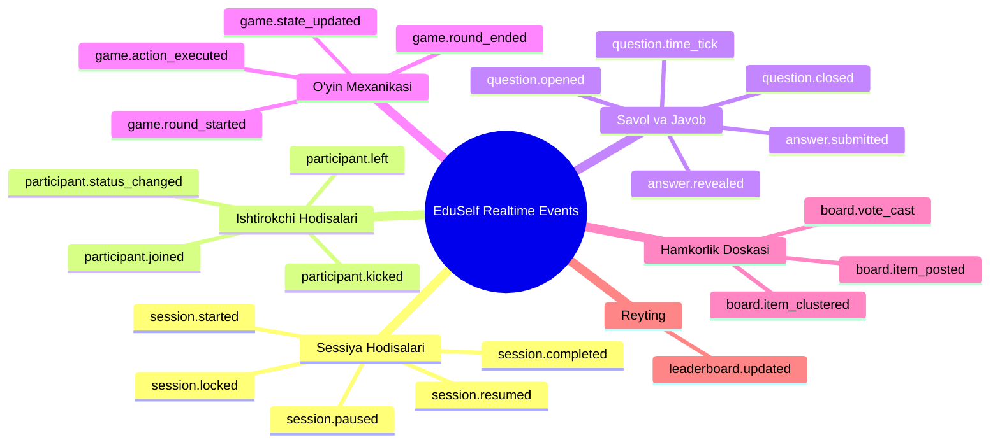

# Event Specification

**Hujjat identifikatori:** DOC-59  
**Fayl nomi:** `EVENTS.md`  
**Status:** Tasdiqlangan arxitektura spetsifikatsiyasi  
**Modul:** `apps.realtime.events`  
**Mavzu:** Barcha WebSocket hodisalari katalogi, JSON payload sxemalari va versiyalash qoidalari  

---

## 1. Umumiy Standart va Nomlash Qoidalari

EduSelf Teacher platformasidagi barcha real-vaqt hodisalari qat'iy **`<domain>.<action>`** formatida nomlanadi (masalan: `session.started`, `question.opened`, `answer.revealed`).

### Asosiy Tamoyillar:
1. **Semantik Aniqlik:** Hodisa nomi o‘tmish zamonda yoki aniq holat o‘zgarishida ifodalanadi (`.opened`, `.closed`, `.submitted`).
2. **Deterministic Payload:** Har bir hodisa o‘zining mustaqil JSON sxemasiga ega bo‘lib, klient qo‘shimcha so‘rov yubormasdan holatni yangilashi uchun yetarli ma'lumotni o‘z ichiga oladi.
3. **Immutability:** Hodisa bir marta yaratilib yuborilgach, uning mazmuni o‘zgarmaydi.

---

## 2. Hodisalar Katalogi (Kategoriya Bo‘yicha)



---

## 3. Asosiy Hodisalar va Ularning JSON Sxemalari

### 3.1 `session.started`
O‘qituvchi lobbida "Boshlash" tugmasini bosganda barcha ishtirokchilar va proyektorga yuboriladi.

```json
{
  "type": "session.started",
  "session_id": "ses_7f8a9b",
  "seq": 10,
  "ts": 1728945600000,
  "payload": {
    "total_questions": 12,
    "game_mode": "boss_battle",
    "teams_enabled": true,
    "settings": {
      "speed_bonus": true,
      "show_leaderboard": true
    }
  }
}
```

---

### 3.2 `question.opened` (Zero-Knowledge Savol Kadri)
Savol o‘quvchilar ekranida ochilganda yuboriladi. Talabalar uchun to‘g‘ri javob kaliti olib tashlangan.

```json
{
  "type": "question.opened",
  "session_id": "ses_7f8a9b",
  "seq": 15,
  "ts": 1728945605000,
  "payload": {
    "question_id": "q_101",
    "question_index": 1,
    "total_questions": 12,
    "question_type": "single_choice",
    "prompt": "Quyosh sistemasidagi eng katta sayyora qaysi?",
    "media": {
      "type": "image",
      "url": "https://storage.eduself.uz/planets.webp"
    },
    "options": [
      { "id": "opt_A", "text": "Mars" },
      { "id": "opt_B", "text": "Yupiter" },
      { "id": "opt_C", "text": "Saturn" },
      { "id": "opt_D", "text": "Venera" }
    ],
    "time_limit_seconds": 30,
    "points": 1000,
    "deadline_ts": 1728945635000
  }
}
```

---

### 3.3 `answer.submitted` (Talaba Tomonidan Yuboriladi)
O‘quvchi javob variantini bosganda serverga uzatiladigan kadr.

```json
{
  "type": "answer.submitted",
  "session_id": "ses_7f8a9b",
  "seq": 16,
  "ts": 1728945612400,
  "payload": {
    "question_id": "q_101",
    "participant_id": "usr_9921",
    "submission_id": "sub_uuid_441",
    "response_data": {
      "selected_option_id": "opt_B"
    },
    "client_submit_ts": 1728945612380
  }
}
```

---

### 3.4 `answer.revealed` (To‘g‘ri Javob Oshkor Qilinganda)
O‘qituvchi javoblarni tekshirishni buyurganda yoki taymer to‘liq tugaganda yuboriladi.

```json
{
  "type": "answer.revealed",
  "session_id": "ses_7f8a9b",
  "seq": 20,
  "ts": 1728945636000,
  "payload": {
    "question_id": "q_101",
    "correct_answer": {
      "correct_option_ids": ["opt_B"]
    },
    "explanation": "Yupiter Quyosh sistemasidagi eng katta sayyora bo'lib, uning massasi boshqa barcha sayyoralar yig'indisidan 2.5 baravar ko'p.",
    "distribution": {
      "opt_A": 2,
      "opt_B": 24,
      "opt_C": 3,
      "opt_D": 1
    },
    "total_answers": 30
  }
}
```

---

### 3.5 `leaderboard.updated`
Raund oralig‘ida umumiy reytingni yangilash uchun proyektor va o‘quvchilarga yuboriladi.

```json
{
  "type": "leaderboard.updated",
  "session_id": "ses_7f8a9b",
  "seq": 22,
  "ts": 1728945640000,
  "payload": {
    "top_entries": [
      { "rank": 1, "participant_id": "usr_102", "nickname": "Aziza", "score": 1950, "streak": 2 },
      { "rank": 2, "participant_id": "usr_9921", "nickname": "Jasur", "score": 1820, "streak": 2 },
      { "rank": 3, "participant_id": "usr_304", "nickname": "Madina", "score": 1710, "streak": 1 }
    ],
    "team_scores": [
      { "team_id": "team_1", "team_name": "Lochinlar", "score": 5480, "rank": 1 },
      { "team_id": "team_2", "team_name": "Qoplonlar", "score": 5120, "rank": 2 }
    ]
  }
}
```

---

### 3.6 `game.state_updated` (Rejimga Xos Holat — Masalan, Boss Battle)
O‘yin mexanikasiga oid o‘ziga xos o‘zgarishlar (Boss HP, Oltinlar, Minora balandligi).

```json
{
  "type": "game.state_updated",
  "session_id": "ses_7f8a9b",
  "seq": 25,
  "ts": 1728945645000,
  "payload": {
    "mode": "boss_battle",
    "boss_name": "Qiyin Masalalar Ajdahosi",
    "boss_current_hp": 7450,
    "boss_max_hp": 10000,
    "damage_dealt_this_round": 2550,
    "class_shield_remaining": 80
  }
}
```

---

## 4. Versiyalash va Moslik Siyosati (Event Versioning)

Dastur yangilanganda eski va yangi klientlar o‘rtasida ziddiyat kelib chiqmasligi uchun:
1. **SemVer Standarti:** Xabar boshidagi `"v": 1` maydoni protokol versiyasini bildiradi.
2. **Backward Compatibility:** Mavjud maydonlarni o‘chirish yoki nomini o‘zgartirish taqiqlanadi. Yangi xususiyatlar faqat **qo‘shimcha ixtiyoriy maydonlar** sifatida kiritiladi.
3. **Breaking Changes (`v2`):** Agar payload strukturasini tubdan o‘zgartirish talab etilsa, `v=2` e'lon qilinadi va server kamida 6 oy davomida ikkala versiya adapterini birga ushlab turadi.
