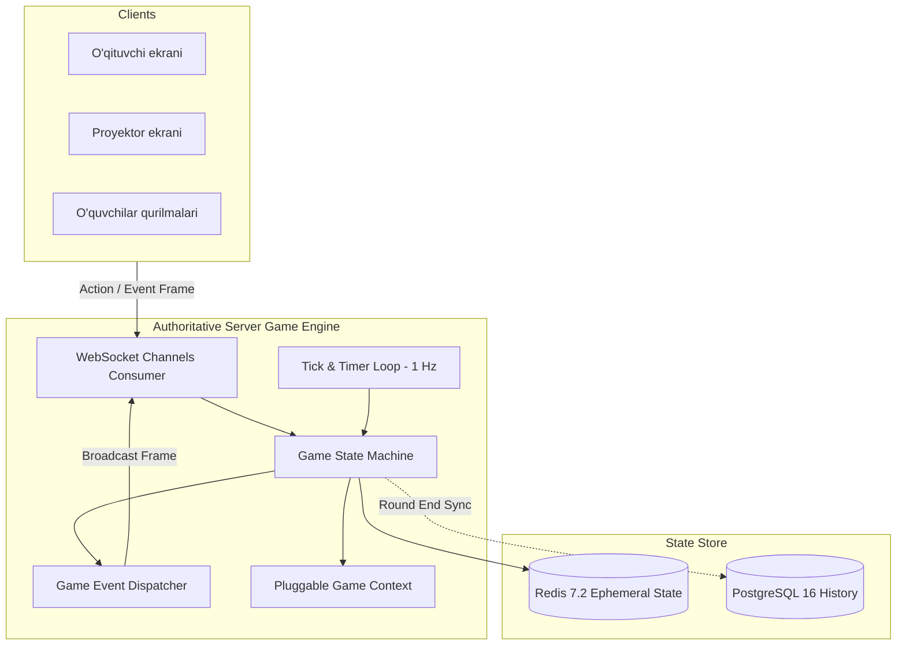
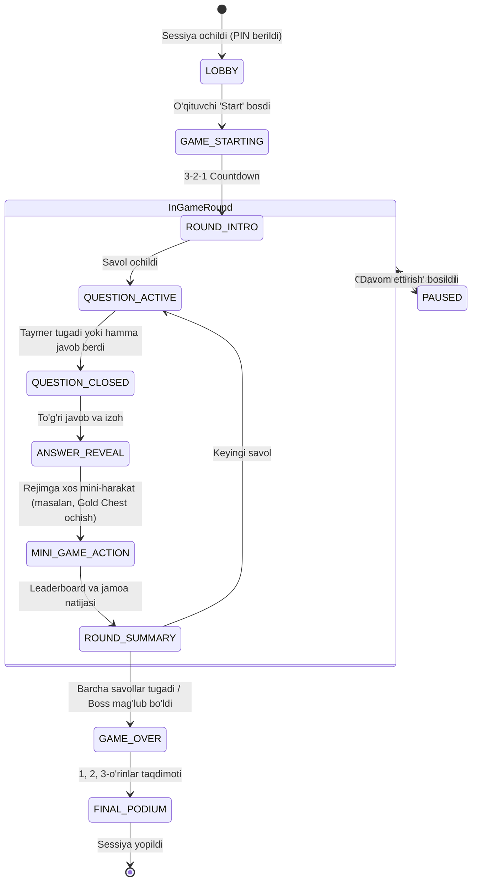

# Game Engine Specification

**Hujjat identifikatori:** DOC-53  
**Fayl nomi:** `GAME_ENGINE.md`  
**Status:** Tasdiqlangan arxitektura spetsifikatsiyasi  
**Modul:** `apps.game_engine`  
**Mavzu:** O‘yin rejimlarini ishga tushirish, server game loop, state machine va event dispatcher  

---

## 1. Umumiy Ko‘rinish va Asosiy Vazifasi

Game Engine — EduSelf Teacher platformasidagi barcha interaktiv o‘yin jarayonlarini yagona qoidalar asosida boshqaruvchi **Authoritative Server Engine** hisoblanadi. 

Brauzer yoki mobil ilovalar faqat ko‘rsatuvchi va buyruq yuboruvchi (Client-side view) hisoblanadi; o‘yinning barcha haqiqiy holati (Game State), taymerlar, g‘alabalar, hayotlar (lives), resurslar va jamoaviy harakatlar faqat server xotirasida (Redis va ASGI Worker) hisoblanadi.



---

## 2. Server Game Loop va Authoritative State

### 2.1 Authoritative Server Qoidasi:
1. **No Client Trust:** Mijoz hech qachon "men 100 ball oldim" yoki "vaqtim 5 soniya qoldi" degan ma'lumotni serverga diktovka qila olmaydi. Mijoz faqat o‘zining harakatini yuboradi: `{"action": "submit_answer", "choice": "B", "client_ts": 1728945600120}`.
2. **Server-Side Timers:** Taymer muddati serverda belgilangan `deadline_timestamp` orqali hisoblanadi. Tarmoq kechikishlari bo‘lsa ham, server soati bo‘yicha `deadline`dan keyin kelgan javoblar rad etiladi (`HTTP 408 / TIMEOUT`).
3. **Tick Loop:** Ba'zi o‘yin rejimlari (masalan, *Boss Battle*, *Tower Defense*, *Racing*) real-vaqtda vaqt o‘tishi bilan resurslar o‘zgarishini talab qiladi. Buni amalga oshirish uchun Channels Consumer har bir faol o‘yin uchun 1 soniyalik asinxron `tick_loop()` vazifasini boshqaradi.

```python
async def game_tick_loop(session_id: str, interval_sec: float = 1.0):
    while is_session_active(session_id):
        await asyncio.sleep(interval_sec)
        await game_engine.tick(session_id, delta_ms=int(interval_sec * 1000))
```

---

## 3. Game Finite State Machine (FSM)

Har bir jonli o‘yin sessiyasi qat'iy holatlar grafigi (FSM) asosida boshqariladi:



### 3.1 Holatlar Izohi:
- `LOBBY`: O‘quvchilar PIN kod yoki QR orqali ulanadi. O‘qituvchi jamoalarni tekshiradi va lobbini qulflaydi.
- `QUESTION_ACTIVE`: Savol o‘quvchilar ekranida ochiq, taymer kamaymoqda, javoblar qabul qilinmoqda.
- `QUESTION_CLOSED`: Javob qabul qilish to‘xtatildi. Lekin to‘g‘ri javob hali oshkor qilinmadi.
- `ANSWER_REVEAL`: Server to‘g‘ri javobni va uning izohini hamma ekranlarga jo‘natadi.
- `MINI_GAME_ACTION`: Blooket yoki gamifikatsiyalangan rejimlarda (masalan, *Gold Quest*, *Treasure Trove*, *Crypto Hack*) to‘g‘ri javob berganlarga mukofot tanlash imkoniyati beriladi.
- `ROUND_SUMMARY`: Har bir raund oralig‘idagi reyting jadvali.
- `PAUSED`: O‘qituvchi sinfni tinchlantirish yoki mavzuni tushuntirish uchun o‘yinni muzlatgan holat (barcha taymerlar to‘xtatiladi).
- `GAME_OVER`: O‘yin yakuni, yakuniy statistika hisoblanadi va saqlanadi.

---

## 4. GameContext va Plaginlar Bilan Integratsiya

Game Engine yadrosi o‘yinlarning ichki mantiqini (qoidalarini) o‘zida kodlamaydi. U faqat `GameContext` orqali yuklangan plaginga (`BaseGameModePlugin`) hodisalarni uzatadi:

```python
@dataclass
class GameContext:
    session_id: str
    quiz_id: str
    host_id: str
    current_round: int
    total_rounds: int
    current_question: Optional[dict]
    participants: dict[str, ParticipantState]
    teams: dict[str, TeamState]
    game_mode_state: dict  # Plaginning o'ziga xos holati (masalan, boss_hp: 5000)
    settings: dict
```

Har bir voqea sodir bo‘lganda (`on_answer_submitted`, `on_tick`, `on_round_end`), Engine joriy `GameContext`ni plaginga beradi. Plagin esa yangilangan holat va mijozlarga yuborilishi kerak bo‘lgan hodisalar ro‘yxatini qaytaradi.

---

## 5. Event Bus Dispatcher va Xabarlar Oqimi

Server ichida ishlab chiqilgan hodisalar `EventBusDispatcher` orqali kerakli auditoriyaga (Broadcast) yo‘naltiriladi:

```mermaid
flowchart LR
    EventBus[Event Bus Dispatcher] --> Filter{Role Filter}
    Filter -->|Barcha ishtirokchilarga| GroupBroadcast[Channels Group: session_{id}]
    Filter -->|Faqat o'qituvchiga| HostChannel[Channels Group: session_{id}_host]
    Filter -->|Alohida o'quvchiga| UserChannel[Channels Single: user_{id}]
```

1. **Global Broadcast:** Barcha o‘quvchilar va proyektorga tegishli hodisalar (`question.opened`, `question.closed`, `session.paused`).
2. **Host-Only Channel:** Faqat o‘qituvchi ko‘rishi kerak bo‘lgan moderatsiya ma'lumotlari (`participant.flagged`, `answer.stats_live`).
3. **Private Direct Channel:** Aniq bitta o‘quvchiga tegishli shaxsiy hodisalar (`answer.acknowledged`, `private_reward.awarded`).

---

## 6. Xatolar Bardoshliligi va Xavfsizlik (Error Boundaries)

1. **Plugin Isolation:** Agar biron bir o‘yin rejimida xatolik (masalan, `ZeroDivisionError` yoki `IndexError`) yuzaga kelsa, bu butun tizimni to‘xtatmaydi. Xato ushlanadi (`try/except Exception`), log qilinadi va sessiya xavfsiz holatda davom etadi.
2. **Redis Failover & Resilience:** Ephemeral holat har bir raund yakunida PostgreSQL'ga asinxron yozib boriladi (`flush_round_state.delay()`). Agar Redis uzilib qolsa, sessiya oxirgi yakunlangan raunddan qayta tiklanishi mumkin.
3. **Spam & Anti-DDoS:** Bitta o‘quvchi soniyasiga ko‘pi bilan 3 ta harakat yuborishi mumkin (Rate Limiting token bucket). Haddan tashqari ko‘p so‘rov yuborgan mijozning paketi vaqtincha e'tiborsiz qoldiriladi.
