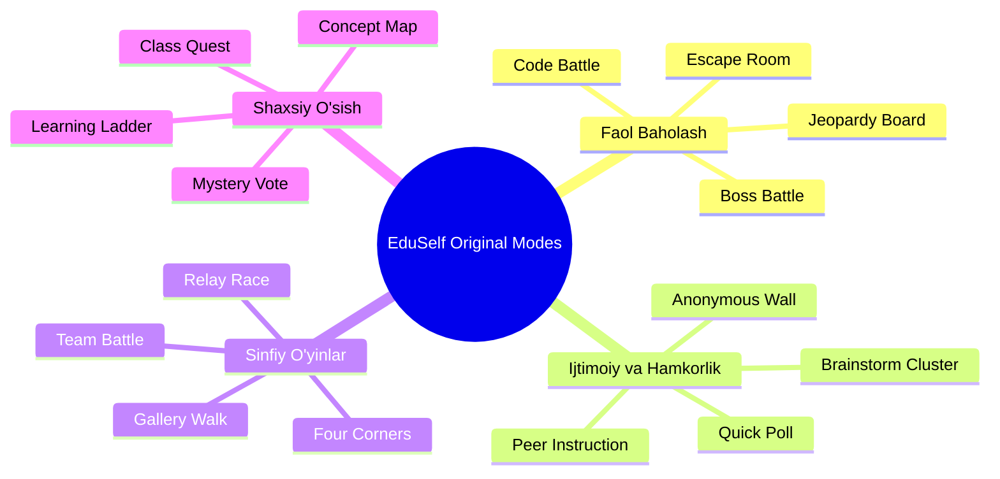

# Game Modes Catalog

**Hujjat identifikatori:** DOC-54  
**Fayl nomi:** `GAME_MODES.md`  
**Status:** Tasdiqlangan arxitektura spetsifikatsiyasi  
**Modul:** `apps.game_engine.modes`  
**Mavzu:** Kahoot (16 ta), Blooket (18+ ta mavsumiy) va EduSelf Original (16 ta) to‘liq o‘yin rejimlarining texnik va pedagogik katalogi  

---

## 1. Kirish va O‘yin Arxitekturasi Tamoyillari

EduSelf Teacher platformasida **Quiz** (savollar mazmuni) va **Game Mode** (o‘yin mexanikasi) bir-biridan to‘liq ajratilgan. Bitta savollar to‘plami dars maqsadiga qarab klassik tezkor viktorina, jamoaviy qutqaruv operatsiyasi (Submarine Squad), strategik resurslarni boshqarish (Gold Quest) yoki sinfiy Boss jangi (Boss Battle) sifatida o‘ynalishi mumkin.

### Rejimlar Matritsasi:
- **Kahoot Ekvivalentlari:** 16 ta rejim
- **Blooket Ekvivalentlari:** 18+ ta rejim (jonli, mavsumiy va solo/uyga vazifa)
- **EduSelf Original Rejimlari:** 16 ta rejim
- **Jami:** 50 ta to‘liq qamrovli o‘yin tajribasi.

---

## 2. Kahoot Referens Katalogi (16 ta Rejim)

Barcha rejimlar EduSelf brendi, original vizual dizayni, original ovoz effektlari va adolatli o‘yin muvozanati bilan yaratilgan.

| № | Rejim Nomi (EduSelf) | Referens Rejim | Form-faktor | Asosiy Mexanika va Gameplay Loop | G‘alaba Qoidasi |
|---|---|---|---|---|---|
| 1 | **Classic Quiz** | Classic | Live / Individual | Har bir savolga tezkor javob, eksponensial tezlik bonusi, savollar oralig‘ida Top-5 reytingi. | Eng yuqori ball to‘plagan o‘quvchi |
| 2 | **Accuracy Master** | Accuracy | Live / Individual | Tezlik bonusi o‘chirilgan. Har kimga to‘liq vaqt beriladi; faqat bilim va to‘g‘ri javoblar soni hisoblanadi. | Eng ko‘p to‘g‘ri javob bergan |
| 3 | **Confidence Wager** | Confidence | Live / Individual | Variant tanlangandan so‘ng 1x, 2x yoki 3x ishonch garovi tikiladi. Xato javob ballni minusga tushiradi. | Xavfni to‘g‘ri baholab eng ko‘p ball yig‘gan |
| 4 | **Team Arena** | Team Mode | Live / Jamoaviy | O‘quvchilar 2–8 jamoaga bo‘linadi. Jamoa a’zolarining o‘rtacha ballari asosida jamoaviy reyting shakllanadi. | Eng yuqori o‘rtacha balli jamoa |
| 5 | **Kingdom Conquest** | Color Kingdoms | Live / Jamoaviy | To‘g‘ri javoblar jamoaga ritsarlar/bayroqlar beradi. Jamoalar xaritadagi qo‘shni hududlarni egallaydi. | Xaritani to‘liq egallagan jamoa |
| 6 | **Canvas Reveal** | Chill Art | Live / Hamkorlik | Butun sinf birgalikda to‘g‘ri javob bersa, proyektorda buyuk san’at asari yoki ilmiy diagramma qismlari ochiladi. | Vaqt tugaguncha rasmni to‘liq ochish |
| 7 | **Submarine Squad** | Submarine Squad | Live / Jamoaviy Survival | Suv osti kemasi bosim ostida. To‘g‘ri javoblar kislorodni to‘ldiradi, noto‘g‘ri javoblar suv oqishini kuchaytiradi. | Barcha savollar tugaguncha omon qolish |
| 8 | **Tallest Tower** | Tallest Tower | Live / Jamoaviy | Har bir to‘g‘ri javob jamoa binosiga yangi qavat qo‘shadi. Noto‘g‘ri javob minoraning muvozanatini pasaytiradi. | Eng baland va barqaror minora qurgan |
| 9 | **Treasure Island** | Treasure Trove | Live / Mini-game | Har 3 ta savoldan so‘ng o‘quvchilar xaritada sandiqlarni ochadi: qo‘shimcha ball, qalqon yoki multiplikatorlar. | Sandiqlardan eng ko‘p olmos yig‘gan |
| 10 | **Pyramid Quest** | The Lost Pyramid | Live / Bosqichli | O‘quvchilar piramida pog‘onalari bo‘ylab ko‘tariladi. Qiyin savollarga javob berish yuqoriroq pog‘onalarga sakratadi. | Piramida cho‘qqisiga birinchi yetgan |
| 11 | **Robot Escape** | Robot Run | Live / Co-Op Escape | O‘quvchilar xavfli fabrikadan robotlarni qutqaradi. Jamoaviy kombinatsiyalangan to‘g‘ri javoblar eshiklarni ochadi. | Vaqt tugashidan oldin qochib qutulish |
| 12 | **Cosmic Voyage** | Cosmic Quest | Live / Arkada | Kosmik kema sayohati: asteroidlarni yo‘q qilish va yonilg‘i yig‘ish to‘g‘ri javoblar orqali amalga oshadi. | Belgilangan yulduz tizimiga yetib borgan |
| 13 | **Interactive Slide** | Professional/Pres | Live / Taqdimot | Taqdimot slaydlari orasiga joylashtirilgan savollar, so‘rovnomalar va tushunishni tekshirish testlari. | Faol ishtirok va baholash |
| 14 | **Guided Lecture** | Lecture | Live / O‘qituvchi boshqaruvi | O‘qituvchi o‘z tezligida dars o‘tadi, har bir mavzudan keyin 1–2 ta tezkor tushunish tekshiruvi beriladi. | Mavzuni o‘zlashtirish foizi |
| 15 | **Unplugged Board** | Unplugged | Shared Screen | O‘quvchilarda telefon yo‘q. Savollar katta ekranda chiqadi, javoblar qo‘l ko‘tarish yoki rangli qog‘ozlar orqali beriladi. | Sinfiy umumiy tushunish |
| 16 | **Marble Grand Prix** | Marble Race | Live / Simulyatsiya | O‘quvchilar quiz davomida yig‘gan ballari ularning sharlari tezligi va vaznini oshiradi. Finalda 3D/2D poyga o‘tkaziladi. | Poygada marraga birinchi kelgan shar |

---

## 3. Blooket Referens Katalogi (18+ ta Rejim)

Blooket formatlari o‘ziga xos gamifikatsiya elementlari: resurslarni to‘plash, boshqalardan o‘g‘irlash, sandiq tanlash va strategik qobiliyatlar bilan mashhur.

### 3.1 Jonli Raqobat Rejimlari:
1. **Battle Royale:** 1v1 turnir jadvali (bracket). Ikki o‘quvchi bir xil savolga qarama-qarshi javob beradi; tez va to‘g‘ri javob bergan g‘olib bo‘lib keyingi bosqichga o‘tadi.
2. **Crypto Hack:** To‘g‘ri javob bergan o‘quvchiga boshqa o‘quvchining kripto-hisobini buzish (hack) yoki o‘z hisobiga firewall (himoya) qo‘yish imkoniyati beriladi.
3. **Gold Quest:** Har bir to‘g‘ri javobdan so‘ng 3 ta oltin sandiqdan biri ochiladi: Oltin olish, boshqa o‘quvchidan oltin o‘g‘irlash (steal) yoki oltinlarni almashtirish (swap).
4. **Fishing Frenzy:** Qarmog‘ini suvga tashlaydi: to‘g‘ri javob katta baliq (ko‘p ball) yoki axlat (0 ball) olib keladi. Qarmog‘ini upgrade qilish imkoniyati mavjud.
5. **Deceptive Dinos:** Qadimiy qazilmalarni yig‘ish; to‘g‘ri javob orqali o‘z dinozavrlar suyagini to‘ldirish va boshqalarning qazilmalarini chalg‘itish.
6. **Blook Rush:** Jamoalar bir-birlarining bazalaridan bayroqlarni tortib olish uchun savollarni yechadi.
7. **Laser Tag:** Mini-jang maydoni: to‘g‘ri javoblar lazer batareyasini quvvatlaydi va raqiblarni nishonga oladi.
8. **Mini Mine:** Yer ostini qazish: to‘g‘ri javob qimmatbaho rudalarni (olmos, zumrad) topish imkonini beradi.
9. **Speedway Racing:** Har bir to‘g‘ri javob avtomobil tezligini oshiradi. Xato javob avtomobilni 3 soniya pit-stop'ga tushiradi.
10. **Busy Bees:** To‘g‘ri javoblar yangi ishchi asalarilarni sotib olish va asal ishlab chiqarishni ko‘paytirishga xizmat qiladi.
11. **Cocoa Cottage:** Issiq shokolad kafelari uchun ingredientlar yig‘ish va mijozlarga xizmat ko‘rsatish.
12. **Star Grazer:** Galaktik fermerlik — asteroidlarni tozalab, yulduz changlarini hosil qilish.

### 3.2 Mavsumiy Rejimlar (Seasonal):
13. **Candy Quest (Halloween):** Konfetlarni yig‘ish va boshqa o‘yinchilarni qo‘rqitish orqali ularning konfetlarini tortib olish.
14. **Santa’s Workshop (Yangi yil):** Yangi yil sovg‘alarini yig‘ish va chanalarga yuklash.
15. **Egg Hunt (Bahor):** Xaritadan yashirilgan tuxumlarni topish.
16. **Tag or Treat:** Quvlashmachoq o‘yini — maxluqqa aylangan o‘yinchi savolga tez javob berib boshqalarga yuqtirishi kerak.

### 3.3 Solo va Homework Rejimlari (O‘z tezligida / Uyga vazifa):
17. **Tower Defense (1 va 2-qism):** O‘quvchi savollarga to‘g‘ri javob berib tangalar oladi va yo‘lak bo‘ylab minoralarni (archer, mage, cannon) o‘rnatib dushman to‘lqinlarini qaytaradi.
18. **Café:** O‘quvchi virtual kafeda mijozlarga taom tayyorlaydi, taomlar tugaganda yangi oziq-ovqatlarni savollarni to‘g‘ri yechish orqali oladi.
19. **Monster Brawl:** Dushmanlar to‘dasi ichida omon qolish (Roguelike survival); har safar daraja oshganda savolga javob berib yangi qobiliyat tanlaydi.
20. **Factory:** Virtual zavodni boshqarish, savollar orqali konveyerlarni avtomatlashtirish.
21. **Crazy Kingdom:** Qirollikni boshqarish: o‘quvchiga turli vazirlar maslahat beradi, to‘g‘ri javob orqali resurslarni muvozanatda ushlaydi.
22. **Study Mode:** Gamifikatsiyasiz, faqat xatolar ustida ishlash va qayta-qayta takrorlash trenajyori.

---

## 4. EduSelf Original Rejimlari (16 ta Rejim)

Ushbu rejimlar zamonaviy ta'lim metodikalariga (Active Learning, Peer Instruction, Formative Feedback) to‘liq moslashtirilgan o‘ziga xos formatlardir:



1. **Anonymous Answer Wall:** O‘quvchilar o‘z fikrlarini butunlay anonim yoki taxallus ostida yuboradi. O‘qituvchi javoblarni saralaydi va doskaga chiqaradi. Boshqalardan iymanadigan bolalar uchun ideal.
2. **Quick Poll / Pulse Check:** Mavzuni tushunganlik darajasini 10 soniya ichida aniqlash (Masalan: *"Tushundim / Savolim bor / Umuman tushunmadim"*).
3. **Brainstorm & Cluster:** O‘quvchilar g‘oyalarni yuboradi, o‘rnatilgan AI agent ularni avtomatik umumiy mavzularga guruhlaydi, sinf eng yaxshi g‘oyalarga ovoz beradi.
4. **Boss Battle:** Katta ekranda umumiy Boss (masalan, *"Qiyin Fizika Yirtqichi"*, 10,000 HP). Sinfning har bir to‘g‘ri javobi Boss HP’sini kamaytiradi, noto‘g‘ri javoblar esa sinf qalqonini yemiradi.
5. **Escape Room:** Ketma-ket 5 ta virtual xona. O‘quvchilar jamoasi xonadan chiqish uchun jumboqli savollarni yechib maxfiy kodlarni ochishi kerak.
6. **Jeopardy Board (Svoya Igra):** 5 ta mavzu ustuni, har bir ustunda 100 dan 500 gacha ballik savollar. Jamoalar navbat bilan savol tanlaydi.
7. **Relay Race (Estafeta):** Jamoa a’zolari navbat bilan savolga javob beradi. Bitta o‘quvchi xato qilsa, estafeta tayoqchasi sekinlashadi.
8. **Peer Instruction (Eric Mazur Metodi):**
   - 1-bosqich: Individual ovoz berish (javoblar yashirin).
   - 2-bosqich: Agar sinf natijasi 30%–70% oralig‘ida bo‘lsa, o‘qituvchi: *"Yonidagi o‘rtog‘ing bilan 2 daqiqa bahslash!"* buyrug‘ini beradi.
   - 3-bosqich: Qayta ovoz berish. Tushunish o‘sishi delta diagrammasida ko‘rsatiladi.
9. **Four Corners:** Katta ekranda 4 xil fikr chiqadi. O‘quvchilar o‘z qurilmasida burchak tanlaydi; sinf umumiy xaritada qaysi burchakda qancha o‘quvchi to‘planganini ko‘radi.
10. **Code Battle / Bug Hunt:** Dasturlash darslari uchun. Ekranda xatosi bor kod chiqadi; o‘quvchilar xatoni birinchi bo‘lib topishi va tuzatishi kerak.
11. **Gallery Walk:** O‘quvchilar o‘z ishlarini (rasm, yozma yechim) yuboradi; qolganlar virtual galereyada aylanib sharh qoldiradi va yulduzlar beradi.
12. **Mystery Vote:** Avval hamma taxmin qiladi; so‘ngra to‘g‘ri ilmiy tushuntirish berilgach qayta ovoz yig‘iladi.
13. **Learning Ladder:** Har bir o‘quvchi o‘z darajasiga mos pog‘onada ketadi (differentsiatsiyalashgan ta'lim).
14. **Concept Map:** O‘quvchilar atamalar orasidagi munosabatlarni bog‘lab sinfiy umumiy bilim xaritasini hosil qiladi.
15. **Team Battle:** Klassik jamoaviy savol-javob, jamoa sarlavhasi, piktogrammasi va guruh suhbati bilan.
16. **Class Quest:** Butun sinf bitta umumiy sayohat xaritasida maqsad sari birgalikda intiladi.

---

## 5. UI Layout Spetsifikatsiyalari

Har bir rejim 3 xil ekranda qanday ko‘rinishini belgilab beradi:

```text
+-------------------------------------------------------+
| PROYEKTOR / STAGE SCREEN                              |
| - Jonli 3D/2D o'yin sahnasi (Boss, Racing, Tower)      |
| - Umumiy sinf taymeri va umumiy hisob-kitoblar        |
| - Top Leaderboard va qiziqarli audio vizuallar        |
+-------------------------------------------------------+
| HOST / O'QITUVCHI EKRANI                              |
| - To'liq nazorat (Pause, Skip, Kick, Reveal)          |
| - Sinfning jonli tushunish grafigi va xatolar tahlili |
| - Yashirin to'g'ri javoblar va o'qituvchi eslatmalari |
+-------------------------------------------------------+
| TALABA QURILMASI (MOBIL / PLANSYET)                   |
| - Katta, qulay rangli javob tugmalari                  |
| - Shaxsiy holat (Mening ballim, Mening sandig'im)     |
| - Minimal chalg'ituvchi elementlar, yuqori tezlik     |
+-------------------------------------------------------+
```
