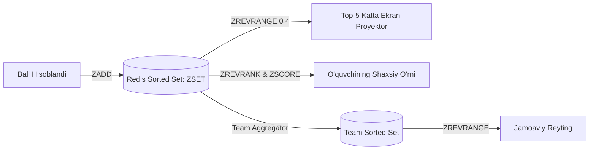
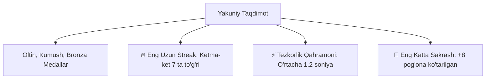

# Leaderboard Specification

**Hujjat identifikatori:** DOC-62  
**Fayl nomi:** `LEADERBOARD.md`  
**Status:** Tasdiqlangan arxitektura spetsifikatsiyasi  
**Modul:** `apps.game_engine.leaderboard`  
**Mavzu:** Individual va jamoaviy real-vaqt reytinglari, Redis Sorted Sets va pedagogik podium  

---

## 1. Umumiy Ko‘rinish va Yuqori Unumdorlik Talabi

Jonli o‘yin davomida yuzlab o‘quvchilar bir vaqtda javob berayotganda reytingni millisekundlarda hisoblash an'anaviy relyatsion bazalar (`ORDER BY score DESC`) uchun og‘ir yuklama hisoblanadi.

Shu sababli, EduSelf Leaderboard dvigateli **Redis Sorted Sets (`ZSET`)** ma'lumotlar tuzilmasiga tayanadi. Barcha reyting amallari $O(\log N)$ vaqt murakkabligida bajariladi.



---

## 2. Redis Sorted Sets Bilan Ishlash Arxitekturasi

### 2.1 Kalitlar Strukturasi:
- **Individual Reyting:** `session:{session_id}:leaderboard`
- **Jamoaviy Reyting:** `session:{session_id}:team_leaderboard`
- **O‘quvchi Metadatasi:** `session:{session_id}:participant:{usr_id}` (ism, avatar, streak)

### 2.2 Asosiy Redis Buyruqlari:
1. **Ballni Yangilash (Update Score):**
   ```bash
   ZADD session:ses_7f8a9b:leaderboard 2450 "usr_9921"
   ```
2. **Katta Ekran Uchun Top-5 ni Olish:**
   ```bash
   ZREVRANGE session:ses_7f8a9b:leaderboard 0 4 WITHSCORES
   ```
3. **O‘quvchining O‘z O‘rnini Aniqlash (Rank Me):**
   ```bash
   ZREVRANK session:ses_7f8a9b:leaderboard "usr_9921"
   # Natija 0 bo'lsa -> 1-o'rin, 5 bo'lsa -> 6-o'rin
   ```
4. **O‘quvchining Atrofidagi Qo‘shnilarini Olish (Surrounding Rank):**
   Agar o‘quvchi 14-o‘rinda bo‘lsa, uning oldidagi (13) va orqasidagi (15) o‘yinchilarni olish:
   ```bash
   ZREVRANGE session:ses_7f8a9b:leaderboard 12 14 WITHSCORES
   ```

---

## 3. Pedagogik Yondashuv: "Surrounding Rank" (Demotivatsiyaning Oldini Olish)

O‘quvchi o‘zining 30 kishi ichida 28-o‘rinda ekanini ko‘rsa, ko‘pincha darsdan ko‘ngli soviydi va o‘yinni tashlab qo‘yadi.

EduSelf mobil interfeysi ushbu muammoni **Atrofdagi O‘rinlar (Surrounding Rank)** ko‘rinishi orqali hal qiladi:

```text
+-------------------------------------------------------+
| SIZNING NATIJANGIZ (MOBIL EKRAN)                      |
|                                                       |
|  13-o'rin: Temur       - 1,820 ball                   |
|  👉 14-o'rin: SIZ (Jasur) - 1,750 ball (🔥 3 Streak)   |
|  15-o'rin: Dilnoza     - 1,690 ball                   |
|                                                       |
|  💡 13-o'ringa yetish uchun atigi 70 ball qoldi!      |
+-------------------------------------------------------+
```

### Afzalliklari:
- O‘quvchi 1-o‘rindagi yetib bo‘lmas 5000 ballik o‘quvchiga emas, aynan o‘zidan bitta oldingi o‘quvchiga yetib olishga harakat qiladi.
- Bu o‘quvchida sog‘lom intilish va kichik g‘alaba hissini uyg‘otadi.

---

## 4. Yashirin Reyting (Hidden / Blind Leaderboard)

O‘qituvchi dars xususiyatiga qarab raqobatni sir tutishni xohlashi mumkin:

1. **Blind Mode Sozlamasi:** O‘yin davomida hech qanday oraliq reyting ko‘rsatilmaydi.
2. **Faqat Natija:** Har bir o‘quvchi faqat o‘zining to‘g‘ri yoki noto‘g‘ri javob berganini biladi.
3. **Katta Intriga:** Finalda o‘qituvchi *"Pardani ochish"* tugmasini bosganda barcha natijalar birdaniga oshkor bo‘ladi.

---

## 5. Yakuniy Podium va Maxsus Unvonlar (Accolades)

O‘yin yakunlanganda platforma faqat 1, 2, 3-o‘rinlarni emas, balki boshqa ijobiy sifatlarni ham taqdirlaydi:



- **Oltin, Kumush, Bronza:** Podium animatsiyasi, konfetti effektlari va tantanali musiqa bilan proyektor markaziga chiqadi.
- **Eng Uzun Streak (Streak Master):** Birorta ham xato qilmasdan eng ko‘p ketma-ket to‘g‘ri javob bergan o‘quvchiga maxsus nishon beriladi.
- **Eng Katta Sakrash (Top Climber):** O‘yin boshida orqada qolib, oxirida eng ko‘p o‘rin yuqorilagan o‘quvchi taqdirlanadi (teng imkoniyat hissi).
