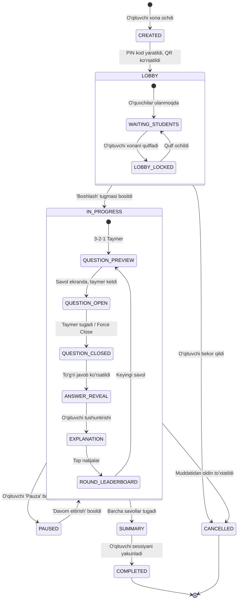
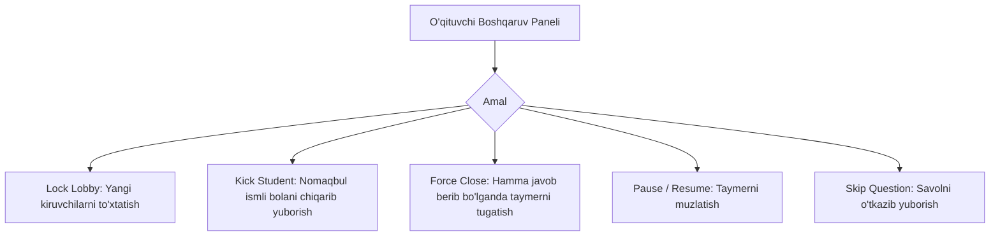

# Live Session Lifecycle Specification

**Hujjat identifikatori:** DOC-57  
**Fayl nomi:** `LIVE_SESSION.md`  
**Status:** Tasdiqlangan arxitektura spetsifikatsiyasi  
**Modul:** `apps.live_session`  
**Mavzu:** Jonli sessiya hayot sikli, PIN/QR kodlar, xona moderatsiyasi va avtomatik tozalash  

---

## 1. Umumiy Ko‘rinish va Xona Arxitekturasi

Live Session — bu dars davomida o‘qituvchi, proyektor va o‘quvchilar qurilmalarini yagona virtual xonaga birlashtiruvchi real-vaqt muhitidir.

Har bir sessiya:
- Yagona va xavfsiz **6 raqamli Game PIN**ga ega bo‘ladi.
- Redis'da xotira keshida (`session:{session_id}`) va PostgreSQL'da arxiv sifatida saqlanadi.
- Django Channels orqali WebSocket guruhlari (`session_{session_id}`) bilan bog‘lanadi.

---

## 2. To‘liq Sessiya Hayot Sikli (Session Lifecycle FSM)

Jonli sessiya quyidagi qat'iy holatlar grafigi asosida ishlaydi:



### 2.1 Holatlar Spetsifikatsiyasi:
1. `CREATED`: Xona serverda ro‘yxatga olindi, resurslar ajratildi.
2. `LOBBY`: Ishtirokchilar ismlarini kiritib qo‘shilmoqda. O‘qituvchi har bir yangi kirgan o‘quvchini ekranda ko‘radi.
3. `IN_PROGRESS`: O‘yin yoki testning faol qismi.
4. `PAUSED`: O‘yin to‘xtatilgan, barcha taymerlar muzlatilgan, o‘quvchilar ekranda *"O‘qituvchi darsni to‘xtatdi"* yozuvi chiqadi.
5. `SUMMARY`: Dars yakunlandi, umumiy g‘oliblar (podium) va qiyin savollar tahlili ko‘rsatilmoqda.
6. `COMPLETED`: Natijalar PostgreSQL'ga doimiy hisobot sifatida saqlandi, Redis'dagi xona xotirasi tozalandi.
7. `CANCELLED`: Sessiya xatolik yoki bekor qilish sababli yopildi.

---

## 3. Game PIN va QR Kod Generatsiyasi

### 3.1 PIN Kod Xavfsizligi va Kolliziyani Oldini Olish:
- **Format:** 6 xonali tasodifiy son (`100000` dan `999999` gacha).
- **Collision Prevention (Redis Set):**
  Server barcha faol xonalar PIN kodlarini Redis `active_game_pins` to‘plamida saqlaydi. Yangi kod yaratilayotganda `SADD` orqali atomik tekshiriladi:
  ```python
  import secrets

  async def generate_unique_pin(redis_client) -> str:
      for _ in range(10):
          pin = f"{secrets.randbelow(900000) + 100000}"
          if await redis_client.sadd("active_game_pins", pin):
              return pin
      raise RuntimeError("PIN kodlar zaxirasi vaqtincha to'ldi")
  ```

### 3.2 Join URL va QR Kod:
- Talaba ulanish manzili: `https://join.eduself.uz/<PIN>` yoki `https://join.eduself.uz?pin=<PIN>`.
- Server-side QR Code SVG formatida generatsiya qilinib, proyektor ekranida katta o‘lchamda ko‘rsatiladi.

---

## 4. O‘qituvchi Nazorati va Moderatsiya (Host Controls)

O‘qituvchi sessiyaning mutlaq egasi (Authoritative Host) hisoblanadi va quyidagi buyruqlarni real-vaqtda bera oladi:



1. **Lock Lobby (`session.lock`):** Xona qulflangandan keyin yangi o‘quvchilar PIN kodni to‘g‘ri kiritgan taqdirda ham kira olmaydi (`ROOM_LOCKED`).
2. **Kick / Ban Participant (`participant.kick`):** Nomaqbul taxallus (bad nickname) bilan kirgan o‘quvchini sessiyadan haydash. Uning WebSocket ulanishi darhol yopiladi va uning qurilmasiga bloklash kuki/tokeni yoziladi.
3. **Force Close (`question.force_close`):** Agar 30 soniyalik taymerning 10-soniyasidayoq sinfdagi 30 ta o‘quvchining barchasi javob berib bo‘lsa, o‘qituvchi kutib o‘tirmasdan savolni darhol yopishi mumkin.
4. **Time Freeze (`session.pause`):** Qolgan vaqt millisekundlarigacha Redis'da muzlatiladi. O‘qituvchi tushuntirib bo‘lgach, davom ettiriladi.

---

## 5. Sessiyalarni Avtomatik Tozalash (Garbage Collection)

Redis xotirasini tejash va tizim barqarorligini ta'minlash uchun sessiyalar muddati qat'iy nazorat qilinadi:

1. **Lobby Timeout:** Agar xona ochilib, 45 daqiqa davomida o‘yin boshlanmasa, sessiya avtomatik ravishda `CANCELLED` holatiga o‘tadi.
2. **Inactivity Watchdog:** Agar faol sessiyada 2 soat davomida o‘qituvchi tomonidan birorta ham harakat qilinmasa, sessiya avtomatik `COMPLETED` deb hisoblanadi.
3. **Redis Key Expiration (TTL):**
   Sessiya tugaganidan so‘ng uning barcha kesh kalitlari 24 soatlik TTL bilan belgilanadi:
   ```text
   EXPIRE session:{session_id}:state 86400
   EXPIRE session:{session_id}:participants 86400
   ```
   24 soatdan keyin Redis ushbu xotirani to‘liq ozod qiladi; barcha doimiy statistika esa PostgreSQL'da saqlanib qoladi.
