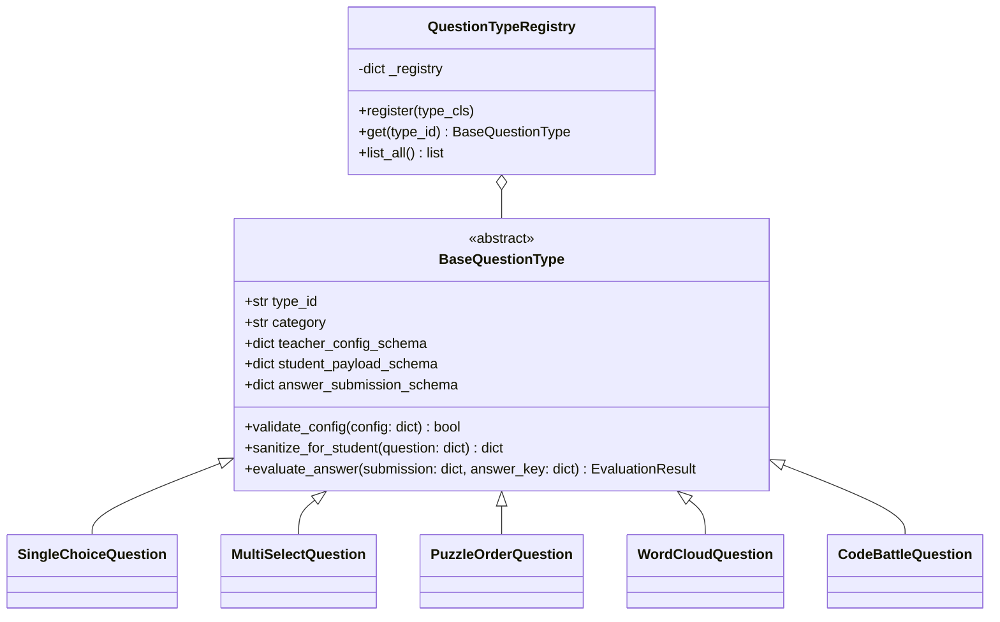

# Question Type Registry

**Hujjat identifikatori:** DOC-52  
**Fayl nomi:** `QUESTION_TYPES.md`  
**Status:** Tasdiqlangan arxitektura spetsifikatsiyasi  
**Modul:** `apps.quiz_engine.question_types`  
**Mavzu:** Barcha 29 ta savol turlari, JSON sxemalari, o‘qituvchi konfiguratsiyasi, talaba javobi va tekshirish algoritmlari  

---

## 1. Umumiy Arxitektura va Reestr (Registry Pattern)

EduSelf Teacher platformasida har bir savol turi mustaqil modul hisoblanadi. Yangi savol turi qo‘shilganda yadro tizimi o‘zgarmaydi; har bir tur `BaseQuestionType` abstraktsiyasidan meros oladi va markaziy reestrda ro‘yxatga olinadi.



---

## 2. 29 ta Savol Turlari Ro‘yxati va Tasnifi

| № | Savol Turi ID | Nomi (O‘zbekcha / English) | Kategoriya | Avto-baholash | Maxfiy Kalit Talabi |
|---|---|---|---|---|---|
| 1 | `single_choice` | Yagona tanlovli test (Single Choice) | Assessment | Ha | Ha |
| 2 | `multiple_select` | Ko‘p tanlovli test (Multiple Select) | Assessment | Ha (Qisman ball) | Ha |
| 3 | `true_false` | To‘g‘ri / Noto‘g‘ri (True/False) | Assessment | Ha | Ha |
| 4 | `short_text` | Qisqa matnli javob (Type Answer) | Assessment | Ha (Normalizatsiya) | Ha |
| 5 | `puzzle_order` | Ketma-ketlikni joylashtirish (Puzzle/Order) | Assessment | Ha | Ha |
| 6 | `numeric` | Aniq sonli javob (Numeric Answer) | Assessment | Ha (Tolerance) | Ha |
| 7 | `slider` | Oraliq / Slayder (Slider) | Assessment | Ha (Gradient ball) | Ha |
| 8 | `pin_answer` | Rasmda to‘g‘ri nuqtani tanlash (Pin Answer) | Assessment | Ha (Bounding Box) | Ha |
| 9 | `drop_pin` | Sinf nuqtalari xaritasi (Drop Pin) | Assessment / Heatmap | Yo‘q / Formative | Yo‘q |
| 10 | `match_pairs` | Juftliklarni moslashtirish (Match Pairs) | Assessment | Ha (Qisman ball) | Ha |
| 11 | `category_sort` | Kategoriyalarga ajratish (Category Sort) | Assessment | Ha (Qisman ball) | Ha |
| 12 | `cloze` | Bo‘sh joylarni to‘ldirish (Fill in Blanks) | Assessment | Ha | Ha |
| 13 | `math_equation` | Matematik formula (Math Expression) | Assessment | Ha (SymPy tenglik) | Ha |
| 14 | `code_output` | Dasturlash kodi va xatoni topish (Code Output) | Assessment | Ha | Ha |
| 15 | `case_study` | Vaziyatli / Matnli savol (Passage / Case) | Assessment | Ha | Ha |
| 16 | `diagram_label` | Diagramma / Chizmani belgilash | Assessment | Ha | Ha |
| 17 | `timed_media` | Audio / Video asosidagi savol | Assessment | Ha | Ha |
| 18 | `poll` | Tezkor so‘rovnoma (Quick Poll) | Formative | Yo‘q (Fikr) | Yo‘q |
| 19 | `likert_scale` | Likert shkalasi (1–5) | Formative | Yo‘q | Yo‘q |
| 20 | `nps_scale` | NPS 0–10 ko‘rsatkichi | Formative | Yo‘q | Yo‘q |
| 21 | `word_cloud` | So‘zlar buluti (Word Cloud) | Formative | Yo‘q | Yo‘q |
| 22 | `open_ended` | Ochiq yozma fikr (Open Ended) | Formative | O‘qituvchi / AI | Yo‘q |
| 23 | `brainstorm` | G‘oyalar va Klasterlash (Brainstorm & Cluster) | Formative | Yo‘q (Ovoz berish) | Yo‘q |
| 24 | `anonymous_wall` | Anonim javoblar doskasi (Anonymous Wall) | Formative | Yo‘q (Moderatsiya) | Yo‘q |
| 25 | `confidence_wager` | Javob + Ishonch darajasi (Confidence Wager) | Hybrid | Ha (Garov ball) | Ha |
| 26 | `exit_ticket` | Dars yakuni chiptasi (Exit Ticket) | Formative | Yo‘q | Yo‘q |
| 27 | `content_slide` | Nazariy Slayd / Tushuntirish kartasi | Presentation | N/A | N/A |
| 28 | `worked_example` | Bosqichma-bosqich yechim namunasi | Presentation | N/A | N/A |
| 29 | `passage_anchor` | Umumiy kontekst / Asosiy matn bloki | Presentation | N/A | N/A |

---

## 3. Kategoriya 1: Assessment Savol Turlari va Sxemalari (1–17)

### 3.1 `single_choice` (Yagona tanlovli test)
- **Qoidalar:** 2 dan 6 tagacha variant, aynan 1 ta to‘g‘ri javob.
- **Teacher Config JSON Schema:**
  ```json
  {
    "type": "object",
    "required": ["options", "correct_option_id"],
    "properties": {
      "options": {
        "type": "array",
        "minItems": 2,
        "maxItems": 6,
        "items": {
          "type": "object",
          "required": ["id", "text"],
          "properties": {
            "id": { "type": "string" },
            "text": { "type": "string" },
            "media_url": { "type": "string", "nullable": true }
          }
        }
      },
      "correct_option_id": { "type": "string" }
    }
  }
  ```
- **Student View Payload:** `correct_option_id` olib tashlangan holda variantlar ro‘yxati.
- **Submission Schema:** `{"selected_option_id": "opt_A"}`
- **Scoring:** Agar `selected_option_id == correct_option_id` bo‘lsa 100% ball + tezlik bonusi, aks holda 0 ball.

---

### 3.2 `multiple_select` (Ko‘p tanlovli test)
- **Qoidalar:** Kamida 3 ta variant, 2 yoki undan ortiq to‘g‘ri javoblar.
- **Baholash siyosati (Sozlanadi):**
  - *All-or-Nothing:* Barcha to‘g‘ri variantlar tanlansa va birorta ham noto‘g‘ri olinmasa 100%, aks holda 0%.
  - *Partial Credit with Penalty (Tavsiya etiladi):*
    $$\text{Score} = \max\left(0, \frac{C_{\text{selected}}}{C_{\text{total}}} - \frac{W_{\text{selected}}}{W_{\text{total}}}\right) \times \text{BasePoints}$$
    Bu yerda $C$ — to‘g‘ri variantlar, $W$ — noto‘g‘ri variantlar.

---

### 3.3 `short_text` (Qisqa matnli javob)
- **Teacher Config Schema:**
  ```json
  {
    "accepted_answers": ["Toshkent", "Tashkent", "Тошкент"],
    "case_sensitive": false,
    "trim_whitespace": true,
    "ignore_punctuation": true,
    "allow_typos_levenshtein": 1
  }
  ```
- **Tekshirish Algoritmi:**
  1. Talaba kiritmasi trim qilinadi, kichik harfga o‘tkaziladi.
  2. Maxsus tinish belgilari (`.,!?-`) olib tashlanadi.
  3. Agar `allow_typos_levenshtein == 1` bo‘lsa, 1 ta harf adashgan bo‘lsa ham qabul qilinadi.

---

### 3.4 `puzzle_order` (Ketma-ketlikni to‘g‘ri joylashtirish)
- **Maqsad:** Tarixiy voqealar, matematik qadamlar yoki algoritm bosqichlarini to‘g‘ri ketma-ketlikka qo‘yish.
- **Teacher Config:** `ordered_items: ["id_1", "id_2", "id_3", "id_4"]`.
- **Student Submission:** `submitted_order: ["id_2", "id_1", "id_3", "id_4"]`.
- **Baholash Algoritmi (Kendall Tau yoki Inversion Distance):**
  Talaba ro‘yxatidagi to‘g‘ri joylashgan inversiya juftliklari soni hisoblanadi. 100% to‘g‘ri bo‘lsa to‘liq ball, qisman to‘g‘rilik uchun $Score \propto (1 - \frac{D_{\text{inv}}}{D_{\max}})$.

---

### 3.5 `numeric` (Aniq sonli javob)
- **Teacher Config:**
  ```json
  {
    "correct_value": 3.1415,
    "tolerance_type": "absolute", 
    "tolerance_value": 0.01,
    "unit": "sm"
  }
  ```
- **Baholash:** Agar $|V_{\text{student}} - V_{\text{correct}}| \le \text{tolerance\_value}$ bo‘lsa, to‘g‘ri deb qabul qilinadi.

---

### 3.6 `slider` (Slayder)
- **Maqsad:** Yil, foiz yoki taxminiy miqdorlarni belgilash (masalan: *"Yer aholisi qancha?"*).
- **Teacher Config:** `min: 0, max: 100, step: 1, target: 45, tolerance_range: 5`.
- **Baholash:**
  - Aniq target ustiga tushsa: 100% ball.
  - Tolerans oralig‘ida bo‘lsa: masofaga qarab chiziqli kamayuvchi ball ($100\% \to 50\%$).
  - Toleransdan tashqarida bo‘lsa: 0 ball.

---

### 3.7 `pin_answer` (Rasmda to‘g‘ri maydonni tanlash)
- **Maqsad:** Xarita, anatomiya yoki arxitektura chizmasida obyektni topish.
- **Teacher Config:**
  ```json
  {
    "image_url": "https://storage.eduself.uz/media/heart.webp",
    "target_bounding_box": {
      "shape": "polygon",
      "coordinates": [[120, 230], [180, 230], [180, 310], [120, 310]]
    }
  }
  ```
- **Baholash (Point-in-Polygon algoritmi):** Talaba bosgan $(x, y)$ koordinatasi ko‘pburchak ichiga tushsa, javob to‘g‘ri deb topiladi.

---

### 3.8 `math_equation` (Matematik formula)
- **Maqsad:** Algebraik ifodalar yoki tenglamalarni kiritish (masalan: $2x + 4 = 10$).
- **Tekshirish Algoritmi:** Serverda Python `sympy` kutubxonasi yordamida simvolik soddalashtirish:
  $$\text{Simplify}(E_{\text{student}} - E_{\text{correct}}) == 0$$
  Bu orqali $x + 2$ va $2 + x$ teng hisoblanadi.

---

### 3.9 `code_output` (Kod va Debugging)
- **Teacher Config:**
  ```json
  {
    "language": "python",
    "code_snippet": "def fn(n):\n    return n * 2 if n > 0 else 0\nprint(fn(5))",
    "expected_stdout": "10",
    "allow_partial_whitespace": true
  }
  ```

---

## 4. Kategoriya 2: Formative, Opinion va Hamkorlik Turlari (18–26)

Bu toifadagi savollar sinfning kayfiyatini aniqlash, erkin fikr to‘plash va muhokama qilish uchun xizmat qiladi. Ularda odatda qat'iy "to‘g‘ri/noto‘g‘ri" javob bo‘lmaydi.

### 4.1 `word_cloud` (So‘zlar buluti)
- **Talaba harakati:** 1 dan 3 tagacha so‘z yuboradi.
- **Server Aggregation Pipeline:**
  1. Kichik harfga o‘tkazish (lower-case) va tinish belgilarini tozalash.
  2. Stop-words filtrlash (O‘zbek: "va", "bilan", "uchun", "ammo"...).
  3. Redis Hash orqali so‘z chastotasini oshirish: `HINCRBY session:{id}:q:{qid}:words "quyosh" 1`.
  4. Real-vaqtda Proyektor ekraniga so‘zlar va ularning chastotasi JSON orqali uzatiladi.

### 4.2 `brainstorm` (G‘oyalar va Klasterlash)
- **1-bosqich (Idea Submission):** O‘quvchilar cheklanmagan miqdorda yopishqoq qog‘oz (sticky note) g‘oyalarini yuboradi.
- **2-bosqich (Clustering):** O‘qituvchi qo‘lda yoki o‘rnatilgan AI agent yordamida o‘xshash g‘oyalarni mavzuli ustunlarga guruhlaydi.
- **3-bosqich (Upvoting):** Har bir o‘quvchiga 3 tadan ovoz (vote) beriladi. Eng ko‘p ovoz to‘plagan g‘oyalar g‘olib bo‘ladi.

### 4.3 `confidence_wager` (Javob + Ishonch darajasi)
- **Mexanika:** O‘quvchi variantni tanlaydi va o‘z ishonchini belgilaydi:
  - `LOW` (25% risk / reward)
  - `MEDIUM` (50% risk / reward)
  - `HIGH` (100% risk / reward)
- Agar javob to‘g‘ri bo‘lsa va `HIGH` tanlansa, 2x ball beriladi.
- Agar javob noto‘g‘ri bo‘lsa va `HIGH` tanlansa, ball ayirib tashlanadi (penalty).

---

## 5. Kategoriya 3: Taqdimot va Kontent Bloklari (27–29)

Ushbu turlar savol emas, balki dars mazmunini boyitish uchun slaydlardir:
1. `content_slide`: Sarlavha, matn, video/rasm va o‘qituvchi eslatmasi (Speaker Notes).
2. `worked_example`: Bosqichma-bosqich ochiladigan matematik yoki mantiqiy misol tushuntirishi.
3. `passage_anchor`: O‘quvchining chap ekranida doimiy turadigan o‘qish matni (Reading Passage), o‘ng tomonda esa ketma-ket unga tegishli savollar ochiladi.
