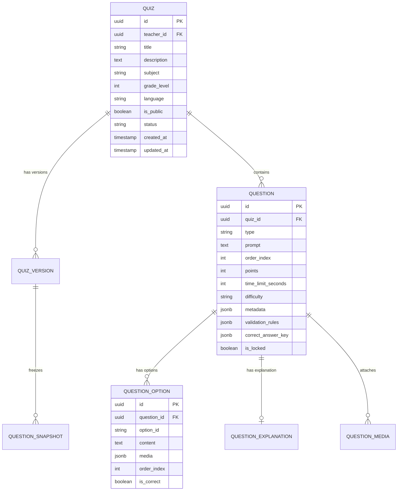
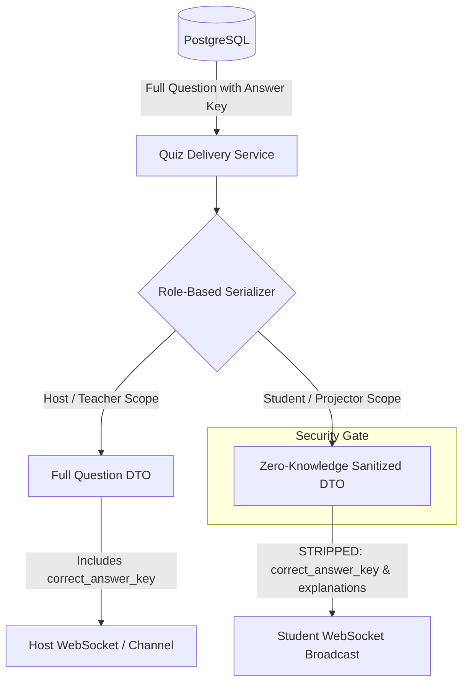
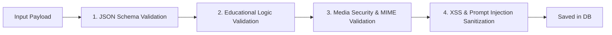

# Quiz Engine Specification

**Hujjat identifikatori:** DOC-51  
**Fayl nomi:** `QUIZ_ENGINE.md`  
**Status:** Tasdiqlangan arxitektura spetsifikatsiyasi  
**Modul:** `apps.quiz_engine`  
**Mavzu:** Savollarni saqlash, ko‘rsatish, tekshirish, versiyalash va xavfsiz uzatish  

---

## 1. Umumiy Ko‘rinish va Vazifasi

Quiz Engine — EduSelf Teacher platformasining kontent yaratish va saqlash poydevoridir. U o‘qituvchi tomonidan qo‘lda (Manual Builder) yoki AI agent yordamida yaratilgan testlar, interaktiv savollar to‘plami va slaydlar bloklarini markazlashtirilgan tarzda boshqaradi.

### Asosiy Vazifalari:
1. **Universal Canonical Model:** Barcha turdagi savollarni (29 xil) yagona formatda saqlash va boshqarish.
2. **Zero-Knowledge Question Delivery:** Talabaga savol uzatilganda to‘g‘ri javob kaliti (`correct_answer`) va izohlar tarmoq darajasida filtrlanadi.
3. **Immutability & Snapshotting:** Sessiya boshlangan vaqtda quiz to‘liq muzlatiladi (immutable snapshot). O‘qituvchining keyingi tahrirlari yangi versiyani hosil qiladi, o‘tayotgan sessiyaga va uning hisobotlariga xalal bermaydi.
4. **Validation Pipeline:** Savol tuzilishi, variantlar, media fayllar va hisoblash qoidalarining to‘g‘riligini server darajasida qat'iy tekshirish.
5. **Import/Export:** Tashqi manbalardan (CSV, XLSX, QTI, JSON) savollarni xatoliksiz yuklash va eksport qilish.

---

## 2. Domen Modeli va relyatsion tuzilma

Quiz Engine PostgreSQL relyatsion bazasida saqlanadi va Django ORM modellari orqali boshqariladi.



### 2.1 Universal Question Maydonlari
Har bir savol quyidagi standart maydonlarga ega:
- `id` (UUIDv4): Yagona identifikator.
- `quiz_id` (UUIDv4): Qaysi quizga tegishliligi.
- `type` (Enum): 29 ta savol turidan biri (masalan, `SINGLE_CHOICE`, `WORD_CLOUD`, `NUMERIC`).
- `prompt` (Text/Markdown): Savol matni (LaTeX formulalar qo‘llab-quvvatlanadi).
- `media` (JSONB): Savolga biriktirilgan rasm, audio yoki video (`{url, type, mime_type, alt_text}`).
- `options` (Array of JSONB): Variantlar ro‘yxati (mavjud bo‘lsa).
- `correct_answer_key` (JSONB): **Maxfiy kalit**, faqat tekshiruvchi qatlam ko‘ra oladi.
- `accepted_answers` (JSONB): Alternativ qabul qilinadigan javoblar (masalan, matnli savolda sinonimlar yoki vergulli/nuqtali sonlar).
- `explanation` (Text): Javob ochilganda ko‘rsatiladigan izoh.
- `points` (Integer): Savol uchun beriladigan maksimal baza ball (default: 1000).
- `time_limit_seconds` (Integer): Taymer soniyalari (default: 30, min: 5, max: 300).
- `difficulty` (Enum): `EASY`, `MEDIUM`, `HARD`.
- `order_index` (Integer): Quiz ichidagi tartib raqami.
- `is_locked` (Boolean): AI agent qayta generatsiya qilganda bu savol o‘zgarmasligi uchun himoya bayrog‘i.

---

## 3. Zero-Knowledge Question Delivery (Maxfiylik Arxitekturasi)

Talaba qurilmasi (Student Device) tarmoq orqali so‘rov yuborganida yoki WebSocket'dan `question.opened` hodisasini qabul qilganda, uning xotirasiga to‘g‘ri javob haqida **hech qanday axborot tushmasligi shart**.



### 3.1 Sanitizatsiya Qoidasi:
Student Serialization qatlami:
1. `correct_answer_key` maydonini o‘chiradi.
2. `options` ro‘yxatidagi har bir variantdan `is_correct` maydonini butunlay kesib tashlaydi.
3. `explanation` matnini olib tashlaydi.
4. Faqat savol yopilib, o‘qituvchi `answer.reveal` komandasini bergandagina server `answer.revealed` alohida hodisasi bilan to‘g‘ri javob va uning izohini uzatadi.

---

## 4. Versiyalash va Immutability (Snapshotting)

O‘qituvchi dars davomida xatoni to‘g‘rilash uchun quizni tahrirlashi mumkin. Ammo agar 5-sinfda bu quiz bo‘yicha jonli sessiya ketayotgan bo‘lsa, jonli o‘yin hech qachon buzilmasligi kerak.

1. **Active Session Freeze:** Sessiya `LIVE` holatiga o‘tgan paytda Quiz Engine joriy quiz holatidan JSONB snapshot oladi va uni `session_snapshots` jadvaliga hamda Redis keshiga yozadi:
   ```text
   Key: session:{session_id}:quiz_snapshot
   Value: JSON-encoded Quiz Schema with all questions & sanitized versions
   ```
2. **Draft / Published Paradigm:**
   - O‘qituvchi tahrir qilayotganda `version = draft` o‘zgaradi.
   - Saqlanganda `version = version + 1` bo‘ladi.
   - O‘tgan barcha sessiyalar va tarixiy hisobotlar qaysi `version`da o‘tkazilgan bo‘lsa, aynan o‘sha versiya bo‘yicha saqlanadi.

---

## 5. Savollarni Validatsiya Qilish Qatlamlari (Validation Pipeline)

Har bir savol saqlanishidan oldin ko‘p bosqichli tekshiruvdan o‘tadi:



1. **Schema Validation:** Tanlangan `type`ga mos Pydantic/JSONSchema tekshiruvi (masalan, `SINGLE_CHOICE` uchun kamida 2 ta, ko‘pi bilan 6 ta variant bo‘lishi shart).
2. **Logic Validation:**
   - To‘g‘ri javob kaliti variantlar ichida mavjudligi.
   - `time_limit_seconds` 5 dan 300 gacha oraliqda ekanligi.
   - Matnli savollarda kamida bitta alternativ to‘g‘ri javob borligi.
3. **Media Validation:** Biriktirilgan URL EduSelf S3 storage'iga tegishli ekanligi, hajmi (Rasm: <10MB, Video: <50MB) va ruxsat berilgan MIME turlari (`image/webp`, `image/png`, `video/mp4`, `audio/mp3`).
4. **Sanitization:** XSS xurujlarining oldini olish uchun HTML teglari tozalanishi (`bleach` yoki `nh3` kutubxonalari), faqat xavfsiz Markdown va LaTeX teglari (`$...$`) saqlanishi.

---

## 6. Import va Export Mexanizmlari

Quiz Engine boshqa ommabop ta'lim vositalari bilan to‘liq integratsiyalashadi:

### 6.1 CSV / Excel Import Formati:
Standart import jadvali ustunlari:
`Order | Question Type | Question Text | Time (sec) | Points | Option A | Option B | Option C | Option D | Correct Option | Explanation`

Import qilinganda:
- Har bir qator alohida parser orqali o‘tadi.
- Xatolar bo‘lsa, qaysi qatorda nima xato ekanligi aniq ko‘rsatiladi (masalan: *"7-qatorda: Single choice savolida Option C to'g'ri deb ko'rsatilgan, lekin matni bo'sh"*).

### 6.2 Export Formatlari:
1. **EduSelf JSON Bundle:** Barcha savollar, media havolalar, izohlar va sozlamalarni o‘z ichiga olgan to‘liq zaxira fayli.
2. **Printable PDF:** O‘qituvchi uchun javoblar kaliti bilan (Teacher Sheet) va o‘quvchilar uchun qog‘ozda ishlashga mo‘ljallangan blank (Student Test Paper).
3. **QTI 2.1 (IMS Global):** Xalqaro test standartlariga mos eksport (Canvas, Moodle, Blackboard uchun).
