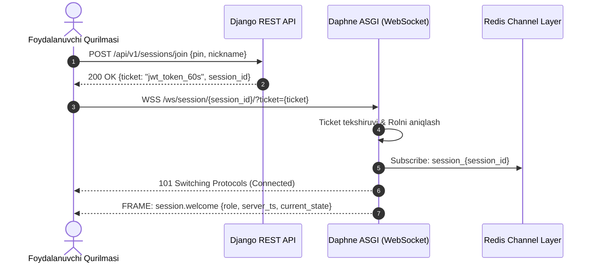
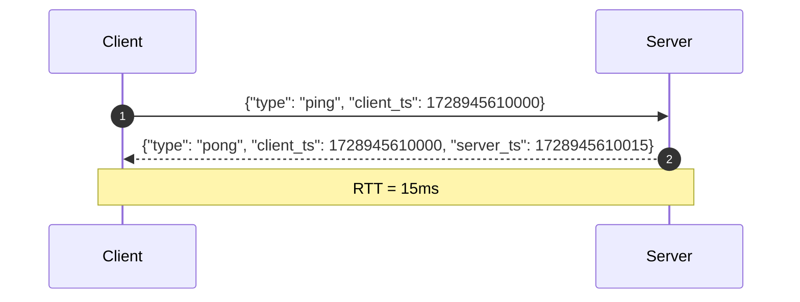

# Realtime Protocol Specification

**Hujjat identifikatori:** DOC-58  
**Fayl nomi:** `REALTIME_PROTOCOL.md`  
**Status:** Tasdiqlangan arxitektura spetsifikatsiyasi  
**Modul:** `apps.realtime`  
**Mavzu:** WebSocket ulanishlari, kadrlar formati, ticket autentifikatsiyasi va xabar almashish protokoli  

---

## 1. Umumiy Arxitektura va Transport Qatlami

EduSelf Teacher platformasining real-vaqt aloqasi **WebSocket Secure (WSS)** protokoli asosida Django Channels va Daphne ASGI serveri orqali amalga oshiriladi. 

Daphne serverlari ortida xabarlarni tarqatish (Fan-out) uchun **Redis Cluster** (`channels_redis`) xizmat qiladi.



---

## 2. Autentifikatsiya va Ticket Handshake

Xavfsizlikni ta'minlash maqsadida WebSocket ulanishida uzoq muddatli parollar yoki asosiy sessiya kukilari uzatilmaydi.

### 2.1 Ikki Bosqichli Handshake:
1. **1-bosqich (HTTP REST):** Talaba PIN kod va ismini yuboradi:
   `POST /api/v1/sessions/join/`
   Server ma'lumotlarni tekshirib, 60 soniya yashaydigan bir martalik **Ticket Token** beradi:
   ```json
   {
     "ticket": "eyJhbGciOi...",
     "session_id": "ses_7f8a9b",
     "participant_id": "usr_9921",
     "role": "student"
   }
   ```
2. **2-bosqich (WebSocket Upgrade):**
   `wss://api.eduself.uz/ws/session/ses_7f8a9b/?ticket=eyJhbGciOi...`
   Daphne `TicketAuthMiddleware` orqali tokenni tekshiradi:
   - Token muddati o‘tmaganmi?
   - Token aynan shu `ses_7f8a9b` xonasiga tegishlimi?
   Agar xato bo‘lsa, ulanish darhol `Close Code 4001 (Unauthorized)` bilan uziladi.

---

## 3. Standart Xabar Kadrlari Formati (Frame Envelope)

Barcha yuboriladigan va qabul qilinadigan xabarlar qat'iy yagona JSON konverti (Envelope) ichida bo‘ladi:

```json
{
  "v": 1,
  "id": "evt_01J8XK9M39K09Z",
  "type": "question.opened",
  "session_id": "ses_7f8a9b",
  "seq": 42,
  "ts": 1728945600123,
  "payload": {
    "question_id": "q_101",
    "prompt": "O'zbekiston poytaxti qaysi shahar?",
    "time_limit": 30,
    "options": [
      { "id": "A", "text": "Samarqand" },
      { "id": "B", "text": "Toshkent" }
    ]
  }
}
```

### Maydonlar Tavsifi:
- `v` (Integer): Protokol versiyasi (hozirgi versiya: `1`).
- `id` (String): Yagona xabar identifikatori (KSUID yoki ULID — vaqt bo‘yicha saralanuvchi).
- `type` (String): Hodisa turi (masalan: `answer.submit`, `question.closed`).
- `session_id` (String): Xona identifikatori.
- `seq` (Integer): Xonadagi xabarlarning qat'iy o‘suvchi tartib raqami (Sequence Number). Uzilishdan keyin xabarlarni tiklash uchun xizmat qiladi.
- `ts` (Integer): Server UTC timestamp millisekundlarda.
- `payload` (Object): Hodisaga oid aniq ma'lumotlar.

---

## 4. Rollar va Ruxsatlar Matritsasi (RBAC over WebSocket)

WebSocket orqali har kim xohlagan xabarini yubora olmaydi. Server consumer darajasida ruxsatlarni filtrlaydi:

| Xabar Turi (`type`) | Kim Yuborishi Mumkin? | Kimlarga Broadcast Qilinadi? |
|---|---|---|
| `session.start` | Faqat O‘qituvchi (`host`) | Barcha ishtirokchilar + Proyektor |
| `session.pause` / `session.resume` | Faqat O‘qituvchi (`host`) | Barcha ishtirokchilar + Proyektor |
| `question.open` | Faqat O‘qituvchi (`host`) | Barcha ishtirokchilar + Proyektor |
| `question.close` | Faqat O‘qituvchi (`host`) | Barcha ishtirokchilar + Proyektor |
| `answer.reveal` | Faqat O‘qituvchi (`host`) | Barcha ishtirokchilar + Proyektor |
| `participant.kick` | Faqat O‘qituvchi (`host`) | Faqat chiqarilgan o‘quvchiga |
| `answer.submit` | Faqat O‘quvchi (`student`) | Faqat Serverga (Private ACK bilan javob) |
| `activity.post` (Anonim doska) | Faqat O‘quvchi (`student`) | Faqat O‘qituvchiga (moderatsiya uchun) |
| `ping` | Barcha mijozlar | Faqat Serverga (`pong` qaytaradi) |

*Agar o‘quvchi `question.open` yoki `answer.reveal` buyrug‘ini yuborishga urinsa, server uni xavfsizlik qoidasi buzilishi deb baholaydi (`4003 Forbidden`).*

---

## 5. Yurak Urishi va Faollikni Tekshirish (Heartbeat & Liveness)

Mobil telefonlar ekranlari o‘chganda yoki brauzer fonda qolganda ulanish uzilishi mumkin:



- **Interval:** Klient har 15 soniyada `ping` xabarini yuboradi.
- **Server Javobi:** Server darhol o‘z vaqti bilan `pong` qaytaradi (bu orqali klient tarmoq kechikishini (RTT) ham o‘lchab boradi).
- **Timeout Qoidasi:** Agar ketma-ket 3 ta ping (45 soniya) davomida mijozdan signal kelmasa, server ulanishni yopiq deb hisoblaydi va Redis'da holatni `OFFLINE` deb belgilaydi.

---

## 6. Backpressure va Tarmoq Oqimini Cheklash (Rate Limiting)

Bir vaqtning o‘zida 500 nafar o‘quvchi javob yuborganida server yuklamasini muvozanatlash:
1. **Client Throttle:** Talaba qurilmasi soniyasiga ko‘pi bilan 2 ta harakat yuborishi mumkin.
2. **Channel Layer Buffer:** Har bir Channels guruhiga maksimal xabarlar buferi belgilanadi (`capacity = 1000`).
3. **Compression:** WebSocket matnlari 1KB dan oshganda `permessage-deflate` siqish algoritmidan foydalaniladi.
