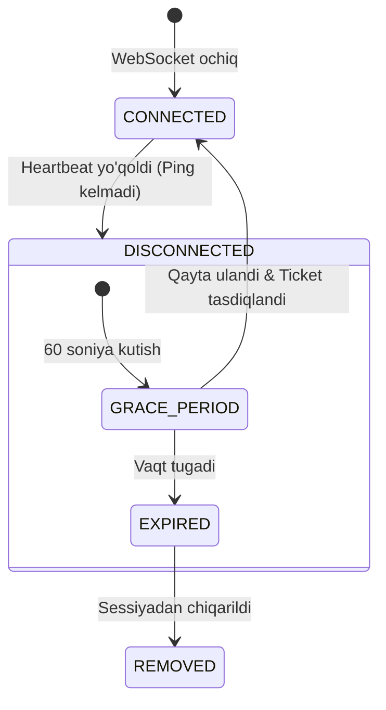
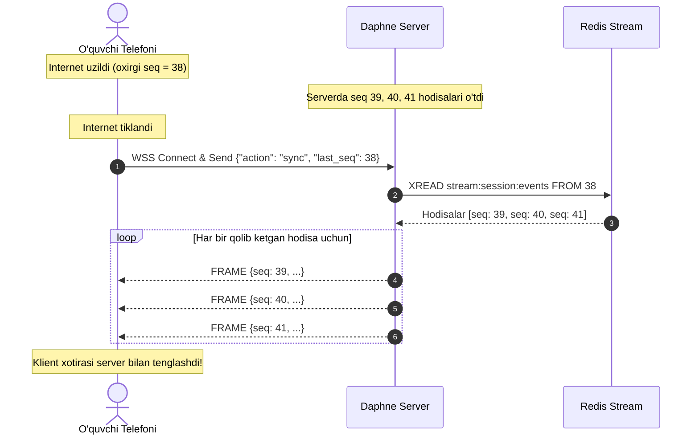
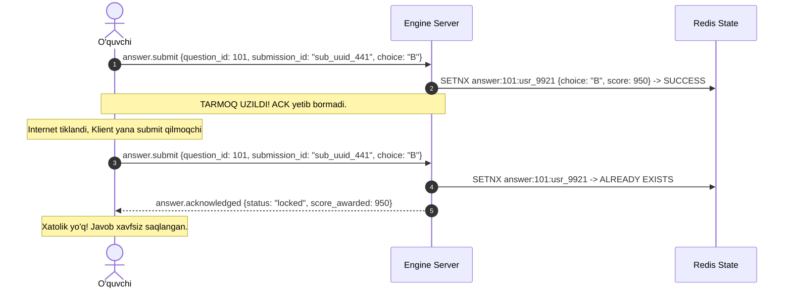

# Reconnection Strategy Specification

**Hujjat identifikatori:** DOC-60  
**Fayl nomi:** `RECONNECTION.md`  
**Status:** Tasdiqlangan arxitektura spetsifikatsiyasi  
**Modul:** `apps.realtime.sync`  
**Mavzu:** Internet uzilganda sessiyani tiklash, Redis Streams catch-up va holat sinxronizatsiyasi  

---

## 1. Muammo va Talablar

O‘zbekiston sharoitida maktablar va auditoriyalarda mobil internet yoki Wi-Fi tarmog‘i beqaror bo‘lishi (paketlar yo‘qolishi, 5–30 soniyalik uzilishlar, telefon ekranining o‘chishi) tabiiy holatdir.

Quiz & Game Engine uchun quyidagi talablar qo‘yiladi:
1. **Zero Data Loss:** O‘quvchi javob bergan bo‘lsa, ulanish uzilsa ham uning javobi yo‘qolmasligi shart.
2. **Seamless Reconnection:** Internet tiklanganda talaba sahifani qayta yuklamasdan (F5 bosmasdan) darhol joriy savol va o‘yin holatiga qaytishi lozim.
3. **Ghost Grace Period:** Vaqtincha uzilgan o‘quvchi zudlik bilan sessiyadan o‘chirib yuborilmaydi (kamida 60 soniya kutish vaqti beriladi).

---

## 2. Uzilishni Aniqlash va Kutish Vaqti (Grace Period)



- **Offline Qayd Etish:** Mijozdan 3 ta ketma-ket ping (45 soniya) kelmasa, Redis'da `presence:usr_9921:status = "OFFLINE"` deb belgilanadi.
- **Grace Period (60 soniya):** O‘quvchining jamoa tarkibidagi o‘rni va to‘plagan ballari tegilmasdan saqlanadi.
- **Auto-Kick:** Agar uzilish 5 daqiqadan oshsa, o‘quvchi sessiyadan to‘liq chiqariladi va o‘rni bo‘shatiladi.

---

## 3. Ketma-ketlikni Tiklash (Redis Streams Catch-Up)

Har bir xonada yuborilgan barcha kadrlar Redis Stream xotirasiga yozib boriladi:
`stream:session:{session_id}:events`

Mijoz brauzerida har bir qabul qilingan xabarning `seq` tartib raqami saqlanib turadi (`last_seq`).



### 3.1 Qoidalar:
- **Fast Catch-Up ($\Delta \le 50$ event):** Agar o‘quvchi 15–30 soniyaga uzilgan bo‘lsa va qolib ketgan hodisalar soni 50 tadan kam bo‘lsa, server barcha qolib ketgan kadrlarni ketma-ket qayta uzatadi (Fast-forward).
- **Snapshot Fallback ($\Delta > 50$ event):** Agar o‘quvchi 3 daqiqaga uzilib qolgan bo‘lsa va o‘yin allaqachon boshqa bosqichga o‘tib ketgan bo‘lsa, alohida-alohida kadrlarni emas, balki to‘liq **Joriy Holat Snapshot'i** (`session.state_snapshot`) yuboriladi.

---

## 4. To‘liq Holat Snapshot'i (State Snapshot Payload)

Mijoz juda uzoq vaqt uzilib qaytganda server quyidagi to‘liq obyektni jo‘natadi:

```json
{
  "type": "session.state_snapshot",
  "session_id": "ses_7f8a9b",
  "seq": 45,
  "ts": 1728945650000,
  "payload": {
    "session_status": "IN_PROGRESS",
    "current_question_index": 3,
    "total_questions": 12,
    "current_question": {
      "question_id": "q_103",
      "prompt": "Kislorodning davriy sistemadagi tartib raqami?",
      "options": [...],
      "time_limit_seconds": 30,
      "deadline_ts": 1728945670000
    },
    "my_state": {
      "has_answered_current": false,
      "total_score": 2450,
      "current_streak": 2,
      "team_id": "team_1"
    },
    "team_score": 7890
  }
}
```

Ushbu snapshot tushgach, o‘quvchi interfeysi darhol 3-savolning qolgan soniyalaridan o‘yinni davom ettiradi.

---

## 5. Javob Yuborishdagi Idempotentlik (Answer Idempotency)

Eng xatarli holat: O‘quvchi "B" variantini bosdi, tarmoq paketi serverga yetib bordi, ammo serverning "Qabul qilindi" degan javobi qaytgunicha o‘quvchining interneti uzilib qoldi.



- Har bir javob mijoz tomonidan generatsiya qilingan `submission_id` (UUID) ga ega bo‘ladi.
- Server Redis'da `SETNX` (Set if Not Exists) orqali yozadi.
- Agar bir xil so‘rov 2 marta kelsa, ikkinchi so‘rov yangi ball hisoblamaydi, faqat mavjud holatni tasdiqlaydi (`HTTP 200 / ACK`).

---

## 6. O‘qituvchi Qurilmasining Uzilishi (Host Recovery)

Agar dars o‘rtasida o‘qituvchining noutbuki o‘chib qolsa yoki brauzeri yopilib ketsa:
1. Serverdagi sessiya to‘xtab qolmaydi; server authoritative bo‘lgani uchun taymerlar va o‘quvchilar javoblari odatdagidek qabul qilinadi.
2. O‘qituvchi qayta kirganda, uning `host_token`i orqali xonaning boshqaruv huquqi to‘liq tiklanadi.
3. O‘qituvchi ekranida har bir o‘quvchining joriy statistikasi, kim javob bergani va natijalar darhol to‘liq qayta aks etadi.
