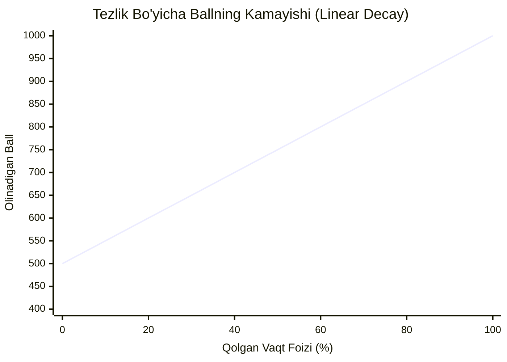
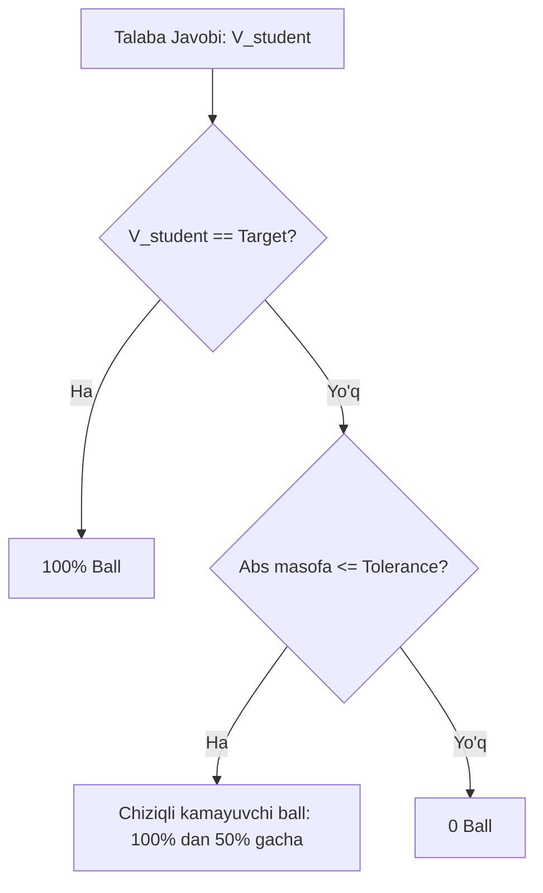

# Scoring Algorithm Specification

**Hujjat identifikatori:** DOC-55  
**Fayl nomi:** `SCORING.md`  
**Status:** Tasdiqlangan arxitektura spetsifikatsiyasi  
**Modul:** `apps.quiz_engine.scoring`  
**Mavzu:** Ball hisoblash, tezlik bonusi egri chiziqlari, qisman ball, ishonch garovi va streak multiplikatorlari  

---

## 1. Umumiy Tamoyillar va Standartlar

EduSelf Teacher platformasida ball hisoblash tizimi pedagogik adolat va o‘yin dinamikasining muvozanatiga tayanadi.

### Asosiy Qoidalar:
1. **Standart Shkala:** Har bir savol uchun maksimal standart baza ball $B_{\text{base}} = 1000$ ball qilib belgilanadi (o‘qituvchi 0 dan 5000 gacha o‘zgartirishi mumkin).
2. **Pedagogik Moslashuvchanlik:** O‘qituvchi har bir quiz uchun scoring rejimini tanlay oladi:
   - *Tezlik va Bilim (Speed & Accuracy)* — Kahoot/Blooket uslubidagi klassik poyga.
   - *Faqat Bilim (Accuracy Only)* — Barcha o‘quvchilarga teng vaqt, tezlik uchun ortiqcha ball yo‘q.
   - *Ishonch Garovi (Confidence Wager)* — O‘z bilimiga ishonch darajasini qo‘shib o‘ynash.

---

## 2. Tezlik Bonusi (Speed Decay Function)

Savol ochilgan payt $T_0$ va savol yopilish muddati $T_{\text{deadline}}$ o‘rtasida o‘tgan vaqt hisoblanadi.

$$T_{\text{elapsed}} = T_{\text{submission}} - T_0, \quad T_{\text{total}} = T_{\text{deadline}} - T_0, \quad T_{\text{remaining}} = T_{\text{deadline}} - T_{\text{submission}}$$

### 2.1 Standart Chiziqli Formula (Linear Decay):
Agar javob to‘g‘ri bo‘lsa:

$$\text{FinalScore} = B_{\text{base}} \times \left( 0.5 + 0.5 \times \frac{T_{\text{remaining}}}{T_{\text{total}}} \right)$$

- Darhol javob berilsa ($T_{\text{remaining}} \approx T_{\text{total}}$): $1000 \times 1.0 = 1000$ ball.
- Taymer tugash arafasida javob berilsa ($T_{\text{remaining}} \to 0$): $1000 \times 0.5 = 500$ ball (to‘g‘ri javob uchun kafolatlangan 50% ball).
- Noto‘g‘ri javob berilsa: $0$ ball.

### 2.2 Notekis Kamayuvchi Formula (Sigmoidal Decay - Tanlov):
O‘quvchilar javobni o‘qimasdan shunchaki birinchi soniyada bosib yuborishining (random guessing) oldini olish uchun dastlabki 1 soniyada ball bir xil saqlanadi, so‘ngra sekin pasayadi:

$$\text{Multiplier} = 0.5 + \frac{0.5}{1 + e^{k \cdot (T_{\text{elapsed}} - T_{\text{half}})}}$$

---

## 3. Qisman Ball Berish Qoidalari (Partial Credit)

### 3.1 Ko‘p Tanlovli Savollar (Multiple Select)
Faraz qilaylik, 4 ta variant bor, shundan 2 tasi to‘g‘ri ($C_1, C_2$), 2 tasi noto‘g‘ri ($W_1, W_2$).

**Jarima Bilan Qisman Ball (Partial Credit with Penalty):**
$$\text{Score} = B_{\text{base}} \times \max\left( 0, \frac{|S \cap C|}{|C|} - \frac{|S \cap W|}{|W|} \right)$$
*Bu yerda $S$ — talaba tanlagan variantlar to‘plami.*

**Misol:**
- To‘g‘ri variantlar: {A, B}. Noto‘g‘ri variantlar: {C, D}.
- Talaba {A} ni tanladi: $\frac{1}{2} - \frac{0}{2} = 0.5 \implies 500$ ball.
- Talaba {A, C} ni tanladi: $\frac{1}{2} - \frac{1}{2} = 0 \implies 0$ ball (tasodifiy hammasini belgilab chiqishga yo‘l qo‘yilmaydi).
- Talaba {A, B} ni tanladi: $\frac{2}{2} - 0 = 1.0 \implies 1000$ ball.

### 3.2 Tartiblash Savollari (Puzzle / Order)
Talaba ro‘yxatidagi elementlar tartibi to‘g‘ri tartib bilan **Kendall Tau masofasi (Inversiyalar soni)** orqali taqqoslanadi.

$$\text{Score} = B_{\text{base}} \times \left( 1 - \frac{\text{Inversions}}{\text{MaxInversions}} \right)$$

4 ta element uchun $\text{MaxInversions} = \frac{4 \times (4-1)}{2} = 6$.
- Agar talaba faqat 2 ta qo‘shni elementni adashtirgan bo‘lsa ($\text{Inversions} = 1$):
  $$\text{Score} = 1000 \times \left( 1 - \frac{1}{6} \right) \approx 833 \text{ ball}.$$

### 3.3 Juftliklarni Moslashtirish (Match Pairs)
Agar savolda $N$ ta juftlik bo‘lsa:
$$\text{Score} = B_{\text{base}} \times \frac{K_{\text{correct}}}{N}$$
Har bir to‘g‘ri topilgan juftlik uchun proporsional ball beriladi.

---

## 4. Oraliq va Tolerans Baholash (Sliders & Numeric)

Aniq sonli yoki oraliqli savollarda o‘quvchi haqiqiy qiymatga qanchalik yaqin kelgani baholanadi.

### Formula:
Agar $|V_{\text{student}} - V_{\text{target}}| \le \text{Tolerance}$:
$$\text{Score} = B_{\text{base}} \times \left( 1.0 - 0.5 \times \frac{|V_{\text{student}} - V_{\text{target}}|}{\text{Tolerance}} \right)$$

---

## 5. Ishonch Garovi Qoidalari (Confidence Wagering)

O‘quvchi javob berish bilan birga o‘zining ishonch darajasini belgilaydi:

| Ishonch Darajasi | Garov Multiplikatori ($M$) | To‘g‘ri Javobda | Noto‘g‘ri Javobda (Penalty) |
|---|---|---|---|
| **Past (Low)** | $1.0\times$ | $+500$ ball | $-0$ ball (xavfsiz) |
| **O‘rta (Medium)** | $1.5\times$ | $+1000$ ball | $-250$ ball |
| **Yuqori (High)** | $2.0\times$ | $+2000$ ball | $-1000$ ball (yuqori xavf) |

*Eslatma: Natija hech qachon umumiy hisobda 0 dan pastga tushib ketmaydi ($\text{TotalScore} \ge 0$).*

---

## 6. Ketma-ket To‘g‘ri Javob Multiplikatori (Streak Multiplier)

O‘quvchining motivatsiyasini oshirish uchun ketma-ket to‘g‘ri javoblar zanjiri (Answer Streak) uchun bonus beriladi:

| Streak (Ketma-ketlik) | Multiplikator | Izoh |
|---|---|---|
| 1 ta to‘g‘ri | $1.0\times$ | Bonus yo‘q |
| 2 ta ketma-ket | $1.1\times$ | +10% bonus |
| 3 ta ketma-ket | $1.2\times$ | +20% bonus ("On Fire" unvoni) |
| 4 ta ketma-ket | $1.3\times$ | +30% bonus |
| 5 va undan ortiq | $1.5\times$ | Maksimal cap (+50% bonus) |

Bitta noto‘g‘ri javob berilganda streak darhol 0 ga qaytadi.

---

## 7. Anti-Cheat va Millisekundlik Tenglikni Hal Qilish (Tie-Breaking)

Ikkita o‘quvchi bir xil ball to‘plaganda yoki bir xil variantni tanlaganda:
1. **Server-Side Timestamp:** Klient yuborgan vaqtga emas, xabar Daphne WebSocket serveriga yetib kelgan aniq UTC millisekundiga (`arrival_ts`) tayaniladi.
2. **Tie-Breaker Ketma-ketligi:**
   - 1-mezon: Eng ko‘p to‘g‘ri javoblar soni.
   - 2-mezon: Umumiy javob berish uchun sarflangan o‘rtacha vaqt (kamroq vaqt sarflagan yuqoriga chiqadi).
   - 3-mezon: Eng uzun streak rekordi.
   - 4-mezon: Deterministik UUID tartibi.
