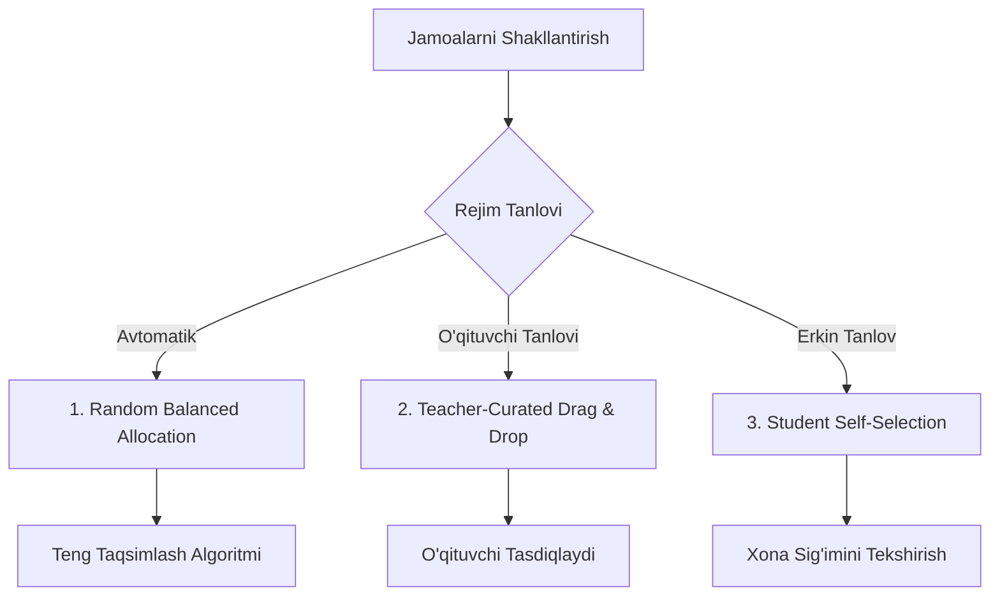
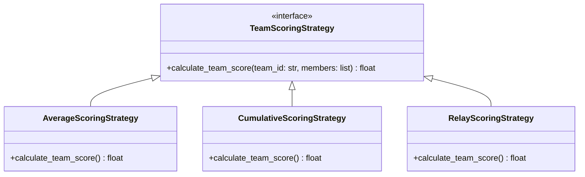

# Team Management Specification

**Hujjat identifikatori:** DOC-56  
**Fayl nomi:** `TEAM_SYSTEM.md`  
**Status:** Tasdiqlangan arxitektura spetsifikatsiyasi  
**Modul:** `apps.game_engine.teams`  
**Mavzu:** Jamoalarni shakllantirish, balanslash, jamoaviy ball hisoblash va uzilgan o‘yinchilarni boshqarish  

---

## 1. Umumiy Ko‘rinish va Maqsad

Team System — EduSelf Teacher platformasida o‘quvchilar o‘rtasida hamkorlik (collaboration), ijtimoiy muloqot va do‘stona raqobatni shakllantirishga xizmat qiladi.

Tizim quyidagi 3 ta asosiy talabni ta'minlaydi:
1. **Adolatli Taqsimot:** Sinfdagi o‘quvchilar soni toq bo‘lganda ham jamoalar o‘rtasida sun'iy tengsizlik yaratmaslik.
2. **Moslashuvchan Hisob-Kitob:** Har xil sonli a'zolarga ega jamoalar uchun o‘rtacha (average) yoki estafeta (relay) ko‘rsatkichlarini hisoblash.
3. **Ghost Player Himoyasi:** Dars paytida telefoni o‘chib qolgan yoki tarmoqdan uzilgan o‘quvchilar jamoaning umumiy ballini tushirib yubormasligi.

---

## 2. Jamoalarni Shakllantirish Usullari (Formation Modes)

### 2.1 Random Balanced Allocation (Tasodifiy Balanslash):
- O‘qituvchi jamoalar sonini belgilaydi ($K \in [2, 8]$).
- Tizim Fisher-Yates shuffle algoritmi orqali ishtirokchilar ro‘yxatini aralashtiradi va modulo bo‘yicha tarqatadi:
  $$\text{TeamIndex}_i = i \pmod K$$
- Bu usulda har bir jamoa a'zolari soni orasidagi farq ko‘pi bilan 1 tadan oshmaydi ($|N_A - N_B| \le 1$).

### 2.2 Teacher-Curated (O‘qituvchi Boshqaruvi):
- O‘qituvchi kuchli va sust o‘zlashtiruvchi o‘quvchilarni ataylab aralashtirishi yoki sinf partalariga qarab qo‘lda guruhlashi mumkin.
- Dashboardda qulay Kanban-uslubidagi Drag-and-Drop interfeysi beriladi.

### 2.3 Student Self-Selection (Erkin Tanlov):
- O‘quvchi o‘z telefonida bo‘sh jamoalardan birini tanlaydi.
- Jamoaga kirish uchun maksimal limit o‘rnatiladi:
  $$\text{MaxPerTeam} = \left\lceil \frac{\text{TotalStudents}}{K} \right\rceil + 1$$
- Birorta jamoa to‘lib qolsa, boshqa o‘quvchi unga kira olmaydi, boshqa bo‘sh jamoani tanlashi shart bo‘ladi.

---

## 3. Jamoaviy Ballarni Agregatsiya Qilish Modellari

O‘yin turiga qarab jamoaning umumiy bali quyidagi 3 usuldan biri orqali hisoblanadi:

### 3.1 Average Score Model (O‘rtacha Ball — Default):
A jamoada 5 kishi, B jamoada 4 kishi bo‘lsa, adolatni saqlash uchun a'zolarning o‘rtacha bali olinadi:
$$\text{Score}_{\text{team}} = \frac{1}{|M_{\text{active}}|} \sum_{i \in M_{\text{active}}} \text{Score}_i$$
Bu yerda $M_{\text{active}}$ — faol (offline bo‘lmagan) a'zolar to‘plami.

### 3.2 Cumulative Sum Model (Yig‘indi Ball):
*Gold Quest*, *Boss Battle* yoki *Blook Rush* kabi umumiy resurs yig‘ish o‘yinlarida qo‘llaniladi. Jamoaning har bir to‘g‘ri javobi umumiy g‘aznaga qo‘shiladi:
$$\text{Score}_{\text{team}} = \sum_{i \in M} \text{Score}_i$$

### 3.3 Relay / Turn-Based Model (Estafeta):
Har bir savolga butun jamoa emas, balki jamoaning faqat bitta belgilangan o‘yinchisi navbat bilan javob beradi:
- 1-savol: O‘yinchi A1 (Jamoa A) vs O‘yinchi B1 (Jamoa B)
- 2-savol: O‘yinchi A2 (Jamoa A) vs O‘yinchi B2 (Jamoa B)
Bu barcha o‘quvchilarning teng ishtirokini kafolatlaydi.

---

## 4. Tarmoqdan Uzilgan O‘yinchilar (Ghost Player Handling)

Agar jamoa a'zosi o‘yin o‘rtasida tarmoqdan uzilib qolsa (offline bo‘lsa):

1. **Grace Period (Kutish muddati):** Server 45 soniya davomida o‘yinchini "Uzilgan" (`OFFLINE`) deb belgilaydi, ammo jamoa tarkibidan o‘chirmaydi.
2. **Active Denominator Exclusion:** Agar o‘yinchi savol vaqtida javob bermasa va uning holati `OFFLINE` bo‘lsa, u **O‘rtacha Ball maxrajidan vaqtincha chiqariladi**:
   $$|M_{\text{active}}| = |M_{\text{total}}| - |M_{\text{offline\_no\_answer}}|$$
   Natijada, bitta o‘quvchining telefoni o‘chib qolishi butun jamoaning o‘rtacha ballini yerga urmaydi.
3. **Reconnection Recovery:** O‘quvchi interneti tiklangach, avvalgi to‘plagan ballari bilan yana faol hisob-kitobga qaytadi.

---

## 5. Jamoa Identifikatsiyasi va Vizualizatsiya (Team Identity)

Har bir jamoaga bolalarga qiziqarli va taniqli nomlar avtomatik beriladi:

| Jamoa ID | Nomi (O‘zbekcha) | Asosiy Rang | Hex Kodi | Emblema / Ikonka |
|---|---|---|---|---|
| `team_1` | **Qoplonlar (Leopards)** | Yorqin Qizil | `#EF4444` | 🐆 Chaqqonlik |
| `team_2` | **Lochinlar (Falcons)** | Moviy Ko‘k | `#3B82F6` | 🦅 Tezkorlik |
| `team_3` | **Sherlar (Lions)** | Qahrabo Sariq | `#F59E0B` | 🦁 Jasorat |
| `team_4` | **Bo‘rilar (Wolves)** | Zumrad Yashil | `#10B981` | 🐺 Hamjihatlik |
| `team_5` | **Burgutlar (Eagles)** | Binafsharang | `#8B5CF6` | 🦅 Aniqlik |
| `team_6` | **Tulporlar (Stallions)** | Zangori Firuza | `#06B6D4` | 🐎 Quvvat |

O‘quvchining mobil ekrani o‘z jamoasi rangiga bo‘yaladi va tepa qismida doimiy ravishda o‘z jamoasining o‘rni va yaqin raqib bilan farqi aks etib turadi.
