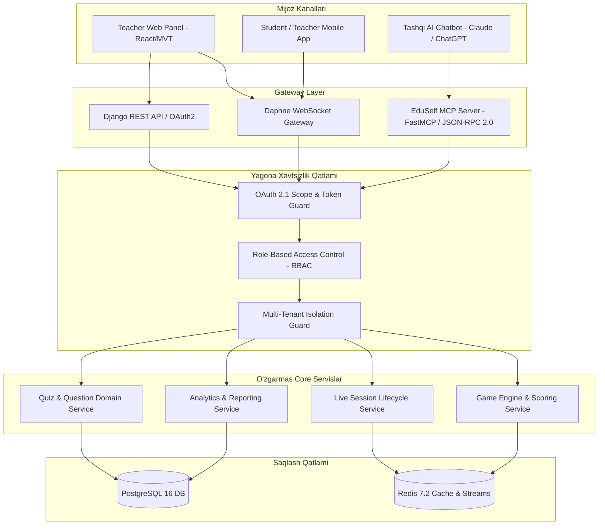

# MCP Architecture Specification

**Hujjat identifikatori:** DOC-80  
**Fayl nomi:** `MCP_ARCHITECTURE.md`  
**Status:** Tasdiqlangan arxitektura spetsifikatsiyasi  
**Modul:** `apps.mcp_server`  
**Mavzu:** Model Context Protocol (MCP) serverining me'moriy tuzilishi, subsystem bog‘lanishlari va Zero-Bypass tamoyili  

---

## 1. Umumiy Ko‘rinish va Vazifasi

EduSelf Teacher MCP Serveri tashqi sun'iy intellekt mijozlari (masalan, Claude Desktop, ChatGPT, Cursor, Windsurf va boshqa MCP qo‘llab-quvvatlovchi tizimlar) uchun EduSelf Teacher platformasining standartlashtirilgan interfeysini (API Gateway) taqdim etadi.

O‘qituvchi o‘zi o‘rgangan AI chatbot ichida turib:
- Dars mavzusiga mos viktorina yaratishi;
- Jonli o‘yin xonasini (Live Session) ochishi;
- Savollarni almashtirishi va natijalarni tahlil qilishi mumkin.

---

## 2. Kritik Arxitektura Sharti: Zero-Bypass Architecture

> [!IMPORTANT]
> **Zero-Bypass Printsipi:**
> MCP server alohida biznes mantiqqa yoki to‘g‘ridan-to‘g‘ri ma'lumotlar bazasiga (PostgreSQL/Redis) kirish huquqiga ega **mustaqil backend emas**. U xuddi EduSelf Web Dashboard yoki Mobil Ilova kabi platformaning **Yagona Core Domain Servislari** (Unified Domain Layer) orqali ishlaydi.

### 2.1 Zero-Bypass Qoidalarining Kafolati:
1. **Validatsiyadan Qochib Bo‘lmaydi:** MCP orqali yuborilgan savollar qo‘lda kiritilgan savollar bilan bir xil Pydantic va relyatsion validatsiyalardan o‘tadi.
2. **Tenant Izolyatsiyasi:** O‘qituvchi boshqa maktab yoki boshqa o‘qituvchining quizlarini MCP orqali ko‘ra olmaydi yoki tahrirlay olmaydi (`403 Forbidden`).
3. **Idempotency & Auditing:** Har bir MCP tool chaqiruvi audit loglarida qayd etiladi va xavfli amallar (masalan, sessiyani boshlash yoki o‘chirish) o‘qituvchining aniq tasdig‘ini (`destructiveHint`) talab qiladi.

---

## 3. Subsystemlar va Komponentlar Bog‘lanishi

MCP arxitekturasi 4 ta asosiy qatlamdan iborat:

### 3.1 Transport Adapters (`apps.mcp_server.transport`)
- **Stdio Transport:** Mahalliy ish stoli mijozlari (Claude Desktop, IDElar) uchun standart oqim orqali uzatish.
- **HTTP SSE Transport:** Masofaviy veb-mijozlar va ChatGPT Actions uchun Server-Sent Events shlyuzi.

### 3.2 Protocol & Dispatcher (`apps.mcp_server.protocol`)
- JSON-RPC 2.0 xabarlarini tahlil qiluvchi (parser), metodlarni marshrutlovchi va xatolarni standart formatda qaytaruvchi dispetcher.

### 3.3 MCP Features Registry (`apps.mcp_server.registry`)
- **Tools Registry:** 17 ta platforma amallarining JSONSchema deklaratsiyasi.
- **Resources Registry:** `eduself://...` URI resurslarini taqdim etish.
- **Prompts Registry:** Tayyor pedagogik prompt shablonlarini e'lon qilish.

### 3.4 Core Service Connectors (`apps.mcp_server.connectors`)
- MCP buyruqlarini Django Core xizmatlariga yo‘naltiruvchi asinxron ko‘prik.
