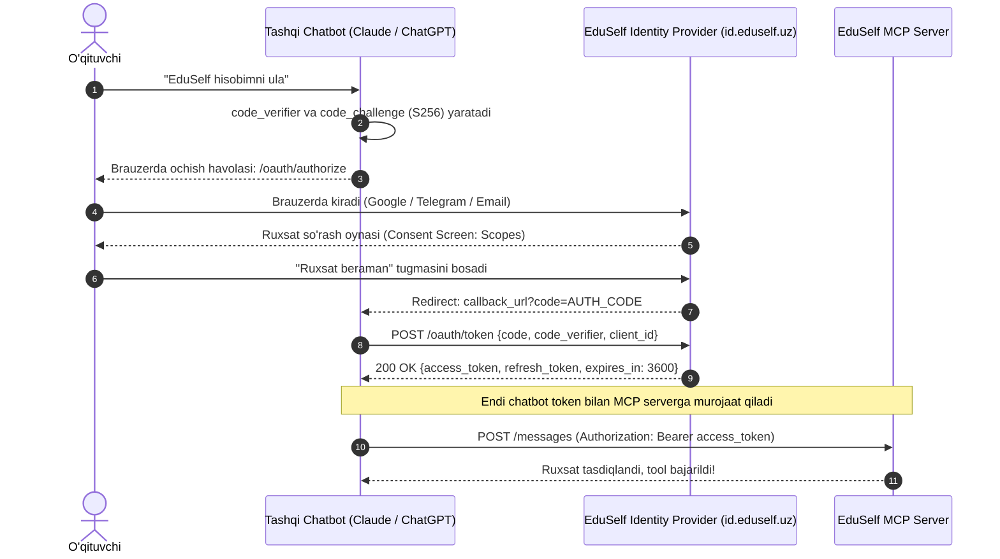

# MCP Authentication Specification

**Hujjat identifikatori:** DOC-84  
**Fayl nomi:** `MCP_AUTH.md`  
**Status:** Tasdiqlangan arxitektura spetsifikatsiyasi  
**Modul:** `apps.mcp_server.auth`  
**Mavzu:** OAuth 2.1 + PKCE protokoli, hisobni bog‘lash (Account Linking) va xavfsiz token boshqaruvi  

---

## 1. Umumiy Ko‘rinish va Xavfsizlik Talabi

EduSelf Teacher MCP Serveri ochiq parollar yoki statik API kalitlar bilan ishlamaydi. Har qanday tashqi AI chatbot (Claude Desktop, ChatGPT va boshqalar) zamonaviy **OAuth 2.1** standarti va **PKCE (Proof Key for Code Exchange)** orqali o‘qituvchining EduSelf akkauntiga xavfsiz bog‘lanadi (Account Linking).

### Asosiy Qoidalar:
1. **Statik Parollar Taqiqlanadi:** Chatbot foydalanuvchining login/parolini hech qachon bilmaydi.
2. **PKCE Majburiy:** Kodlarni tutib olish (Code Interception Attack) xurujlarining oldini olish uchun barcha mijozlar `S256` PKCE shifrlash usulidan foydalanishi shart.
3. **Qisqa Muddatli Tokenlar:** `access_token` 1 soat yashaydi, uzluksiz ishlash esa `refresh_token` orqali ta'minlanadi.

---

## 2. To‘liq OAuth 2.1 + PKCE Hisobni Bog‘lash Oqimi



---

## 3. OAuth 2.1 Endpoints Spetsifikatsiyasi

EduSelf Identity Server quyidagi standart endpointlarni taqdim etadi:

### 3.1 Avtorizatsiya Nuqtasi (Authorization Endpoint)
- **URL:** `GET https://id.eduself.uz/oauth/authorize`
- **Majburiy Parametrlar:**
  - `response_type=code`
  - `client_id=claude-desktop-client`
  - `redirect_uri=http://localhost:8085/oauth/callback`
  - `scope=quiz:read quiz:write session:create session:control`
  - `code_challenge=E9Melhoa2OwvFrEMTJguCHAo652R29pxq046Wv...`
  - `code_challenge_method=S256`

---

### 3.2 Token Almashish Nuqtasi (Token Endpoint)
- **URL:** `POST https://id.eduself.uz/oauth/token`
- **Headers:** `Content-Type: application/x-www-form-urlencoded`
- **Body:**
  ```text
  grant_type=authorization_code
  &client_id=claude-desktop-client
  &code=AUTH_CODE_xyz
  &redirect_uri=http://localhost:8085/oauth/callback
  &code_verifier=dBjftJeZ4CVP-mB92K27uhbUJU1p1r_wW1gFWFOEjXk
  ```
- **Javob (200 OK):**
  ```json
  {
    "access_token": "eyJhbGciOi...",
    "token_type": "Bearer",
    "expires_in": 3600,
    "refresh_token": "rfr_99a8b7c6...",
    "scope": "quiz:read quiz:write session:create session:control"
  }
  ```

---

## 4. Stdio Mahalliy Ulanish va CLI Login (`eduself login`)

Mahalliy terminal yoki Claude Desktop foydalanuvchilari uchun qulay buyruqlar satri vositasi taqdim etiladi:

1. Foydalanuvchi terminalda buyruq beradi:
   ```bash
   eduself login
   ```
2. CLI avtomatik ravishda mahalliy vaqtinchalik portni (`http://localhost:8085`) ochadi va foydalanuvchining standart brauzerida tizimga kirish sahifasini ochadi.
3. Tasdiqlangach, `refresh_token` operatsion tizimning xavfsiz kalitlar omboriga (Windows Credential Manager / macOS Keychain) `keyring` kutubxonasi orqali yoziladi.
4. Natijada foydalanuvchi har safar qayta login qilib o‘tirmaydi.
