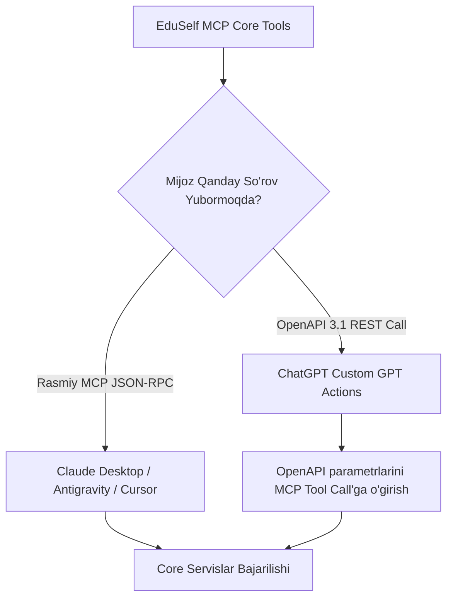

# MCP Compatibility Matrix Specification

**Hujjat identifikatori:** DOC-87  
**Fayl nomi:** `MCP_COMPATIBILITY.md`  
**Status:** Tasdiqlangan arxitektura spetsifikatsiyasi  
**Modul:** `apps.mcp_server.compatibility`  
**Mavzu:** ChatGPT, Claude Desktop, Cursor, Windsurf va boshqa AI mijozlarining MCP imkoniyatlari va moslik matritsasi  

---

## 1. Umumiy Ko‘rinish

Har bir sun'iy intellekt mijozi Model Context Protocol (MCP) spetsifikatsiyasini to‘liq yoki qisman qo‘llab-quvvatlaydi. Masalan, ayrim mijozlar faqat Stdio transportini tanisa, boshqalari (ChatGPT) faqat OpenAPI/SSE shlyuzlari orqali ulanishi mumkin.

EduSelf MCP serveri turli mijozlarga moslashuvchan (Polyfill & Adapter) arxitekturasiga ega.

---

## 2. Mijozlar Moslik Matritsasi (Compatibility Matrix)

| AI Mijoz Nomi | Transport Rejimi | Tools Qo‘llanishi | Resources | Prompts | Tasdiq Oynasi (`destructiveHint`) | Autentifikatsiya Usuli |
|---|---|---|---|---|---|---|
| **Claude Desktop** | Stdio & SSE | To‘liq (Native) | Ha | Ha | **Ha (To‘liq)** | Mahalliy CLI Token / OAuth |
| **ChatGPT (Custom GPT)** | HTTP SSE / OpenAPI | To‘liq (Actions) | Qisman | Yo‘q | Ha (ChatGPT Conformation) | OAuth 2.0 / 2.1 |
| **Cursor IDE** | Stdio | To‘liq | Ha | Qisman | Yo‘q (Avtomatik) | Local Env Var |
| **Windsurf IDE** | Stdio | To‘liq | Ha | Qisman | Yo‘q | Local Env Var |
| **Antigravity IDE** | Stdio & SSE | To‘liq (Native) | Ha | Ha | Ha | OAuth / Token |
| **LibreChat / OpenWebUI** | HTTP SSE | To‘liq | Ha | Qisman | Klient sozlamasiga bog‘liq | Bearer Token |

---

## 3. Mijozlarning O‘ziga Xos Xususiyatlari va Adaptatsiya

### 3.1 Claude Desktop (Rasmiy Standart)
- Claude Desktop rasmiy Anthropic MCP spetsifikatsiyasining eng to‘liq ijrochisi hisoblanadi.
- Barcha 17 ta tool, 4 ta resurs va 3 ta prompt hech qanday qo‘shimcha konversiyalarsiz to‘g‘ridan-to‘g‘ri ishlaydi.

### 3.2 ChatGPT (Custom GPT Actions Orqali)
- ChatGPT hozirgi kunda MCP JSON-RPC protokolini to‘g‘ridan-to‘g‘ri emas, balki **Custom Actions (OpenAPI 3.1)** orqali qabul qiladi.
- EduSelf MCP Serveri o‘zining SSE manzilida `/openapi.json` marshrutini taqdim etadi. Bu orqali 17 ta tool avtomatik ravishda OpenAPI Actions ko‘rinishida ChatGPT’ga ulanadi.

---

## 4. Sinovdan O‘tkazish va Smoke Testing Qo‘llanmasi

Har bir yangi versiya chiqarilganda quyidagi ketma-ketlikda smoke test o‘tkaziladi:
1. **Claude Desktop Test:** Viktorina yaratish $\to$ Lobbini ochish $\to$ `destructiveHint` oynasi chiqishini tekshirish.
2. **ChatGPT Action Test:** OAuth orqali kirish $\to$ `list_question_sets` buyrug‘i bilan testlar ro‘yxatini olish.
3. **Stdio Protocol Test:** CLI orqali JSON-RPC `tools/list` chaqiruviga to‘g‘ri schema qaytishini tekshirish.
