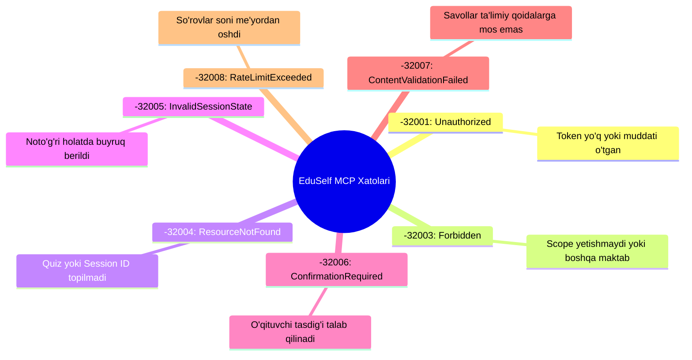

# MCP Error & Compatibility Policy

**Hujjat identifikatori:** DOC-89  
**Fayl nomi:** `MCP_ERRORS.md`  
**Status:** Tasdiqlangan arxitektura spetsifikatsiyasi  
**Modul:** `apps.mcp_server.errors`  
**Mavzu:** JSON-RPC 2.0 xatolik kodlari, EduSelf domen xatolari, versiyalash va orqaga moslik (Backward Compatibility) siyosati  

---

## 1. Umumiy Ko‘rinish

EduSelf Teacher MCP Serveri rasmiy **JSON-RPC 2.0** spetsifikatsiyasiga to‘liq mos keladigan xatoliklar tizimini yuritadi. Har qanday xatolik (noto‘g‘ri argument, muddati o‘tgan token yoki ziddiyatli o‘yin holati) mijoz dasturiga tushunarli, dasturiy qayta ishlanishi oson bo‘lgan strukturali formatda qaytariladi.

---

## 2. JSON-RPC 2.0 Standart Xatolari

Ushbu xatolar protokol darajasidagi buzilishlar uchun ajratilgan:

| Kod | Xatolik Nomi | Tavsifi va Kelib Chiqish Sababi |
|---|---|---|
| `-32700` | **Parse Error** | Serverga yaroqsiz JSON matni kelib tushdi |
| `-32600` | **Invalid Request** | Yuborilgan JSON-RPC so‘rovi tuzilishi noto‘g‘ri |
| `-32601` | **Method Not Found** | Chaqirilgan tool yoki metod mavjud emas |
| `-32602` | **Invalid Params** | Tool argumentlari noto‘g‘ri yoki tipi mos emas (Validation Error) |
| `-32603` | **Internal Error** | Server ichki xatoligi (boshqarilmagan istisno) |

---

## 3. EduSelf Maxsus Domen Xatolari (`-32000` dan `-32099` gacha)

Domen va biznes qoidalariga oid xatoliklar quyidagi kodlar bilan belgilanadi:



### 3.1 Xatolik Javobi Strukturasi (Error Response Example):
```json
{
  "jsonrpc": "2.0",
  "id": 14,
  "error": {
    "code": -32005,
    "message": "Sessiya allaqachon yakunlangan, savollarni almashtirib bo'lmaydi!",
    "data": {
      "error_code": "INVALID_SESSION_STATE",
      "session_id": "ses_7f8a9b",
      "current_state": "COMPLETED",
      "allowed_actions": ["get_session_report", "generate_followup_activity"]
    }
  }
}
```

---

## 4. Xatoliklar Izohi va Ularni Hal Qilish

### 4.1 `-32005 InvalidSessionState`
- **Vaziyat:** Masalan, AI chatbot `start_session` buyrug‘ini allaqachon yakunlangan (`COMPLETED`) sessiyaga nisbatan chaqirganida.
- **Yechim:** Server qaysi amallar ruxsat etilganligini `allowed_actions` massivida qaytaradi, shunda chatbot o‘qituvchiga to‘g‘ri yo‘nalish bera oladi.

### 4.2 `-32006 ConfirmationRequired`
- **Vaziyat:** Xavfli amal (masalan, `end_session`) o‘qituvchi tasdig‘isiz bajarilmoqchi bo‘lganda.
- **Yechim:** Chatbot o‘qituvchiga tasdiqlash so‘rovini ko‘rsatishi shart.

---

## 5. Versiyalash va Orqaga Moslik (Backward Compatibility Policy)

Platforma rivojlanishi davomida tashqi mijozlar bilan aloqa uzilib qolmasligi uchun:
1. **SemVer Standarti:** MCP server versiyasi `1.0.0` ko‘rinishida belgilanadi.
2. **Maydonlarni O‘chirish Taqiqlanadi:** Mavjud toollarning argumentlari yoki resurslar URI manzillari o‘zgartirilmaydi. Yangi xususiyatlar faqat **qo‘shimcha ixtiyoriy parametrlar** sifatida kiritiladi.
3. **Deprecation Policy:** Agar biron tool eskirsa, u kamida 6 oy davomida ogohlantirish (`deprecated: true`) bilan saqlanadi va faqat yangi Major versiyada (`2.0.0`) o‘chirilishi mumkin.
