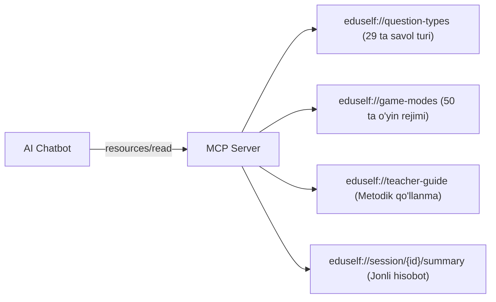
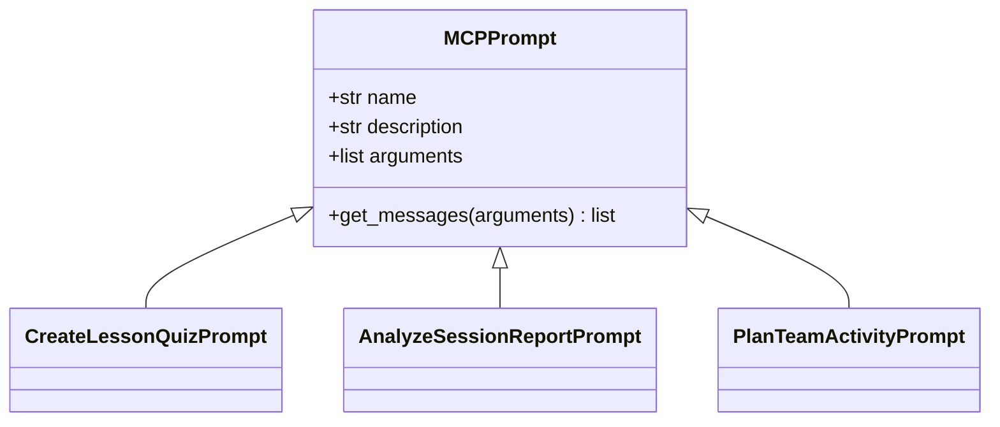

# MCP Resources & Prompts Specification

**Hujjat identifikatori:** DOC-83  
**Fayl nomi:** `MCP_RESOURCES.md`  
**Status:** Tasdiqlangan arxitektura spetsifikatsiyasi  
**Modul:** `apps.mcp_server.resources`  
**Mavzu:** Tizim resurslari (`eduself://...`), dinamik obunalar va o‘rnatilgan prompt shablonlari  

---

## 1. Umumiy Ko‘rinish

Model Context Protocol (MCP) nafaqat Toollarni, balki sun'iy intellekt modeli o‘qishi va kontekst sifatida foydalanishi mumkin bo‘lgan **Resurslar (Resources)** hamda o‘qituvchiga qulaylik yaratuvchi **O‘rnatilgan Promptlar (Prompts)**ni ham taqdim etadi.

---

## 2. Standart Tizim Resurslari (MCP Resources)

Resurslar modelga platforma haqidagi statik va dinamik bilimlarni kontekst sifatida yuklash imkonini beradi:

### 2.1 Resurslar Katalogi:

| Resurs URI | MIME Type | Tavsifi | Ruxsat Talabi |
|---|---|---|---|
| `eduself://question-types` | `application/json` | Barcha 29 ta savol turlari, ularning cheklovlari va JSON sxemalari | Ochiq (Public) |
| `eduself://game-modes` | `application/json` | Barcha 50 ta o‘yin rejimlari, g‘alaba shartlari va form-faktorlari | Ochiq (Public) |
| `eduself://teacher-guide` | `text/markdown` | Darsda interaktiv viktorinalarni o‘tkazish bo‘yicha metodik qo‘llanma | Ochiq (Public) |
| `eduself://session/{session_id}/summary` | `application/json` | Jonli sessiyaning joriy holati, ballari va savollari xulosasi | `session:read` |

### 2.2 Dinamik Resurslarga Obuna Bo‘lish (Resource Subscription)
Mijoz `resources/subscribe` orqali `eduself://session/{id}/summary` manziliga obuna bo‘lishi mumkin. O‘qituvchi ekranda savolni almashtirganda yoki yangi o‘quvchi ulanganda, server mijozga `notifications/resources/updated` bildirishnomasini yuboradi.

---

## 3. O‘rnatilgan Prompt Shablonlari (MCP Prompts)

O‘qituvchi chatbot ichida uzun prompt yozib o‘tirmasdan, bitta tugma bilan quyidagi tayyor stsenariylarni tanlashi mumkin:

### 3.1 `create-lesson-quiz` (Dars Viktorinasi Yaratish)
- **Argumentlar:** `subject` (majburiy), `grade` (majburiy), `topic` (ixtiyoriy).
- **Vazifasi:** Modelga metodist roliga kirishni, berilgan mavzu bo‘yicha 10 ta sifatli savol o‘ylab topishni va ularni `create_quiz_draft` to‘g‘ri tool chaqiruvi bilan saqlashni buyuradi.

### 3.2 `analyze-session-report` (Natijalarni Tahlil Qilish)
- **Argumentlar:** `session_id` (majburiy).
- **Vazifasi:** `get_session_report` tool orqali sessiya xulosasini oladi va o‘qituvchiga quyidagi savollarga javob beruvchi tahlilni tayyorlaydi:
  1. *Sinfning eng katta bo‘shlig‘i qaysi savollarda bo‘ldi?*
  2. *Qaysi o‘quvchilarga qo‘shimcha e'tibor qaratish kerak?*
  3. *Keyingi dars uchun qanday 3 ta tavsiya bor?*

### 3.3 `plan-team-activity` (Jamoaviy Faoliyat Rejalashtirish)
- **Argumentlar:** `student_count`, `duration_minutes`.
- **Vazifasi:** Dars vaqtiga mos eng yaxshi jamoaviy rejimni (masalan: *Boss Battle* yoki *Submarine Squad*) tanlash va xona sozlamalarini to‘g‘rilash.
