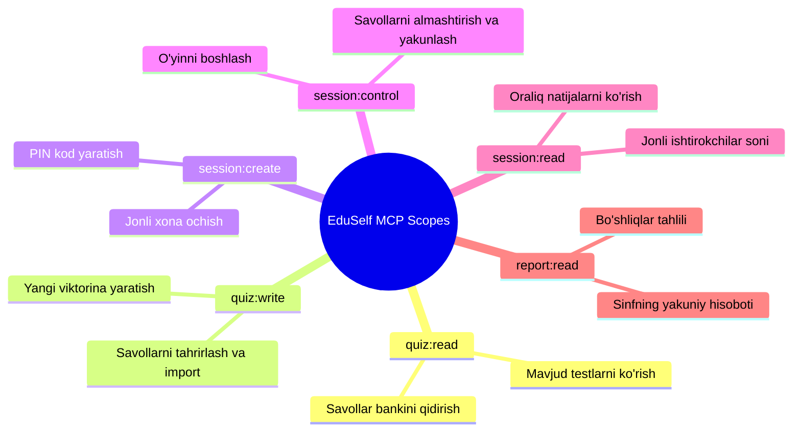

# MCP Authorization Scopes Specification

**Hujjat identifikatori:** DOC-85  
**Fayl nomi:** `MCP_SCOPES.md`  
**Status:** Tasdiqlangan arxitektura spetsifikatsiyasi  
**Modul:** `apps.mcp_server.scopes`  
**Mavzu:** Har bir MCP tool va resursi uchun ruxsat doiralari (OAuth Scopes), minimal vakolat prinsipi va tekshirish mantig‘i  

---

## 1. Umumiy Ko‘rinish va Minimal Vakolat Prinsipi

Xavfsizlikni ta'minlash maqsadida har bir tashqi AI chatbotiga cheklanmagan to‘liq ruxsat (Full Admin) berilmaydi. **Minimal Vakolat Prinsipi (Principle of Least Privilege)** asosida har bir tool aniq belgilangan OAuth 2.1 ruxsat doiralariga (Scopes) bog‘lanadi.

Foydalanuvchi akkauntini ulayotganda qaysi vakolatlarni berayotganini aniq ko‘radi (masalan: *"Faqat testlarni o‘qish va yangi test yaratish"* yoki *"Jonli darsni boshqarish"*).

---

## 2. Standart Ruxsat Doiralari (Scope Definitions)

Platformada quyidagi 6 ta asosiy doira mavjud:



---

## 3. Toollar va Ruxsatlar Bog‘liqligi Matritsasi

| № | MCP Tool Nomi | Talab Qilinadigan Scope | Destructive Hint | Operatsiya Turi |
|---|---|---|---|---|
| 1 | `create_quiz_draft` | `quiz:write` | Yo‘q | Yaratish (Create) |
| 2 | `get_quiz` | `quiz:read` | Yo‘q | O‘qish (Read) |
| 3 | `update_quiz` | `quiz:write` | Yo‘q | Tahrirlash (Update) |
| 4 | `validate_quiz` | `quiz:read` | Yo‘q | O‘qish (Read) |
| 5 | `import_questions` | `quiz:write` | Yo‘q | Yaratish (Create) |
| 6 | `list_question_sets` | `quiz:read` | Yo‘q | Qidiruv (Search) |
| 7 | `create_live_session` | `session:create` | Yo‘q | Xona ochish |
| 8 | `get_session_status` | `session:read` | Yo‘q | Monitoring |
| 9 | `start_session` | `session:control` | **HA (Tasdiq)** | Holatni o‘zgartirish |
| 10 | `advance_question` | `session:control` | Yo‘q | O‘yinni surish |
| 11 | `reveal_answers` | `session:control` | **HA (Tasdiq)** | Natijani ochish |
| 12 | `end_session` | `session:control` | **HA (Tasdiq)** | O‘yinni yopish |
| 13 | `get_live_results` | `session:read` | Yo‘q | Monitoring |
| 14 | `create_team_game` | `session:create` | Yo‘q | O‘yin sozlash |
| 15 | `create_anonymous_board` | `session:create` | Yo‘q | Xona ochish |
| 16 | `get_session_report` | `report:read` | Yo‘q | Hisobot olish |
| 17 | `generate_followup_activity` | `quiz:write` & `report:read` | Yo‘q | Tahlil va Yaratish |

---

## 4. Serverda Ruxsatlarni Tekshirish (Scope Enforcement Code)

Har bir tool funksiyasi Python dekoratori orqali himoyalanadi:

```python
from functools import wraps
from apps.mcp_server.exceptions import MCPForbiddenError

def require_scope(required_scope: str):
    def decorator(func):
        @wraps(func)
        async def wrapper(*args, **kwargs):
            context = get_current_mcp_context()
            user_scopes = context.token_payload.get("scope", "").split()
            
            if required_scope not in user_scopes:
                raise MCPForbiddenError(
                    f"Ushbu amalni bajarish uchun '{required_scope}' ruxsati yetishmaydi!"
                )
            return await func(*args, **kwargs)
        return wrapper
    return decorator

# Namuna Chaqiruv:
@mcp_server.tool()
@require_scope("session:control")
async def start_session(session_id: str) -> dict:
    return await live_session_service.start(session_id)
```

Agar mijoz yetarli ruxsatsiz tool chaqirishga urinsa, server darhol JSON-RPC `-32003 (Forbidden)` xatoligini qaytaradi.
