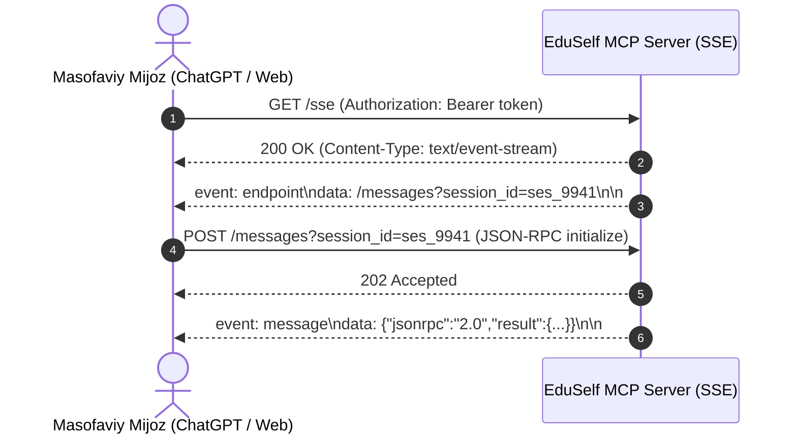

# MCP Server Specification

**Hujjat identifikatori:** DOC-81  
**Fayl nomi:** `MCP_SERVER.md`  
**Status:** Tasdiqlangan arxitektura spetsifikatsiyasi  
**Modul:** `apps.mcp_server.server`  
**Mavzu:** Serverning ishga tushishi, transport protokollari (HTTP SSE, Stdio), konfiguratsiyasi va hayot sikli  

---

## 1. Umumiy Ko‘rinish

EduSelf Teacher MCP Serveri rasmiy **Python MCP SDK** (Model Context Protocol) va **FastMCP** kutubxonasiga asoslangan bo‘lib, ikkita asosiy transport rejimida ishlashga mo‘ljallangan:
1. **HTTP Server-Sent Events (SSE) Transport:** Masofaviy serverlar, veb-mijozlar va ChatGPT kabi bulutli integratsiyalar uchun.
2. **Standard I/O (Stdio) Transport:** Foydalanuvchi kompyuteridagi mahalliy dasturlar (Claude Desktop, Cursor, mahalliy terminal agentlari) uchun.

---

## 2. Transport Protokollari Spetsifikatsiyasi

### 2.1 HTTP SSE Transport (Remote Cloud Mode)
Masofaviy mijozlar uchun xavfsiz HTTPS ulanishi:
- **SSE Ulanish Nuqtasi:** `GET https://mcp.eduself.uz/sse`
  - Mijoz bu yerga ulanadi va Server-Sent Events oqimini ochadi.
  - Server mijozga sessiyaga oid `endpoint` manzilini yuboradi.
- **Xabar Yuborish Nuqtasi:** `POST https://mcp.eduself.uz/messages?session_id=<session_id>`
  - Mijoz JSON-RPC 2.0 so‘rovlarini aynan shu manzilga yuboradi.
- **Autentifikatsiya:** `Authorization: Bearer <oauth_access_token>`



### 2.2 Standard Input/Output (Stdio Transport - Local Mode)
Mahalliy dasturlar (Claude Desktop) EduSelf MCP serverini alohida sub-jarayon (sub-process) sifatida ishga tushiradi:
- **Ishga tushirish buyrug‘i:**
  ```bash
  uvx eduself-mcp
  # Yoki
  python -m apps.mcp_server.cli
  ```
- **Konfiguratsiya parametrlar (Env Vars):**
  - `EDUSELF_API_URL=https://api.eduself.uz`
  - `EDUSELF_API_TOKEN=usr_token_...`

---

## 3. Protokol Handshake va Qobiliyatlarni E'lon Qilish (Initialization)

Mijoz ulanishi bilan JSON-RPC `initialize` metodini yuboradi:

### 3.1 Mijoz So‘rovi (`initialize`):
```json
{
  "jsonrpc": "2.0",
  "id": 1,
  "method": "initialize",
  "params": {
    "protocolVersion": "2024-11-05",
    "capabilities": {
      "roots": { "listChanged": true },
      "sampling": {}
    },
    "clientInfo": {
      "name": "Claude Desktop",
      "version": "0.7.1"
    }
  }
}
```

### 3.2 Server Javobi (Capabilities Declaration):
```json
{
  "jsonrpc": "2.0",
  "id": 1,
  "result": {
    "protocolVersion": "2024-11-05",
    "capabilities": {
      "tools": { "listChanged": false },
      "resources": { "subscribe": true, "listChanged": false },
      "prompts": { "listChanged": false }
    },
    "serverInfo": {
      "name": "eduself-teacher-mcp",
      "version": "1.0.0"
    }
  }
}
```

Mijoz ushbu javobni olgach, `notifications/initialized` bildirishnomasini yuboradi va server to‘liq faol holatga o‘tadi.

---

## 4. Yurak Urishi va Barqarorlik (Keep-Alive)

- **SSE Keep-Alive:** SSE ulanishida oraliq proksi-serverlar (Cloudflare, AWS ALB) ulanishni yopib qo‘ymasligi uchun har 15 soniyada bo‘sh izoh yuboriladi:
  ```text
  : ping
  ```
- **Stdio Crash Handling:** Agar asosiy dastur (Claude Desktop) yopilsa, stdin oqimi tugaydi (`EOF`) va EduSelf MCP sub-jarayoni barcha ochiq soketlarni tozalab xotirjam yopiladi (`SIGTERM`).
