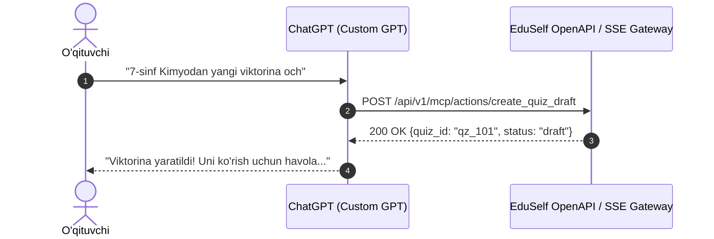

# MCP Integration Setup Guides

**Hujjat identifikatori:** DOC-88  
**Fayl nomi:** `integrations/INTEGRATION_GUIDES.md`  
**Status:** Tasdiqlangan arxitektura spetsifikatsiyasi  
**Modul:** `apps.mcp_server.integrations`  
**Mavzu:** Har bir sun'iy intellekt mijozi (Claude Desktop, ChatGPT, Cursor, Windsurf) uchun bosqichma-bosqich ulash yo‘riqnomasi  

---

## 1. Claude Desktop Bilan Integratsiya

Claude Desktop rasmiy MCP protokolini to‘liq qo‘llab-quvvatlaydi.

### 1.1 Konfiguratsiya Fayli Joylashuvi:
- **Windows:** `%APPDATA%\Claude\claude_desktop_config.json`  
  *(Masalan: `C:\Users\<Foydalanuvchi>\AppData\Roaming\Claude\claude_desktop_config.json`)*
- **macOS:** `~/Library/Application Support/Claude/claude_desktop_config.json`

### 1.2 Sozlash (JSON Konfiguratsiya):
Faylni oching va quyidagi blokni qo‘shing:

```json
{
  "mcpServers": {
    "eduself-teacher": {
      "command": "uvx",
      "args": ["eduself-mcp"],
      "env": {
        "EDUSELF_API_URL": "https://api.eduself.uz",
        "EDUSELF_API_TOKEN": "<SIZNING_SHAXSIY_TOKENINGIZ>"
      }
    }
  }
}
```

*Eslatma: Agar Python orqali ishga tushirmoqchi bo‘lsangiz, `"command": "python"`, `"args": ["-m", "apps.mcp_server.cli"]` ko‘rinishida sozlashingiz mumkin.*

### 1.3 Tekshirish:
1. Claude Desktop dasturini qayta ishga tushiring.
2. Chat oynasining pastki o‘ng burchagida 🔌 **Bolg‘acha (Tools)** belgisi paydo bo‘ladi.
3. Claude chatiga yozing:
   > *"EduSelf'dagi saqlangan testlarim ro'yxatini ko'rsat"*
4. Claude `list_question_sets` toolini chaqiradi va sizning testlaringizni jadvalda chiqarib beradi.

---

## 2. ChatGPT (Custom GPT / Actions) Bilan Integratsiya

ChatGPT foydalanuvchilari uchun EduSelf MCP serveri OpenAPI 3.1 shlyuzini taqdim etadi.



### 2.1 Bosqichma-bosqich O‘rnatish:
1. [chat.openai.com](https://chat.openai.com) saytida **Explore GPTs $\to$ Create a GPT** bo‘limiga o‘ting.
2. **Configure** bo‘limiga o‘tib, quyidagi ma'lumotlarni kiriting:
   - **Name:** EduSelf Teacher Assistant
   - **Description:** EduSelf platformasida testlar yaratish va dars o‘yinlarini boshqarish yordamchisi.
3. Pastki qismdagi **Actions $\to$ Create new action** tugmasini bosing.
4. **Schema** maydoniga quyidagi manzilni kiriting va *Import* tugmasini bosing:
   `https://mcp.eduself.uz/openapi.json`
5. **Authentication** bo‘limini oching:
   - **Auth Type:** `OAuth`
   - **Client ID:** `chatgpt-action-client`
   - **Client Secret:** `<Sizga berilgan Secret>`
   - **Authorization URL:** `https://id.eduself.uz/oauth/authorize`
   - **Token URL:** `https://id.eduself.uz/oauth/token`
   - **Scope:** `quiz:read quiz:write session:create session:control`
6. GPTni saqlang (**Save $\to$ Only Me** yoki **Public**).

---

## 3. Cursor va Windsurf IDE Bilan Integratsiya

Dasturchi-o‘qituvchilar dars materiallarini to‘g‘ridan-to‘g‘ri kod muharriridan turib boshqarishi mumkin.

### 3.1 Cursor Sozlamasi:
1. **Settings $\to$ Features $\to$ MCP Servers $\to$ Add New MCP Server** bo‘limiga kiring.
2. Ma'lumotlarni to‘ldiring:
   - **Name:** `eduself`
   - **Type:** `command`
   - **Command:** `uvx eduself-mcp`
3. Saqlang. Endi Cursor Composer yoki Chat oynasida `@eduself` deb murojaat qilishingiz mumkin.

---

## 4. Antigravity AI Agent Bilan Integratsiya

Antigravity IDE yoki CLI muhitida EduSelf MCP serverini global konfiguratsiyaga ulash:

`C:\Users\<Foydalanuvchi>\.gemini\config\mcp_config.json`:
```json
{
  "mcpServers": {
    "eduself": {
      "command": "python",
      "args": ["-m", "apps.mcp_server.cli"],
      "cwd": "c:/Users/Asus/Desktop/teacher-eduself-mcp",
      "env": {
        "EDUSELF_API_URL": "http://127.0.0.1:8000"
      }
    }
  }
}
```
Antigravity agenti ushbu serverni avtomatik ravishda tanib oladi va barcha 17 ta tool’dan erkin foydalanadi.
