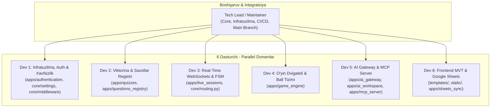
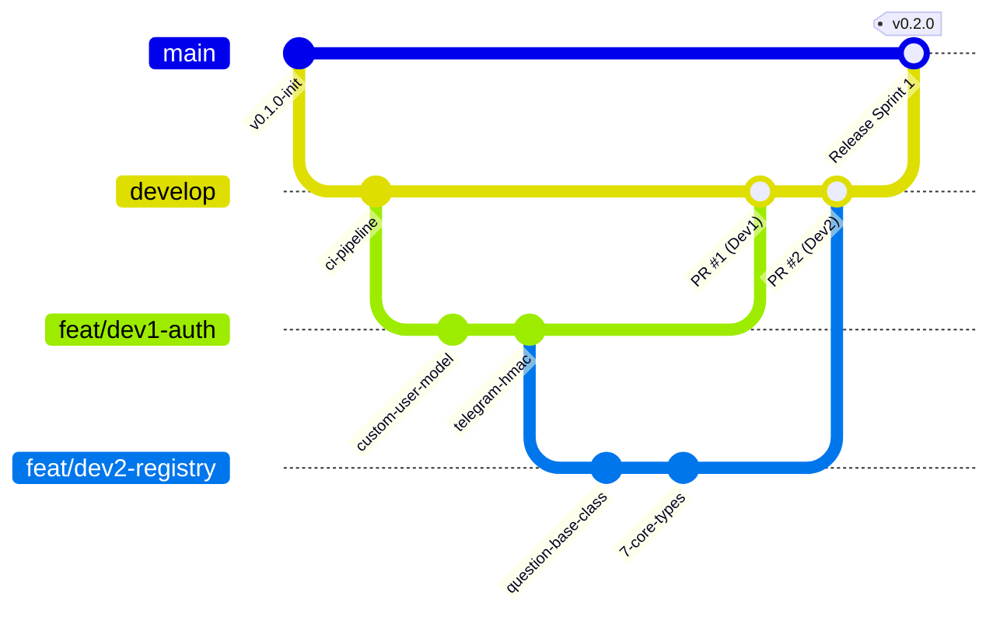

# EduSelf Teacher — Jamoaviy Dasturiy Rivojlanish Yo‘l Xaritasi (team_development_plan.md)
## 6 Dasturchi va 1 Tech Lead / Maintainer Uchun Parallel Muhandislik Rejasi

**Loyiha:** EduSelf Teacher — Real-Time Classroom Gamification & Multi-Provider AI Platform  
**Hujjat versiyasi:** 1.0.0 (Master Team Collaboration Plan)  
**Sana:** 15-oktabr 2026  
**Jamoa tarkibi:** 1 Tech Lead (Maintainer) + 6 Ixtisoslashgan Dasturchi (Dev 1 – Dev 6)  
**Asosiy maqsad:** 6 nafar dasturchining o‘zaro to‘siqlarsiz (non-blocking), Git ziddiyatlarisiz (zero merge conflicts) va qat'iy sifat standartlari asosida parallel kod yozishini ta'minlash.

---

## 📑 Mundarija

1. [Jamoa Rollari va Domen Egaligi (Code Ownership Matrix)](#1-jamoa-rollari-va-domen-egaligi-code-ownership-matrix)
2. [Git Workflow va Tarmoqlanish Strategiyasi (Branching & PR Protocol)](#2-git-workflow-va-tarmoqlanish-strategiyasi-branching--pr-protocol)
3. [Zero-Blocking Interfeys Shartnomalari (Interface Contracts & Mocking)](#3-zero-blocking-interfeys-shartnomalari-interface-contracts--mocking)
4. [Sprintlar Bo‘yicha Parallel Ish Taqsimoti (Sprints 1 – 6)](#4-sprintlar-boyicha-parallel-ish-taqsimoti-sprints-1--6)
   - [Sprint 1: Poydevor, Interfeys Shartnomalari va Boshlang‘ich Skeletlar](#sprint-1-poydevor-interfeys-shartnomalari-va-boshlangich-skeletlar)
   - [Sprint 2: Yadroviy Biznes Mantiq va API Endpointlar](#sprint-2-yadroviy-biznes-mantiq-va-api-endpointlar)
   - [Sprint 3: Real-Time Dvigatel, Shohsupa va AI Integratsiyasi](#sprint-3-real-time-dvigatel-shohsupa-va-ai-integratsiyasi)
   - [Sprint 4: Murakkab Rejimlar, MCP Server va Tashqi Sinxronizatsiya](#sprint-4-murakkab-rejimlar-mcp-server-va-tashqi-sinxronizatsiya)
   - [Sprint 5: Xavfsizlik Qat'iylashtiruvi, Yuklama Sinovlari va Bog‘lash](#sprint-5-xavfsizlik-qatiylashtiruvi-yuklama-sinovlari-va-boglash)
   - [Sprint 6: Ishlab Chiqarishga Chiqarish (Release), AWS Deploy va Monitoring](#sprint-6-ishlab-chiqarishga-chiqarish-release-aws-deploy-va-monitoring)
5. [Umumiy Fayllar va Ziddiyatlarni Boshqarish Qoidalari (Shared File Etiquette)](#5-umumiy-fayllar-va-ziddiyatlarni-boshqarish-qoidalari-shared-file-etiquette)
6. [Haftalik Marosimlar va Kundalik Aloqa (Agile Ceremonies)](#6-haftalik-marosimlar-va-kundalik-aloqa-agile-ceremonies)
7. [CI/CD Sifat Darvozalari (Quality Gates & Automation)](#7-cicd-sifat-darvozalari-quality-gates--automation)

---

## 1. Jamoa Rollari va Domen Egaligi (Code Ownership Matrix)

Loyiha arxitekturasi modulli monolit bo‘lgani sababli, har bir dasturchiga aniq domen va katalog biriktiriladi. Birovning katalogidagi faylni ruxsatsiz tahrirlash qat'iyan taqiqlanadi.



### 1.1 Domenlar va Javobgarlik Tafsilotlari

| Rol | Egallagan Kataloqlari | Asosiy Texnologiyalar | Hujjat Manbalari |
|---|---|---|---|
| **Tech Lead / Maintainer** | `core/`, `deploy/`, `.github/`, root config | Docker Compose, Nginx, CI/CD, Postgres/Redis config | [DEPLOYMENT_ARCHITECTURE.md](file:///c:/Users/Asus/Desktop/teacher-eduself-mcp/.docs/DEPLOYMENT_ARCHITECTURE.md), [SCALABILITY.md](file:///c:/Users/Asus/Desktop/teacher-eduself-mcp/.docs/SCALABILITY.md) |
| **Dev 1 (Auth & Security)** | `apps/authentication/`, `core/middleware/` | Custom User (UUID), Google OAuth2, Telegram HMAC, RBAC, Rate Limiting | [Backend.md#3](file:///c:/Users/Asus/Desktop/teacher-eduself-mcp/.docs/Backend.md), [SECURITY.md](file:///c:/Users/Asus/Desktop/teacher-eduself-mcp/.docs/SECURITY.md) |
| **Dev 2 (Quiz & Registry)** | `apps/quizzes/`, `apps/questions_registry/` | 29 savol turlari, Pydantic, JSON Schema, versiyalash, serializers | [QUIZ_ENGINE.md](file:///c:/Users/Asus/Desktop/teacher-eduself-mcp/.docs/engine/QUIZ_ENGINE.md), [QUESTION_TYPES.md](file:///c:/Users/Asus/Desktop/teacher-eduself-mcp/.docs/engine/QUESTION_TYPES.md) |
| **Dev 3 (Real-Time Channels)** | `apps/live_sessions/`, `core/routing.py` | Django Channels, Daphne, Redis Channel Layer, Room FSM, Reconnection | [LIVE_SESSION.md](file:///c:/Users/Asus/Desktop/teacher-eduself-mcp/.docs/engine/LIVE_SESSION.md), [REALTIME_PROTOCOL.md](file:///c:/Users/Asus/Desktop/teacher-eduself-mcp/.docs/engine/REALTIME_PROTOCOL.md) |
| **Dev 4 (Game Engine)** | `apps/game_engine/` | 40+ o‘yin rejimlari, tezlik bonusi, Redis Sorted Sets shohsupasi, jamoalar | [GAME_MODES.md](file:///c:/Users/Asus/Desktop/teacher-eduself-mcp/.docs/engine/GAME_MODES.md), [SCORING.md](file:///c:/Users/Asus/Desktop/teacher-eduself-mcp/.docs/engine/SCORING.md) |
| **Dev 5 (AI & MCP Server)** | `apps/ai_gateway/`, `apps/ai_workspace/`, `apps/mcp_server/` | 7 ta AI provayderi, BYOK AES-256, Python MCP SDK (SSE/Stdio), 12 Tools | [AI_PROVIDERS.md](file:///c:/Users/Asus/Desktop/teacher-eduself-mcp/.docs/ai/AI_PROVIDERS.md), [MCP_SERVER.md](file:///c:/Users/Asus/Desktop/teacher-eduself-mcp/.docs/mcp/MCP_SERVER.md) |
| **Dev 6 (Frontend & Sheets)** | `templates/`, `static/`, `apps/sheets_sync/` | "EduPlay 3D", Bento Grid, Web Audio API, `gspread`, Celery Beat | [DESIGN_SYSTEM.md](file:///c:/Users/Asus/Desktop/teacher-eduself-mcp/.docs/ui/DESIGN_SYSTEM.md), [COMPONENTS.md](file:///c:/Users/Asus/Desktop/teacher-eduself-mcp/.docs/ui/COMPONENTS.md) |

### 1.2 Loyihaning `.github/CODEOWNERS` Konfiguratsiyasi
```text
# Global Infratuzilma va sozlamalar
*                           @tech-lead
/core/                      @tech-lead @dev1-auth
/deploy/                    @tech-lead
/.github/                   @tech-lead
/requirements.txt           @tech-lead

# Dasturchilarning shaxsiy domenlari
/apps/authentication/       @dev1-auth
/apps/quizzes/              @dev2-quiz
/apps/questions_registry/   @dev2-quiz
/apps/live_sessions/        @dev3-realtime
/apps/game_engine/          @dev4-game
/apps/ai_gateway/           @dev5-ai
/apps/ai_workspace/         @dev5-ai
/apps/mcp_server/           @dev5-ai
/apps/sheets_sync/          @dev6-ui-sheets
/templates/                 @dev6-ui-sheets
/static/                    @dev6-ui-sheets
```

---

## 2. Git Workflow va Tarmoqlanish Strategiyasi (Branching & PR Protocol)

Jamoada **Trunk-Based Development + Feature Branches** modeli qo‘llaniladi.



### 2.1 Tarmoqlar Qoidalari

1. **`main` tarmog‘i:**
   - Faqat ishlab chiqarishga (Production) tayyor kod saqlanadi.
   - **Qat'iy himoyalangan (Protected):** To‘g‘ridan-to‘g‘ri `git push` qilish bloklangan.
   - Faqat **Tech Lead** `develop` tarmog‘idan pull request orqali birlashtira oladi.
2. **`develop` tarmog‘i:**
   - Dasturchilarning barcha yangi funksiyalari (features) birlashadigan asosiy integratsion tarmoq.
   - Staging serveriga avtomatik deploy qilinadi.
3. **Ishchi tarmoqlar (Feature Branches):**
   - Nomi formati: `feat/dev<N>-<qisqa-nom>` (Masalan: `feat/dev1-telegram-auth`, `feat/dev3-room-fsm`, `feat/dev5-mcp-tools`).
   - Har bir tarmoq `develop` tarmog‘idan ajratib olinadi va qaytib `develop` ga PR qilinadi.
4. **Hotfix tarmoqlari:**
   - Format: `hotfix/<muammo-nomi>`. Faqat `main` dagi kritik xatoni tuzatish uchun ochiladi va tuzatilgach ham `main`ga, ham `develop`ga birlashtiriladi.

### 2.2 Pull Request (PR) Qoidalari va Shabloni

Har bir PR qabul qilinishi (Merge) uchun quyidagi shartlar qanoatlantirilishi shart:
1. **Kamida 2 ta tasdiq:** 1 ta Tech Lead roziligi (`Approved`) + 1 ta boshqa dasturchining ko‘rib chiqishi (Peer Review).
2. **CI Pipeline 100% yashil:** Pytest unit testlari, Flake8 sintaksisi va Migrations tekshiruvi xatosiz o‘tishi.
3. **Coverage cheklovi:** Yangi yozilgan kodning test bilan qamrab olinishi kamida **85%** bo‘lishi.

#### PR Shabloni (`.github/PULL_REQUEST_TEMPLATE.md`):
```markdown
## Vazifa Tavsifi
Qaysi vazifa bajarildi? (Masalan: #42 - Telegram login vidjetini integratsiya qilish)

## O'zgartirilgan Fayllar
- [ ] apps/authentication/models.py
- [ ] apps/authentication/services.py
- [ ] apps/authentication/tests/test_telegram_auth.py

## Verifikatsiya va Test Natijalari
Qaysi buyruq orqali tekshirildi?
`pytest apps/authentication/tests/`

## Self-Audit Checklist
- [ ] Boshqa dasturchining katalogiga tegmadimmi?
- [ ] Yangi migratsiyalar qo'shildimi va to'g'ri ishlayaptimi?
- [ ] Barcha testlar yashilmi?
```

---

## 3. Zero-Blocking Interfeys Shartnomalari (Interface Contracts & Mocking)

Bir dasturchi ikkinchisining kodi tayyor bo‘lishini kutib o‘tirmasligi uchun, Sprint 1 da quyidagi **Python Protocol va Dataclass** interfeyslari umumiy shartnoma sifatida qabul qilinadi:

### 3.1 Quiz va Real-Time Sessiya Shartnomasi (`QuizSessionContract`)
Dev 3 (WebSockets) Dev 2 (Quiz) ning bazasi to‘liq bitishini kutmaydi; quyidagi DTO orqali o‘z testlarini yozadi:

```python
# core/contracts/quiz_contract.py
from typing import List, Dict, Any, Optional
from dataclasses import dataclass

@dataclass(frozen=True)
class QuestionDTO:
    id: str
    type: str
    prompt: str
    options: List[Dict[str, Any]]
    correct_answer: Any
    points: int
    time_limit_seconds: int

@dataclass(frozen=True)
class QuizDTO:
    id: str
    title: str
    questions: List[QuestionDTO]
```

### 3.2 Real-Time va Game Engine Ball Shartnomasi (`ScoringContract`)
Dev 3 javob kelganda Dev 4 ning ball hisoblagichiga quyidagi formatda uzatadi:

```python
# core/contracts/scoring_contract.py
from typing import Protocol
from dataclasses import dataclass

@dataclass(frozen=True)
class AnswerSubmissionDTO:
    participant_id: str
    question_id: str
    user_answer: any
    time_taken_ms: int
    streak_count: int

class ScoringEngineProtocol(Protocol):
    def calculate_score(self, submission: AnswerSubmissionDTO, question: any) -> int:
        """Berilgan vaqt va streak asosida 0 dan 1500 gacha ball qaytaradi."""
        ...
```

### 3.3 AI va Quiz Saqlash Shartnomasi (`AIQuizContract`)
Dev 5 (AI) ishlab chiqqan savollarni Dev 2 ning bazasiga uzatish formati:

```python
# core/contracts/ai_contract.py
from pydantic import BaseModel, Field
from typing import List, Dict, Any

class GeneratedQuestionSchema(BaseModel):
    type: str
    prompt: str
    options: List[Dict[str, Any]]
    correct_answer: Any
    explanation: str
    difficulty: str = "medium"

class GeneratedQuizPayload(BaseModel):
    title: str
    subject: str
    grade_level: int
    questions: List[GeneratedQuestionSchema]
```

> [!TIP]
> **Mocking Qoidasi:** Har bir dasturchi qo‘shni modul funksiyasini chaqirayotganda `unittest.mock.patch` yoki `pytest-mock` orqali yuqoridagi DTO larni qaytaruvchi soxta (mock) obyektlardan foydalanadi. Bu orqali 6 kishi 100% mustaqil ishlay oladi!

---

## 4. Sprintlar Bo‘yicha Parallel Ish Taqsimoti (Sprints 1 – 6)

Loyiha har biri **2 haftalik** bo‘lgan 6 ta sprintga bo‘lingan. Jami ishlab chiqish davri: **12 hafta (3 oy)**.

---

### Sprint 1: Poydevor, Interfeys Shartnomalari va Boshlang‘ich Skeletlar

**Sprint Maqsadi:** Barcha muhitlar (Docker, Postgres, Redis), umumiy interfeys shartnomalari (`core/contracts/`) va har bir dasturchining boshlang‘ich ilova skeletlarini yo‘lga qo‘yish.

```text
SPRINT 1 VAZIFALARI TAQSIMOTI:
├── Tech Lead : Docker Compose, CI/CD GitHub Actions, requirements.txt, CODEOWNERS
├── Dev 1     : Custom User (UUID), Organization modeli, Base Auth sozlamalari
├── Dev 2     : BaseQuestionType abstrakt sinfi, QuestionTypeRegistry, 7 ta asosiy savol turi
├── Dev 3     : Django Channels arxitekturasi, routing.py, WebSocket Echo Consumer
├── Dev 4     : BaseGameMode interfeysi, ScoringEngine formulasi (speed decay, streaks)
├── Dev 5     : BaseAIAdapter interfeysi, AES-256-GCM crypto moduli (BYOK shifrlash)
└── Dev 6     : "EduPlay 3D" design tokenlari, styles.css va Web Audio API audio.js
```

- **Tech Lead:**
  - `Dockerfile.backend`, `docker-compose.yml`, `pytest.ini` yaratish.
  - GitHub Actions da Linter va Pytest workflow'larini sozlash.
  - `core/contracts/` papkasida yuqoridagi 3 ta umumiy interfeysni e'lon qilish.
- **Dev 1 (Auth):**
  - `apps/authentication/models.py` da `User` va `Organization` yaratish.
  - Test: `pytest apps/authentication/tests/test_models.py`.
- **Dev 2 (Quiz):**
  - `apps/questions_registry/base.py` va `types/single_choice.py`, `types/multiple_choice.py`.
  - Test: `pytest apps/questions_registry/tests/`.
- **Dev 3 (Real-Time):**
  - `core/routing.py`, `core/asgi.py`, `apps/live_sessions/consumers.py` da `EchoConsumer`.
  - Test: `pytest apps/live_sessions/tests/test_echo.py`.
- **Dev 4 (Game Engine):**
  - `apps/game_engine/scoring.py` da ball hisoblash formulasi.
  - Test: `pytest apps/game_engine/tests/test_scoring.py`.
- **Dev 5 (AI):**
  - `apps/ai_gateway/base.py`, `apps/ai_gateway/crypto.py` (AES-256-GCM kalit shifrlash).
  - Test: `pytest apps/ai_gateway/tests/test_crypto.py`.
- **Dev 6 (Frontend):**
  - `ui_components/` dagi dizayn tizimi, CSS va Web Audio API sintezatorini `static/` ga ko‘chirish.
  - Test: `python manage.py collectstatic --noinput`.

**Sprint 1 Demo Natijasi:** Barcha 6 dasturchining boshlang‘ich PR'lari `develop`ga birlashadi, CI sinovlari yashil, Docker barcha xizmatlarni xatosiz ko‘taradi.

---

### Sprint 2: Yadroviy Biznes Mantiq va API Endpointlar

**Sprint Maqsadi:** Autentifikatsiya, viktorinalar CRUD'i, xonalar ochish, o‘yin rejimlari va birinchi AI provayderi ulanishi.

- **Tech Lead:** PR'larni ko‘rib chiqish, Postgres migratsiyalarini sinxronlash, Staging serverini ko‘tarish.
- **Dev 1 (Auth):**
  - Telegram Widget login callback (HMAC-SHA256 tekshiruvi) va Google OAuth2 token almashish.
  - `apps/authentication/views.py` va `urls.py`.
- **Dev 2 (Quiz):**
  - `apps/quizzes/models.py` da `Quiz`, `Question` modellarini yaratish va `QuestionTypeRegistry` bilan bog‘lash.
  - Serializerlar va CRUD API endpointlari.
- **Dev 3 (Real-Time):**
  - `apps/live_sessions/fsm.py` da xona holat mashinasi (`draft` -> `lobby` -> `active`).
  - `RoomCodeGenerator` (6 xonali takrorlanmas PIN kod va QR link).
- **Dev 4 (Game Engine):**
  - `apps/game_engine/modes/classic.py` (Kahoot uslubidagi klassik savol-javob rejimi).
  - `apps/game_engine/teams.py` (jamoalarni shakllantirish).
- **Dev 5 (AI):**
  - `apps/ai_gateway/adapters/openai_adapter.py` va `gemini_adapter.py`.
  - Provayderlarning yagona javob (`AIResponse`) qaytarishi.
- **Dev 6 (Frontend):**
  - `templates/base.html`, `templates/auth/login.html` (Google va Telegram tugmalari bilan).
  - `templates/dashboard/teacher_home.html` (Bento Grid dizaynida).

**Sprint 2 Demo Natijasi:** O‘qituvchi Telegram/Google orqali tizimga kiradi, yangi test yaratadi va 6 xonali PIN kodli xona ochadi.

---

### Sprint 3: Real-Time Dvigatel, Shohsupa va AI Integratsiyasi

**Sprint Maqsadi:** O‘quvchilarning real-time ulanishi, savollarga javob berish, tezkor Redis shohsupasi va AI savol generatsiyasi.

- **Tech Lead:** Redis klasterini yuklamaga tayyorlash, Channel Layer monitoringi.
- **Dev 1 (Auth):**
  - RBAC ruxsatlar (`IsTeacher`, `IsSchoolAdmin`), oylik AI token byudjeti nazorati.
- **Dev 2 (Quiz):**
  - Qolgan 22 ta savol turlari (ordering, categorization, cloze, geo_pin, open_short).
  - Savollarni tahrirlashdan qulflash (`is_locked`) mantiqi.
- **Dev 3 (Real-Time):**
  - `ClassroomGameConsumer`: o‘quvchilar javoblarini qabul qilish, vaqtni tekshirish, savol ochish/yopish hodisalari.
  - Qayta ulanish tokeni (Reconnection manager).
- **Dev 4 (Game Engine):**
  - `apps/game_engine/leaderboard.py` (Redis Sorted Sets yordamida <5ms reyting hisoblash).
  - Rank Delta ko‘rsatkichlari (`▲ +2`, `▼ -1`).
- **Dev 5 (AI):**
  - `apps/ai_workspace/prompts.py` (v1.0 pedagogik promptlar).
  - `apps/ai_workspace/generator.py` (mavzu bo‘yicha 10 ta savolli to‘liq viktorina generatsiya qilish).
- **Dev 6 (Frontend):**
  - `templates/player/student_game.html` (Dual-coded 4 ta rangli variantlar).
  - `static/js/game_client.js` (WebSocket xabarlarini boshqarish va to‘g‘ri/xato ovozlarini yangratish).

**Sprint 3 Demo Natijasi:** 10 nafar o‘quvchi telefonidan PIN kod terib xonaga kiradi, test yechadi, har bir to‘g‘ri javob uchun tovush yangraydi va real-time shohsupada o‘rinlar almashadi.

---

### Sprint 4: Murakkab Rejimlar, MCP Server va Tashqi Sinxronizatsiya

**Sprint Maqsadi:** Blooket uslubidagi sandiqlar rejimi, rasmiy Python MCP Server va Google Sheets sinxronizatsiyasi.

- **Tech Lead:** MCP server xavfsizlik auditi, SSE transporti yuklama testi.
- **Dev 1 (Auth):**
  - MCP uchun shaxsiy API tokenlar generatsiyasi va OAuth 2.0 PKCE ulanishi.
- **Dev 2 (Quiz):**
  - Viktorinalarni versiyalash (`QuizVersion`), testlarni JSON/Excel formatida eksport/import qilish.
- **Dev 3 (Real-Time):**
  - `templates/live/host_screen.html` (Sinf proyektori uchun katta ekran animatsiyalari, jonli shohsupa).
- **Dev 4 (Game Engine):**
  - `apps/game_engine/modes/gold_quest.py` (Oltin sandiqlar, o‘g‘irlash va mini-o‘yinlar).
  - `apps/game_engine/modes/team_battle.py` (Jamoaviy ballar jangi).
- **Dev 5 (AI & MCP):**
  - Rasmiy `mcp` SDK orqali `apps/mcp_server/server.py` ni yaratish.
  - 12 ta Core MCP Tools (`create_quiz`, `start_live_session`, `get_session_results` va b.).
  - SSE va Stdio transportlarini yo‘lga qo‘yish.
- **Dev 6 (Frontend & Sheets):**
  - `apps/sheets_sync/` (Google Service Account va `gspread`).
  - Dars tugashi bilan natijalarni o‘qituvchining Google Sheet jadvaliga avtomatik yozish.

**Sprint 4 Demo Natijasi:** Claude Desktop yoki tashqi chatbot orqali MCP yordamida yangi viktorina ochiladi, sinfda Blooket Gold Quest o‘ynaladi va natijalar avtomatik Google Sheets'da paydo bo‘ladi.

---

### Sprint 5: Xavfsizlik Qat'iylashtiruvi, Yuklama Sinovlari va Bog‘lash

**Sprint Maqsadi:** Xavfsizlik (OWASP, Rate Limiting), AI Diff Engine va 500 ta o‘quvchi ishtirokidagi yuklama (load) sinovi.

- **Tech Lead:** Locust / k6 orqali 500 ta parallel WebSocket ulanishlarini stress-test qilish.
- **Dev 1 (Security):**
  - `core/middleware/rate_limit.py` (Redis sliding window: login 5/min, AI 20/min).
  - XSS sanitizatsiya (`bleach`), CSP va CORS sarlavhalari.
- **Dev 2 & Dev 3 (Integratsiya):**
  - Savollar vaqt chegarasi tugaganda xavfsiz avtomatik yopilish testlari.
  - Tarmoq uzilganda sessiyaning xavfsiz saqlanib qolishi.
- **Dev 4 & Dev 6 (UI Polish):**
  - "Perfect Scorer" 3D kubok animatsiyasi va g‘alaba fanfarasi integratsiyasi.
  - Mobil ekranlarda Thumb Zone va 60 FPS silliq animatsiyalar tekshiruvi.
- **Dev 5 (AI Workspace):**
  - `apps/ai_workspace/diff_engine.py` (AI taklif etgan o‘zgarishlarni o‘qituvchiga "Oldin / Keyin" ko‘rinishida tasdiqlash uchun chiqarish).
  - `is_locked=True` bo‘lgan savollarni AI o‘chira olmasligini tekshirish.

**Sprint 5 Demo Natijasi:** Tizim 500 ta concurrent o‘quvchi yuklamasida xatosiz ishlaydi, xavfsizlik skanerlari (`bandit`, `check --deploy`) hech qanday jiddiy zaiflik topmaydi.

---

### Sprint 6: Ishlab Chiqarishga Chiqarish (Release), AWS Deploy va Monitoring

**Sprint Maqsadi:** AWS EC2 infratuzilmasiga to‘liq o‘rnatish, Nginx, SSL, avtomatik zaxira nusxalash va Production Launch!

- **Tech Lead:**
  - AWS EC2 da `docker-compose.prod.yml` ni ko‘tarish, Nginx va Let's Encrypt SSL sozlash.
  - Sentry xatoliklar monitoringi va har kunlik PostgreSQL backup skriptini yoqish.
  - `develop` tarmog‘ini `main` ga birlashtirish va `v1.0.0` rasmiy reliz tegini qo‘yish.
- **Barcha Dasturchilar (Dev 1 – Dev 6):**
  - Foydalanuvchi qo‘llanmalari va API hujjatlarini to‘ldirish.
  - Smoke testing (ishlab chiqarish muhitida barcha funksiyalarni jonli tekshirish).
  - Topilgan mayda vizual va matn xatoliklarini hotfix qilish.

---

## 5. Umumiy Fayllar va Ziddiyatlarni Boshqarish Qoidalari (Shared File Etiquette)

Jamoaviy dasturlashda eng ko‘p konfliktlar bir nechta umumiy fayllarda ro‘y beradi. Ularning oldini olish uchun quyidagi qat'iy qoidalarga amal qilinadi:

### 5.1 `core/settings/base.py` qoidalari
- Dasturchilar o‘zlarining yangi ilovalarini (masalan, `apps.game_engine`) qo‘shish uchun to‘g‘ridan-to‘g‘ri `base.py` ni tahrirlamaydi.
- `base.py` dinamik ravishda barcha mavjud ilovalarni o‘qiydi yoki har bir sprint boshida Tech Lead ro‘yxatga kiritib beradi.

### 5.2 `core/urls.py` qoidalari
Asosiy `core/urls.py` faqat modul yo‘naltiruvchilarini saqlaydi. Har bir dasturchi o‘z ilovasi ichidagi `apps/<nomi>/urls.py` faylida to‘liq erkinlikka ega:
```python
# core/urls.py — Faqat 1 marta yoziladi va o'zgarmaydi!
urlpatterns = [
    path('admin/', admin.site.urls),
    path('auth/', include('apps.authentication.urls')),
    path('quizzes/', include('apps.quizzes.urls')),
    path('live/', include('apps.live_sessions.urls')),
    path('ai/', include('apps.ai_workspace.urls')),
    path('mcp/', include('apps.mcp_server.urls')),
    path('sheets/', include('apps.sheets_sync.urls')),
]
```

### 5.3 Django Migratsiyalari Ziddiyati (Migration Conflicts)
Agar ikkita dasturchi bir vaqtda model o‘zgartirib, migratsiya raqamlari to‘qnashsa:
1. `develop` dan so‘nggi o‘zgarishlarni o‘z tarmog‘iga oladi (`git pull origin develop`).
2. Quyidagi buyruqni ishga tushiradi:
   ```bash
   python manage.py makemigrations --merge
   ```
3. Hosil bo‘lgan merge-migratsiyani tekshirib, keyin PR qiladi.

---

## 6. Haftalik Marosimlar va Kundalik Aloqa (Agile Ceremonies)

| Marosim | Vaqti | Ishtirokchilar | Maqsadi va Tartibi |
|---|---|---|---|
| **Daily Async Standup** | Har kuni soat 10:00 gacha | Barcha dasturchilar | Telegram guruh / Slack da 3 ta savolga javob berish (Kecha nima qildim, bugun nima qilaman, qanday to‘siq bor). |
| **Sprint Planning** | Har 2 dushanba, 11:00 (1 soat) | Butun jamoa | Yangi sprint vazifalarini baholash, interfeys shartnomalarini kelishib olish. |
| **PR Review Hour** | Har kuni soat 17:00 – 18:00 | Barcha dasturchilar | Dasturchilar bir-birining kodini ko‘rib chiqadi (Peer review), Tech Lead merge qiladi. |
| **Sprint Demo & Retro** | Har 2 juma, 16:00 (1.5 soat) | Butun jamoa | Ishlaydigan dasturni jonli ko‘rsatish, muammolarni tahlil qilish va nishonlash. |

---

## 7. CI/CD Sifat Darvozalari (Quality Gates & Automation)

Har bir Pull Request ochilganda GitHub Actions quyidagi avtomatlashtirilgan tekshiruvlarni amalga oshiradi:

```yaml
# .github/workflows/ci.yml namunasi
name: CI Quality Gate

on:
  pull_request:
    branches: [ develop, main ]

jobs:
  test:
    runs-on: ubuntu-latest
    services:
      postgres:
        image: postgres:16
        env:
          POSTGRES_DB: eduself_test
          POSTGRES_PASSWORD: test
        ports: [ 5432:5432 ]
      redis:
        image: redis:7.2-alpine
        ports: [ 6379:6379 ]

    steps:
      - uses: actions/checkout@v4
      - name: Python o'rnatish
        uses: actions/setup-python@v5
        with:
          python-version: '3.12'

      - name: Kutubxonalarni o'rnatish
        run: pip install -r requirements.txt pytest-cov flake8

      - name: Linter tekshiruvi (PEP8)
        run: flake8 apps/ core/ --max-line-length=120

      - name: Migratsiyalar butunligini tekshirish
        run: python manage.py makemigrations --check --dry-run

      - name: Pytest barcha unit testlarni ishga tushirish
        run: pytest --cov=apps --cov-fail-under=85
```

---

## 8. Xulosa va Jamoaviy Boshlash Ko‘rsatmasi

Ushbu reja orqali **6 nafar dasturchi** va **1 nafar Tech Lead** 12 hafta ichida loyihani birorta ham to‘siqsiz, bir-birining ishiga xalaqit bermasdan va professional arxitektura asosida to‘liq ishlab chiqarish darajasiga olib chiqadi.

Loyihani boshlash uchun birinchi qadam:
1. **Tech Lead** `Sprint 1` doirasida repository, Docker va `core/contracts/` bazasini yaratadi.
2. Dasturchilar o‘zlariga tegishli `feat/dev<N>-...` tarmoqlarini ochib, parallel ishlashga kirishadilar!
