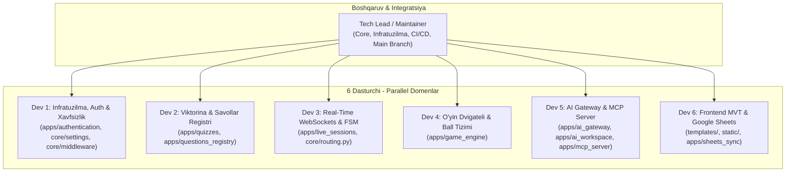
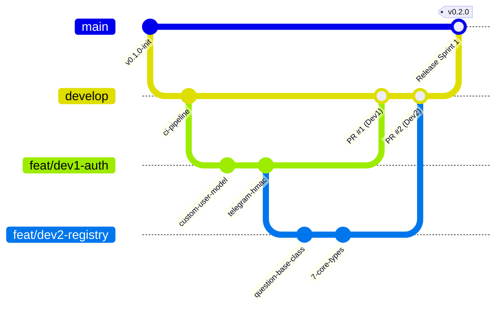

# EduSelf Teacher — Jamoaviy Dasturiy Rivojlanish Yo‘l Xaritasi (team_development_plan.md)
## 6 Dasturchi va 1 Tech Lead / Maintainer Uchun Parallel Muhandislik Rejasi

**Loyiha:** EduSelf Teacher — Real-Time Classroom Gamification & Multi-Provider AI Platform  
**Hujjat versiyasi:** 1.0.0 (Master Team Collaboration Plan)  
**Sana:** 15-oktabr 2026  
**Jamoa tarkibi:** 1 Tech Lead (Maintainer) + 6 Ixtisoslashgan Dasturchi (Dev 1 – Dev 6)  
**Asosiy maqsad:** 6 nafar dasturchining o‘zaro to‘siqlarsiz (non-blocking), Git ziddiyatlarisiz (zero merge conflicts) va qat'iy sifat standartlari asosida parallel kod yozishini ta'minlash.

---

## 📑 Mundarija

1. [Jamoa Rollari va Domen Egaligi (Code Ownership Matrix)](#1-jamoa-rollari-va-domen-egaligi-code-ownership-matrix)
2. [Git Workflow va Tarmoqlanish Strategiyasi (Branching & PR Protocol)](#2-git-workflow-va-tarmoqlanish-strategiyasi-branching--pr-protocol)
3. [Zero-Blocking Interfeys Shartnomalari (Interface Contracts & Mocking)](#3-zero-blocking-interfeys-shartnomalari-interface-contracts--mocking)
4. [Sprintlar Bo‘yicha Parallel Ish Taqsimoti (Sprints 1 – 6)](#4-sprintlar-boyicha-parallel-ish-taqsimoti-sprints-1--6)
   - [Sprint 1: Poydevor, Interfeys Shartnomalari va Boshlang‘ich Skeletlar](#sprint-1-poydevor-interfeys-shartnomalari-va-boshlangich-skeletlar)
   - [Sprint 2: Yadroviy Biznes Mantiq va API Endpointlar](#sprint-2-yadroviy-biznes-mantiq-va-api-endpointlar)
   - [Sprint 3: Real-Time Dvigatel, Shohsupa va AI Integratsiyasi](#sprint-3-real-time-dvigatel-shohsupa-va-ai-integratsiyasi)
   - [Sprint 4: Murakkab Rejimlar, MCP Server va Tashqi Sinxronizatsiya](#sprint-4-murakkab-rejimlar-mcp-server-va-tashqi-sinxronizatsiya)
   - [Sprint 5: Xavfsizlik Qat'iylashtiruvi, Yuklama Sinovlari va Bog‘lash](#sprint-5-xavfsizlik-qatiylashtiruvi-yuklama-sinovlari-va-boglash)
   - [Sprint 6: Ishlab Chiqarishga Chiqarish (Release), AWS Deploy va Monitoring](#sprint-6-ishlab-chiqarishga-chiqarish-release-aws-deploy-va-monitoring)
5. [Umumiy Fayllar va Ziddiyatlarni Boshqarish Qoidalari (Shared File Etiquette)](#5-umumiy-fayllar-va-ziddiyatlarni-boshqarish-qoidalari-shared-file-etiquette)
6. [Haftalik Marosimlar va Kundalik Aloqa (Agile Ceremonies)](#6-haftalik-marosimlar-va-kundalik-aloqa-agile-ceremonies)
7. [CI/CD Sifat Darvozalari (Quality Gates & Automation)](#7-cicd-sifat-darvozalari-quality-gates--automation)

---

## 1. Jamoa Rollari va Domen Egaligi (Code Ownership Matrix)

Loyiha arxitekturasi modulli monolit bo‘lgani sababli, har bir dasturchiga aniq domen va katalog biriktiriladi. Birovning katalogidagi faylni ruxsatsiz tahrirlash qat'iyan taqiqlanadi.



### 1.1 Domenlar va Javobgarlik Tafsilotlari

| Rol | Egallagan Kataloqlari | Asosiy Texnologiyalar | Hujjat Manbalari |
|---|---|---|---|
| **Tech Lead / Maintainer** | `core/`, `deploy/`, `.github/`, root config | Docker Compose, Nginx, CI/CD, Postgres/Redis config | [DEPLOYMENT_ARCHITECTURE.md](file:///c:/Users/Asus/Desktop/teacher-eduself-mcp/.docs/DEPLOYMENT_ARCHITECTURE.md), [SCALABILITY.md](file:///c:/Users/Asus/Desktop/teacher-eduself-mcp/.docs/SCALABILITY.md) |
| **Dev 1 (Auth & Security)** | `apps/authentication/`, `core/middleware/` | Custom User (UUID), Google OAuth2, Telegram HMAC, RBAC, Rate Limiting | [Backend.md#3](file:///c:/Users/Asus/Desktop/teacher-eduself-mcp/.docs/Backend.md), [SECURITY.md](file:///c:/Users/Asus/Desktop/teacher-eduself-mcp/.docs/SECURITY.md) |
| **Dev 2 (Quiz & Registry)** | `apps/quizzes/`, `apps/questions_registry/` | 29 savol turlari, Pydantic, JSON Schema, versiyalash, serializers | [QUIZ_ENGINE.md](file:///c:/Users/Asus/Desktop/teacher-eduself-mcp/.docs/engine/QUIZ_ENGINE.md), [QUESTION_TYPES.md](file:///c:/Users/Asus/Desktop/teacher-eduself-mcp/.docs/engine/QUESTION_TYPES.md) |
| **Dev 3 (Real-Time Channels)** | `apps/live_sessions/`, `core/routing.py` | Django Channels, Daphne, Redis Channel Layer, Room FSM, Reconnection | [LIVE_SESSION.md](file:///c:/Users/Asus/Desktop/teacher-eduself-mcp/.docs/engine/LIVE_SESSION.md), [REALTIME_PROTOCOL.md](file:///c:/Users/Asus/Desktop/teacher-eduself-mcp/.docs/engine/REALTIME_PROTOCOL.md) |
| **Dev 4 (Game Engine)** | `apps/game_engine/` | 40+ o‘yin rejimlari, tezlik bonusi, Redis Sorted Sets shohsupasi, jamoalar | [GAME_MODES.md](file:///c:/Users/Asus/Desktop/teacher-eduself-mcp/.docs/engine/GAME_MODES.md), [SCORING.md](file:///c:/Users/Asus/Desktop/teacher-eduself-mcp/.docs/engine/SCORING.md) |
| **Dev 5 (AI & MCP Server)** | `apps/ai_gateway/`, `apps/ai_workspace/`, `apps/mcp_server/` | 7 ta AI provayderi, BYOK AES-256, Python MCP SDK (SSE/Stdio), 12 Tools | [AI_PROVIDERS.md](file:///c:/Users/Asus/Desktop/teacher-eduself-mcp/.docs/ai/AI_PROVIDERS.md), [MCP_SERVER.md](file:///c:/Users/Asus/Desktop/teacher-eduself-mcp/.docs/mcp/MCP_SERVER.md) |
| **Dev 6 (Frontend & Sheets)** | `templates/`, `static/`, `apps/sheets_sync/` | "EduPlay 3D", Bento Grid, Web Audio API, `gspread`, Celery Beat | [DESIGN_SYSTEM.md](file:///c:/Users/Asus/Desktop/teacher-eduself-mcp/.docs/ui/DESIGN_SYSTEM.md), [COMPONENTS.md](file:///c:/Users/Asus/Desktop/teacher-eduself-mcp/.docs/ui/COMPONENTS.md) |

### 1.2 Loyihaning `.github/CODEOWNERS` Konfiguratsiyasi
```text
# Global Infratuzilma va sozlamalar
*                           @tech-lead
/core/                      @tech-lead @dev1-auth
/deploy/                    @tech-lead
/.github/                   @tech-lead
/requirements.txt           @tech-lead

# Dasturchilarning shaxsiy domenlari
/apps/authentication/       @dev1-auth
/apps/quizzes/              @dev2-quiz
/apps/questions_registry/   @dev2-quiz
/apps/live_sessions/        @dev3-realtime
/apps/game_engine/          @dev4-game
/apps/ai_gateway/           @dev5-ai
/apps/ai_workspace/         @dev5-ai
/apps/mcp_server/           @dev5-ai
/apps/sheets_sync/          @dev6-ui-sheets
/templates/                 @dev6-ui-sheets
/static/                    @dev6-ui-sheets
```

---

## 2. Git Workflow va Tarmoqlanish Strategiyasi (Branching & PR Protocol)

Jamoada **Trunk-Based Development + Feature Branches** modeli qo‘llaniladi.



### 2.1 Tarmoqlar Qoidalari

1. **`main` tarmog‘i:**
   - Faqat ishlab chiqarishga (Production) tayyor kod saqlanadi.
   - **Qat'iy himoyalangan (Protected):** To‘g‘ridan-to‘g‘ri `git push` qilish bloklangan.
   - Faqat **Tech Lead** `develop` tarmog‘idan pull request orqali birlashtira oladi.
2. **`develop` tarmog‘i:**
   - Dasturchilarning barcha yangi funksiyalari (features) birlashadigan asosiy integratsion tarmoq.
   - Staging serveriga avtomatik deploy qilinadi.
3. **Ishchi tarmoqlar (Feature Branches):**
   - Nomi formati: `feat/dev<N>-<qisqa-nom>` (Masalan: `feat/dev1-telegram-auth`, `feat/dev3-room-fsm`, `feat/dev5-mcp-tools`).
   - Har bir tarmoq `develop` tarmog‘idan ajratib olinadi va qaytib `develop` ga PR qilinadi.
4. **Hotfix tarmoqlari:**
   - Format: `hotfix/<muammo-nomi>`. Faqat `main` dagi kritik xatoni tuzatish uchun ochiladi va tuzatilgach ham `main`ga, ham `develop`ga birlashtiriladi.

### 2.2 Pull Request (PR) Qoidalari va Shabloni

Har bir PR qabul qilinishi (Merge) uchun quyidagi shartlar qanoatlantirilishi shart:
1. **Kamida 2 ta tasdiq:** 1 ta Tech Lead roziligi (`Approved`) + 1 ta boshqa dasturchining ko‘rib chiqishi (Peer Review).
2. **CI Pipeline 100% yashil:** Pytest unit testlari, Flake8 sintaksisi va Migrations tekshiruvi xatosiz o‘tishi.
3. **Coverage cheklovi:** Yangi yozilgan kodning test bilan qamrab olinishi kamida **85%** bo‘lishi.

#### PR Shabloni (`.github/PULL_REQUEST_TEMPLATE.md`):
```markdown
## Vazifa Tavsifi
Qaysi vazifa bajarildi? (Masalan: #42 - Telegram login vidjetini integratsiya qilish)

## O'zgartirilgan Fayllar
- [ ] apps/authentication/models.py
- [ ] apps/authentication/services.py
- [ ] apps/authentication/tests/test_telegram_auth.py

## Verifikatsiya va Test Natijalari
Qaysi buyruq orqali tekshirildi?
`pytest apps/authentication/tests/`

## Self-Audit Checklist
- [ ] Boshqa dasturchining katalogiga tegmadimmi?
- [ ] Yangi migratsiyalar qo'shildimi va to'g'ri ishlayaptimi?
- [ ] Barcha testlar yashilmi?
```

---

## 3. Zero-Blocking Interfeys Shartnomalari (Interface Contracts & Mocking)

Bir dasturchi ikkinchisining kodi tayyor bo‘lishini kutib o‘tirmasligi uchun, Sprint 1 da quyidagi **Python Protocol va Dataclass** interfeyslari umumiy shartnoma sifatida qabul qilinadi:

### 3.1 Quiz va Real-Time Sessiya Shartnomasi (`QuizSessionContract`)
Dev 3 (WebSockets) Dev 2 (Quiz) ning bazasi to‘liq bitishini kutmaydi; quyidagi DTO orqali o‘z testlarini yozadi:

```python
# core/contracts/quiz_contract.py
from typing import List, Dict, Any, Optional
from dataclasses import dataclass

@dataclass(frozen=True)
class QuestionDTO:
    id: str
    type: str
    prompt: str
    options: List[Dict[str, Any]]
    correct_answer: Any
    points: int
    time_limit_seconds: int

@dataclass(frozen=True)
class QuizDTO:
    id: str
    title: str
    questions: List[QuestionDTO]
```

### 3.2 Real-Time va Game Engine Ball Shartnomasi (`ScoringContract`)
Dev 3 javob kelganda Dev 4 ning ball hisoblagichiga quyidagi formatda uzatadi:

```python
# core/contracts/scoring_contract.py
from typing import Protocol
from dataclasses import dataclass

@dataclass(frozen=True)
class AnswerSubmissionDTO:
    participant_id: str
    question_id: str
    user_answer: any
    time_taken_ms: int
    streak_count: int

class ScoringEngineProtocol(Protocol):
    def calculate_score(self, submission: AnswerSubmissionDTO, question: any) -> int:
        """Berilgan vaqt va streak asosida 0 dan 1500 gacha ball qaytaradi."""
        ...
```

### 3.3 AI va Quiz Saqlash Shartnomasi (`AIQuizContract`)
Dev 5 (AI) ishlab chiqqan savollarni Dev 2 ning bazasiga uzatish formati:

```python
# core/contracts/ai_contract.py
from pydantic import BaseModel, Field
from typing import List, Dict, Any

class GeneratedQuestionSchema(BaseModel):
    type: str
    prompt: str
    options: List[Dict[str, Any]]
    correct_answer: Any
    explanation: str
    difficulty: str = "medium"

class GeneratedQuizPayload(BaseModel):
    title: str
    subject: str
    grade_level: int
    questions: List[GeneratedQuestionSchema]
```

> [!TIP]
> **Mocking Qoidasi:** Har bir dasturchi qo‘shni modul funksiyasini chaqirayotganda `unittest.mock.patch` yoki `pytest-mock` orqali yuqoridagi DTO larni qaytaruvchi soxta (mock) obyektlardan foydalanadi. Bu orqali 6 kishi 100% mustaqil ishlay oladi!

---

## 4. Sprintlar Bo‘yicha Parallel Ish Taqsimoti (Sprints 1 – 6)

Loyiha har biri **2 haftalik** bo‘lgan 6 ta sprintga bo‘lingan. Jami ishlab chiqish davri: **12 hafta (3 oy)**.  
Har bir dasturchi o‘z vazifasini boshlashdan oldin ko‘rsatilgan branch nomini ochadi va belgilangan fayllar doirasida ishlaydi.

---

### Sprint 1: Poydevor, Interfeys Shartnomalari va Boshlang‘ich Skeletlar

**Sprint Maqsadi:** Barcha muhitlar (Docker, Postgres, Redis), umumiy interfeys shartnomalari (`core/contracts/`) va har bir dasturchining boshlang‘ich ilova skeletlarini yo‘lga qo‘yish.

#### 1. Tech Lead (Maintainer)
- **Branch:** `feat/lead-sprint1-infra-contracts`
- **O‘qilishi shart:** [Backend.md#1](file:///c:/Users/Asus/Desktop/teacher-eduself-mcp/.docs/Backend.md), [TECH_STACK.md](file:///c:/Users/Asus/Desktop/teacher-eduself-mcp/.docs/TECH_STACK.md)
- **Vazifalar:**
  1. `Dockerfile.backend` (Python 3.12, non-root user) va `docker-compose.yml` (PostgreSQL 16, Redis 7.2) ni yaratish.
  2. `core/settings/` paketini ajratish (`base.py`, `local.py`, `production.py`) va `.env.example` ni tayyorlash.
  3. `core/contracts/` papkasida 3 ta umumiy shartnomani (`quiz_contract.py`, `scoring_contract.py`, `ai_contract.py`) yaratish.
  4. `.github/workflows/ci.yml` (Flake8 linter, Pytest) va `.github/CODEOWNERS` ni sozlash.
- **Fayllar:** `Dockerfile.backend`, `docker-compose.yml`, `requirements.txt`, `core/settings/{base,local,production}.py`, `core/contracts/*`, `.github/workflows/ci.yml`.
- **Verifikatsiya:** `docker compose up -d && python manage.py check && pytest`

#### 2. Dev 1 (Auth & Security)
- **Branch:** `feat/dev1-sprint1-user-models`
- **O‘qilishi shart:** [Backend.md#2.1](file:///c:/Users/Asus/Desktop/teacher-eduself-mcp/.docs/Backend.md), [SECURITY.md#1](file:///c:/Users/Asus/Desktop/teacher-eduself-mcp/.docs/SECURITY.md)
- **Vazifalar:**
  1. `apps/authentication/models.py` da `Organization` (UUID, nom, obuna rejasi, oylik AI token byudjeti) modelini yaratish.
  2. `User` (AbstractUser, UUID primary key, `role`: teacher/school_admin/system_admin, `telegram_id` index, `preferred_locale`, `avatar_url`) modelini yozish.
  3. `apps/authentication/admin.py` da modellar uchun Django Admin interfeysini sozlash.
  4. Dastlabki migratsiyani yaratish va modellarni test qilish.
- **Fayllar:** `apps/authentication/models.py`, `apps/authentication/admin.py`, `apps/authentication/tests/test_models.py`.
- **Verifikatsiya:** `python manage.py makemigrations authentication && pytest apps/authentication/tests/test_models.py`

#### 3. Dev 2 (Quiz & Registry)
- **Branch:** `feat/dev2-sprint1-question-registry`
- **O‘qilishi shart:** [QUIZ_ENGINE.md](file:///c:/Users/Asus/Desktop/teacher-eduself-mcp/.docs/engine/QUIZ_ENGINE.md), [QUESTION_TYPES.md](file:///c:/Users/Asus/Desktop/teacher-eduself-mcp/.docs/engine/QUESTION_TYPES.md)
- **Vazifalar:**
  1. `apps/questions_registry/base.py` da `BaseQuestionType` abstrakt klassini e'lon qilish (`validate_payload`, `check_answer`, `get_schema`).
  2. `apps/questions_registry/registry.py` da plaginlarni ro‘yxatga oluvchi `QuestionTypeRegistry` klassini qurish.
  3. Dastlabki 7 ta asosiy savol turi plaginlarini yozish: `single_choice.py`, `multiple_choice.py`, `true_false.py`, `ordering.py`, `categorization.py`, `cloze.py`, `open_short.py`.
  4. Har bir savol turi uchun to‘g‘ri/noto‘g‘ri payload yuborilganda xatolikni ushlovchi testlar yozish.
- **Fayllar:** `apps/questions_registry/{base.py, registry.py, types/*.py, tests/test_registry.py}`.
- **Verifikatsiya:** `pytest apps/questions_registry/tests/`

#### 4. Dev 3 (Real-Time Channels)
- **Branch:** `feat/dev3-sprint1-channels-echo`
- **O‘qilishi shart:** [LIVE_SESSION.md](file:///c:/Users/Asus/Desktop/teacher-eduself-mcp/.docs/engine/LIVE_SESSION.md), [REALTIME_PROTOCOL.md](file:///c:/Users/Asus/Desktop/teacher-eduself-mcp/.docs/engine/REALTIME_PROTOCOL.md)
- **Vazifalar:**
  1. Daphne ASGI serverini `core/asgi.py` orqali sozlash va `core/routing.py` marshrutini Channels'ga ulash.
  2. Redis Channel Layer (`channels_redis.core.RedisChannelLayer`) sozlamalarini tekshirish.
  3. `apps/live_sessions/consumers.py` da ikki tomonlama sinov uchun `EchoConsumer` (ping/pong) iste'molchisini yozish.
  4. `WebsocketCommunicator` yordamida WebSocket ulanishini sinovchi avtomatlashgan test yozish.
- **Fayllar:** `core/routing.py`, `core/asgi.py`, `apps/live_sessions/consumers.py`, `apps/live_sessions/tests/test_echo.py`.
- **Verifikatsiya:** `pytest apps/live_sessions/tests/test_echo.py`

#### 5. Dev 4 (Game Engine)
- **Branch:** `feat/dev4-sprint1-scoring-engine`
- **O‘qilishi shart:** [SCORING.md](file:///c:/Users/Asus/Desktop/teacher-eduself-mcp/.docs/engine/SCORING.md), [GAME_PLUGIN_ARCHITECTURE.md](file:///c:/Users/Asus/Desktop/teacher-eduself-mcp/.docs/engine/GAME_PLUGIN_ARCHITECTURE.md)
- **Vazifalar:**
  1. `apps/game_engine/base.py` da `BaseGameMode` abstrakt sinfini yaratish (`on_round_start`, `on_answer_submitted`, `on_round_end`).
  2. `apps/game_engine/scoring.py` da ball hisoblash formulasini yozish: $S = \text{base} \times [1 - (t / 2T)] \times \text{multiplier}$.
  3. Ketma-ket to‘g‘ri javoblar (Streak: 1.0x dan 1.5x gacha) va qisman ball berish (Partial credit) algoritmini yozish.
  4. Chegara holatlari (0-soniyada javob, so‘nggi millisekundda javob, noto‘g‘ri javob) bo‘yicha to‘liq unit testlar.
- **Fayllar:** `apps/game_engine/{base.py, scoring.py, tests/test_scoring.py}`.
- **Verifikatsiya:** `pytest apps/game_engine/tests/test_scoring.py`

#### 6. Dev 5 (AI & MCP)
- **Branch:** `feat/dev5-sprint1-ai-crypto-base`
- **O‘qilishi shart:** [AI_ADAPTERS.md](file:///c:/Users/Asus/Desktop/teacher-eduself-mcp/.docs/ai/AI_ADAPTERS.md), [BYOK.md](file:///c:/Users/Asus/Desktop/teacher-eduself-mcp/.docs/ai/BYOK.md)
- **Vazifalar:**
  1. `apps/ai_gateway/base.py` da yagona `BaseAIAdapter` protokolini e'lon qilish (`complete`, `stream`, `count_tokens`).
  2. `apps/ai_gateway/crypto.py` da o‘qituvchilarning BYOK shaxsiy API kalitlarini shifrlash uchun `AES-256-GCM` yordamchi funksiyalarini yozish.
  3. `apps/ai_gateway/models.py` da `UserApiKey` (shifrlangan kalit) va `TokenUsageLog` modellarini yaratish.
  4. Shifrlash va kalitni qayta ochish (decrypt) bo‘yicha xavfsizlik testlarini yozish.
- **Fayllar:** `apps/ai_gateway/{base.py, crypto.py, models.py, tests/test_crypto.py}`.
- **Verifikatsiya:** `python manage.py makemigrations ai_gateway && pytest apps/ai_gateway/tests/test_crypto.py`

#### 7. Dev 6 (Frontend & Audio)
- **Branch:** `feat/dev6-sprint1-design-audio`
- **O‘qilishi shart:** [DESIGN_SYSTEM.md](file:///c:/Users/Asus/Desktop/teacher-eduself-mcp/.docs/ui/DESIGN_SYSTEM.md), [COMPONENTS.md](file:///c:/Users/Asus/Desktop/teacher-eduself-mcp/.docs/ui/COMPONENTS.md)
- **Vazifalar:**
  1. `ui_components/styles.css` dagi "EduPlay 3D" Claymorphic dizayn tizimini `static/css/eduplay_3d.css` ga joylashtirish.
  2. `ui_components/audio.js` dagi Web Audio API protsedurali ovoz generatorini (Coin, Correct, Wrong, Tick, Fanfare) `static/js/audio.js` ga integratsiya qilish.
  3. `templates/base.html` shablonini Google Fonts (Plus Jakarta Sans, Poppins) va statik fayllar bilan yaratish.
  4. Statik fayllarni to‘plash va brauzer konsolida audio sinovini o‘tkazish.
- **Fayllar:** `static/css/eduplay_3d.css`, `static/js/audio.js`, `templates/base.html`.
- **Verifikatsiya:** `python manage.py collectstatic --noinput`

**Sprint 1 Demo Natijasi:** Barcha 6 dasturchining PR'lari `develop`ga birlashadi, CI sinovlari yashil, Docker barcha xizmatlarni xatosiz ko‘taradi.

---

### Sprint 2: Yadroviy Biznes Mantiq va API Endpointlar

**Sprint Maqsadi:** Autentifikatsiya (Telegram/Google), viktorinalar CRUD'i, jonli xonalar ochish FSM holatlari, klassik o‘yin rejimi va OpenAI/Gemini adapterlari.

#### 1. Tech Lead (Maintainer)
- **Branch:** `feat/lead-sprint2-staging-sync`
- **Vazifalar:** Dasturchilarning PR'larini ko‘rib chiqish, migratsiyalar konfliktini tekshirish, Staging serverini sozlash, Redis monitoringini yoqish.
- **Verifikatsiya:** Barcha PR'lar tekshirilib `develop`ga birlashtiriladi.

#### 2. Dev 1 (Auth & Security)
- **Branch:** `feat/dev1-sprint2-telegram-google-auth`
- **O‘qilishi shart:** [Backend.md#3](file:///c:/Users/Asus/Desktop/teacher-eduself-mcp/.docs/Backend.md), [user_stories.md#US-01](file:///c:/Users/Asus/Desktop/teacher-eduself-mcp/.docs/user_stories.md)
- **Vazifalar:**
  1. `apps/authentication/services.py` da Telegram Login Widget ma'lumotlarini SHA-256 HMAC orqali tekshiruvchi `check_telegram_hash` funksiyasini yozish (24 soatlik muddat nazorati bilan).
  2. Google OAuth2 token almashish va foydalanuvchini ro‘yxatga olish / login qilish xizmatini yozish.
  3. `apps/authentication/views.py` da `/auth/telegram/callback/`, `/auth/google/` va `/auth/logout/` endpointlarini ochish.
  4. Soxta Telegram hashlari yuborilganda `403 Forbidden` qaytishini tekshiruvchi testlar yozish.
- **Fayllar:** `apps/authentication/{services.py, views.py, urls.py, tests/test_telegram_auth.py}`.
- **Verifikatsiya:** `pytest apps/authentication/tests/test_telegram_auth.py`

#### 3. Dev 2 (Quiz & Registry)
- **Branch:** `feat/dev2-sprint2-quiz-crud`
- **O‘qilishi shart:** [Backend.md#2.2](file:///c:/Users/Asus/Desktop/teacher-eduself-mcp/.docs/Backend.md), [QUIZ_ENGINE.md](file:///c:/Users/Asus/Desktop/teacher-eduself-mcp/.docs/engine/QUIZ_ENGINE.md)
- **Vazifalar:**
  1. `apps/quizzes/models.py` da `Quiz` (title, subject, grade_level, status: draft/published, current_version) va `Question` (quiz, type, prompt, options, correct_answer JSONB, points, time_limit, is_locked) modellarini yaratish.
  2. `apps/quizzes/serializers.py` da Quiz va Question serializerlarini yozish (`correct_answer` serializerda xavfsiz himoyalanishi shart!).
  3. Savol yaratilayotganda `QuestionTypeRegistry` orqali options va correct_answerni validatsiya qilish xizmatini yozish.
  4. Viktorina yaratish, yangilash va o‘chirish bo‘yicha to‘liq CRUD API yozish.
- **Fayllar:** `apps/quizzes/{models.py, serializers.py, services.py, views.py, urls.py, tests/test_crud.py}`.
- **Verifikatsiya:** `python manage.py makemigrations quizzes && pytest apps/quizzes/tests/test_crud.py`

#### 4. Dev 3 (Real-Time Channels)
- **Branch:** `feat/dev3-sprint2-room-fsm-pin`
- **O‘qilishi shart:** [LIVE_SESSION.md](file:///c:/Users/Asus/Desktop/teacher-eduself-mcp/.docs/engine/LIVE_SESSION.md), [EVENTS.md](file:///c:/Users/Asus/Desktop/teacher-eduself-mcp/.docs/engine/EVENTS.md)
- **Vazifalar:**
  1. `apps/live_sessions/models.py` da `LiveSession` (room_code, quiz, host, status, game_mode) va `Participant` modellarini yaratish.
  2. `services.py` da 6 ta belgili takrorlanmas unikal PIN kod (`RoomCodeGenerator`) va QR kod linki yaratish logikasini yozish.
  3. `apps/live_sessions/fsm.py` da xona holat mashinasini (`draft` -> `lobby` -> `active` -> `paused` -> `completed`) xavfsiz o‘tkazuvchi sinf qurish.
  4. O‘qituvchi xona ochganda va boshlaganda FSM holatlari to‘g‘ri o‘zgarishini tekshiruvchi testlar yozish.
- **Fayllar:** `apps/live_sessions/{models.py, services.py, fsm.py, views.py, urls.py, tests/test_fsm.py}`.
- **Verifikatsiya:** `python manage.py makemigrations live_sessions && pytest apps/live_sessions/tests/test_fsm.py`

#### 5. Dev 4 (Game Engine)
- **Branch:** `feat/dev4-sprint2-classic-team-mode`
- **O‘qilishi shart:** [GAME_MODES.md](file:///c:/Users/Asus/Desktop/teacher-eduself-mcp/.docs/engine/GAME_MODES.md), [TEAM_SYSTEM.md](file:///c:/Users/Asus/Desktop/teacher-eduself-mcp/.docs/engine/TEAM_SYSTEM.md)
- **Vazifalar:**
  1. `apps/game_engine/modes/classic.py` da Kahoot uslubidagi klassik rejim plaginini yozish.
  2. `apps/game_engine/teams.py` da o‘quvchilarni jamoalarga taqsimlash (avtomatik balansli yoki qo‘lda tanlash) mexanizmini yozish.
  3. `TeamScoreAggregator` orqali jamoa a'zolarining umumiy ballarini jamlash va o‘rtacha ko‘rsatkichni hisoblash.
  4. Jamoaviy o‘yin rejimi bo‘yicha unit testlar yozish.
- **Fayllar:** `apps/game_engine/modes/classic.py`, `apps/game_engine/teams.py`, `apps/game_engine/tests/test_modes.py`.
- **Verifikatsiya:** `pytest apps/game_engine/tests/test_modes.py`

#### 6. Dev 5 (AI & MCP)
- **Branch:** `feat/dev5-sprint2-openai-gemini-adapters`
- **O‘qilishi shart:** [AI_PROVIDERS.md](file:///c:/Users/Asus/Desktop/teacher-eduself-mcp/.docs/ai/AI_PROVIDERS.md), [MODEL_ROUTING.md](file:///c:/Users/Asus/Desktop/teacher-eduself-mcp/.docs/ai/MODEL_ROUTING.md)
- **Vazifalar:**
  1. `apps/ai_gateway/adapters/openai_adapter.py` (GPT-4o va GPT-4o-mini uchun to‘liq implementatsiya).
  2. `apps/ai_gateway/adapters/gemini_adapter.py` (Gemini 1.5 Flash va Pro uchun to‘liq implementatsiya).
  3. `apps/ai_gateway/router.py` da kaskadli zaxira (fallback) mexanizmini yozish (agar OpenAI xato bersa, avtomatik Gemini'ga yo‘naltirish).
  4. Mock javoblar orqali provayderlar va fallback mexanizmini test qilish.
- **Fayllar:** `apps/ai_gateway/adapters/{openai_adapter.py, gemini_adapter.py}`, `apps/ai_gateway/router.py`, `tests/test_router.py`.
- **Verifikatsiya:** `pytest apps/ai_gateway/tests/test_router.py`

#### 7. Dev 6 (Frontend & Audio)
- **Branch:** `feat/dev6-sprint2-auth-dashboard-ui`
- **O‘qilishi shart:** [UI_UX_SPEC.md](file:///c:/Users/Asus/Desktop/teacher-eduself-mcp/.docs/ui/UI_UX_SPEC.md), [WIREFRAMES.md](file:///c:/Users/Asus/Desktop/teacher-eduself-mcp/.docs/ui/WIREFRAMES.md)
- **Vazifalar:**
  1. `templates/auth/login.html` (Google va Telegram tugmali, zamonaviy claymorphism uslubida).
  2. `templates/dashboard/teacher_home.html` (Bento Grid kartalari, darslar ro‘yxati va "Yangi Viktorina" tugmasi).
  3. `static/js/components.js` da modal oynalar, tugmalar bosilganda audio sintezatorini (`window.eduAudio.playTick()`) chaqirish.
  4. Ekranlarning barcha brauzerlarda to‘g‘ri ochilishini vizual tekshirish.
- **Fayllar:** `templates/auth/login.html`, `templates/dashboard/teacher_home.html`, `static/js/components.js`.
- **Verifikatsiya:** Sahifalarni brauzerda ochib, tugmalar va dizaynni ko‘zdan kechirish.

**Sprint 2 Demo Natijasi:** O‘qituvchi tizimga kiradi, yangi test yaratadi, 6 xonali PIN kodli xona ochadi va o‘yin rejimini tanlaydi.

---

### Sprint 3: Real-Time Dvigatel, Shohsupa va AI Integratsiyasi

**Sprint Maqsadi:** O‘quvchilarning jonli ulanishi, savollarga javob berish, Redis shohsupasi (<5ms) va AI orqali test generatsiyasi.

#### 1. Tech Lead (Maintainer)
- **Branch:** `feat/lead-sprint3-redis-cluster`
- **Vazifalar:** Redis Sorted Sets xotira yuklamasini optimallashtirish, Channels guruh xabarlari kechikishini (<100ms) o‘lchash.
- **Verifikatsiya:** Redis benchmark testlari.

#### 2. Dev 1 (Auth & Security)
- **Branch:** `feat/dev1-sprint3-rbac-quotas`
- **O‘qilishi shart:** [Backend.md#2.1](file:///c:/Users/Asus/Desktop/teacher-eduself-mcp/.docs/Backend.md), [SECURITY.md#2](file:///c:/Users/Asus/Desktop/teacher-eduself-mcp/.docs/SECURITY.md)
- **Vazifalar:**
  1. `apps/authentication/permissions.py` da `IsTeacher`, `IsSchoolAdmin`, `IsSystemAdmin` ruxsatlarini yozish.
  2. Tashkilotlarning oylik AI token limiti va o‘qituvchilarning kvotasini nazorat qiluvchi middleware/dekorator yozish.
  3. Ruxsatlar va limitlar oshganda `403 Forbidden` qaytarilishini test qilish.
- **Fayllar:** `apps/authentication/permissions.py`, `apps/authentication/services.py`, `tests/test_permissions.py`.
- **Verifikatsiya:** `pytest apps/authentication/tests/test_permissions.py`

#### 3. Dev 2 (Quiz & Registry)
- **Branch:** `feat/dev2-sprint3-advanced-question-types`
- **O‘qilishi shart:** [QUESTION_TYPES.md](file:///c:/Users/Asus/Desktop/teacher-eduself-mcp/.docs/engine/QUESTION_TYPES.md)
- **Vazifalar:**
  1. Qolgan 22 ta savol turlari plaginlarini yozish (`geo_pin.py`, `code_snippet.py`, `drag_drop_match.py`, `matrix_sort.py` va b.).
  2. Savollarni tahrirlashdan qulflash (`is_locked=True`) mexanizmini to‘liq ishga tushirish (AI qayta yozishidan himoya).
  3. Barcha 29 ta savol turining validatsiya testlarini yakunlash.
- **Fayllar:** `apps/questions_registry/types/*.py`, `apps/questions_registry/tests/test_all_types.py`.
- **Verifikatsiya:** `pytest apps/questions_registry/tests/test_all_types.py`

#### 4. Dev 3 (Real-Time Channels)
- **Branch:** `feat/dev3-sprint3-gameplay-consumer`
- **O‘qilishi shart:** [REALTIME_PROTOCOL.md](file:///c:/Users/Asus/Desktop/teacher-eduself-mcp/.docs/engine/REALTIME_PROTOCOL.md), [RECONNECTION.md](file:///c:/Users/Asus/Desktop/teacher-eduself-mcp/.docs/engine/RECONNECTION.md)
- **Vazifalar:**
  1. `ClassroomGameConsumer` ni to‘liq yozish: o‘quvchilar qo‘shilishi (`join`), savol ochilishi (`question_open`), javob qabul qilish (`submit_answer`), savol yopilishi (`question_closed`).
  2. Server vaqti bo‘yicha tekshirish: taymer tugagandan so‘ng kelgan javoblarni avtomatik rad etish.
  3. `ReconnectionManager` orqali interneti uzilgan o‘quvchini sessiya tokeni orqali qayta ulash logikasi.
  4. Real-time testlar: 10 ta virtual o‘quvchi bir vaqtda javob berganda consumer to‘g‘ri ishlashi.
- **Fayllar:** `apps/live_sessions/consumers.py`, `apps/live_sessions/services.py`, `tests/test_gameplay.py`.
- **Verifikatsiya:** `pytest apps/live_sessions/tests/test_gameplay.py`

#### 5. Dev 4 (Game Engine)
- **Branch:** `feat/dev4-sprint3-redis-leaderboard`
- **O‘qilishi shart:** [LEADERBOARD.md](file:///c:/Users/Asus/Desktop/teacher-eduself-mcp/.docs/engine/LEADERBOARD.md)
- **Vazifalar:**
  1. `apps/game_engine/leaderboard.py` da Redis `ZADD`, `ZREVRANGE`, `ZREVRANK` orqali ishlovchi `RedisLeaderboard` klassini yozish.
  2. Har bir raunddan keyin o‘quvchilarning o‘rin o‘zgarishini hisoblash (`Rank Delta`: `▲ +2`, `▼ -1`).
  3. Top-5 va Top-10 o‘yinchilar ro‘yxatini <5ms ichida qaytarish xizmati.
  4. Testlar: bir xil ball to‘plagan o‘quvchilarni vaqt bo‘yicha to‘g‘ri saralash.
- **Fayllar:** `apps/game_engine/leaderboard.py`, `apps/game_engine/tests/test_leaderboard.py`.
- **Verifikatsiya:** `pytest apps/game_engine/tests/test_leaderboard.py`

#### 6. Dev 5 (AI & MCP)
- **Branch:** `feat/dev5-sprint3-quiz-generator`
- **O‘qilishi shart:** [AI_QUIZ_GENERATION.md](file:///c:/Users/Asus/Desktop/teacher-eduself-mcp/.docs/ai/AI_QUIZ_GENERATION.md), [PROMPT_SPEC.md](file:///c:/Users/Asus/Desktop/teacher-eduself-mcp/.docs/ai/PROMPT_SPEC.md)
- **Vazifalar:**
  1. `apps/ai_workspace/prompts.py` da pedagogik qoidalarga asoslangan tizimli prompt shablonlarini (v1.0) yozish.
  2. `apps/ai_workspace/schemas.py` da Pydantic asosidagi `GeneratedQuizSchema` va `GeneratedQuestionSchema` ni belgilash.
  3. `apps/ai_workspace/generator.py` da mavzu yoki matn berilganda 10 ta savolli to‘liq JSON qaytaruvchi generatorni yozish.
  4. Format buzilganda avtomatik qayta tuzatish (Retry logic) bo‘yicha testlar yozish.
- **Fayllar:** `apps/ai_workspace/{prompts.py, schemas.py, generator.py, tests/test_generator.py}`.
- **Verifikatsiya:** `pytest apps/ai_workspace/tests/test_generator.py`

#### 7. Dev 6 (Frontend & Audio)
- **Branch:** `feat/dev6-sprint3-student-game-ui`
- **O‘qilishi shart:** [ACCESSIBILITY.md](file:///c:/Users/Asus/Desktop/teacher-eduself-mcp/.docs/ui/ACCESSIBILITY.md), [ui_components/](file:///c:/Users/Asus/Desktop/teacher-eduself-mcp/ui_components)
- **Vazifalar:**
  1. `templates/player/student_game.html` da mobil o‘quvchi interfeysini qurish (Dual-coded 4 ta rangli va shaklli variantlar: ▲ Qizil, ◆ Moviy, ● Sariq, ■ Yashil).
  2. `static/js/game_client.js` orqali WebSocket aloqasini yo‘lga qo‘yish (javob bosilganda serverga xabar jo‘natish).
  3. Javob to‘g‘ri bo‘lsa `playCorrect()`, xato bo‘lsa `playWrong()` ovozlarini yangratish va porlash/silkinish animatsiyalarini ulash.
- **Fayllar:** `templates/player/student_game.html`, `static/js/game_client.js`.
- **Verifikatsiya:** Brauzerda test o‘yinini o‘ynab, ovozlar va variantlar reaksiyasini tekshirish.

**Sprint 3 Demo Natijasi:** O‘qituvchi AI yordamida yangi test generatsiya qiladi, 10 nafar o‘quvchi telefonidan ulanib test yechadi va jonli shohsupada o‘rinlar almashadi.

---

### Sprint 4: Murakkab Rejimlar, MCP Server va Tashqi Sinxronizatsiya

**Sprint Maqsadi:** Blooket Gold Quest rejimi, rasmiy Python MCP Server (12 Tools) va Google Sheets ikki tomonlama sinxronizatsiyasi.

#### 1. Tech Lead (Maintainer)
- **Branch:** `feat/lead-sprint4-mcp-sheets-audit`
- **Vazifalar:** MCP SSE transporti xavfsizlik auditi, Celery Beat fon ishchi konteynerlarini sozlash.
- **Verifikatsiya:** `celery -A core inspect ping`

#### 2. Dev 1 (Auth & Security)
- **Branch:** `feat/dev1-sprint4-mcp-tokens-oauth`
- **O‘qilishi shart:** [MCP_AUTH.md](file:///c:/Users/Asus/Desktop/teacher-eduself-mcp/.docs/mcp/MCP_AUTH.md), [MCP_SCOPES.md](file:///c:/Users/Asus/Desktop/teacher-eduself-mcp/.docs/mcp/MCP_SCOPES.md)
- **Vazifalar:**
  1. O‘qituvchilar tashqi chatbotlar uchun shaxsiy API tokenlar yaratishi mumkin bo‘lgan `PersonalAccessToken` modelini yaratish.
  2. OAuth 2.0 PKCE ulanishi va scope nazoratchisini (`quizzes:read`, `quizzes:write`, `session:host`) yozish.
  3. Ruxsatsiz tokenlar rad etilishini test qilish.
- **Fayllar:** `apps/authentication/models.py`, `apps/authentication/scopes.py`, `tests/test_tokens.py`.
- **Verifikatsiya:** `pytest apps/authentication/tests/test_tokens.py`

#### 3. Dev 2 (Quiz & Registry)
- **Branch:** `feat/dev2-sprint4-versioning-export`
- **O‘qilishi shart:** [Backend.md#2.2](file:///c:/Users/Asus/Desktop/teacher-eduself-mcp/.docs/Backend.md)
- **Vazifalar:**
  1. `apps/quizzes/models.py` da `QuizVersion` modelini yaratish (har bir o‘zgartirilgan versiyani saqlash).
  2. Viktorinalarni JSON va Excel formatida eksport hamda import qilish xizmatlarini yozish.
  3. Versiya bo‘yicha qaytish (rollback) testlarini yozish.
- **Fayllar:** `apps/quizzes/{models.py, services.py, views.py, tests/test_versioning.py}`.
- **Verifikatsiya:** `pytest apps/quizzes/tests/test_versioning.py`

#### 4. Dev 3 (Real-Time Channels)
- **Branch:** `feat/dev3-sprint4-host-projector-screen`
- **O‘qilishi shart:** [UI_UX_SPEC.md#3](file:///c:/Users/Asus/Desktop/teacher-eduself-mcp/.docs/ui/UI_UX_SPEC.md)
- **Vazifalar:**
  1. `templates/live/host_screen.html` da sinf proyektori uchun katta ekran ko‘rinishini yaratish (katta PIN kod, ulangan o‘quvchilar ro‘yxati, suzuvchi tojlar).
  2. Raund tugaganda proyektor ekranida to‘g‘ri javob statistikasi va 3D shohsupani (1-2-3 o‘rinlar) ko‘rsatish hodisalarini yozish.
  3. WebSocket orqali proyektor ekranini boshqaruvchi consumer logikasini yakunlash.
- **Fayllar:** `templates/live/host_screen.html`, `apps/live_sessions/consumers.py`.
- **Verifikatsiya:** Proyektor ekranida test o‘yinini o‘tkazib ko‘rish.

#### 5. Dev 4 (Game Engine)
- **Branch:** `feat/dev4-sprint4-gold-quest-blooket`
- **O‘qilishi shart:** [GAME_MODES.md#2](file:///c:/Users/Asus/Desktop/teacher-eduself-mcp/.docs/engine/GAME_MODES.md)
- **Vazifalar:**
  1. `apps/game_engine/modes/gold_quest.py` da Blooket uslubidagi sandiqlar rejimini yozish (to‘g‘ri javob berganda 3 ta sandiqdan birini tanlash, tanga yutish yoki o‘g‘irlash).
  2. O‘quvchilar balansi va xurujlarini (steal gold) xavfsiz boshqaruvchi server-authoritative logikasini yozish.
  3. Mini-o‘yin hodisalarini sinovchi testlar yozish.
- **Fayllar:** `apps/game_engine/modes/gold_quest.py`, `tests/test_gold_quest.py`.
- **Verifikatsiya:** `pytest apps/game_engine/tests/test_gold_quest.py`

#### 6. Dev 5 (AI & MCP)
- **Branch:** `feat/dev5-sprint4-mcp-server-tools`
- **O‘qilishi shart:** [MCP_SERVER.md](file:///c:/Users/Asus/Desktop/teacher-eduself-mcp/.docs/mcp/MCP_SERVER.md), [MCP_TOOLS.md](file:///c:/Users/Asus/Desktop/teacher-eduself-mcp/.docs/mcp/MCP_TOOLS.md)
- **Vazifalar:**
  1. Rasmiy Python `mcp` SDK orqali `apps/mcp_server/server.py` ni yaratish.
  2. 12 ta Core MCP Tools (`create_quiz`, `list_quizzes`, `start_live_session`, `get_session_results` va b.) ni Django ORM bilan bog‘lash.
  3. Claude Desktop uchun `stdio` va tashqi chatbotlar uchun `SSE` transportlarini yozish.
  4. MCP asboblari chaqirilishini sinovchi to‘liq integratsion testlar yozish.
- **Fayllar:** `apps/mcp_server/{server.py, auth.py, tools/*.py, transports/*.py, tests/test_mcp.py}`.
- **Verifikatsiya:** `pytest apps/mcp_server/tests/test_mcp.py`

#### 7. Dev 6 (Frontend & Sheets)
- **Branch:** `feat/dev6-sprint4-sheets-sync-celery`
- **O‘qilishi shart:** [Backend.md#1.1](file:///c:/Users/Asus/Desktop/teacher-eduself-mcp/.docs/Backend.md), [DATA_FLOWS.md](file:///c:/Users/Asus/Desktop/teacher-eduself-mcp/.docs/DATA_FLOWS.md)
- **Vazifalar:**
  1. `apps/sheets_sync/client.py` da Google Service Account orqali Google Sheets'ga ulanuvchi `gspread` mijozini yozish.
  2. `apps/sheets_sync/tasks.py` da Celery vazifasini yaratish: dars tugaganda o‘quvchilar ballari va baholarini avtomatik jadvalga yozish.
  3. Redis qulfi (`sync_lock_{quiz_id}`) orqali bir vaqtda ikkita sinxronizatsiya to‘qnashuvini oldini olish.
  4. Mock Sheets API orqali testlar yozish.
- **Fayllar:** `apps/sheets_sync/{client.py, tasks.py, services.py, tests/test_sheets.py}`.
- **Verifikatsiya:** `pytest apps/sheets_sync/tests/test_sheets.py`

**Sprint 4 Demo Natijasi:** Tashqi chatbotdan (Claude) MCP orqali dars yaratiladi, sinfda Blooket Gold Quest o‘ynaladi va o‘quvchilar bahosi avtomatik Google Sheets'ga tushadi.

---

### Sprint 5: Xavfsizlik Qat'iylashtiruvi, Yuklama Sinovlari va Bog‘lash

**Sprint Maqsadi:** Xavfsizlik (OWASP, Rate Limiting), AI Diff Engine, mukofotlash modallari va 500 ta o‘quvchi ishtirokidagi stress-test.

#### 1. Tech Lead (Maintainer)
- **Branch:** `feat/lead-sprint5-stress-testing`
- **Vazifalar:** Locust yoki k6 orqali 500 ta parallel WebSocket o‘yinchilari bilan stress-test o‘tkazish, Redis va Daphne CPU yuklamasini o‘lchash.
- **Verifikatsiya:** 500 ta parallel ulanishda xatolar soni 0% bo‘lishi.

#### 2. Dev 1 (Auth & Security)
- **Branch:** `feat/dev1-sprint5-rate-limiting-owasp`
- **O‘qilishi shart:** [SECURITY.md](file:///c:/Users/Asus/Desktop/teacher-eduself-mcp/.docs/SECURITY.md)
- **Vazifalar:**
  1. `core/middleware/rate_limit.py` da Redis asosidagi Sliding Window tezlik cheklovchisini yozish (login 5/min, AI 20/min).
  2. Kiruvchi barcha matnlarni `bleach` orqali XSS tozalash.
  3. `core/middleware/security_headers.py` da CSP, HSTS, X-Frame-Options sarlavhalarini ulash.
- **Fayllar:** `core/middleware/{rate_limit.py, security_headers.py}`, `tests/test_security.py`.
- **Verifikatsiya:** `pytest tests/test_security.py && python manage.py check --deploy`

#### 3. Dev 2 & Dev 3 (Quiz & Real-Time Integratsiya)
- **Branch:** `feat/dev2-dev3-sprint5-edge-cases`
- **Vazifalar:**
  1. Savol o‘rtasida o‘qituvchining interneti uzilsa xonani avtomatik pauzaga qo‘yish logikasi.
  2. Barcha 29 ta savol turining real-time o‘yinda to‘g‘ri ochilishi va baholanishini birgalikda sinash.
- **Verifikatsiya:** Integratsion testlar yashil bo‘lishi.

#### 4. Dev 4 & Dev 6 (Gamifikatsiya & UI Polish)
- **Branch:** `feat/dev4-dev6-sprint5-victory-modals`
- **Vazifalar:**
  1. "Perfect Scorer" 3D kubok animatsiyasi va g‘alaba fanfarasi modalini jonli o‘yin oxiriga ulash.
  2. O‘quvchi mobil ekranida Thumb Zone qulayligi va 60 FPS silliq animatsiyalarni tekshirish.
- **Verifikatsiya:** Brauzerda mukofot modalini sinash.

#### 5. Dev 5 (AI Workspace)
- **Branch:** `feat/dev5-sprint5-diff-engine`
- **O‘qilishi shart:** [AI_AGENT.md](file:///c:/Users/Asus/Desktop/teacher-eduself-mcp/.docs/ai/AI_AGENT.md)
- **Vazifalar:**
  1. `apps/ai_workspace/diff_engine.py` ni yaratish (AI taklif etgan o‘zgartirishlarni o‘qituvchiga "Oldin / Keyin" ko‘rinishida tasdiqlash uchun chiqarish).
  2. `is_locked=True` bo‘lgan savollarni AI o‘chira olmasligini tekshiruvchi guardrail testlarini yozish.
- **Fayllar:** `apps/ai_workspace/diff_engine.py`, `tests/test_diff.py`.
- **Verifikatsiya:** `pytest apps/ai_workspace/tests/test_diff.py`

**Sprint 5 Demo Natijasi:** Tizim 500 ta concurrent o‘quvchi yuklamasida xatosiz ishlaydi, xavfsizlik skanerlari (`bandit`, `check --deploy`) hech qanday jiddiy zaiflik topmaydi.

---

### Sprint 6: Ishlab Chiqarishga Chiqarish (Release), AWS Deploy va Monitoring

**Sprint Maqsadi:** AWS EC2 infratuzilmasiga to‘liq o‘rnatish, Nginx, SSL, avtomatik zaxira nusxalash va Production Launch!

#### 1. Tech Lead (Maintainer)
- **Branch:** `feat/lead-sprint6-production-deploy`
- **O‘qilishi shart:** [DEPLOYMENT_ARCHITECTURE.md](file:///c:/Users/Asus/Desktop/teacher-eduself-mcp/.docs/DEPLOYMENT_ARCHITECTURE.md)
- **Vazifalar:**
  1. AWS EC2 serverida `deploy/docker-compose.prod.yml` ni ko‘tarish (Daphne, Celery, Postgres, Redis).
  2. `deploy/nginx/nginx.conf` da HTTP/2 va WebSocket Upgrade (`/ws/`) ni sozlash, Certbot orqali bepul Let's Encrypt SSL olish.
  3. Har kunlik avtomatik PostgreSQL zaxira nusxalash skriptini (`deploy/scripts/backup_db.sh`) Cron'ga qo‘yish.
  4. Sentry monitoringini yoqish va `/health/live` endpointini sozlash.
  5. `develop` tarmog‘ini `main` ga birlashtirish va `v1.0.0` reliz tegini qo‘yish!
- **Verifikatsiya:** Production domenida HTTPS orqali to‘liq ishga tushirish.

#### 2. Barcha Dasturchilar (Dev 1 – Dev 6)
- **Branch:** `fix/dev<N>-sprint6-polish`
- **Vazifalar:**
  1. Foydalanuvchi qo‘llanmalari va API hujjatlarini to‘ldirish.
  2. Smoke Testing (ishlab chiqarish serverida barcha funksiyalarni jonli sinab ko‘rish).
  3. Topilgan mayda matn va vizual xatoliklarni tezkorlik bilan tuzatish.
- **Verifikatsiya:** Real muhitda barcha foydalanuvchi yo‘llari (User Stories) muvaffaqiyatli o‘tishi.

---


---

## 5. Umumiy Fayllar va Ziddiyatlarni Boshqarish Qoidalari (Shared File Etiquette)

Jamoaviy dasturlashda eng ko‘p konfliktlar bir nechta umumiy fayllarda ro‘y beradi. Ularning oldini olish uchun quyidagi qat'iy qoidalarga amal qilinadi:

### 5.1 `core/settings/base.py` qoidalari
- Dasturchilar o‘zlarining yangi ilovalarini (masalan, `apps.game_engine`) qo‘shish uchun to‘g‘ridan-to‘g‘ri `base.py` ni tahrirlamaydi.
- `base.py` dinamik ravishda barcha mavjud ilovalarni o‘qiydi yoki har bir sprint boshida Tech Lead ro‘yxatga kiritib beradi.

### 5.2 `core/urls.py` qoidalari
Asosiy `core/urls.py` faqat modul yo‘naltiruvchilarini saqlaydi. Har bir dasturchi o‘z ilovasi ichidagi `apps/<nomi>/urls.py` faylida to‘liq erkinlikka ega:
```python
# core/urls.py — Faqat 1 marta yoziladi va o'zgarmaydi!
urlpatterns = [
    path('admin/', admin.site.urls),
    path('auth/', include('apps.authentication.urls')),
    path('quizzes/', include('apps.quizzes.urls')),
    path('live/', include('apps.live_sessions.urls')),
    path('ai/', include('apps.ai_workspace.urls')),
    path('mcp/', include('apps.mcp_server.urls')),
    path('sheets/', include('apps.sheets_sync.urls')),
]
```

### 5.3 Django Migratsiyalari Ziddiyati (Migration Conflicts)
Agar ikkita dasturchi bir vaqtda model o‘zgartirib, migratsiya raqamlari to‘qnashsa:
1. `develop` dan so‘nggi o‘zgarishlarni o‘z tarmog‘iga oladi (`git pull origin develop`).
2. Quyidagi buyruqni ishga tushiradi:
   ```bash
   python manage.py makemigrations --merge
   ```
3. Hosil bo‘lgan merge-migratsiyani tekshirib, keyin PR qiladi.

---

## 6. Haftalik Marosimlar va Kundalik Aloqa (Agile Ceremonies)

| Marosim | Vaqti | Ishtirokchilar | Maqsadi va Tartibi |
|---|---|---|---|
| **Daily Async Standup** | Har kuni soat 10:00 gacha | Barcha dasturchilar | Telegram guruh / Slack da 3 ta savolga javob berish (Kecha nima qildim, bugun nima qilaman, qanday to‘siq bor). |
| **Sprint Planning** | Har 2 dushanba, 11:00 (1 soat) | Butun jamoa | Yangi sprint vazifalarini baholash, interfeys shartnomalarini kelishib olish. |
| **PR Review Hour** | Har kuni soat 17:00 – 18:00 | Barcha dasturchilar | Dasturchilar bir-birining kodini ko‘rib chiqadi (Peer review), Tech Lead merge qiladi. |
| **Sprint Demo & Retro** | Har 2 juma, 16:00 (1.5 soat) | Butun jamoa | Ishlaydigan dasturni jonli ko‘rsatish, muammolarni tahlil qilish va nishonlash. |

---

## 7. CI/CD Sifat Darvozalari (Quality Gates & Automation)

Har bir Pull Request ochilganda GitHub Actions quyidagi avtomatlashtirilgan tekshiruvlarni amalga oshiradi:

```yaml
# .github/workflows/ci.yml namunasi
name: CI Quality Gate

on:
  pull_request:
    branches: [ develop, main ]

jobs:
  test:
    runs-on: ubuntu-latest
    services:
      postgres:
        image: postgres:16
        env:
          POSTGRES_DB: eduself_test
          POSTGRES_PASSWORD: test
        ports: [ 5432:5432 ]
      redis:
        image: redis:7.2-alpine
        ports: [ 6379:6379 ]

    steps:
      - uses: actions/checkout@v4
      - name: Python o'rnatish
        uses: actions/setup-python@v5
        with:
          python-version: '3.12'

      - name: Kutubxonalarni o'rnatish
        run: pip install -r requirements.txt pytest-cov flake8

      - name: Linter tekshiruvi (PEP8)
        run: flake8 apps/ core/ --max-line-length=120

      - name: Migratsiyalar butunligini tekshirish
        run: python manage.py makemigrations --check --dry-run

      - name: Pytest barcha unit testlarni ishga tushirish
        run: pytest --cov=apps --cov-fail-under=85
```

---

## 8. Xulosa va Jamoaviy Boshlash Ko‘rsatmasi

Ushbu reja orqali **6 nafar dasturchi** va **1 nafar Tech Lead** 12 hafta ichida loyihani birorta ham to‘siqsiz, bir-birining ishiga xalaqit bermasdan va professional arxitektura asosida to‘liq ishlab chiqarish darajasiga olib chiqadi.

Loyihani boshlash uchun birinchi qadam:
1. **Tech Lead** `Sprint 1` doirasida repository, Docker va `core/contracts/` bazasini yaratadi.
2. Dasturchilar o‘zlariga tegishli `feat/dev<N>-...` tarmoqlarini ochib, parallel ishlashga kirishadilar!
