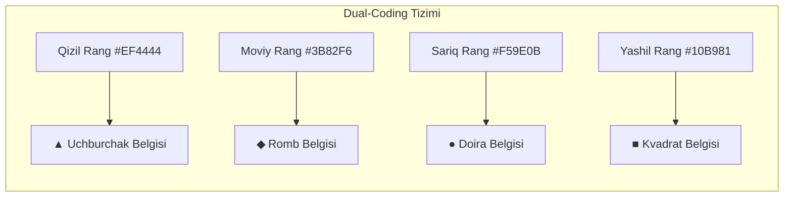

# Accessibility Specification

**Hujjat identifikatori:** DOC-31  
**Fayl nomi:** `ACCESSIBILITY.md`  
**Status:** Tasdiqlangan arxitektura spetsifikatsiyasi  
**Modul:** `ui_ux.accessibility`  
**Standart:** Web Content Accessibility Guidelines (WCAG 2.1 Level AA)  
**Mavzu:** Inklyuzivlik, rang ko‘rligi (Daltonizm) himoyasi, kontrast, klaviatura boshqaruvi va Screen Reader  

---

## 1. Umumiy Inklyuzivlik Tamoyillari

Ta'lim platformasi har bir bola va o‘qituvchi, jumladan, ko‘rishida nuqsoni bor, ranglarni to‘liq ajrata olmaydigan yoki harakat sezgirligi yuqori bo‘lgan o‘quvchilar uchun teng imkoniyatli bo‘lishi shart.

---

## 2. Rang Ko‘rligi (Daltonizm) Uchun Dual-Coding Tizimi

Statistikaga ko‘ra, o‘g‘il bolalarning $8\%$ qismi rang ajratishda (qizil-yashil daltonizm) qiynaladi. Shu sababli, axborot hech qachon **faqat rang orqali** berilmaydi.



### Amaliy Ko‘rinishi:
O‘quvchi ekranda nafaqat rangni, balki aniq shaklni ham ko‘radi. O‘qituvchi: *"Uchburchakni bosing!"* yoki *"Qizilni bosing!"* desa ham, har qanday bola to‘g‘ri variantni topa oladi.

---

## 3. Rang Kontrasti Standartlari (Contrast Ratios)

Barcha matnlar va interaktiv elementlar WCAG 2.1 AA talabiga javob beradi:
- **Oddiy matnlar:** Minimal kontrast **$4.5:1$** (Krem fonda `#1E1E24` matni: $12.8:1$ kontrast beradi).
- **Katta sarlavhalar va tugmalar:** Minimal kontrast **$3.0:1$** (Olovrang `#FF7527` ustida oq `#FFFFFF` qalin shrift: $3.4:1$ kontrast beradi).

---

## 4. Klaviatura Bilan To‘liq Boshqaruv (Keyboard Navigation)

Sichqonchadan foydalana olmaydigan o‘qituvchi va o‘quvchilar uchun klaviatura yorliqlari:
- `Tab` va `Shift+Tab`: Interaktiv elementlar bo‘ylab ketma-ket yurish.
- **Ko‘rinadigan Fokus Halqasi (Focus Ring):**
  ```css
  *:focus-visible {
    outline: 3px solid #FF7527;
    outline-offset: 2px;
  }
  ```
- **Tezkor Tugmalar (Shortcuts):**
  - O‘quvchi: `1`, `2`, `3`, `4` raqamlari tegishli variantni tanlaydi.
  - O‘qituvchi: `Bo‘sh joy (Space)` — Taymerni to‘xtatish/davom ettirish, `O‘ngga ko‘rsatkich (→)` — Keyingi savolga o‘tish.

---

## 5. Screen Reader va ARIA Standartlari

Ko‘rish imkoniyati cheklanganlar uchun ovozli o‘qish dasturlari (NVDA, JAWS, VoiceOver, TalkBack):
- **Jonli Yangilanishlar (`aria-live="polite"`):** Yangi savol ochilganda yoki ballar o‘zgarganda ekranni o‘qish dasturi o‘quvchiga darhol ovoz chiqarib aytadi:
  ```html
  <div aria-live="polite" class="sr-only">
    3-savol ochildi: Quyosh sistemasidagi eng katta sayyora qaysi? 30 soniya vaqtingiz bor.
  </div>
  ```
- **3D Tasvirlar Uchun `alt` Matnlari:** 3D personajlar shunchaki bezak bo‘lsa `aria-hidden="true"` qo‘yiladi, muhim axborot bo‘lsa (masalan, kubok) to‘liq tavsif beriladi.

---

## 6. Harakat Sezgirligi (Reduced Motion)

Epilepsiya yoki vestibulyar sezgirligi bor bolalar uchun animatsiyalarni to‘xtatish:
```css
@media (prefers-reduced-motion: reduce) {
  *, *::before, *::after {
    animation-duration: 0.01ms !important;
    animation-iteration-count: 1 !important;
    transition-duration: 0.01ms !important;
  }
}
```
Ushbu rejim yoqilganda konfetti, uchuvchi tangalar va 3D sakrashlar o‘rniga oddiy statik ma'lumotlar ko‘rsatiladi.
