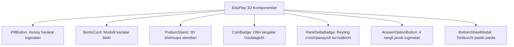

# UI Component Library Specification

**Hujjat identifikatori:** DOC-29  
**Fayl nomi:** `COMPONENTS.md`  
**Status:** Tasdiqlangan arxitektura spetsifikatsiyasi  
**Modul:** `ui_ux.components`  
**Dizayn Tili:** "EduPlay 3D" (Bento Grid, Claymorphism, Playful Buttons)  
**Mavzu:** Asosiy UI komponentlar kutubxonasi, propslar, HTML/CSS tuzilmasi va holatlar (States)  

---

## 1. Umumiy Ko‘rinish

EduSelf Teacher platformasidagi har bir komponent o‘ziga xos 3D estetikaga, yumaloqlangan burchaklarga (`border-radius: 28px`), qulay sensor maydoniga va haptik/audio aloqaga ega.

---

## 2. Asosiy Komponentlar Katalogi



---

## 3. Komponentlar Spetsifikatsiyasi va Kod Namunalari

### 3.1 `PillButton` (Asosiy Kapsula Tugma)
Foydalanuvchi namunasidagi "Get Started" va "Next Level" tugmalarining dasturiy spetsifikatsiyasi.

- **Variantlar:** `primary` (Olovrang `#FF7527`), `secondary` (Oq Outline `#FFFFFF`), `ghost`.
- **Props:** `variant`, `size`, `icon`, `loading`, `disabled`, `onClick`.
- **CSS / Stil Tuzilmasi:**
```css
.pill-button-primary {
  display: inline-flex;
  align-items: center;
  justify-content: center;
  width: 100%;
  height: 56px;
  background-color: #FF7527;
  color: #FFFFFF;
  font-family: 'Plus Jakarta Sans', sans-serif;
  font-size: 16px;
  font-weight: 700;
  border-radius: 9999px;
  border: none;
  cursor: pointer;
  box-shadow: 0px 8px 24px rgba(255, 117, 39, 0.35);
  transition: transform 0.15s cubic-bezier(0.34, 1.56, 0.64, 1);
}

.pill-button-primary:active {
  transform: scale(0.96);
  background-color: #E65D0F;
}

.pill-button-secondary {
  height: 56px;
  background-color: transparent;
  color: #FF7527;
  border: 2px solid #FFD9C7;
  border-radius: 9999px;
  font-weight: 700;
}
```

---

### 3.2 `BentoCard` (Bento Modul Kartasi)
Bosh sahifadagi rang-barang bloklar ("PLAY EARN WIN", "Challenge Friends").

- **Variantlar:** `sky-blue` (`#00A3FF`), `purple` (`#8B5CF6`), `gold` (`#F59E0B`), `dark` (`#1E1E24`).
- **CSS Tuzilmasi:**
```css
.bento-card {
  position: relative;
  border-radius: 28px;
  padding: 24px;
  overflow: hidden;
  box-shadow: 0px 12px 32px rgba(30, 30, 36, 0.06);
  display: flex;
  flex-direction: column;
  justify-content: space-between;
}

.bento-card-blue {
  background: linear-gradient(180deg, #38BDF8 0%, #00A3FF 100%);
  color: #FFFFFF;
}

.bento-card-purple {
  background: linear-gradient(180deg, #A78BFA 0%, #8B5CF6 100%);
  color: #FFFFFF;
}
```

---

### 3.3 `PodiumStand` (3D Shohsupa Stendi)
Reyting ekranidagi 1, 2 va 3-o‘rinlar stendlari.

- **1-o‘rin (Markaziy):** Balandligi `160px`, rangi `#FF6B35`, tepasida oltin toj (`👑`), matni "1 / 4250 coins".
- **2-o‘rin (Chap):** Balandligi `120px`, rangi `#60A5FA`, matni "2 / 3980 coins".
- **3-o‘rin (O‘ng):** Balandligi `90px`, rangi `#FFD154`, matni "3 / 3720 coins".

```html
<div class="podium-container">
  <!-- 2-o'rin -->
  <div class="podium-stand stand-blue">
    <div class="avatar-circle">👦</div>
    <span class="rank-number">2</span>
    <span class="coins-label">3980 coins</span>
  </div>
  <!-- 1-o'rin -->
  <div class="podium-stand stand-orange">
    <div class="crown-icon">👑</div>
    <div class="avatar-circle">👧</div>
    <span class="rank-number">1</span>
    <span class="coins-label">4250 coins</span>
  </div>
  <!-- 3-o'rin -->
  <div class="podium-stand stand-yellow">
    <div class="avatar-circle">👧</div>
    <span class="rank-number">3</span>
    <span class="coins-label">3720 coins</span>
  </div>
</div>
```

---

### 3.4 `RankDeltaBadge` (Reyting O‘zgarishi Belgisi)
O‘quvchining yuqoriga yoki pastga siljiganligini ko‘rsatuvchi mikronishon:
- **Ko‘tarilish:** Yashil fon `#ECFDF5`, matn `#10B981` $\to$ `▲ 2`
- **Pastlash:** Qizil fon `#FEF2F2`, matn `#EF4444` $\to$ `▼ 1`
- **O‘zgarmas:** Kulrang fon `#F3F4F6`, matn `#6B7280` $\to$ `─`

---

### 3.5 `AnswerOptionButton` (4 Rangli Javob Kartasi)
O‘quvchi telefonida chiqadigan 4 ta sensor tugma:
1. **Qizil (Red):** `▲` (Uchburchak belgisi bilan)
2. **Moviy (Blue):** `◆` (Romb belgisi bilan)
3. **Sariq (Yellow):** `●` (Doira belgisi bilan)
4. **Yashil (Green):** `■` (Kvadrat belgisi bilan)

*Geometrik shakllar rang ajrata olmaydigan (Color-blind) bolalar uchun majburiy kiritilgan.*
