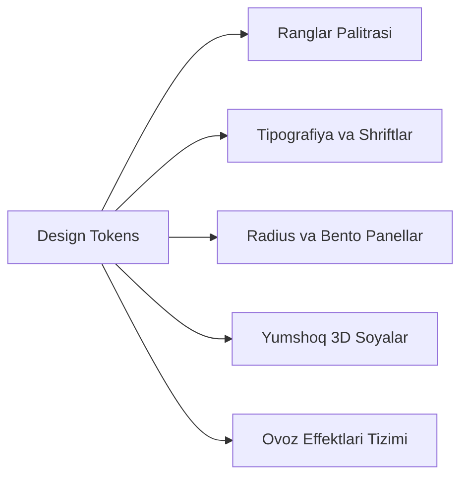

# EduPlay 3D — Design System Specification

**Hujjat identifikatori:** DOC-25  
**Fayl nomi:** `DESIGN_SYSTEM.md`  
**Status:** Tasdiqlangan arxitektura spetsifikatsiyasi  
**Modul:** `ui_ux.design_system`  
**Dizayn Tili:** "EduPlay 3D" (Toy Claymorphism, Bento Grid, Vibrant Gamification)  
**Mavzu:** Ranglar palitrasi, tipografiya, radius, spacing, mikro-animatsiyalar va audio tizimi  

---

## 1. Vizual Uslub va Asosiy Tokenlar (Visual Foundations)

"EduPlay 3D" dizayn tizimi bolalarda o‘qishga qiziqish uyg‘otish va o‘qituvchiga zamonaviy estetik zavq berish uchun ishlab chiqilgan.



---

## 2. Ranglar Palitrasi (Color Palette Tokens)

### 2.1 Asosiy Ranglar (Brand & Primary):
- **Primary Orange (`--color-primary`):** `#FF7527` (Asosiy CTA, g‘alaba elementlari, "Get Started" tugmasi)
- **Primary Hover (`--color-primary-hover`):** `#E65D0F`
- **Primary Soft (`--color-primary-soft`):** `#FFF2EB` (Tanlangan holatlar foni)

### 2.2 Bento Kartalar Palitrasi (Bento Grid Accents):
- **Sky Blue (`--color-bento-blue`):** `#00A3FF` / `#38BDF8` ("Play Earn Win" kartasi)
- **Playful Purple (`--color-bento-purple`):** `#8B5CF6` / `#9D72FF` ("Challenge Friends" kartasi)
- **Warm Gold (`--color-bento-gold`):** `#F59E0B` / `#FFB800` (Kubok va tangalar kartasi)
- **Dark Charcoal (`--color-bento-dark`):** `#1E1E24` ("Fun games!" nishoni)

### 2.3 Fon va Sirt Ranglari (Surfaces):
- **Warm Background (`--color-bg-warm`):** `#FBF9F5` (Ko‘zni toliqtirmaydigan iliq qaymoqrang fon)
- **Card Surface (`--color-surface-card`):** `#FFFFFF` (Yumaloqlangan oq kartalar)
- **Card Border (`--color-border-subtle`):** `#EAE6DF` (Nozik ajratuvchi chiziqlar)

### 2.4 Shohsupa Ranglari (Leaderboard Podium):
- **1-o‘rin (Oltin Shohsupa):** `#FF6B35` (Yorqin olovrang stend + oltin toj)
- **2-o‘rin (Kumush Shohsupa):** `#60A5FA` (Moviy rangli stend)
- **3-o‘rin (Bronza Shohsupa):** `#FFD154` (Iliq sariq stend)

---

## 3. Tipografiya Standartlari (Typography Scale)

Platforma uchun zamonaviy, yumaloq va o‘qilishi yengil Google Fonts shriftlari tanlangan:
- **Sarlavhalar (Headlines):** `Plus Jakarta Sans` yoki `Fredoka` (Bold / ExtraBold).
- **Asosiy Matn va Raqamlar (Body & UI):** `Poppins` yoki `Inter` (Medium / SemiBold).

| Uslub Nomi | Shrift O‘lchami | Satr Balandligi | Shrift Vazni | Ishlatilish Joyi |
|---|---|---|---|---|
| `Display 1` | `36px` (`2.25rem`) | `44px` | ExtraBold (800) | "Play to Gain Knowledge and Skills" |
| `Heading 1` | `28px` (`1.75rem`) | `36px` | Bold (700) | "Leaderboard / January 2026", "Perfect Scorer" |
| `Heading 2` | `22px` (`1.375rem`) | `28px` | Bold (700) | Bento karta sarlavhalari |
| `Subtitle` | `16px` (`1.0rem`) | `24px` | Medium (500) | Tushuntirish va ostki matnlar |
| `Body Bold` | `15px` (`0.9375rem`) | `22px` | SemiBold (600) | O‘quvchilar ismlari, savol matni |
| `Button Text` | `16px` (`1.0rem`) | `20px` | Bold (700) | "Get Started", "Next Level" tugmalari |
| `Caption` | `13px` (`0.8125rem`) | `18px` | Medium (500) | Tangalar soni, kichik parametrlar |

---

## 4. Radius va Geometriya (Border Radius Tokens)

Barcha elementlar yumshoq, o‘yinchoq uslubidagi doiraviy burchaklarga ega:
- `--radius-sm`: `12px` (Kichik nishonlar, badge'lar)
- `--radius-md`: `18px` (Variant tugmalari, inputlar)
- `--radius-lg`: `28px` (Bento kartalar, asosiy konteynerlar)
- `--radius-xl`: `36px` (Pastki tortma modallar — Bottom Sheets)
- `--radius-pill`: `9999px` (Pill-shaklidagi harakat tugmalari)

---

## 5. Soyalar va 3D Chuqurlik (Elevation & Shadows)

Haqiqiy 3D tuyg‘usini beruvchi iliq rangli yumshoq soyalar (Claymorphism):
```css
/* Asosiy olovrang tugma soyasi */
--shadow-primary-btn: 0px 8px 24px rgba(255, 117, 39, 0.35);

/* Bento kartalar yumshoq soyasi */
--shadow-bento-card: 0px 12px 32px rgba(30, 30, 36, 0.05);

/* Qalqib chiquvchi modal soyasi */
--shadow-floating-modal: 0px 24px 64px rgba(30, 30, 36, 0.15);
```

---

## 6. Mikro-Animatsiyalar va Fizika (Spring Motion)

1. **Tugma Bosilishi (Scale Press):**
   ```css
   .pill-button:active {
     transform: scale(0.96);
     transition: transform 0.1s cubic-bezier(0.34, 1.56, 0.64, 1);
   }
   ```
2. **Karta Ochilishi (Spring Pop-In):**
   Har bir karta ekranga chiqqanda yengil sakrash effekti bilan paydo bo‘ladi (Stiffness: 300, Damping: 20).
3. **Tanga Sakrashi (Coin Bounce):**
   To‘g‘ri javob berilganda oltin tanga yuqoriga sakrab hisoblagichga qo‘shiladi.

---

## 7. Audio va Ovoz Dizayni Tizimi (Sound Tokens)

Platforma quloqqa yoqimli, past dinamikali va bolalarni charchatmaydigan tovush effektlariga ega:

| Tovush Identifikatori | Trigger (Hodisa) | Akustik Xarakteristikasi | Fayl Nomi |
|---|---|---|---|
| `sound-coin` | Tanga yig‘ilganda | Yorqin 2 bosqichli metall chime ($987\text{Hz} \to 1318\text{Hz}$, 120ms) | `coin_ping.mp3` |
| `sound-correct` | Savolga to‘g‘ri javob berganda | Katta C-Major akkordi (Do-Mi-Sol, 350ms, yoqimli va iliq) | `correct_chime.mp3` |
| `sound-wrong` | Savolga xato javob berganda | Yumshoq tebranish ($220\text{Hz} \to 180\text{Hz}$, bolani ranjitmaydigan wobble) | `wrong_soft.mp3` |
| `sound-tick` | Taymerning oxirgi 5 soniyasi | Yog‘och quticha taqillashi (Woodblock tick, 40ms) | `timer_tick.mp3` |
| `sound-victory` | "Perfect Scorer" yoki Podium chiqqanda | Qisqa tantanali karnay va konfetti hushtagi (1.2 soniya) | `podium_fanfare.mp3` |
| `sound-streak` | 3+ ketma-ket to‘g‘ri javobda | Olovli tezkor "whoosh" sadolari | `streak_flame.mp3` |

*Foydalanuvchi istalgan vaqtda yuqori burchakdagi karnay belgisi orqali ovozlarni o‘chirib qo‘yishi (Mute) mumkin.*
