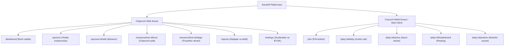
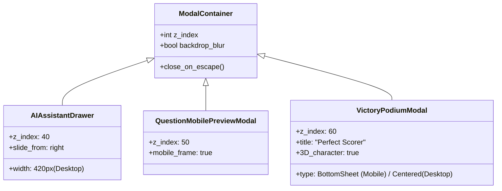

# Information Architecture Specification

**Hujjat identifikatori:** DOC-27  
**Fayl nomi:** `INFORMATION_ARCHITECTURE.md`  
**Status:** Tasdiqlangan arxitektura spetsifikatsiyasi  
**Modul:** `ui_ux.information_architecture`  
**Mavzu:** Sayt xaritasi (Sitemap), sahifalar ierarxiyasi, navigatsiya tuzilmasi va modallar arxitekturasi  

---

## 1. Umumiy Axborot Arxitekturasi (Sitemap)

EduSelf Teacher platformasi o‘qituvchi va o‘quvchilar uchun aniq ajratilgan ikki xil axborot makoniga ega:

---

## 2. O‘qituvchi Web Ilovasi Ierarxiyasi

### 2.1 `/dashboard` (Bosh Boshqaruv Markazi)
- **Yuqori qism:** Xush kelibsiz banneri, "Yangi Quiz", "Jonli Dars Boshlash" va "AI bilan generatsiya" tezkor tugmalari.
- **Asosiy qism:** Bento uslubidagi oxirgi faol testlar, darslar statistikasi.
- **O‘ng chekka:** Bildirishnomalar va AI assistentining tezkor maslahatlari.

### 2.2 `/quizzes` va `/quizzes/:id/edit` (Kutubxona va Muharrir)
- Papkalar (`Fanlar`, `Sinflar`, `Arxiv`).
- Savollar banki: oldin ishlatilgan savollarni boshqa testga qayta qo‘shish.
- Ikki panelli muharrir: Chapda savollar daraxti, markazda savol kartasi, o‘ngda AI agent draweri.

### 2.3 `/sessions/live/:id/*` (Jonli Dars Makoni)
- `:id/host` — Faqat o‘qituvchi ko‘radigan to‘liq ma'lumotlar (to‘g‘ri javoblar, darsni to‘xtatish, o‘quvchilarni chiqarish).
- `:id/stage` — Proyektor yoki televizorga uzatiladigan toza, katta shriftli vizual sahna (o‘quvchilar javoblari sir tutiladi).

### 2.4 `/reports` (Tahlil va Hisobotlar)
- Sinf bo‘yicha o‘zlashtirish foizi (Heatmap).
- Eng qiyin 3 ta savol tahlili.
- Excel (XLSX) va chop etiladigan PDF hisobotlar eksporti.

---

## 3. O‘quvchi Mobil Ilovasi Ierarxiyasi (Distraction-Free)

O‘quvchi ekrani dars paytida **chalg‘ituvchi elementlardan to‘liq tozalangan** (Distraction-Free):
- Pastki tablar (Bottom navigation) o‘yin vaqtida yashiriladi.
- Brauzerning "Orqaga" tugmasi tasodifiy chiqib ketishni oldini olish uchun bloklanadi (`beforeunload` ogohlantirishi).
- Ekranda faqat savol, javob variantlari, tangalar hisoblagichi va reyting ko‘rinadi.

---

## 4. Modallar, Drawers va Qalqib Chiquvchi Oynalar (Overlay Hierarchy)

1. **AI Assistant Drawer (z-index: 40):** O‘qituvchi muharriridan chiqmasdan turib AI bilan maslahatlashishi uchun o‘ngdan silliq surilib chiqadi.
2. **Mobile Preview Simulator (z-index: 50):** O‘qituvchi savol bolaning telefonida qanday ko‘rinishini tekshirish uchun ochiladigan interaktiv smartfon oynasi.
3. **Victory & Reward Modal (z-index: 60):** Rasmda keltirilgan "Perfect Scorer" g‘alaba pardasi (Bottom Sheet) — fonni xiralashtirib (Backdrop Blur: 16px), 3D kubokli qizaloq va tangalar bilan ochiladi.
