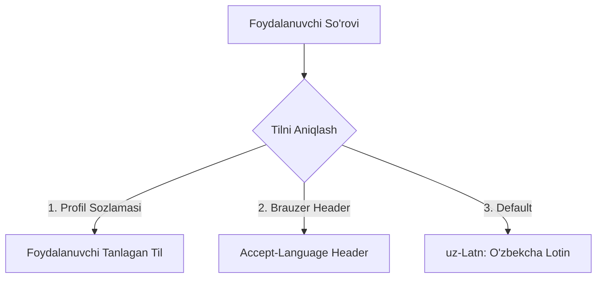

# Localization Specification

**Hujjat identifikatori:** DOC-32  
**Fayl nomi:** `LOCALIZATION.md`  
**Status:** Tasdiqlangan arxitektura spetsifikatsiyasi  
**Modul:** `ui_ux.localization`  
**Qo‘llab-quvvatlanadigan Tillar:** O‘zbekcha (Lotin), O‘zbekcha (Kirill), Ruscha va Inglizcha  
**Mavzu:** Ko‘p tilli interfeys, matn kengayishi (Text Expansion), sonlar va sanalar formati  

---

## 1. Umumiy Ko‘rinish va Til Strategiyasi

EduSelf Teacher O‘zbekiston va Markaziy Osiyo ta'lim muhiti uchun ishlab chiqilgan bo‘lib, 4 ta asosiy til/alifbo formatini qo‘llab-quvvatlaydi:
1. **`uz-Latn` (O‘zbekcha Lotin):** Birlamchi (Default) tizim tili.
2. **`uz-Cyrl` (O‘zbekcha Kirill):** Katta yoshli o‘qituvchilar va ayrim hududlar uchun.
3. **`ru-RU` (Ruscha):** Rus tilidagi sinflar va xalqaro maktablar uchun.
4. **`en-US` (Inglizcha):** Prezident maktablari va xalqaro foydalanuvchilar uchun.



---

## 2. Matn Kengayishi va Dizayn Chidamliligi (Text Expansion)

Turli tillarda bir xil ma'noni beruvchi so‘zlar uzunligi keskin farq qiladi:
- Inglizcha: `"Next Level"` (10 belgi)
- O‘zbekcha: `"Keyingi Bosqich"` (15 belgi — $+50\%$ uzunroq)
- Ruscha: `"Следующий Уровень"` (17 belgi — $+70\%$ uzunroq)

### 2.1 Dizayn Qoidalari:
1. **Tugmalar Ichida Qat'iy En (Fixed Width) Taqiqlanadi:** Barcha `PillButton` komponentlari `min-width: 140px; width: 100%` bilan dinamik kengayadi.
2. **Matn Qirqilishi (Clipping) Bo‘lmasligi:** Asosiy harakat tugmalarida matnni `...` (ellipsis) qilib qisqartirish mutlaqo taqiqlanadi.
3. **O‘zbek Tili Maxsus Harflari:** `o‘`, `g‘`, `sh`, `ch` harflaridagi teskari vergul (`‘`) noto‘g‘ri belgilar bilan almashib ketmasligi uchun Unicode `\u02BB` (Modifier Letter Turned Comma) qat'iy standart sifatida kiritilgan.

---

## 3. Raqamlar, Valyuta va Vaqt Formatlari

| Til | Tangalar / Ballar | Vaqt (24h/12h) | Sana Formati |
|---|---|---|---|
| **O‘zbekcha (Lotin)** | `2 185 ball` / `2 185 tanga` | `12:41` | `15-oktabr 2026-yil` |
| **O‘zbekcha (Kirill)**| `2 185 балл` / `2 185 танга` | `12:41` | `15 октябр 2026 йил` |
| **Ruscha** | `2 185 баллов` / `2 185 монет`| `12:41` | `15 октября 2026 г.` |
| **Inglizcha** | `2,185 points` / `2,185 coins`| `12:41 PM` | `October 15, 2026` |

---

## 4. Tarjimalar Fayllari Strukturasi (i18n Architecture)

Tarjimalar JSON kalitlari asosida saqlanadi:
`locales/uz-Latn.json`:
```json
{
  "home": {
    "play_earn_win": "O'YNA G'ALABA QOZON",
    "challenge_friends": "Do'stlar Bilan Bellashing",
    "fun_games": "Qiziqarli o'yinlar!",
    "hero_headline": "Bilim va Ko'nikma Olish Uchun O'ynang",
    "get_started_btn": "Boshlash",
    "create_account_btn": "Hisob Yaratish"
  },
  "leaderboard": {
    "title": "Peshqadamlar Jadvali",
    "coins_count": "{count} tanga",
    "rank_up": "{delta} pog'ona ko'tarildi",
    "rank_down": "{delta} pog'ona tushdi"
  },
  "victory": {
    "perfect_scorer": "MUKAMMAL NATIJA!",
    "perfect_scorer_desc": "Sizning ajoyib natijangiz barcha uchun yangi bilim cho'qqisini belgilab berdi",
    "next_level": "Keyingi Bosqich",
    "share_with_friends": "Do'stlarga Ulashish"
  }
}
```

Ushbu arxitektura kelgusida yangi tillarni (masalan, Qoraqalpoqcha yoki Qozoqcha) osonlik bilan kiritish imkonini beradi.
