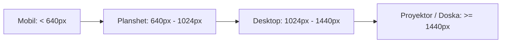

# Responsive Design Guidelines

**Hujjat identifikatori:** DOC-30  
**Fayl nomi:** `RESPONSIVE_DESIGN.md`  
**Status:** Tasdiqlangan arxitektura spetsifikatsiyasi  
**Modul:** `ui_ux.responsive`  
**Mavzu:** Mobil, planshet, noutbuk va sinf proyektori (16:9 va 4:3) uchun moslashuvchan dizayn qoidalari  

---

## 1. Ekran O‘lchamlari va Breakpointlar Standarti

EduSelf Teacher platformasi kichik smartfonlardan tortib maktabning katta interaktiv doskalarigacha (Smartboards / Projectors) birdek mukammal ishlashi kerak.



### Breakpointlar Jadvali:

| Qurilma Turi | Breakpoint | Asosiy Interfeys | Layout Xususiyati |
|---|---|---|---|
| **Kichik Smartfon** | `< 400px` | Talaba O‘yini | 1 ustunli stack, ixcham bento, 100dvh |
| **Standart Smartfon** | `400px - 640px` | Talaba O‘yini | Bento 2x2 grid, pastki parda (Bottom Sheet) |
| **Planshet (iPad)** | `640px - 1024px` | O‘qituvchi / Talaba | 2 ustunli kengaytirilgan boshqaruv paneli |
| **Desktop / Noutbuk** | `1024px - 1440px` | O‘qituvchi Muharriri | 3 panelli Canvas (Savollar + Muharrir + AI) |
| **Proyektor / 4K Doska** | `>= 1440px` | Sinf Sahna Ekrani | Ulkan shriftlar (10 metrdan o‘qiladigan), 16:9 / 4:3 |

---

## 2. Mobil Qurilmalar Uchun Dinamik Balandlik (`100dvh`)

Mobil brauzerlarda (Safari iOS, Chrome Android) manzil satri (URL bar) ochilib-yopilishi tufayli an'anaviy `100vh` qiymati ekranni sakratadi. 

EduSelf barcha mobil o‘yin sahifalarida **`100dvh` (Dynamic Viewport Height)** qoidasidan foydalanadi:

```css
.student-game-container {
  width: 100%;
  height: 100dvh; /* Manzil satriga moslashuvchan balandlik */
  display: flex;
  flex-direction: column;
  justify-content: space-between;
  padding: env(safe-area-inset-top) 16px env(safe-area-inset-bottom) 16px;
  overflow: hidden;
}
```

---

## 3. Bosh Barmoq Zonasi (Thumb Zone Optimization)

O‘quvchilar telefonni bir qo‘lda ushlab javob berishini hisobga olib, barcha interaktiv javob tugmalari ekranning qulay **"Tabiiy Bosh Barmoq Zonasi"** (Natural Thumb Zone) ichiga joylashtirilgan:

```text
+-----------------------------------+
|  [ Savol Matni va Taymer ]       | <-- Faqat ko'rish zonasi (No touch)
|                                   |
|                                   |
|  ...............................  |
|  [ Variant A ]   [ Variant B ]   | <-- O'rtacha yetish masofasi
|                                   |
|  [ Variant C ]   [ Variant D ]   | <-- ENGI QULAY BOSH BARMOQ ZONASI
|                                   |     (Eng tez bosiladigan qism)
+-----------------------------------+
```

---

## 4. Sinf Proyektori va Katta Ekranlar (16:9 va 4:3 Moslashuvi)

Maktablardagi proyektorlar har doim ham zamonaviy 16:9 keng formatda bo‘lmasligi, ayrim sinflarda 4:3 nisbatli eski ekranlar bo‘lishi mumkin:

1. **Aspect Ratio Container:** Proyektor sahnasi `aspect-ratio: 16/9` asosida markazlashadi; 4:3 ekranga tushganda avtomatik ravishda tepa va pastdan proporsional qisqaradi (Letterboxing).
2. **Katta Shriftlar (Fluid Typography):**
   ```css
   .projector-question-text {
     font-size: clamp(28px, 4vw, 54px);
     line-height: 1.25;
     font-weight: 800;
   }
   ```
3. **Sensor Maydoni (Touch Target):** Barcha tugmalar kamida `48px x 48px` o‘lchamda bo‘ladi, qo‘shni tugmalar orasidagi masofa esa tasodifiy bosib yuborishni oldini olish uchun kamida `12px` qilib belgilanadi.
