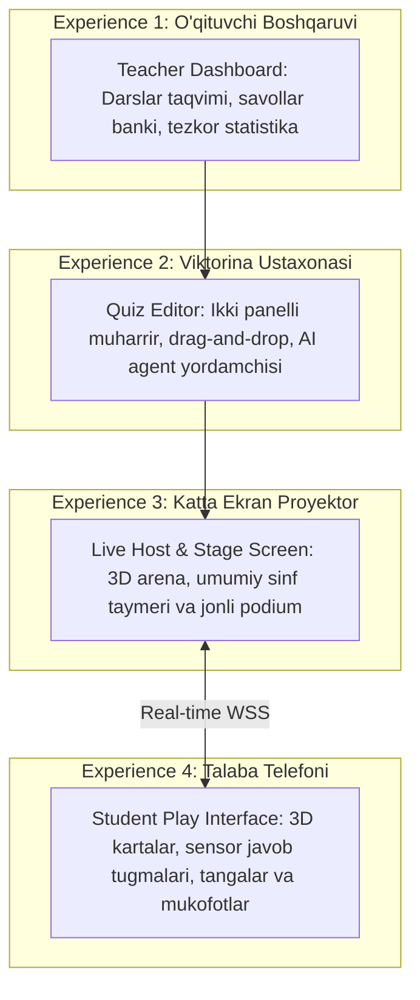

# UI/UX Design Specification

**Hujjat identifikatori:** DOC-24  
**Fayl nomi:** `UI_UX_SPEC.md`  
**Status:** Tasdiqlangan arxitektura spetsifikatsiyasi  
**Modul:** `ui_ux.specification`  
**Dizayn Tili:** "EduPlay 3D" — Gamified Claymorphism & Bento Grid  
**Mavzu:** To‘rtta asosiy foydalanuvchi tajribasi (Teacher Dashboard, Quiz Editor, Live Host Screen, Student Play Interface)  

---

## 1. Umumiy Dizayn Falsafasi va Vizual Identifikatsiya

EduSelf Teacher platformasining foydalanuvchi interfeysi zerikarli akademik jadvallar o‘rniga bolalar va o‘qituvchilarga quvonch bag‘ishlovchi **3D Toy / Claymorphism & Bento Grid** uslubida yaratilgan.

```mermaid
graph TD
    subgraph Design Philosophy [EduPlay 3D Falsafasi]
        Playful[1. 3D Gamifikatsiya: Qahramonlar, Oltin Tangalar va Shohsupa]
        Bento[2. Bento Grid: Modulli, yumaloq burchakli (28px) toza bloklar]
        Warmth[3. Iliq Ranglar: Energetik olovrang (#FF7527) va krem fon (#FBF9F5)]
        Micro[4. Tirik Dinamika: Spring fizika animatsiyalari va audio effektlar]
    end
```

### 1.1 Asosiy Vizual Namuna (Reference Screens):
Platformaning mobil o‘quvchi interfeysi quyidagi uchta asosiy sahifaga tayanadi:
1. **Gamified Home / Lobby:** 3D personajlar bilan bezatilgan Bento Grid, "Play to Gain Knowledge and Skills" shiori va olovrang "Get Started" pill-tugmasi.
2. **Leaderboard Podium:** 3D shohsupa (1-o‘rin Olovrang, 2-o‘rin Moviy, 3-o‘rin Sariq), toj va tangalar, pastki qismda interaktiv reyting ro‘yxati.
3. **Victory & Reward Modal ("Perfect Scorer"):** Oltin kubok ko‘targan quvnoq 3D qizaloq, uchayotgan oltin tangalar (`+2185 coins`) va "Next Level" harakat tugmasi.

---

## 2. To‘rtta Asosiy Foydalanuvchi Tajribasi (Four Core Experiences)

EduSelf Teacher platformasi barcha ishtirokchilar uchun 4 ta mustaqil, ammo bir-biri bilan uzviy bog‘langan tajribani taqdim etadi:



---

## 3. Tajriba 1: Teacher Dashboard (O‘qituvchi Boshqaruv Markazi)

O‘qituvchi ish stoli (Desktop / Laptop) uchun optimallashtirilgan, o‘qish oson va qulay navigatsiyali boshqaruv paneli.

### 3.1 Asosiy Bloklar:
- **Salomlashish va Dars Boshlash Paneli:** *"Xayrli kun, Malika ustoz!"*, bitta tugma bilan `[ + Yangi Dars Boshlash ]` yoki `[ AI bilan Quiz Yaratish ]`.
- **Faol Viktorinalar Kutubxonasi (Bento Cards):** Har bir test kartasida fan piktogrammasi, savollar soni, oxirgi natijalar va `[ Jonli O'yin ]` tugmasi.
- **Sinfning O‘zlashtirish Dinamikasi:** So‘nggi 7 kundagi o‘rtacha aniqlik (Accuracy: $78\%$) va eng qiyin o‘zlashtirilgan mavzular diagrammasi.
- **Tezkor AI Chat Draweri:** Ekranning o‘ng burchagida doimiy tayyor turuvchi yordamchi agent paneli.

---

## 4. Tajriba 2: Quiz Editor (Universal Viktorina Muharriri)

Qo‘lda kiritish (Manual) va sun'iy intellekt (AI) bilan ishlashni birlashtirgan universal muharrir.

```text
+-----------------------------------------------------------------------------------------+
| [← Dashboard]   7-sinf Fizika: Zichlik va Massa            [Preview]  [💾 Saqlash] [🚀 Start]|
+----------------------------------+----------------------------------+-------------------+
| SAVOLLAR RO'YXATI (Chap Panel)   | ASOSIY TAHRIRLASH MAYDONI        | AI YORDAMCHI AGENT|
|                                  |                                  | (O'ng Panel)      |
| [1] Single Choice (30s, 1000b)   | Savol matni:                     | "3-savolni sal    |
|     "Zichlik formulasi..."       | [ Zichlik formulasi qaysi?     ] | osonlashtiraylikmi|
|                                  | Media: [+ Rasm / Video yuklash]  | yoki formula      |
| [2] True / False (20s, 1000b)    |                                  | o'rniga amaliy    |
|     "Massa o'lchov birligi..."   | Variantlar:                      | misol qo'shami?"  |
|                                  | [A] rho = m / V  (✅ To'g'ri)    |                   |
| [3] 🔒 Puzzle Order (45s, 1500b) | [B] rho = m * V                  | [Taklifni Qabul   |
|     "O'lchash bosqichlari..."    | [C] rho = V / m                  |  Qilish (Diff)]   |
|                                  | [D] rho = m + V                  |                   |
| [+ Yangi Savol Qo'shish]         | Taymer: [30s ▼]  Ball: [1000 ▼]  | [Savol generatsiya|
| [📥 Import CSV / DOCX]           | Izoh: "Zichlik = massa / hajm"   |  qilish...]       |
+----------------------------------+----------------------------------+-------------------+
```

### 4.1 Muharrir Xususiyatlari:
- **Instant WYSIWYG:** Matn kiritilishi bilan o‘quvchi telefonida qanday ko‘rinishi kichik ekranda (Live Mobile Preview) aks etadi.
- **Formula Muharriri (KaTeX):** Matematik va fizik ifodalar tezkor tugmalar orqali LaTeX formatida kiritiladi.
- **Question Locking:** Yoqtirgan savolni 🔒 qulflab qo‘yish imkoniyati.

---

## 5. Tajriba 3: Live Host & Stage Screen (Katta Ekran / Proyektor)

Sinf xonasidagi interaktiv doska yoki proyektor uchun mo‘ljallangan, 10 metrdan ham tiniq ko‘rinuvchi vizual sahna.

### 5.1 Bosqichlar Vizualizatsiyasi:
1. **Lobby Fazasi:**
   - Ekranning markazida ulkan 6 xonali PIN kod (`489 201`) va katta QR-kod.
   - Pastki qismda yangi qo‘shilgan o‘quvchilarning 3D avatarlari va taxalluslari qiziqarli sakrash animatsiyasi bilan paydo bo‘ladi.
2. **Savol Fazasi:**
   - Ekranning yuqorisida savol matni va katta rasm/video.
   - Markazda 30 soniyalik silliq kamayuvchi doiraviy taymer (SVG radial countdown).
   - Pastda 4 ta rangli variant kartalari (Qizil, Moviy, Sariq, Yashil).
3. **Natija va Shohsupa (Podium Fazasi):**
   - 3D blokli podium sahnasi, konfetti yomg‘iri, g‘oliblarning nomlari va yakuniy ballari.

---

## 6. Tajriba 4: Student Play Interface (Talaba Mobil Interfeysi)

O‘quvchining smartfoni yoki planshetiga moslashtirilgan, minimal chalg‘ituvchi, chaqqon va o‘ta sezgir (Ultra-responsive) o‘yin interfeysi.

### 6.1 Dizayn Prinsiplari:
- **Thumb-Zone Optimization:** Barcha asosiy javob tugmalari ekranning pastki yarmida, bosh barmoq oson yetadigan masofada joylashadi.
- **Haptik Sezgi (Haptic Feedback):** Tugma bosilganda yengil tebranish (15ms), to‘g‘ri javobda muvaffaqiyatli tebranish (Success vibration).
- **Gamified Rewards:** Har bir to‘g‘ri javobdan so‘ng ekranda uchuvchi oltin tangalar animatsiyasi (`+100 coins`) va streak olovi.
