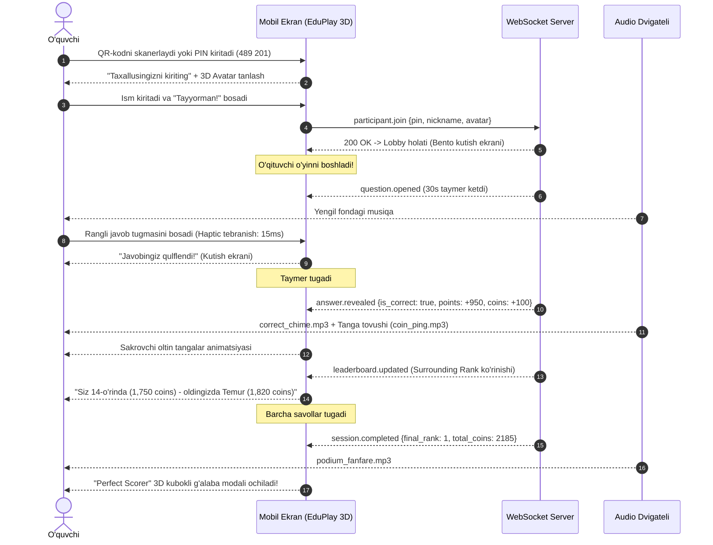

# User Flow Diagrams Specification

**Hujjat identifikatori:** DOC-26  
**Fayl nomi:** `USER_FLOWS.md`  
**Status:** Tasdiqlangan arxitektura spetsifikatsiyasi  
**Modul:** `ui_ux.user_flows`  
**Mavzu:** Talaba va o‘qituvchining asosiy harakat yo‘llari, ekrandan-ekranga o‘tish xaritalari va holatlar almashinuvi  

---

## 1. Umumiy Ko‘rinish

Foydalanuvchi yo‘llari (User Flows) EduSelf Teacher platformasidagi har bir qadamni keraksiz bosqichlarsiz, eng tez va intuitiv tarzda amalga oshirishga qaratilgan.

---

## 2. 1-Yo‘l: O‘quvchining O‘yinga Kirishi va O‘ynashi (Student Gameplay Flow)

Talaba hech qanday ro‘yxatdan o‘tish yoki murakkab parollarsiz, 15 soniya ichida o‘yin sahnasiga kirib boradi:



---

## 3. 2-Yo‘l: O‘qituvchining Test Yaratish Yo‘li (Teacher Creation Flow)

O‘qituvchi o‘z xohishiga ko‘ra to‘liq qo‘lda (Manual) yoki AI yordamida test tayyorlaydi:

```mermaid
flowchart TD
    Start[Dashboard: 'Yangi Quiz Yaratish'] --> ModeChoice{Qaysi usulda?}
    
    ModeChoice -->|Qo'lda kiritish| Manual[Bo'sh muharrir ochiladi: 29 ta savol turidan tanlash]
    ModeChoice -->|AI Agent bilan| AIWizard[AI Wizard: Fan, Sinf, Mavzu, O'yin turini aytish]
    ModeChoice -->|Fayldan import| Import[CSV / Word darslikni yuklash]

    AIWizard --> AIGen[Agent savollarni generatsiya qiladi (SSE Stream)]
    AIGen --> DiffReview[Diff ko'rinishida taklif: Accept / Reject]
    
    DiffReview --> Editor[Canonical Quiz Editor muharriri]
    Manual --> Editor
    Import --> Editor

    Editor --> EditActions{O'qituvchi tahrirlaydi}
    EditActions --> Lock[Yoqtirgan savolini 🔒 qulflaydi]
    EditActions --> Reorder[Drag-and-drop bilan tartiblaydi]
    EditActions --> Media[Rasm yoki video biriktiradi]

    Editor --> Preview[Live Mobile Simulator'da o'quvchi ko'zidan tekshiradi]
    Preview --> Save[💾 Saqlash yoki 🚀 Jonli O'yin Boshlash]
```

---

## 4. 3-Yo‘l: Jonli Dars O‘tkazish Yo‘li (Live Hosting & Stage Flow)

Dars boshlanganda o‘qituvchi noutbuki va sinf proyektori o‘rtasidagi sinxron harakatlar:

```mermaid
stateDiagram-v2
    [*] --> LOBBY: O'qituvchi 'Jonli Xona' ochdi
    
    state LOBBY {
        Proyektor: Ulkan PIN va QR-kod chiqariladi
        O'quvchilar: Birin-ketin ekranda 3D avatarlari paydo bo'ladi
        O'qituvchi: Noo'rin ismlarni chiqarib yuboradi yoki lobbini qulflaydi
    }

    LOBBY --> COUNTDOWN: O'qituvchi 'Boshlash' tugmasini bosdi
    COUNTDOWN --> QUESTION_ACTIVE: 3-2-1 Animatsiyasi

    state QUESTION_ACTIVE {
        Proyektor: Savol matni, media va markaziy doiraviy taymer
        O'qituvchi: Sinfdagi kim javob bergani jonli monitoringi
        O'quvchilar: Telefonlarida 4 ta rangli variant tugmasi
    }

    QUESTION_ACTIVE --> QUESTION_CLOSED: Taymer tugadi yoki 'Force Close'
    QUESTION_CLOSED --> REVEAL: To'g'ri javob va foizlar taqsimoti
    REVEAL --> ROUND_PODIUM: Raund yakuni reytingi
    
    ROUND_PODIUM --> QUESTION_ACTIVE: Keyingi savolga o'tish
    ROUND_PODIUM --> FINAL_PODIUM: Barcha savollar tugadi

    state FINAL_PODIUM {
        Proyektor: 3D oltin shohsupa, 1-2-3 o'rinlar, konfetti va musiqa
        O'quvchilar: Shaxsiy kubok yoki mukofot modali
    }

    FINAL_PODIUM --> [*]: Hisobotni saqlash va darsni yakunlash
```
