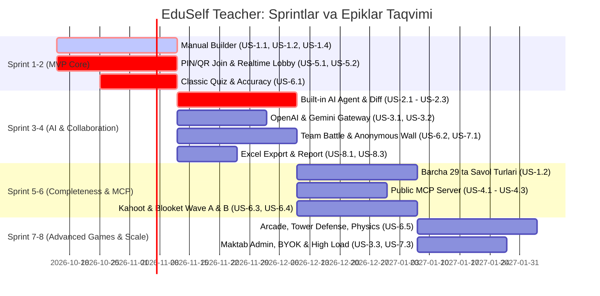

# EduSelf Teacher — Agile User Stories & Acceptance Criteria

**Hujjat versiyasi:** 1.0.0  
**Sana:** 14-oktabr 2026  
**Holati:** Approved Product Backlog  
**Asosiy hujjatlar:** [.docs/PRD.md](file:///c:/Users/Asus/Desktop/teacher-eduself-mcp/.docs/PRD.md) va [.docs/SRS.md](file:///c:/Users/Asus/Desktop/teacher-eduself-mcp/.docs/SRS.md)  
**Metodologiya:** Agile / Scrum, User Story Mapping, BDD (Behavior-Driven Development / Gherkin)

---

## 1. Kirish va Agile Konvensiyalari

Ushbu hujjat **EduSelf Teacher** platformasining barcha funksional talablarini ishlab chiquvchilar jamoasi uchun sprintlarga ajratish, vazifalarni baholash va sinovdan o'tkazish uchun qulay bo'lgan **Foydalanuvchi Hikoyalari (User Stories)** formatida ifodalaydi.

### 1.1 Hikoyalar Strukturasi
Har bir foydalanuvchi hikoyasi quyidagi xalqaro standart bo'yicha shakllantirilgan:
- **Story Statement:** `Kim sifatida [Rol / Persona], men [Amalni bajarishni xohlayman], toki [Maqsadga erishay / Biznes qiymat olay].`
- **Acceptance Criteria (Gherkin Sintaksisi):**
  - `Given` (Dastlabki shart / Kontekst)
  - `When` (Foydalanuvchi tomonidan bajarilgan aniq amal)
  - `Then` (Tizimning kutilayotgan reaksiyasi va natijasi)
- **Ustuvorlik (MoSCoW):**
  - **Must-have (M):** MVP bosqichida tizim ishga tushishi uchun qat'iy majburiy.
  - **Should-have (S):** Birinchi to'liq reliz uchun muhim va zarur.
  - **Could-have (C):** Qulaylik va ilg'or imkoniyatlar (vaqt bo'lsa amalga oshiriladi).
  - **Won't-have (W):** Keyingi bosqichlarga qoldirilgan.
- **Baholash (Estimation):** Story Points (Fibonacci: 1, 2, 3, 5, 8, 13) va T-Shirt Size (S, M, L, XL).
- **Traceability:** [.docs/SRS.md](file:///c:/Users/Asus/Desktop/teacher-eduself-mcp/.docs/SRS.md) dagi tegishli FR bandlariga to'g'ridan-to'g'ri havolalar.

---

## 2. Foydalanuvchi Personajlari (User Personas)

```mermaid
classDiagram
    class SardorAka {
        +Kasbi: O'rta maktab fizika o'qituvchisi
        +Maqsadi: Vaqtni tejash, sinfni to'liq faollashtirish
        +Qurilmasi: Noutbuk, Interaktiv doska
        +Asosiy rejimi: Team Battle, Formulas, Polls
    }
    class MalikaOpa {
        +Kasbi: Boshlang'ich sinf / Chet tili o'qituvchisi
        +Maqsadi: Bolalarni qiziqtirish, vizual va o'yinli dars
        +Qurilmasi: Planshet, Proyektor
        +Asosiy rejimi: Chill Art, Gold Quest, Busy Bees
    }
    class Aziz {
        +Roli: 7-sinf o'quvchisi (Ishtirokchi)
        +Maqsadi: Zerikmaslik, tezkor javob berish, jamoa bilan yutish
        +Qurilmasi: Arzon Android smartfon, Mobil internet
        +Asosiy ehtiyoji: Past internetda ishlash, oson PIN ulanish
    }
    class BotirAka {
        +Roli: Maktab IT direktori / Administrator
        +Maqsadi: Xavfsizlik, AI byudjetini nazorat qilish, litsenziyalar
        +Qurilmasi: Desktop kompyuter
        +Asosiy ehtiyoji: BYOK boshqaruvi, audit loglar, hisobotlar
    }
    class Jahongir {
        +Roli: Innovator o'qituvchi / MCP Chatbot foydalanuvchisi
        +Maqsadi: ChatGPT/Claude orqali dars rejasidan bir zumda quiz ochish
        +Qurilmasi: Mac / PC, Claude Desktop
        +Asosiy ehtiyoji: Ishonchli MCP tools, tezkor sinxronizatsiya
    }
```



---

## 3. Epik 1: Manual Quiz Builder & Tarkib Boshqaruvi (SRS: FR-1)

Ushbu epik o'qituvchiga sun'iy intellektdan mutlaqo foydalanmagan holda ham professional, to'liq shakllangan viktorinalarni yaratish, tahrirlash va saqlash imkonini beradi.

### US-1.1: Bo'sh viktorina yaratish va metama'lumotlarni sozlash
- **As a** O'qituvchi (Sardor aka),  
- **I want to** Yangi viktorina yaratishda uning nomi, fani, sinf darajasi, tili va umumiy tavsifini kiritishni,  
- **So that** Viktorinam kutubxonamda tartibli saqlansin va dars maqsadlarimga to'g'ri mos kelsin.  
- **Priority:** Must-have | **Estimate:** 2 SP (S) | **SRS Ref:** FR-1.1

> **Acceptance Criteria (Gherkin):**
> ```gherkin
> Scenario: O'qituvchi yangi quiz boshlaydi
>   Given O'qituvchi tizimga kirgan va "Dashboard" sahifasida turibdi
>   When U "Yangi viktorina" tugmasini bosadi va sarlavhaga "Nyuton qonunlari", fanga "Fizika", sinfga "7" deb kiritadi
>   And Til sifatida "O'zbekcha (Lotin)"ni tanlaydi va "Yaratish"ni bosadi
>   Then Tizim yangi qoralama (draft) holatidagi quizni yaratishi kerak
>   And Muharrir (Editor) sahifasini 1 soniya ichida ochishi lozim.
> ```

---

### US-1.2: 29 ta savol turidan istalganini qo'lda kiritish
- **As a** O'qituvchi (Sardor aka yoki Malika opa),  
- **I want to** "Savol qo'shish" menyusidan 29 ta formatdan birini tanlab, savol matni, variantlari, to'g'ri javoblari, balli va taymerini sozlashni,  
- **So that** Darsimda nafaqat oddiy test, balki xarita, formula, slayder yoki juftliklarni topish mashqlarini bera olay.  
- **Priority:** Must-have | **Estimate:** 8 SP (XL) | **SRS Ref:** FR-1.2, FR-1.3, FR-4

> **Acceptance Criteria (Gherkin):**
> ```gherkin
> Scenario: Matematik formula va slayder savoli qo'shish
>   Given O'qituvchi quiz muharririda
>   When U "Math Expression" savol turini tanlaydi va formulani LaTeX formatida kiritadi
>   And Keyin "Slider" savol turini qo'shib, to'g'ri oraliqni 50-60 deb belgilaydi
>   Then Ikkala savol ham ro'yxatda to'g'ri validation qoidalari bilan paydo bo'lishi kerak
>   And To'g'ri javoblar faqat serverda maxfiy saqlanishi kerak.
> ```

---

### US-1.3: Savollarni Drag-and-Drop bilan tartiblash va ommaviy tahrir (Bulk Edit)
- **As a** O'qituvchi,  
- **I want to** Savollarni sichqoncha bilan ushlab yuqoriga/pastga siljitishni hamda bir nechta savolni tanlab vaqtini bir vaqtda o'zgartirishni,  
- **So that** Viktorina ketma-ketligini dars rejasi oqimiga moslab tezda optimallashtira olay.  
- **Priority:** Should-have | **Estimate:** 5 SP (M) | **SRS Ref:** FR-1.4

> **Acceptance Criteria (Gherkin):**
> ```gherkin
> Scenario: Savollar tartibini o'zgartirish va vaqtni ommaviy yangilash
>   Given O'qituvchida 10 ta savolli viktorina mavjud
>   When U 10-savolni 1-o'ringa sudrab olib keladi (Drag and Drop)
>   And 3 ta savolni belgilab (checkbox), vaqt limitini "45 soniya" deb o'zgartiradi
>   Then Savollar yangi indeks tartibida darhol qayta raqamlanishi kerak
>   And Tanlangan 3 ta savolning barchasida vaqt 45 soniyaga o'zgarishi kerak.
> ```

---

### US-1.4: Real-time Autosave va Undo/Redo kafolati
- **As a** O'qituvchi,  
- **I want to** Matn yozganimda tizim avtomatik ravishda barcha o'zgarishlarni saqlashini va xato qilsam `Ctrl+Z` bilan qaytara olishimni,  
- **So that** Kompyuter o'chib qolsa yoki internet uzilsa, mehnatim aslo yo'qolmasin.  
- **Priority:** Must-have | **Estimate:** 5 SP (M) | **SRS Ref:** FR-1.5

> **Acceptance Criteria (Gherkin):**
> ```gherkin
> Scenario: O'zgarishlarning avtomatik saqlanishi
>   Given O'qituvchi savol matnini o'zgartirdi
>   When Oxirgi klaviatura bosilishidan 1 soniya o'tadi (debounce)
>   Then Ekranning yuqori burchagida "Barcha o'zgarishlar saqlandi" yozuvi chiqishi kerak
>   And Brauzer yangilanganda (F5) o'zgartirilgan matn to'liq saqlanib qolishi shart.
> ```

---

### US-1.5: Savollarga media (rasm, audio, video) biriktirish
- **As a** Chet tili o'qituvchisi (Malika opa),  
- **I want to** Savolga MP3 audio fragment yoki rasm qo'shishni,  
- **So that** Tinglab tushunish (Listening) yoki rasmdagi obyektni topish mashqini o'tkaza olay.  
- **Priority:** Should-have | **Estimate:** 5 SP (M) | **SRS Ref:** FR-1.7

> **Acceptance Criteria (Gherkin):**
> ```gherkin
> Scenario: Audio fayl yuklash
>   Given O'qituvchi "Audio-based" savol turini tanlagan
>   When U kompyuterdan 5MB hajmdagi .mp3 faylni yuklaydi
>   Then Tizim faylni tekshirib, xavfsiz Object Storage'ga yuklashi kerak
>   And O'qituvchi muharrir ichida audioni tinglab ko'rish imkoniga ega bo'lishi kerak.
> ```

---

### US-1.6: Jadvaldan (CSV/Excel) import qilish va PDF eksport
- **As a** O'qituvchi,  
- **I want to** Oldindan tayyorlangan Excel jadvalidagi 20 ta test savolini bir zumda import qilishni va qog'ozda tarqatish uchun PDF yuklab olishni,  
- **So that** Qog'ozdagi yoki boshqa tizimdagi savollarni qayta yozib o'tirmay, vaqtimni tejay.  
- **Priority:** Should-have | **Estimate:** 5 SP (M) | **SRS Ref:** FR-1.6

> **Acceptance Criteria (Gherkin):**
> ```gherkin
> Scenario: CSV fayldan import
>   Given O'qituvchi tayyor savollar jadvaliga ega (.csv)
>   When U faylni yuklaydi va ustunlarni moslashtiradi (Mapping preview)
>   Then Tizim 20 ta savolni validatsiyadan o'tkazib, xatolarsiz quizga qo'shishi kerak
>   And "Export PDF" tugmasi bosilganda toza javob varaqasi bilan birga printerga tayyor fayl berishi lozim.
> ```

---

## 4. Epik 2: O'rnatilgan AI Agent Workspace & Visual Diff (SRS: FR-2)

Ushbu epik web-panel ichidagi ichki AI agenti orqali o'qituvchiga dars savollarini tezkor shakllantirish, o'zgarishlarni taqqoslash va savollarni xavfsiz boshqarish imkonini beradi.

### US-2.1: Chat orqali to'liq viktorina draftini yaratish
- **As a** O'qituvchi (Sardor aka),  
- **I want to** AI agent chatiga "8-sinf, Termodinamika, 10 ta savol, 4 ta jamoa uchun Team Battle" deb yozishni,  
- **So that** AI menga tayyor o'quv dasturiga mos savollar to'plamini bir zumda tuzib bersin.  
- **Priority:** Must-have | **Estimate:** 5 SP (M) | **SRS Ref:** FR-2.1, FR-2.2, FR-2.3

> **Acceptance Criteria (Gherkin):**
> ```gherkin
> Scenario: AI dan yangi quiz so'rash
>   Given O'qituvchi AI agent panelida
>   When U dars mavzusi va parametrlarini kiritadi
>   Then AI agent so'rovni tahlil qilib, 10 ta savol, to'g'ri javoblar va izohlar bilan structured JSON draft yaratishi kerak
>   And Quiz darhol muharrir oynasida ko'rinishi shart.
> ```

---

### US-2.2: AI takliflarini Visual Diff orqali ko'rib chiqish (Accept / Reject)
- **As a** O'qituvchi,  
- **I want to** AI taklif etgan o'zgartirishlarni eski holat bilan yonma-yon (Diff Preview) ko'rishni va ularni tasdiqlash yoki bekor qilishni,  
- **So that** AI mening o'zim kiritgan to'g'ri savollarimni o'zboshimchalik bilan o'chirib yoki o'zgartirib yubormasin.  
- **Priority:** Must-have | **Estimate:** 8 SP (L) | **SRS Ref:** FR-2.4, FR-2.7

> **Acceptance Criteria (Gherkin):**
> ```gherkin
> Scenario: AI taklifini qabul qilish yoki rad etish
>   Given AI mavjud savollarni yaxshilash bo'yicha o'zgarishlar taklif qildi
>   When Ekranda "Diff Preview" modali ochiladi (Yashil: qo'shilgan, Qizil: o'chirilgan)
>   Then O'qituvchi "Qabul qilish (Accept)" tugmasini bossagina o'zgarishlar asosiy quizga saqlanadi
>   And "Bekor qilish (Reject)" bosilsa oldingi asl nusxa to'liq tiklanadi.
> ```

---

### US-2.3: Savollarni selektiv qulflash (Lock Question Mechanism)
- **As a** O'qituvchi,  
- **I want to** Menga yoqqan 3 ta savolni qulf (Lock) belgisi bilan himoyalab qo'yishni,  
- **So that** AI ga "Quizni qiyinlashtir" deb buyruq bersam ham, qulflangan savollar o'zgarmasdan qolsin.  
- **Priority:** Must-have | **Estimate:** 3 SP (S) | **SRS Ref:** FR-2.5

> **Acceptance Criteria (Gherkin):**
> ```gherkin
> Scenario: Qulflangan savolning saqlanib qolishi
>   Given 2- va 5-savollar "Locked" holatiga o'tkazilgan
>   When O'qituvchi AI ga "Barcha savollarni qayta generatsiya qil" deb yozadi
>   Then Qolgan barcha savollar yangilanadi, ammo 2- va 5-savollar matni va javoblari bir harf ham o'zgarmasdan saqlanib qoladi.
> ```

---

### US-2.4: Bitta aniq savolni nuqtali tahrirlash (Targeted Revision)
- **As a** O'qituvchi,  
- **I want to** AI ga "Faqat 4-savolning chalg'ituvchi variantlarini qiyinlashtir" deb yozishni,  
- **So that** Butun quizni buzmagan holda faqat kamchiligi bor savolni aniq tuzata olay.  
- **Priority:** Should-have | **Estimate:** 3 SP (S) | **SRS Ref:** FR-2.6

> **Acceptance Criteria (Gherkin):**
> ```gherkin
> Scenario: Nuqtali tahrirlash
>   Given O'qituvchi 4-savolni tanlagan
>   When U AI ga faqat variantlarni yangilash buyrug'ini beradi
>   Then AI faqat 4-savolning 3 ta noto'g'ri variantini qayta yaratadi, savol matni va to'g'ri javob saqlanadi.
> ```

---

## 5. Epik 3: Multi-Provider AI Gateway & BYOK (SRS: FR-3)

Ushbu epik turli xil AI modellari bilan barqaror ishlash, shaxsiy API kalitlarini ulash va xarajatlarni nazorat qilishni ta'minlaydi.

### US-3.1: Provayder va modelni moslashuvchan tanlash
- **As a** O'qituvchi yoki Maktab ma'muri,  
- **I want to** Sozlamalardan OpenAI, Gemini, Claude, DeepSeek, Groq, Qwen yoki Grok modellaridan birini tanlashni,  
- **So that** Mavzuning xususiyatiga ko'ra (masalan matematika uchun DeepSeek R1, tezkorlik uchun Groq, umumiy savollar uchun Gemini/OpenAI) eng qulay modeldan foydalanay.  
- **Priority:** Should-have | **Estimate:** 5 SP (M) | **SRS Ref:** FR-3.1, FR-3.2

> **Acceptance Criteria (Gherkin):**
> ```gherkin
> Scenario: Modelni almashtirish
>   Given O'qituvchi AI sozlamalarida
>   When U "Google Gemini 2.5 Flash" modelidan "DeepSeek R1" ga o'tadi
>   Then Keyingi savol generatsiyasi DeepSeek API orqali amalga oshiriladi
>   And Interfeysda yangi tanlangan model belgisi ko'rsatiladi.
> ```

---

### US-3.2: Shaxsiy API kalitni kiritish (BYOK — Bring Your Own Key)
- **As a** Maktab direktori (Botir aka) yoki Innovator o'qituvchi,  
- **I want to** Maktabimizning shaxsiy OpenAI yoki Gemini API kalitini xavfsiz ulab qo'yishni,  
- **So that** Platformaning umumiy token limitlariga bog'liq bo'lmay, o'z hisobimizdan keng foydalana olaylik.  
- **Priority:** Should-have | **Estimate:** 5 SP (M) | **SRS Ref:** FR-3.4

> **Acceptance Criteria (Gherkin):**
> ```gherkin
> Scenario: BYOK kalitini kiritish va shifrlash
>   Given Foydalanuvchi "Tashkilot AI sozlamalari" bo'limida
>   When U o'z API kalitini kiritadi va "Saqlash"ni bosadi
>   Then Tizim kalitni AES-256 bilan shifrlab ma'lumotlar bazasida saqlashi kerak
>   And Kalit hech qachon brauzer console yoki tarmoq so'rovlarida ochiq holda ko'rinmasligi shart.
> ```

---

### US-3.3: AI sarf-xarajati va token monitoringi
- **As a** Maktab IT administratori (Botir aka),  
- **I want to** Oylik AI xarajatlari, sarflangan tokenlar va o'qituvchilar bo'yicha sarf grafigini ko'rib turishni,  
- **So that** Maktab byudjeti nazoratdan chiqib ketmasin.  
- **Priority:** Should-have | **Estimate:** 3 SP (S) | **SRS Ref:** FR-3.3

> **Acceptance Criteria (Gherkin):**
> ```gherkin
> Scenario: Byudjet limitiga yetganda ogohlantirish
>   Given Maktab uchun oylik $20 limit o'rnatilgan
>   When Sarf-xarajat $18 ga yetganda
>   Then Administratorga "Byudjetning 90% sarflandi" degan ogohlantirish xati borishi lozim.
> ```

---

### US-3.4: Provayder ishlamay qolganda uzluksiz ishlash (Failover & Graceful Degradation)
- **As a** O'qituvchi,  
- **I want to** Agar OpenAI xizmatida uzilish bo'lsa, tizim avtomatik Gemini/Claude'ga o'tishini yoki Manual Builder to'xtovsiz ishlashini,  
- **So that** Dars o'rtasida ishim chala qolmasin.  
- **Priority:** Must-have | **Estimate:** 5 SP (M) | **SRS Ref:** FR-3.5, FR-3.6

> **Acceptance Criteria (Gherkin):**
> ```gherkin
> Scenario: AI API uzilishi paytida
>   Given Asosiy AI provayderi 503 Service Unavailable xatosini qaytardi
>   When O'qituvchi savol yaratmoqchi bo'ladi
>   Then Tizim muammoni bildiradi va ikkilamchi provayder orqali javob qaytaradi
>   And O'qituvchining qo'lda tahrirlash funksiyalari mutlaqo to'xtamasligi shart.
> ```

---

## 6. Epik 4: Public Model Context Protocol (MCP) Server (SRS: FR-7)

Ushbu epik tashqi AI chatbotlar (ChatGPT, Claude Desktop, Gemini) ichidan EduSelf Teacher imkoniyatlarini bevosita chaqirishni ta'minlaydi.

### US-4.1: Tashqi Chatbotdan (Claude / ChatGPT) turib EduSelf'ga ulanish
- **As a** AI Chatbot foydalanuvchisi (Jahongir),  
- **I want to** O'z chat dasturimga EduSelf MCP serverini ulab, hisobimni bog'lashni (OAuth 2.1),  
- **So that** Chatbotim EduSelf platformasidagi mening viktorinalarimni taniy olsin.  
- **Priority:** Should-have | **Estimate:** 5 SP (M) | **SRS Ref:** FR-7

> **Acceptance Criteria (Gherkin):**
> ```gherkin
> Scenario: MCP ulanishi va OAuth tasdig'i
>   Given Foydalanuvchi Claude Desktop ilovasida MCP konfiguratsiyasini kiritadi
>   When U EduSelf avtorizatsiya oynasidan ruxsat beradi
>   Then Claude ichida `create_quiz_draft`, `get_quiz`, `start_session` kabi tool'lar faollashishi kerak.
> ```

---

### US-4.2: Chat buyrug'i orqali viktorina draftini yaratish va tahrirlash
- **As a** O'qituvchi (Jahongir),  
- **I want to** ChatGPT yoki Claude oynasida "Menga biologiyadan 8-sinf uchun 5 ta savol tuz va EduSelf profilingga saqla" deb yozishni,  
- **So that** Boshqa web-saytga kirmasdan, bitta chat orqali viktorinamni tayyorlay olay.  
- **Priority:** Should-have | **Estimate:** 5 SP (M) | **SRS Ref:** FR-7

> **Acceptance Criteria (Gherkin):**
> ```gherkin
> Scenario: MCP tool orqali quiz yaratish
>   Given Chatbot foydalanuvchisi buyruq berdi
>   When Chatbot `create_quiz_draft` MCP toolini to'g'ri argumentlar bilan chaqiradi
>   Then EduSelf serveri yangi quiz yaratib, uning havolasini (URL) va qisqa xulosasini chatga qaytarishi kerak.
> ```

---

### US-4.3: Tashqi chatdan turib sessiyani xavfsiz boshlash (Confirmation Dialog)
- **As a** O'qituvchi,  
- **I want to** Chatbot "Jonli sessiyani boshlayapsizmi?" deb aniq tasdiq (confirmation) so'rashini,  
- **So that** Chatbot tasodifan mening xonamni ochib yoki sessiyani bevaqt yakunlab yubormasin.  
- **Priority:** Must-have | **Estimate:** 5 SP (M) | **SRS Ref:** FR-7 (Destructive Hints)

> **Acceptance Criteria (Gherkin):**
> ```gherkin
> Scenario: Xavfli amallar uchun tasdiq
>   Given Chatbot `start_session` yoki `end_session` chaqirmoqchi
>   When Ushbu tool `destructiveHint=true` annotatsiyasiga ega bo'lsa
>   Then Foydalanuvchi interfeysda "Ha, tasdiqlayman" tugmasini bosmaguncha amal bajarilmasligi kerak.
> ```

---

## 7. Epik 5: Real-Time Jonli Dars Sessiyasi va Sinxronizatsiya (SRS: FR-6)

Ushbu epik sinfxonada 200 tagacha o'quvchini bir zumda jalb qilish, barqaror aloqa va server nazoratidagi adolatli o'yin tajribasini ta'minlaydi.

### US-5.1: PIN va QR-kod orqali bir necha soniyada ulanish
- **As a** 7-sinf o'quvchisi (Aziz),  
- **I want to** Smartfon kameram bilan proyektordagi QR-kodni skanerlab yoki 6 xonali PIN kodni kiritib o'yinga ulanishni,  
- **So that** Hech qanday login, parol yoki ro'yxatdan o'tish bilan vaqt yo'qotmay, darsga darhol qo'shilay.  
- **Priority:** Must-have | **Estimate:** 5 SP (M) | **SRS Ref:** FR-6.1

> **Acceptance Criteria (Gherkin):**
> ```gherkin
> Scenario: Tezkor ulanish
>   Given O'qituvchi proyektorda xona kodini (masalan: 729104) ochgan
>   When O'quvchi telefonda eduself.uz saytiga kirib, kodni va "Aziz" taxallusini yozadi
>   Then O'quvchi 1 soniya ichida xona lobby'siga ulanishi va proyektor ekranida uning ismi paydo bo'lishi kerak.
> ```

---

### US-5.2: O'qituvchi tomonidan Lobby boshqaruvi va xonani qulflash
- **As a** O'qituvchi (Sardor aka),  
- **I want to** Lobby'da noto'g'ri ism bilan kirganlarni chetlatishni va barcha o'quvchilar kirib bo'lgach xonani qulflashni,  
- **So that** Begona odamlar yoki nomaqbul taxalluslar dars tartibini buzmasin.  
- **Priority:** Must-have | **Estimate:** 3 SP (S) | **SRS Ref:** FR-6.2

> **Acceptance Criteria (Gherkin):**
> ```gherkin
> Scenario: Noo'rin ismni o'chirish va xonani qulflash
>   Given Lobby'da "Noo'rinIsm" paydo bo'ldi
>   When O'qituvchi uning yonidagi "X" tugmasini bosadi va "Xonani qulflash" tugmasini yoqadi
>   Then Ushbu ishtirokchi darhol xonadan chiqariladi va boshqa hech kim yangi PIN bilan kira olmaydi.
> ```

---

### US-5.3: Server nazoratidagi qat'iy taymer (Server-Authoritative Timer)
- **As a** O'qituvchi va O'quvchi,  
- **I want to** Savol vaqti qat'iy ravishda server bo'yicha hisoblanishini,  
- **So that** Telefoni sekin ishlaydigan o'quvchilar qo'shimcha vaqt ololmasin yoki vaqt tugashi bilan javoblar to'xtatilsin.  
- **Priority:** Must-have | **Estimate:** 5 SP (M) | **SRS Ref:** FR-6.3

> **Acceptance Criteria (Gherkin):**
> ```gherkin
> Scenario: Vaqt tugaganda javoblarni to'xtatish
>   Given Savol uchun 30 soniya belgilangan
>   When Serverdagi 30 soniyalik deadline tugaydi
>   Then Barcha o'quvchilar ekranidagi sensor tugmalar darhol faolsizlantirilishi (disabled) kerak
>   And Muddatdan keyin yuborilgan har qanday javob rad etilishi kerak.
> ```

---

### US-5.4: To'g'ri javob kalitining maxfiyligi (Zero Knowledge to Client)
- **As a** O'qituvchi,  
- **I want to** To'g'ri javob qaysi ekanligi savol yopilmaguncha hech qaysi o'quvchining telefoniga yuborilmasligini,  
- **So that** Ziyrak o'quvchilar brauzer konsoli yoki tarmoq paketlarini (DevTools) ochib aldasholmasin.  
- **Priority:** Must-have | **Estimate:** 3 SP (S) | **SRS Ref:** FR-6.4

> **Acceptance Criteria (Gherkin):**
> ```gherkin
> Scenario: Tarmoq trafigida javob kalitini yashirish
>   Given Savol ochildi va o'quvchilarga WebSocket orqali savol yuborildi
>   When Tarmoq paketlari tekshirilganda
>   Then Paket ichida `correct_answer` maydoni umuman mavjud bo'lmasligi kerak
>   And Faqat o'qituvchi "Javoblarni ochish (Reveal)" buyrug'ini bergandagina to'g'ri javob hammaga ko'rsatiladi.
> ```

---

### US-5.5: Tarmoq uzilishidan keyin progressni saqlab qayta ulanish (Reconnection)
- **As a** O'quvchi (Aziz),  
- **I want to** Agar sinfxonadagi Wi-Fi uzilib qaytsa, sahifani yangilab yana o'z to'plagan ballarim bilan o'yinga qaytishni,  
- **So that** Bir lahzalik internet uzilishi tufayli butun o'yindagi natijam kuyib ketmasin.  
- **Priority:** Must-have | **Estimate:** 5 SP (M) | **SRS Ref:** FR-6.5

> **Acceptance Criteria (Gherkin):**
> ```gherkin
> Scenario: Qayta ulanish (Reconnection)
>   Given Aziz 1200 ball to'plagan va tarmoq uzildi
>   When U internetga qayta ulanib brauzerni yangilaydi
>   Then Tizim uning xotiradagi `anonymous_token`i orqali tanib, so'nggi holat va 1200 ballini tiklab berishi shart.
> ```

---

## 8. Epik 6: O'yin Rejimlari va Pedagogik Interaktivlik (SRS: FR-4 & FR-5)

Ushbu epik sinfdagi barcha o'quvchilarni jalb qiluvchi Kahoot va Blooket ekvivalentlari hamda original EduSelf rejimlarini qamrab oladi.

### US-6.1: Klassik va Yuqori Aniqlik viktorinasi (Classic & Accuracy)
- **As a** O'qituvchi,  
- **I want to** Shoshilmasdan fikrlash talab qilinadigan mavzularda faqat to'g'rilikka ball beruvchi (Accuracy) rejimni tanlashni,  
- **So that** O'quvchilar faqat tez bosishga emas, chuqur tushunishga e'tibor qaratishsin.  
- **Priority:** Must-have | **Estimate:** 5 SP (M) | **SRS Ref:** FR-5 (Kahoot Analoglari)

> **Acceptance Criteria (Gherkin):**
> ```gherkin
> Scenario: Accuracy First rejimida ball hisoblash
>   Given O'qituvchi "Accuracy" rejimini tanlagan
>   When 1-o'quvchi 3-soniyada, 2-o'quvchi 25-soniyada to'g'ri javob beradi
>   Then Har ikkala o'quvchiga ham bir xil to'liq 1000 ball berilishi kerak (Tezlik bonusi berilmaydi).
> ```

---

### US-6.2: Jamoaviy Jang va Estafeta (Team Battle & Relay Race)
- **As a** O'qituvchi,  
- **I want to** Sinfni avtomatik 4 ta jamoaga ajratib, umumiy ballar poygasini o'tkazishni,  
- **So that** O'quvchilarda jamoada ishlash va bir-biriga yordam berish ruhi shakllansin.  
- **Priority:** Must-have | **Estimate:** 5 SP (M) | **SRS Ref:** FR-5

> **Acceptance Criteria (Gherkin):**
> ```gherkin
> Scenario: Jamoaviy ballar
>   Given Sinf 4 ta jamoaga ajratildi (Lochinlar, Qoplonlar, Qalqon, Burgut)
>   When Jamoa a'zolari javob beradi
>   Then Proyektor ekranida jamoalarning umumiy yig'ilgan ballari va o'rtacha aniqligi real vaqtda yangilanadi.
> ```

---

### US-6.3: Hamkorlikdagi qahramonlik (Boss Battle & Submarine Squad)
- **As a** O'qituvchi (Sardor aka),  
- **I want to** Proyektorda 10,000 HP jonga ega bo'lgan umumiy "Boss" maxluqini chiqarishni,  
- **So that** Butun sinf birlashib to'g'ri javoblari bilan Boss'ni yengsin va sinfiy jipslik oshsin.  
- **Priority:** Should-have | **Estimate:** 8 SP (L) | **SRS Ref:** FR-5 (EduSelf Original)

> **Acceptance Criteria (Gherkin):**
> ```gherkin
> Scenario: Boss HP kamayishi
>   Given Boss joni 10,000 HP
>   When Sinfdagi 20 ta o'quvchi to'g'ri javob beradi (har biri 200 damage)
>   Then Boss ekranda jarohatlanadi va uning joni 6,000 HP ga tushishi ko'rinadi.
> ```

---

### US-6.4: Qiziqarli Iqtisodiy Strategiyalar (Gold Quest & Crypto Hack & Factory)
- **As a** Boshlang'ich sinf o'quvchisi (yoki Malika opa darsidagi o'quvchi),  
- **I want to** To'g'ri javobdan so'ng sandiq tanlab oltin topishni yoki boshqa jamoa bilan oltin almashishni,  
- **So that** O'yin o'ta qiziqarli va kutilmagan burilishlarga boy bo'lsin.  
- **Priority:** Should-have | **Estimate:** 8 SP (L) | **SRS Ref:** FR-5 (Blooket Analoglari)

> **Acceptance Criteria (Gherkin):**
> ```gherkin
> Scenario: Gold Quest sandig'ini ochish
>   Given O'quvchi savolga to'g'ri javob berdi
>   When Ekranda 3 ta sirli sandiq chiqadi va u bittasini tanlaydi
>   Then O'quvchiga "+50 Gold", "Swap Gold" yoki "Chest Rob" mukofotlaridan biri chiqishi kerak.
> ```

---

### US-6.5: Minora mudofaasi va Arkada (Tower Defense & Racing)
- **As a** O'quvchi,  
- **I want to** To'g'ri javoblarim evaziga dushmanlardan himoyalovchi minora qurishni yoki poyga mashinamni oldinga surishni,  
- **So that** Viktorina oddiy imtihon emas, haqiqiy kompyuter o'yiniga aylansin.  
- **Priority:** Could-have | **Estimate:** 8 SP (L) | **SRS Ref:** FR-5

> **Acceptance Criteria (Gherkin):**
> ```gherkin
> Scenario: Tower Defense to'lqinini qaytarish
>   Given O'quvchi to'g'ri javob orqali 100 tanga oldi
>   When U xaritaga yangi mudofaa minorasini o'rnatadi
>   Then Minora dushman to'lqinlariga o'q uzadi va xaritadagi jonlar saqlab qolinadi.
> ```

---

### US-6.6: Peer Instruction (Mazur metodi bo'yicha tengdoshlar o'rganishi)
- **As a** O'qituvchi (Sardor aka),  
- **I want to** Savolga javob yig'ish → natijani ko'rsatmasdan 2 daqiqa juftlikda muhokama ettirish → qayta javob olishni,  
- **So that** O'quvchilar bir-biriga tushuntirish orqali mavzuni ancha chuqur o'rganishsin.  
- **Priority:** Should-have | **Estimate:** 5 SP (M) | **SRS Ref:** FR-5 (EduSelf Original)

> **Acceptance Criteria (Gherkin):**
> ```gherkin
> Scenario: Peer Instruction qayta ovoz berish
>   Given 1-raundda sinfning 40% to'g'ri javob berdi
>   When O'qituvchi "Juftlikda muhokama" vaqtini berib, 2-raundni ochadi
>   Then O'quvchilar qayta ovoz berishadi va ekranda tushunish darajasining 40% dan 85% ga o'sishi tahlili ko'rsatiladi.
> ```

---

### US-6.7: Solo / Uy vazifasi rejimi (Self-paced Homework & Study)
- **As a** O'quvchi (Madina),  
- **I want to** O'qituvchim bergan havolani uyda ochib, o'z tezligimda mashq qilishni,  
- **So that** Darsdan keyin ham mavzuni mustaqil takrorlay olay.  
- **Priority:** Should-have | **Estimate:** 5 SP (M) | **SRS Ref:** FR-5

> **Acceptance Criteria (Gherkin):**
> ```gherkin
> Scenario: Uy vazifasini topshirish
>   Given O'quvchi uy vazifasi havolasiga kirdi
>   When U 15 ta savolni o'z tezligida yechib "Yakunlash"ni bosadi
>   Then Uning natijalari to'g'ridan-to'g'ri o'qituvchining dars hisobotiga kelib tushadi.
> ```

---

## 9. Epik 7: Xavfsizlik, Moderatsiya va Maxfiylik (SRS: FR-8)

Ushbu epik sinfxonadagi psixologik xavfsizlik, axloqiy me'yorlar va bolalar shaxsiy ma'lumotlarining daxlsizligini ta'minlaydi.

### US-7.1: Anonim javoblar devori (Anonymous Answer Wall) va moderatsiya
- **As a** O'qituvchi,  
- **I want to** Nozik yoki erkin fikrli mavzularda o'quvchilar anonim fikr yozishini, ammo ular proyektorda faqat mening tasdig'imdan keyin chiqishini,  
- **So that** O'quvchilar tortinmasdan fikr bildirishsin, lekin efirga noo'rin gaplar chiqib ketmasin.  
- **Priority:** Must-have | **Estimate:** 5 SP (M) | **SRS Ref:** FR-8.1, FR-8.2

> **Acceptance Criteria (Gherkin):**
> ```gherkin
> Scenario: Anonim xabarni moderatsiya qilish
>   Given O'quvchi anonim fikr devoriga matn yubordi
>   When O'qituvchi o'z panelidagi "Ko'rib chiqish navbati"da uni o'qiydi
>   Then O'qituvchi "Tasdiqlash" tugmasini bossagina ushbu matn umumiy katta ekranda paydo bo'lishi kerak.
> ```

---

### US-7.2: Avtomatik haqoratli so'zlar filtri (Profanity Scrubber)
- **As a** O'qituvchi va Maktab ma'muri,  
- **I want to** O'quvchi taxallusida yoki ochiq javobida nojo'ya so'z yozsa, tizim uni avtomatik yulduzchalar (`***`) bilan to'sishini yoki rad etishini,  
- **So that** Darsda odob-axloq buzilmasin.  
- **Priority:** Must-have | **Estimate:** 3 SP (S) | **SRS Ref:** FR-8.2

> **Acceptance Criteria (Gherkin):**
> ```gherkin
> Scenario: Nomaqbul so'z to'silishi
>   Given O'quvchi o'zbekcha yoki ruscha haqoratli so'z bilan ism kiritmoqchi bo'ladi
>   When Tizim leksik tekshiruvdan o'tkazadi
>   Then Ism "Yaroqsiz taxallus, iltimos boshqa ism tanlang" deb rad etilishi kerak.
> ```

---

### US-7.3: O'quvchi PII ma'lumotlarini to'liq himoyalash (COPPA / FERPA)
- **As a** Ota-ona va Maktab rahbari,  
- **I want to** O'yin davomida bolalarning telefon raqami, familiyasi yoki yashash joyi so'ralmasligini va AI ga uzatilmasligini,  
- **So that** Voyaga yetmaganlarning shaxsiy daxlsizligi qonuniy himoyada bo'lsin.  
- **Priority:** Must-have | **Estimate:** 3 SP (S) | **SRS Ref:** FR-8.3

> **Acceptance Criteria (Gherkin):**
> ```gherkin
> Scenario: PII ma'lumotlari xavfsizligi
>   Given O'yin sessiyasi ma'lumotlari AI ga tahlil uchun yuborilyapti
>   When Tizim ma'lumotlarni yuborishdan oldin filtrlaydi
>   Then AI ga faqat agregatsiyalangan statistika borishi kerak, shaxsiy ism yoki identifikatorlar ketmasligi shart.
> ```

---

## 10. Epik 8: Tahlil, Hisobotlar va O'zlashtirish Nazorati (SRS: FR-8)

Ushbu epik dars yakunida o'qituvchiga darsning samaradorligini ko'rish va keyingi darsni rejalashtirish uchun aniq ma'lumotlar beradi.

### US-8.1: Dars yakunidagi chuqur tahliliy hisobot (Session Report)
- **As a** O'qituvchi (Sardor aka),  
- **I want to** Sessiya tugashi bilan qaysi savolga eng ko'p xato javob berilganini va qaysi mavzu oqsayotganini ko'rishni,  
- **So that** Keyingi darsda qaysi mavzuni qayta tushuntirish kerakligini aniq bilay.  
- **Priority:** Must-have | **Estimate:** 5 SP (M) | **SRS Ref:** FR-8.4

> **Acceptance Criteria (Gherkin):**
> ```gherkin
> Scenario: Xatolar tahlili
>   Given 10 ta savolli dars sessiyasi yakunlandi
>   When O'qituvchi hisobot sahifasiga o'tadi
>   Then 4-savolda aniqlik 30% bo'lgani qizil rangda ajratib ko'rsatiladi va "Diqqat talab mavzu" sifatida belgilanadi.
> ```

---

### US-8.2: Bo'shliqlar bo'yicha avtomatik Follow-up viktorina yaratish
- **As a** O'qituvchi,  
- **I want to** "Xatolarni mustahkamlash uchun 5 ta yangi savol tuz" tugmasini bosishni,  
- **So that** O'quvchilar eng ko'p adashgan qoidalar bo'yicha AI yangi mashq qilib bersin.  
- **Priority:** Should-have | **Estimate:** 5 SP (M) | **SRS Ref:** FR-8.4, FR-7

> **Acceptance Criteria (Gherkin):**
> ```gherkin
> Scenario: Xatolar asosida mashq generatsiya qilish
>   Given Dars yakunlandi va hisobot mavjud
>   When O'qituvchi "Follow-up mashq yaratish"ni bosadi
>   Then AI agent o'quvchilar adashgan savollar mantig'i bo'yicha yangi mini-quiz qoralamasini tayyorlaydi.
> ```

---

### US-8.3: Natijalarni Excel (XLSX) va PDF formatida eksport qilish
- **As a** O'qituvchi,  
- **I want to** Butun sinfning har bir savol bo'yicha javoblari jadvalini Excel fayl qilib yuklab olishni,  
- **So that** Kundalik.com yoki maktab jurnaliga baholarni oson qo'yib chiqa olay.  
- **Priority:** Must-have | **Estimate:** 3 SP (S) | **SRS Ref:** FR-8.5

> **Acceptance Criteria (Gherkin):**
> ```gherkin
> Scenario: Excel eksport
>   Given O'qituvchi hisobot ekranida
>   When U "Export XLSX" tugmasini bosadi
>   Then Brauzerga barcha o'quvchilar ismlari, to'g'ri/noto'g'ri soni va foizlari aks etgan fayl yuklanadi.
> ```

---

## 11. Sprint Rejalashtirish va Traceability Matrix

### 11.1 Sprint Taqsimoti (Sprint 1 dan Sprint 8 gacha)



### 11.2 Talablar Muvofiqligi Matritsasi (Traceability Matrix)

| User Story ID | Hikoya Nomi | SRS Manbasi | PRD Manbasi | Ustuvorlik | Qabul Kriteriysi |
|---|---|---|---|---|---|
| **US-1.1** | Bo'sh quiz va sozlamalar | FR-1.1 | 7.1 | Must-have | Gherkin berilgan |
| **US-1.2** | 29 ta savol turini kiritish | FR-1.2, FR-4 | 7.3 | Must-have | Gherkin berilgan |
| **US-1.3** | Drag-Drop & Bulk Edit | FR-1.4 | 7.1 | Should-have | Gherkin berilgan |
| **US-1.4** | Autosave & Undo/Redo | FR-1.5 | 7.1 | Must-have | Gherkin berilgan |
| **US-1.5** | Media biriktirish | FR-1.7 | 7.1 | Should-have | Gherkin berilgan |
| **US-1.6** | Import / Export | FR-1.6 | 7.5 | Should-have | Gherkin berilgan |
| **US-2.1** | AI Draft yaratish | FR-2.1 - FR-2.3 | 4.2, 11.2 | Must-have | Gherkin berilgan |
| **US-2.2** | Visual Diff Proposal | FR-2.4, FR-2.7 | 7.2, 11.2 | Must-have | Gherkin berilgan |
| **US-2.3** | Savollarni qulflash (Lock) | FR-2.5 | 7.2 | Must-have | Gherkin berilgan |
| **US-2.4** | Nuqtali qayta ishlash | FR-2.6 | 7.2 | Should-have | Gherkin berilgan |
| **US-3.1** | 7 ta Provayder tanlash | FR-3.1, FR-3.2 | 11.1 | Should-have | Gherkin berilgan |
| **US-3.2** | BYOK API kalit ulash | FR-3.4 | 11.5 | Should-have | Gherkin berilgan |
| **US-3.3** | Token & Byudjet monitoring | FR-3.3 | 11.5 | Should-have | Gherkin berilgan |
| **US-3.4** | Failover & Degradation | FR-3.5, FR-3.6 | 11.5 | Must-have | Gherkin berilgan |
| **US-4.1** | MCP OAuth ulanishi | FR-7 | 6.1, 6.3 | Should-have | Gherkin berilgan |
| **US-4.2** | Chatdan quiz yaratish | FR-7 | 6.2 | Should-have | Gherkin berilgan |
| **US-4.3** | Destructive confirmation | FR-7 | 6.3 | Must-have | Gherkin berilgan |
| **US-5.1** | PIN va QR kod bilan join | FR-6.1 | 9.2 | Must-have | Gherkin berilgan |
| **US-5.2** | Lobby va Moderatsiya | FR-6.2 | 9.2 | Must-have | Gherkin berilgan |
| **US-5.3** | Server Authoritative Timer | FR-6.3 | 9.2 | Must-have | Gherkin berilgan |
| **US-5.4** | Zero Knowledge javob kaliti | FR-6.4 | 7.4, 9.2 | Must-have | Gherkin berilgan |
| **US-5.5** | Qayta ulanish (Resync) | FR-6.5 | 9.2 | Must-have | Gherkin berilgan |
| **US-6.1** | Classic & Accuracy | FR-5 | 8.2 | Must-have | Gherkin berilgan |
| **US-6.2** | Team Battle & Relay | FR-5 | 8.2, 8.4 | Must-have | Gherkin berilgan |
| **US-6.3** | Boss Battle & Submarine | FR-5 | 8.2, 8.4 | Should-have | Gherkin berilgan |
| **US-6.4** | Gold Quest & Iqtisod | FR-5 | 8.3 | Should-have | Gherkin berilgan |
| **US-6.5** | Tower Defense & Racing | FR-5 | 8.3 | Could-have | Gherkin berilgan |
| **US-6.6** | Peer Instruction | FR-5 | 8.4 | Should-have | Gherkin berilgan |
| **US-6.7** | Homework / Self-study | FR-5 | 8.3 | Should-have | Gherkin berilgan |
| **US-7.1** | Anonim devor moderatsiyasi | FR-8.1 | 8.4, 16 | Must-have | Gherkin berilgan |
| **US-7.2** | Profanity Filter | FR-8.2 | 16 | Must-have | Gherkin berilgan |
| **US-7.3** | PII & COPPA himoyasi | FR-8.3 | 16 | Must-have | Gherkin berilgan |
| **US-8.1** | Dars yakuni hisoboti | FR-8.4 | 18 | Must-have | Gherkin berilgan |
| **US-8.2** | Follow-up mashqlar | FR-8.4 | 6.2, 11.3 | Should-have | Gherkin berilgan |
| **US-8.3** | Excel va PDF eksport | FR-8.5 | 7.5, 13.2 | Must-have | Gherkin berilgan |

---

## 12. Xulosa

Ushbu **User Stories** hujjati [.docs/PRD.md](file:///c:/Users/Asus/Desktop/teacher-eduself-mcp/.docs/PRD.md) va [.docs/SRS.md](file:///c:/Users/Asus/Desktop/teacher-eduself-mcp/.docs/SRS.md) hujjatlarida ifodalangan barcha talablarni to'liq qamrab olib, dasturchilar va sinovchilar uchun har bir vazifaning yakuniy natijasini aniq o'lchanadigan mezonlar (Gherkin AC) bilan mustahkamladi.
